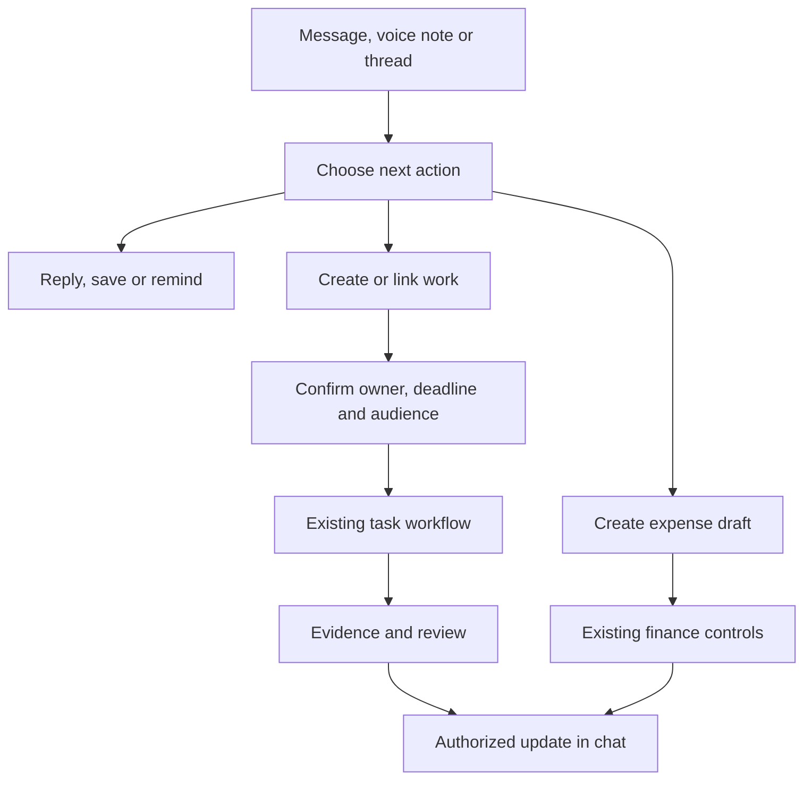

# Schach Workspace — Internal Communication Blueprint

**Working module name:** Connect  
**Date:** 10 October 2026  
**Status:** Proposed product and architecture design for review; messaging has not been implemented.  
**Existing baseline:** Schach Workspace 1.1.0, inspected source commit `1ab6055`.  
**Purpose:** Replace internal WhatsApp dependence with company-owned conversations connected to tasks, departments, projects, budgets and expenses.

This document records the brainstorm, recommended decisions, alternatives, integration gaps and acceptance criteria. It is a proposed source of truth for the next design discussion, not an approved engineering implementation plan or a claim of WhatsApp/Slack feature parity. The existing application ZIP remains the released task-and-finance build.

## 1. Intended outcome

An employee should be able to find a colleague, send a message or voice note, share a site photo, discuss it with a group, create an accountable task, and return to the conversation for its outcome. A department head should see pending requests and blocked work. A CEO should see commitments, decisions and delivery without reading every conversation.

The user explicitly requested group messaging, the important functionality of WhatsApp and Slack, and the ability to create a task from any chat. This design interprets “any chat” as an authorized message, selected messages, a thread, voice note, or selected portion of a conversation. It does not assume that the person can assign work outside their existing authority or publish confidential content to a wider audience.

Working assumptions:

- Internal employees are the initial audience. External guests and partner collaboration are an explicit later capability.
- Every conversation belongs to exactly one company environment. Having the same users in two companies does not merge those environments.
- Web and mobile are both required. Native mobile calling is included in the target experience, with a separate delivery and device-validation gate.
- The existing Go, Encore, GORM and PostgreSQL stack remains the business backend.
- Leadership visibility applies to authorized work and business reporting. It does not automatically grant access to every employee DM.
- Company-managed searchable communication is the recommended initial privacy model; full end-to-end encrypted messaging is a separate architectural choice with different search, AI and recovery behavior.
- The desired end state includes dependable calls. A text-only pilot is a staging step and cannot be called a complete replacement.

Success means the employee has no routine reason to move an internal conversation, document, follow-up or call back to WhatsApp. Measure that with a pilot and reported fallback reasons rather than assuming a feature checklist guarantees adoption.

## 2. Recommended product shape

Add **Connect inside Schach Workspace**, using the same login, company switcher, people directory, tasks, reporting and finance modules. The main destinations should be Chats, Work, Inbox, Calls and More on mobile; desktop can retain the existing navigation and add Connect.

The design combines a familiar chronological chat for quick coordination with durable department/project channels, optional message threads, and structured work records. A user can simply talk, save a message privately, request an acknowledgement, create work or open a financial request. These actions have different meanings.

| Action | Meaning | Visibility |
| --- | --- | --- |
| Reply / react | Continue a conversation | Conversation audience |
| Pin | Shared reference for the conversation | Conversation audience |
| Save | Personal bookmark | Saving user only |
| Remind me | Personal follow-up reminder | Reminding user only |
| Request acknowledgement | Ask named recipients to confirm receipt/understanding | Declared recipients and authorized requester |
| Create task | Establish work, owner, deadline and review | Existing task authorization, shown before creation |
| Link existing task | Connect discussion with an existing work record | Each endpoint keeps its own authorization |
| Create expense draft | Start financial processing | Existing finance authorization |
| Record decision | Preserve a reviewed decision with its scope and source | Explicit selected audience |

Slack already supports creating a task/list item from a message. The opportunity for Schach is completing the whole workflow: correct ownership, original context, evidence, independent review, finance links and status updates back to the source conversation. [S1]

## 3. Three architecture choices

| Choice | Advantages for this project | Tradeoffs | Recommendation |
| --- | --- | --- | --- |
| Integrated Go messaging domain plus LiveKit for media | One product, company membership and business authorization; direct task/finance integration; control over interface and data | We own durable messaging, sync, notifications, moderation and mobile integration | Preferred for the long-term integrated product |
| Adopt self-hosted Mattermost, or a Matrix-based product | Existing communication capabilities and clients can accelerate a separate internal-chat deployment | A second identity/permission domain, product navigation and integration surface; edition/license and upgrade obligations need review | Strong alternative if immediate adoption is more valuable than one integrated app |
| Use a managed chat provider, such as Stream | More messaging and synchronization behavior supplied by a provider | Recurring usage costs, residency/contract decisions, provider ACL mapping and migration/export work | Viable when delivery speed outweighs infrastructure control |

Matrix is a protocol/ecosystem with room and event semantics, including optional E2EE; Mattermost is an application product. They are separate choices, not interchangeable libraries. Stream documents team/tenant partitioning, which would still have to match Schach company permissions. These are architectural judgments, not implementation-time or cost estimates. [S11–S13]

Recommended deployment shape: one modular Go application for communication and business workflows, PostgreSQL, an outbox worker, object storage, a lightweight realtime layer and specialist media infrastructure. Add operational components only when their purpose is established. A large microservice fleet is unnecessary for the initial target.

## 4. What the source inspection found

These are observations from the existing release, not new features. Paths below are relative to the Schach Workspace source inside the release archive.

| Existing code / behavior | Reuse or required change |
| --- | --- |
| `backend/platform/permissions.go`: `Server.access` requires active company membership | Reuse identity and company boundary for every chat operation |
| `permissions.go`: `canRead` exposes company tasks to founder, CEO, admin and viewer, plus other scoped roles | Task audience is broader than DM audience; a task assigned to oneself is not private |
| `backend/platform/tasks.go`: task construction, validation, numbering and workflow helpers | Reuse the real task engine for conversions; avoid a second lightweight task system |
| `Task.DueDate` and task validation currently support date-only deadlines | Add a deliberate timed-deadline extension before promising that chat instructions such as “by 4 pm” become enforceable task deadlines |
| `backend/platform/collaboration.go`: task uploads and authorized downloads | Reuse validation patterns, but introduce conversation-owned media and explicit publication to task evidence |
| `backend/platform/workspace.go`: generic taskless activity is visible to leadership/viewers | Private chat content must use its own scoped events; generic audit rows would leak it |
| `workspace.go`: notifications with no task/expense target lack conversation authorization | Add typed chat targets and recheck source visibility on retrieval and delivery |
| `permissions.go`: `withAccessTransaction` uses `organization.go`'s company-row lock | Ordinary chat traffic needs narrower concurrency control, so it does not serialize with finance and task writes |
| `frontend/src/store.tsx`: complete workspace polling every 30 seconds and broad invalidation after mutations | Separate paginated conversation/message queries and targeted realtime cache updates |
| `backend/cmd/server/main.go`: ordinary HTTP server has a 60-second write timeout | Deliberately configure streaming routes, heartbeats, proxy behavior and reconnects |
| `frontend/src/components/TaskDrawer.tsx`: existing task form supports normal creation/editing | Add source-aware initialization, audience preview and an atomic conversion submission |
| Existing in-app inbox has no configured mobile push provider | Push subscriptions, devices, dispatch and delivery-state handling are new infrastructure |
| Existing uploads are capped at 10 MiB and stored in the database | Rich chat media, voice/video, quotas, scanning and object storage are new capabilities |

There is no existing conversation/message model, durable chat transport, chat search, native mobile client or calling subsystem in the inspected release. The local browser demo cannot verify real multi-user delivery.

## 5. Conversation structure

| Conversation | Example | Membership and use |
| --- | --- | --- |
| Direct message | One employee and a colleague | Fixed pair, within one company; adding a third person creates a new group |
| Small group | Dispatch coordination for a delivery | Named participants; quick chronological conversation |
| Department channel | Engineering, Operations, Sales, Finance | Department membership rules plus explicit authorized guests within the company |
| Project/site channel | Tower B formwork or Site 104 | Named project team, project context and durable history |
| Company announcement channel | Official notices | All company employees can read; authorized publishers post; optional acknowledgement |
| Private working channel | Leadership, HR case or restricted finance discussion | Explicit participants; company rank alone does not grant readership |
| Task discussion | Discussion attached to a task | Access follows the underlying task; reuses its existing comments rather than duplicating them |
| Thread | One issue inside a conversation | Inherits the parent conversation; never broadens it |

Every persistent channel has an owner, purpose, membership policy, posting permissions, history policy, notification defaults and lifecycle. Group owners can hand over administration. Archiving stops new ordinary messages but preserves authorized history and task links.

Proposed history defaults:

- Company announcements and open company knowledge channels expose retained history to current company members.
- Department/project channels expose retained history to authorized current participants, with this rule visible on joining.
- Ad hoc/private groups give new participants messages from joining by default. A moderator can deliberately share selected earlier context under the forwarding policy.
- Removed or deactivated members lose server access and future delivery at the defined authorization boundary. Managed caches are cleared on the next successful policy check/contact; a disconnected device cannot be remotely erased immediately. Previously decrypted or exported copies cannot be recalled.
- Rejoining a restricted group establishes a fresh history boundary unless explicitly granted older history.
- Private-to-public conversion is not a silent setting change in the first release; create a new audience and deliberately publish selected material.

History boundaries also apply to quoted previews, thread roots and search. A newly visible reply cannot reveal an older message outside that participant's history window. Proposed offline policy: ordinary chat caches may be readable for up to 24 hours after the last successful membership check, subject to a shorter company setting; restricted finance/private-history offline access is disabled initially. Offline drafts and the send queue remain possible, but queued sends revalidate current permissions online. This is a cooperative-client policy, not a guarantee against a user retaining previously viewed material.

Open channels are open inside their company, not on the public internet. This distinction follows the useful public/private work-channel model while keeping the company boundary explicit. [S2]

### Proposed permissions

Company role and conversation role are different. A company admin can manage company policy without becoming a participant in every private conversation.

| Role / capability | Proposed communication behavior |
| --- | --- |
| Active employee | DM colleagues, create ordinary internal groups within policy, participate in joined channels |
| Department head | Own/moderate department channels; view authorized requests and work |
| Channel owner/moderator | Manage membership, posting, pins, archive and moderation within that channel |
| Founder / CEO | Company announcements and authorized company work reporting; private channels by membership |
| Finance user | Normal communication participation plus independent existing financial permissions |
| Viewer | Read permitted/open or explicitly joined conversations; no messaging, task conversion or reactions by default |
| Bot / integration | Named service identity with narrowly granted channels and actions |
| External guest | Disabled in initial rollout; later a separate expiring, restricted membership type |

Exceptional administrative access, if required by company policy, should be separately governed, disclosed and auditable. It is not an ordinary “read all DMs” button.

## 6. Functional coverage and prioritization

“WhatsApp plus Slack” is a target experience, not a single feature. The table assigns business capabilities to sensible release gates. Every feature is proposed.

| Area | Required behavior | Gate |
| --- | --- | --- |
| Text | Unicode, paragraphs, limited safe formatting, emoji, links, drafts | Core pilot |
| Message actions | Quote reply, threads, reactions, copy, edit, delete, forward with context and audience checks | Core pilot |
| Group messaging | DMs, ad hoc groups, department/project channels, owners, invites, removal, archive | Core pilot |
| Moderation | Report a selected message, mute/unwanted-DM controls under company policy, moderator actions and appeal/support route | Core pilot |
| Media | Camera, multiple photos, documents, video attachments, progress, cancel/retry, download | Core pilot |
| Voice notes | Record, pause/resume, preview, cancel, playback speed, resume listening | Core pilot |
| Follow-up | Pins, private saves, personal reminders, mark unread, draft/scheduled messages | Core pilot |
| Attention | Mentions, thread subscriptions, unread navigation, push, mute and working hours | Core pilot |
| Search | Messages, people, channels and files; sender/date/type/project filters | Core pilot |
| Work | Single/multiple-message task conversion, existing-task links, protected source context, status cards | Core pilot |
| Decisions | Explicit acknowledgements, basic polls, meeting/site events, RSVPs | Before full internal cutover |
| Calls | One-to-one/group audio and video, call history, missed calls, channel huddles | Before full internal cutover |
| Screen sharing | Desktop sharing, supported mobile share flow, clear stop controls | Before full internal cutover where used |
| Reliability | Multi-device sync, offline queue, idempotency, reconnect/replay, session revocation | Core pilot; real mobile gates before cutover |
| Company operations | Provisioning, departure handover, storage quotas, retention controls, recovery and support | Before full internal cutover |
| Finance bridge | Create/link an expense draft or request; fresh authorized approval screen | After core messaging, before finance-team cutover |
| Knowledge | Reviewed decisions, channel notes, SOP links, drawing/file revisions | Structured-work wave |
| Intelligence | Voice transcription, reviewed action suggestions, summaries, permission-aware search assistance | After core reliability |
| Advanced collaboration | Meeting recordings/transcripts, workflow builder, external guests, device call transfer | Later explicit expansions |

WhatsApp's voice-note controls and current group features illustrate why familiar details matter: recording controls, playback, polls and subgroup coordination belong in the benchmark. Slack adds persistent channel/thread organization and configurable attention controls. [S3–S5]

Other consumer features need a deliberate disposition: manual availability/status is included; social stories, public broadcast discovery, payment products and personal address-book syncing are outside the internal-work purpose. A voluntary site/location pin can be supported; continuous employee location tracking is not a default. Disappearing/view-once content is disabled in ordinary work channels because it conflicts with durable work references. If confidential ephemeral rooms become a requirement, their conversion, retention and encryption rules need a separate design.

## 7. Message-to-task: the central workflow

### Everyday experience

1. Long-press a message on mobile, or use its action menu on desktop.
2. Choose **Create task**, **Link existing task**, **Create several tasks**, **Save** or **Remind me**.
3. For a task, show a compact sheet: title, one accountable owner, explicit deadline/timezone, department/project, reviewer and “Done when” criterion. Reuse valid defaults; let the user review them.
4. Show the resulting task audience, including leadership and the current broad viewer rule. A summary is disclosed content too; replacing a quote with AI wording does not make it private.
5. Include only the selected, permitted instruction/excerpt and explicitly selected files. Keep the original source link protected by conversation access.
6. Create the task, source link and business events atomically.
7. Render a task card in the source conversation. Its content is resolved separately for each viewer under task authorization.
8. Show meaningful outcomes—blocked, submitted for review, accepted, reopened—back in the conversation. Avoid posting every minor field change.

The original message remains a message. The converting user becomes the task creator; original message authorship is separate provenance. The task uses the existing independent-review rules and original-deadline behavior.

### Context choices

| Source | Conversion behavior |
| --- | --- |
| One text message | One reviewed instruction/task by default |
| Several selected messages | One task with selected context, or deliberately split into several tasks |
| Whole thread / chat segment | Define the selected range; review a proposed task or bundle; never silently copy an unlimited conversation |
| Voice note | Manual task creation works immediately; optional transcript/action extraction adds a reviewed draft |
| Photo or drawing | Create a task with an explicitly published attachment copy/version |
| Existing task update | Link to that task or add authorized context; do not create a duplicate by default |
| Person lacks assignment authority | Offer a private reminder or a request for the authorized department owner to triage |
| Read-only viewer | View permitted context; no task creation |

“Tomorrow” or “Friday afternoon” must be resolved into a visible calendar date and company timezone before creation. Missing owners, uncertain names, contradictory deadlines or unclear quantities remain unresolved draft fields for the user to confirm.

### Required timed-deadline extension

The current task engine accepts `DueDate` as a calendar date and calculates overdue/reminder behavior by date. It cannot currently enforce a 4 pm commitment. The proposed target adds an optional absolute `dueAt` plus an IANA timezone, with an explicit all-day versus timed choice. Keep the calendar date consistent with the selected business timezone, preserve the original timed commitment and audit reasoned changes. Existing records stay all-day; migration must not invent historical times. Extend API validation, forms, calendars, reminders, overdue/report calculations, imports/exports and original-deadline metrics together. Ambiguous daylight-saving times require an explicit choice. Until this extension passes its gate, conversion must advertise date-only deadlines and must not silently discard an extracted time.

### Integrity rules

- Source access and destination task-creation authority are independent checks.
- Previewing an audience is not authorization. Recheck current membership, source revision, destination authority and forwarding policy at commit.
- Reading a DM does not authorize sharing its whole transcript or other participants' files.
- Forwarding restrictions govern excerpts, summaries, attachments and derived titles, not just source links.
- Task audience can change as roles, reporting lines and collaborators change; disclose this behavior. The first release does not promise a frozen confidential-task audience.
- For genuinely confidential work, add an explicit restricted-task model and test every task/read/report/export path before offering that capability. Until then, private reminders remain separate from shared tasks, and restricted sources can prohibit conversion.
- A task status card must not reveal a hidden task title, owner or financial figure to a source-chat participant who lacks access.
- Editing a source after conversion does not silently change the task. Show an authorized “source changed” indicator and require a deliberate task edit.
- Deleting a source removes normal chat visibility. An explicitly published task excerpt remains a separate business record under its declared retention policy; this consequence must be shown before publication.
- An attachment added to an existing task is new decision evidence: define and implement a version bump/review-refresh policy. Existing task comments/attachments do not currently bump versions consistently, so this is an integration gap to close.
- A thumbs-up, “okay,” read receipt or poll vote never substitutes for a task review or financial approval.

### Duplicate prevention

Two controls are necessary. A client retry key prevents a lost response from creating the same task again; reusing it with a changed payload fails. A separate primary-action key uses a company-scoped anchor message plus a server-recognized action identity, preventing two colleagues from creating the same primary task. Additional selected context and source revisions are provenance, not different primary claims: selecting message A and selecting A+B must not bypass deduplication of A's primary instruction. Deliberate splitting allocates distinct action identities under one reviewed conversion bundle. Related instructions posted as separate new messages require visible duplicate suggestions and human judgment; there is no claim of perfect semantic deduplication.

The interface offers **Open linked task** or **Link another existing task** when appropriate. It must not reveal inaccessible linked task names or counts while checking duplicates.

### Example for Schach

A site engineer posts a marked-up image: “Tower B: revise this corner panel and issue the updated drawing by 4 pm on 14 October.” The head creates a task, selects the designer, confirms the full date/timezone and reviewer, and includes the marked-up image as authorized task evidence. The designer asks a question in the task discussion, uploads the revision and submits it for review. The reviewer accepts it. Authorized people in the site conversation receive the completion card and can open the accepted drawing.

The CEO can see the commitment, any blocker, the deadline history and accepted result through the work dashboard. Personal side discussions are not required to become leadership-readable.

## 8. Connect conversation to finance without weakening finance controls

Keep operational discussions and financial records linked, with separate permissions.

Example: an employee posts a logistics invoice in an authorized finance conversation. **Create expense draft** opens the existing expense form with suggested category/vendor/amount and selected evidence. The user verifies it. Submission, independent approval, budget impact and payment recording all remain under the finance engine.

Rules:

- No expense is approved or paid because somebody typed “approved.”
- An approver opens a fresh authenticated financial decision screen with current amount, version, budget and exceptions.
- Expense cards are rendered per recipient; group membership alone never reveals amounts, receipts or payment references.
- Posting a receipt in chat does not make it an official expense receipt. Promotion into evidence is an explicit authorized operation.
- Finance receipts do not become ordinary task attachments automatically.
- Native inline actions, if added, call the same versioned domain endpoints and preserve the no-self-approval rule.
- A message containing a future cost may become a task/request, but must not be misclassified as an incurred expense; the current expense module rejects future incurred dates.

Budget warnings belong to authorized heads/finance/leadership. Generic project channels can receive a deliberately scoped request such as “Finance review needed” without the underlying private detail.

## 9. Threads, decisions and accountability

Small groups should retain a familiar chronological flow. A quoted reply is a quick response; **Discuss in thread** starts a focused conversation. Threads need visible reply counts, unread indicators, following/unfollowing and an easy return to the main chat. Task discussions should present the existing task comments, with a task header and explicit audience.

Distinguish these states:

| State | What it proves |
| --- | --- |
| Queued | Device has not received server acceptance |
| Sent / accepted | Server committed the message |
| Delivered | A defined recipient device acknowledged receiving it; provider acceptance alone is insufficient |
| Read | A supported client reported the message visible/read, subject to product preferences |
| Acknowledged | Recipient explicitly pressed the acknowledgement action for that message revision |
| Work accepted | Task owner explicitly accepted responsibility, if this new task state is introduced |
| Completed / accepted review | Existing work lifecycle reached the specified completion/review state |

An acknowledgement request captures the target audience and exact message revision. A material edit invalidates previous acknowledgements or requires a new revision-specific request. Automatic roster changes must not silently alter who was originally asked. Polls and RSVPs support coordination but cannot replace expense/task approvals.

A reviewed decision record should capture what was decided, decision owner, effective date, affected project, source references and linked work. It is useful for drawing revisions, dispatch decisions and departmental operating changes. Publishing one still requires appropriate source and destination scope.

## 10. CEO and head reporting

The leadership view should summarize structured outcomes within current authorization:

- Assigned commitments due soon or overdue.
- Requests waiting for an accountable owner.
- Blocked work and the named person/department needed to unblock it.
- Tasks awaiting review and the age of that queue.
- Explicit decisions awaiting leadership.
- Critical notices still awaiting acknowledgement from designated recipients.
- Department budget exposure and financial review queues, subject to finance access.
- Important changed commitments, rejected submissions and reopened work.

An operational intake queue supplies measurable “unowned requests.” Ordinary free-text messages do not magically become requests unless a user marks them or reviews an AI suggestion.

Do not score employees by message volume, read speed, online duration, reaction count or time spent in calls. These describe app usage and availability, not quality or value of work. Use task outcomes, complexity, blockers, accepted evidence and agreed deadlines, with manager judgment.

A morning briefing can combine existing task and budget facts with authorized decision records. Every conclusion should link to the relevant visible record, show its time period and distinguish a recorded fact from an AI interpretation.

## 11. AI that helps without creating accidental commitments

AI is an optional assistance layer; messaging, search basics and manual task conversion remain usable without it.

| Assistance | Proposed behavior | Control |
| --- | --- | --- |
| Voice transcription | Searchable text for English, Hindi and Marathi/code-mixed speech after validation | Preserve original recording; show uncertain terms and allow correction |
| Suggested tasks | Draft action items from selected messages/voice notes | User confirms owner, date, audience and included information |
| Catch-up summary | Summarize a chosen accessible channel/thread and time range | Include authorized source links; explain only coverage limits the requester may know, without revealing inaccessible sources or their names/counts |
| Decision extraction | Suggest a decision record | A named person reviews and publishes it |
| Duplicate suggestions | Find visible related work before creation | No hidden task names/counts disclosed |
| Meeting follow-up | Propose minutes and actions from an authorized recording/transcript | Visible recording state, participant notice and reviewer confirmation |
| Search assistance | Answer questions over authorized workspace records | Recheck source access when retrieving and before returning the answer |

Model output is untrusted draft content. No inferred assignment, deadline, approval or payment is executed automatically. A quoted instruction inside a document is data, not authority to operate the application.

AI retrieval, indexes, prompts, summaries and caches must respect company and conversation permissions. A private-chat summary cannot be added to a CEO digest merely because the assistant could access it in another context. Cache keys must include effective permission scope, and revoked content must be excluded before serving results. The selected model/provider, deployment region and data-use policy are explicit company settings; no provider is configured by this blueprint.

If local AI is later preferred, benchmark the actual deployment hardware and selected models on Schach vocabulary, noisy site audio, names, quantities and drawing references. Owning a model does not establish transcription accuracy or privacy across the rest of the pipeline.

## 12. Mobile and premium UI

Keep the existing Schach orange accent, charcoal navigation and light readable content. Chat should have comfortable text density, predictable message spacing, clear timestamps and a restrained visual hierarchy. The composer is the main action area, not a large dashboard card.

Mobile design:

- One main conversation view at a time, reachable from a recent-chat list.
- Bottom destinations: Chats, Work, Inbox, Calls, More; company switcher and company name remain obvious.
- Large microphone, camera and attachment actions; voice preview and upload progress remain visible.
- Long-press action sheet, selected-message count and an obvious Create task action.
- Full-height thread/task sheets, preserved scroll position and draft text.
- Message search jumps to the original context and preserves a way back to results.
- Proper keyboard, safe-area, accessibility, screen-reader, contrast and reduced-motion behavior.
- Per-company drafts/caches, with explicit company identity on notifications and before sending.
- Offline/queued/retrying/failed states; the user can edit or cancel queued work.
- Media quality choices and sensible download defaults for weak connections.

A browser/PWA is useful for the first client. Apple's documented iOS Web Push model includes Home Screen installation and user-granted notification permission. It does not provide a general background application runtime. [S7]

For the target calling experience, use a React Native mobile client sharing API types, validation and business logic where appropriate. It is a separate client implementation, not automatic reuse of browser DOM components. Native integration must cover iOS PushKit/CallKit, Android calling/foreground behavior, audio routing, notification permissions and device/session revocation. [S8–S9]

The release must test physical devices, app open/background/locked states, interrupted network, Bluetooth/headsets, incoming ordinary phone calls and permission-denied states. OS force-stop, disabled notifications, device power loss and connectivity outages must have honest user-visible behavior. A responsive page or a push provider accepting a request does not prove reliable delivery.

## 13. Calling design

Support one-to-one and group audio/video, quick channel huddles, call history, missed calls and screen sharing. Schedule a call from an event; keep notes and reviewed action items with the project/conversation. Advanced device transfer and sophisticated moderation can follow core reliability.

Slack documents huddles with associated discussions, and WhatsApp announced browser calling, waiting rooms and device transfer in a gradual July 2026 rollout. The benchmark includes both web and mobile use; it is not based on a claim that calls are impossible in browsers. [S6, S16]

Use LiveKit for the media layer and its Go SDK for backend integration. Schach owns the conversation association, participants, call records, token issuance and business permissions. The media server should not become the durable text-message database: LiveKit text streams do not include long-term persistence. [S17, S21]

Before issuing a call token, check current company/session/conversation permission. Use opaque room and participant identifiers; grant only the required publish/subscribe capabilities. Ordinary participants must not receive administrative or recording privileges.

Current LiveKit documentation contains a material revocation distinction: self-hosted deployments do not invalidate existing tokens merely by removing a participant. Cloud revocation also has timing behavior that requires explicit handling for strict removal. Short token lifetimes alone do not prove immediate rejoin prevention. A demonstrated removal/rejoin solution is a gate for restricted calls, whether using managed media or a validated self-hosted design. [S18]

Self-hosting needs network reachability, trusted certificates, TURN and operational monitoring. Recording adds a media-export service, storage and retention costs. Recording is opt-in at the product level with visible participant notice; it is not enabled invisibly in all meetings. [S10]

## 14. Security, encryption and company ownership

Recommended initial mode: **company-managed communication with encrypted transport and storage, role/conversation access controls, clear retention and auditable administration**. Application/database operators remain trusted infrastructure. Explain that model to employees.

End-to-end encryption is different: servers without content keys cannot perform conventional server-side content search, AI analysis and transcript processing. A true E2EE option needs device verification, secure key distribution/recovery, encrypted attachments, membership-change key handling and a compatible client-side or explicitly authorized participant processing model. Self-hosting alone does not supply E2EE. LiveKit's encryption documentation also distinguishes encrypted media from server-readable signaling. [S19]

Policy and lifecycle requirements:

- Every API, socket event, search result, file access, export, notification and call token is company-scoped and authorized.
- Private conversation existence, member names, last-message previews and unread metadata require scope checks, not just the message body.
- SSO/MFA, recovery and device/session management are launch capabilities to design; the current password-based release does not provide enterprise identity integration.
- Departure handling transfers channel ownership, preserves work accountability and revokes sessions, push tokens, active subscriptions and call access.
- Notify users of the company retention policy; edit/delete actions must describe what is removed from normal views versus retained as an authorized business record.
- Retention applies consistently to revisions, attachments, search indexes, summaries, caches and recordings, with documented backup expiry/restoration behavior. No legal retention duration is invented here.
- Define export authority and log exports; downloadable copies are outside subsequent in-app revocation.
- Audit records are ordinary trusted database history unless an independently protected audit sink is explicitly added and verified.

## 15. Proposed technical architecture

| Layer | Direction | Rationale |
| --- | --- | --- |
| Business domain | Go + Encore + GORM | Preserve existing authorization and task/finance behavior |
| Durable data | PostgreSQL with versioned migrations | Authoritative messages, memberships, revisions, task links and delivery work |
| Realtime | Go WebSocket endpoint plus HTTP history/sync APIs | Low-latency updates with recoverable history |
| Event reliability | Transactional outbox and idempotent consumers | Commit message and delivery intent together |
| Multi-instance fanout / presence | Redis or a validated equivalent when multiple gateways are deployed | Ephemeral presence and cross-instance event routing; not the only message store |
| Media | Private S3-compatible object storage | Separate large binaries from ordinary database query payloads |
| Search | PostgreSQL search/trigram initially | Avoid a second source of permissions until search scale/quality demands it |
| Calls | LiveKit, self-hosted or managed after revocation/operations evaluation | Specialist audio/video transport |
| Web | Existing React/TypeScript application | One product and shared company/work UI |
| Mobile | React Native with native notification/call integrations | Credible target for mobile-first daily communication |
| Async jobs | Scoped delivery, scan/thumbnail, transcription and indexing workers | Keep slow processing away from sending/reading |
| Observability | Structured metadata, traces and service metrics | Diagnose delivery without logging private message bodies or tokens |

Encore Go's official raw-endpoint documentation describes WebSocket use. Its typed streaming API guide is for TypeScript, so that syntax is not assumed to exist in Go. The actual Encore/reverse-proxy WebSocket path still requires a runtime gate. [S14]

### Durable send and reconnect

1. Client assigns a retry ID and sends an authenticated message command.
2. Server rechecks membership and posting permission.
3. One database transaction allocates conversation order, writes the message and writes its outbox record.
4. Server acknowledges only after commit. Client reconciles its optimistic bubble with authoritative ID, sequence and time.
5. Worker publishes committed events and notification intents. Retries are expected; consumers deduplicate by event ID.
6. On reconnect, the client requests changes after a durable cursor, including edits, removals and membership changes. It refetches when a gap or stale cursor requires it.
7. Read cursors advance monotonically. Typing/presence expire and do not create durable work history.

A broker's delivery order is not the conversation's source of truth. Live updates are a delivery mechanism; HTTP sync and PostgreSQL remain authoritative.

Encore documents an outbox implementation with SQL adapters. Whichever adapter is chosen must operate on the exact GORM transaction used for the message, not a separate connection. It is acceptable to implement a small outbox table through GORM and publish from a worker if that is the clearer atomic path. [S15]

### Concurrency and revocation

Do not reuse the existing company-wide mutation lock for every message, typing signal or read receipt. Use short conversation-level ordering transactions with explicit membership/version checks. Membership changes and sends must have a defined ordering so removal racing a send cannot authorize a later committed message through a stale snapshot.

Task conversion can retain the existing business transaction discipline, with a documented lock order to avoid deadlocks. Authorization changes publish revocation events to all gateways and devices. Connected clients must not receive private payloads merely because they joined a socket room earlier. Rate limits, backpressure and per-company storage/connection quotas prevent one tenant from overwhelming the others.

Avoid sending one identical rich payload to every member if its linked record has different permissions. Deliver an authorized conversation/event identifier, then resolve content under current viewer authorization. An opaque identifier for an inaccessible task, expense or source is still withheld. Unauthorized source names, business identifiers, counts and snippets are omitted; any placeholder is generic.

### Media lifecycle

Reserve an upload under current membership, upload to quarantine, verify type/size/hash, scan and generate safe previews, then finalize an attachment. Failed or abandoned uploads expire. Forwarding and task publication create explicit grants/copies with provenance; changing an object path does not grant access.

For sensitive media, downloads use authenticated authorization checks. A signed URL is a temporary access capability: its validity window must be accounted for, and strict immediate revocation should use an authorization gateway rather than promising to revoke an already-issued URL. Native local caches require appropriate secure storage and logout/revocation cleanup; browser caches are controlled conservatively, especially for finance.

Existing task/expense file bytes can remain on their tested paths initially. A separate later migration can move them to object storage with byte checks and backward-compatible reads.

## 16. Logical data model and API boundaries

These are proposed domain boundaries, not final SQL or generated API code.

| Entity group | Essential information |
| --- | --- |
| Conversations | Company, kind, lifecycle/version, ownership, visibility, posting/forward/history policies |
| Conversation membership | User, role, join/leave intervals, history boundary, mute/notification settings, read cursor |
| Messages | Company/conversation, immutable sender, server sequence/time, client retry ID, body/type, reply/thread, version, edit/removal state |
| Revisions and scoped events | Exact source revisions, authorized change history, retention attributes |
| Attachments and grants | Object identity, uploader, type/size/hash, scan state, conversation ownership and explicit publication |
| Reactions and thread follows | Unique actor/action, source scope, subscriptions |
| Saves and reminders | Owner-only references and due time; separate from shared tasks |
| Acknowledgements / polls / events | Versioned prompt, defined audience, response/vote, deadline and result policy |
| Work links and conversion bundles | Source selection/revisions, actor, primary action key, task/expense references, published content |
| Decisions / notes | Reviewed decision body, responsible person, effective date, audience and source links |
| Devices and delivery | Session/device binding, push endpoint, preference, revocation, notification state |
| Outbox | Durable event ID, company/scope, retry/claim state and publication outcome |
| Calls | Conversation association, participants, lifecycle, provider mapping, recording/notice metadata |

Critical constraints include tenant-consistent foreign keys, unique DM participant pairs within a company, unique message retry keys, unique conversation sequence, same-conversation thread parents, valid membership intervals, unique conversion action keys and versioned edits.

Suggested company-relative API families: conversations/members; messages/history/sync; reactions/threads; uploads/downloads; saves/reminders; task conversions/work links; acknowledgements/polls/events; search; devices/preferences; call sessions/tokens; retention/admin policy. All read/list endpoints paginate and filter authorization before limits.

Conversion submission includes an expected source revision, retry key, ordinary task fields and explicit publication choices. The server resolves source author/content/company itself. One transaction records the task, protected source link, allowed evidence and events. A preview response never replaces these checks.

Both standalone and Encore adapters use shared domain code. Add ordered migrations to both migration locations; do not use development AutoMigrate as the production upgrade path. Keep communication APIs separate from the current full-workspace snapshot.

## 17. Notifications and attention

The Inbox combines mentions, replies to followed threads, task assignments/reviews, acknowledgements, approvals and missed calls with clear filters. Chats retain their own unread state. Reading a chat does not automatically clear an unrelated task approval.

Default notification behavior:

- DMs and direct mentions notify, within user working-hours settings.
- Joined channels default to mentions/replies; users can opt into all messages.
- Routine reactions and presence changes do not trigger push noise.
- Group-wide mentions are permissioned and rate-limited.
- Critical announcements target named recipients and request acknowledgement; escalation follows the declared policy.
- Urgent alerts can use approved company rules, but the application must not claim it can override every OS focus/notification restriction.
- Lock-screen previews default to minimal content for private/finance conversations.
- Mobile and desktop delivery are coordinated so one event does not create an unnecessary burst across devices.
- Push providers transport notification hints; opening the app fetches current authorized content.

Current Slack documentation illustrates per-conversation and user-level attention controls. Its October 2026 personal-follow-up rollout also distinguishes saved material from to-dos; Schach should retain that useful conceptual separation without depending on Slack's product naming. [S5, S20]

## 18. Adoption and WhatsApp retirement

Replacing the habit requires leaders and heads to work in the new system themselves.

| Stage | Concrete activity | Exit condition |
| --- | --- | --- |
| Inventory | List internal WhatsApp groups, owners, participants and jobs they serve; identify media/calls used daily | Every active internal group has a planned destination and owner |
| Setup | Create company/dept/project channels, import directory memberships and confirm policies | Staff can sign in, find colleagues and understand channel purpose |
| Pilot | One department plus one cross-department/site workflow use messaging and task conversion | Real users complete daily work; fallback reasons are captured and resolved |
| Mobile/call validation | Test supported physical devices, networks and background states | Device/call gates pass for the intended population |
| Work transfer | Move active commitments and current project files; link unresolved requests | No active commitment is stranded in the old channel |
| Department cutover | Official instructions, acknowledgements and follow-up use Connect | Department owner confirms routine work no longer needs internal WhatsApp |
| Company cutover | Archive/close old internal groups through their owners and maintain a support route | Observed usage and support evidence sustain the agreed adoption threshold |

Do not require staff to post identical operational updates in both systems indefinitely. During a short defined transition, nominate a source of truth for each workflow.

Historical imports, if needed, use explicitly provided authorized exports with preview, company/user mapping, deduplication and a clear “Imported history” label. Do not invent delivery/read receipts, impersonate original senders as current users or assume all media/history is available. Moving active tasks and essential files is more valuable than copying years of unstructured discussion before launch.

Keep an ordinary phone/support fallback for application or connectivity outages. Customer-facing WhatsApp can remain a separate business channel; eliminating internal dependence does not require customers or builders to adopt the employee workspace.

### Proposed adoption measures

Measure pilot baseline first, then agree targets. Useful measures include share of sampled internal commitments recorded in tasks, percentage with an owner/deadline, unowned-request age, review waiting time, blocker-resolution time, critical-notice acknowledgement and employee-reported WhatsApp fallback reasons.

An example target is at least 90% of sampled internal work commitments captured with an owner and deadline by cutover. This is a proposed target, not a current result. Message counts may help size infrastructure; they must not become employee performance scores.

## 19. Delivery waves and acceptance gates

This is a capability roadmap, not a promise of dates. Team capacity, employee count, device mix, media use, hosting and policy choices have not been supplied.

| Wave | Scope | Gate |
| --- | --- | --- |
| A. Foundations | Conversation authorization, revisions/events, media storage, send/reconnect, device model, source/task disclosure rules and timed-deadline extension | Tenant/privacy/retry and deadline tests; native database and runtime path demonstrated |
| B. Daily communication | DMs/groups/channels, voice/media, threads, mentions, search, reminders, task conversion and status cards | Real departmental pilot; no lost accepted messages in tested failure cases |
| C. Full daily replacement | Native mobile, push, calls/screenshare, polls/events/acknowledgements, onboarding/offboarding and recovery | Real-device/network/call gates and successful restore; actual fallback reasons resolved |
| D. Structured work | Finance bridge, decisions, requests/triage, knowledge references and leadership briefing | Domain approvals, privacy and reporting remain correct |
| E. Intelligence and expansion | Transcription, reviewed AI actions, meeting follow-up, workflow builder, external guests or E2EE options | Accuracy, consent, permission and cost evaluation for each capability |

Finance bridging can be brought into the pilot if that department needs it, but it must not bypass its acceptance gate. Basic media, mobile delivery and manual conversion should not wait for AI.

## 20. Acceptance criteria

These tests are requirements for the future implementation. None have been executed against a messaging subsystem in this turn.

1. Guessing a different company's conversation, message, file, search cursor, notification or call identifier returns no foreign data.
2. A nonparticipant, including a founder/admin/viewer, cannot read private chat content or metadata under the proposed participant policy.
3. A source-message reader without assignment authority cannot create a task for an unauthorized owner.
4. A private-message conversion shows the current destination audience, publishes only permitted selected content, and protects source context.
5. Generated summaries, filenames and source badges do not leak private data through task/activity/search/notification responses.
6. Two people converting one primary instruction simultaneously create one primary task; retries after a lost response return the same result.
7. Reusing a message retry key with different content fails; ordinary duplicate delivery does not duplicate rendered messages.
8. Disconnect/reconnect, pagination, server restart and outbox-worker failure preserve authoritative history, edits and removals.
9. Membership removal racing a send/conversion is enforced at the defined transaction boundary; active subscriptions stop disclosing new data.
10. Membership/history changes update server search, previews, unread counts, object access and AI retrieval. Managed device caches are cleared at the next policy check/contact, with the declared offline-access window enforced; immediate remote erasure is not claimed.
11. A source edit between preview and conversion produces a version conflict; a later edit never silently changes task commitments.
12. A task card checks task access separately from chat membership; expense cards and receipts retain finance authorization.
13. Uploads enforce type/size/quota and quarantine/scanning policy; expired abandoned uploads are cleaned up; publication is explicit.
14. New evidence in an open task/expense decision invalidates the reviewer view under the defined version policy.
15. Acknowledgements refer to an exact message revision and audience; editing a critical instruction does not preserve a misleading acknowledgement.
16. Scheduling/retry respects company timezone, daylight-saving rules where relevant, preferences and deduplication.
17. Sending chat messages on native PostgreSQL does not take the global company lock or block unrelated finance/task traffic.
18. Encore and standalone streaming paths work through the actual proxy, with origin/session checks, timeouts, backpressure and reconnect behavior.
19. Real phones demonstrate notification and call behavior in foreground/background/locked states, on representative networks and audio devices.
20. Removing a call participant prevents unauthorized rejoining with cached/refreshed tokens under the deployed provider's actual semantics.
21. Recordings/transcripts have visible authorization/notice and the correct audience; private material is not reused in wider AI summaries.
22. Offboarding revokes sessions/devices/subscriptions, reassigns channel ownership and preserves authorized work history.
23. Backups restore messages, memberships, work links and media consistently; retention also covers derived stores and restored data.
24. The demo clearly labels simulated delivery/calls and never stands in for a real multi-user/mobile verification result.
25. Timed deadlines preserve timezone and original commitment through creation, edits, reminders, reporting and import/export; legacy tasks remain all-day, and ambiguous timezone transitions cannot silently shift a commitment.

Set measurable latency, concurrent-user, media-size, retention and recovery objectives after the pilot inventory. Tests should include slow connections and acknowledged-message crash recovery. Disaster recovery objectives are separate from ordinary reconnect behavior; neither is guaranteed by an attractive UI.

## 21. Operational cost and remaining decisions

No defensible monthly cost or delivery date can be quoted without headcount, concurrency, media/call usage and infrastructure choices. Track costs by company:

- Database: retained messages, revisions, memberships, read state and indexes.
- Object storage: photos/documents/voice/video and retention.
- Media: concurrent call participants, network egress and TURN relay traffic.
- Recording: duration, export compute and stored video.
- AI: transcription minutes, selected content and model calls.
- Operations: backups, monitoring, support, native distribution and security maintenance.

Useful sizing formulas: daily messages = active senders × messages per sender; retained media = daily uploaded media × retention days; call load = concurrent calls × participants × media profile. These are planning inputs, not current measurements.

Before engineering scope is frozen, record the employee/company count, device/OS inventory, common file types, hosting preference, required calling scope, privacy/encryption choice, forwarding/history/retention policy, identity/recovery provider and rollout owner. The working defaults in this blueprint let design proceed without pretending those organization-specific decisions are already settled.

## 22. Recommended decision

Proceed with an integrated communication domain and specialist media transport. Deliver familiar group communication, voice/media, reliable sync and safe manual message-to-task conversion first. Include native mobile/calls and operational readiness in the definition of an internal WhatsApp replacement. Add structured decisions and reviewed AI assistance after the everyday experience is dependable.

The critical product promise is: **every important instruction can become owned work, and every completed piece of work can return to its conversation with evidence and an authorized outcome.**

## Sources and evidence

External sources below were checked on 10 October 2026. They establish relevant product/runtime capabilities; the proposed Schach behavior is a design recommendation. Feature availability can depend on rollout, client and plan. No market-wide parity claim, security certification or live deployment is made.

- **S1 — Slack, messages to tracked work:** [Official source](https://slack.com/help/articles/27588021944339-Slack-lists--Track-project-tasks)
- **S2 — Slack, channel visibility:** [Official source](https://slack.com/help/articles/360017938993-What-is-a-channel)
- **S3 — WhatsApp, voice-message controls:** [Official source](https://blog.whatsapp.com/making-voice-messages-better)
- **S4 — WhatsApp, August 2026 group improvements:** [Official source](https://blog.whatsapp.com/your-group-chats-upgraded-introducing-better-polls-all-and-more)
- **S5 — Slack, notification controls:** [Official source](https://slack.com/help/articles/201355156-Configure-your-Slack-notifications)
- **S6 — Slack, huddles:** [Official source](https://slack.com/help/articles/4402059015315-Use-huddles-in-Slack)
- **S7 — WebKit, Home Screen web push:** [Official source](https://webkit.org/blog/13966/webkit-features-in-safari-16-4/)
- **S8 — LiveKit, React Native integration:** [Official source](https://github.com/livekit/client-sdk-react-native/blob/main/README.md)
- **S9 — Apple and Android native calling:** [Apple](https://developer.apple.com/documentation/pushkit/responding-to-voip-notifications-from-pushkit) and [Android](https://developer.android.com/develop/connectivity/telecom/voip-app/telecom)
- **S10 — LiveKit, self-hosted media infrastructure:** [Official source](https://docs.livekit.io/transport/self-hosting/deployment/)
- **S11 — Matrix specification:** [Official source](https://spec.matrix.org/latest/)
- **S12 — Mattermost project:** [Official source](https://github.com/mattermost/mattermost)
- **S13 — Stream, multi-tenancy:** [Official source](https://getstream.io/docs/platform/multi-tenancy/)
- **S14 — Encore Go raw HTTP/WebSockets:** [Official source](https://encore.dev/docs/go/how-to/http-requests)
- **S15 — Encore, transactional outbox and adapters:** [Official source](https://encore.dev/docs/go/how-to/pubsub-outbox)
- **S16 — WhatsApp, July 2026 calling rollout:** [Official source](https://blog.whatsapp.com/introducing-web-calling-on-whatsapp-plus-more-new-updates)
- **S17 — LiveKit, text-stream persistence boundary:** [Official source](https://docs.livekit.io/transport/data/text-streams/)
- **S18 — LiveKit, token and revocation behavior:** [Official source](https://docs.livekit.io/frontends/reference/tokens-grants/)
- **S19 — LiveKit, encryption boundaries:** [Official source](https://docs.livekit.io/transport/encryption/)
- **S20 — Slack, October 2026 personal follow-up rollout:** [Official source](https://slack.com/help/articles/55757634348435-Later-is-now-To-dos)
- **S21 — LiveKit, official Go SDK:** [Official source](https://github.com/livekit/server-sdk-go/blob/main/README.md)

Local source evidence: release `1ab6055`, especially `backend/platform/permissions.go`, `tasks.go`, `collaboration.go`, `workspace.go`, `organization.go`, `finance.go`, `finance_workspace.go`, `finance_receipts.go`, `server.go`, `backend/cmd/server/main.go`, `encore/api/api.go`, `frontend/src/store.tsx`, `frontend/src/components/TaskDrawer.tsx`, and the release's product/API/security/verification documentation. This turn performed read-only inspection and architectural research; it did not modify or retest the product.
