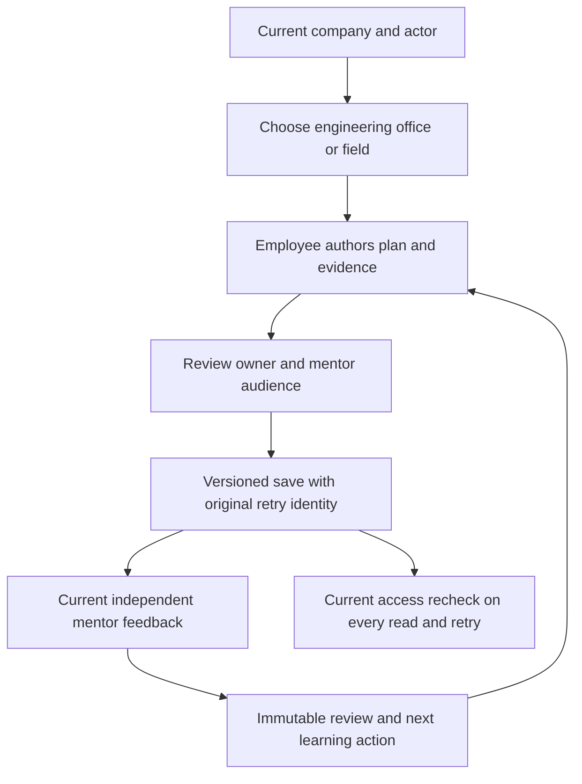
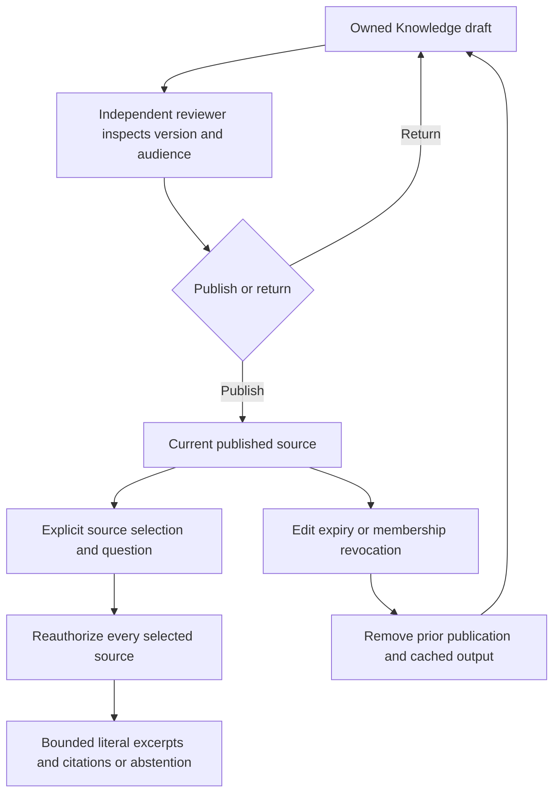
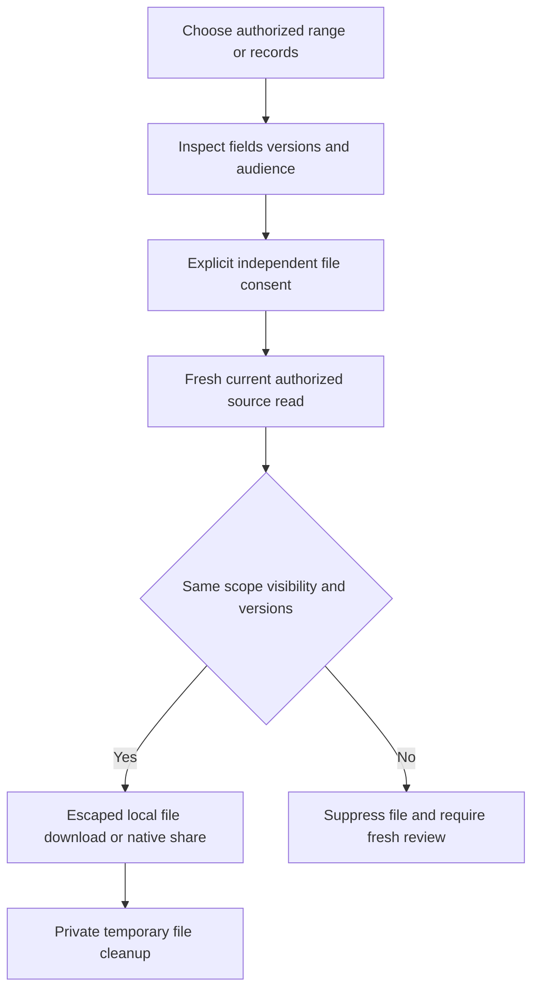

# Premium mobile, Development and Knowledge supplemental QA

Source continuation:18 October2026, baseline8b0f2c0. This supplement adds the new journeys to the [224-case pack](README.md); it does not mark those historical cases as run. Automated results are recorded separately in [current evidence](../../verification/mobile-premium-2026-10-18/record.md). Every manual case below starts **NOT_RUN**. Copy this file into a release execution record, adding device/OS/build/backend revision, actor, exact steps, expected/actual, sanitized evidence and defect ID. Never store credentials or production/private content in evidence.

## Setup and execution order

1. Start a **new fictional** fixture using `SCHACH_QA_PORT=9091 bash docs/qa/tools/start-isolated-qa.sh`. Refuse occupied ports; never adopt retained8080. Use the public fictional demo password from README only in that fixture. PostgreSQL suites use a separately named owned disposable instance and all mirrored numbered migrations1–61.
2. Create employee A, independent mentor/reviewer B, unrelated leader C, selected viewer D, and employee E in another company. Give A/B membership in both companies for isolation probes, so a denial cannot merely be an unrelated ACL failure. Use separate browser profiles/sessions.
3. Capture old source versions and keep a second session for concurrent edits. For unknown outcomes, follow [controlled fault injection](FAULT_INJECTION.md); never retype a request using a fresh key.
4. Verify current web/backend compatibility first. Native Expo Go tests cover core screens only. Use a separately configured signed custom build for calls/push. Follow [native rollout](../deploy/NATIVE_TESTING_ROLLOUT.md); do not redeploy/reseed the already deployed website as a setup shortcut.
5. Execute P0 authority, independent-decision, stale-write and retry cases, then daily journeys, device/accessibility checks and performance/pilot evaluation. A blocked physical/provider case is BLOCKED with a reason, never PASS from a browser screenshot.

## Mobile presentation and preserved workflows

| ID | Scenario and expected result | Status |
| --- | --- | --- |
| PM01 | iPhone narrow/large phone and Android compact/large: sign in, switch company, visit every module and sign out. Correct active company and actor; no stale private data after switch/background/revocation. | NOT_RUN |
| PM02 | Work search, all/open/review and Focus filters; empty result and reset; open a task. Exact company-qualified record, original deadline and observed status, no inferred employee score. | NOT_RUN |
| PM03 | Task create/edit, original timed commitment, evidence, submit and independent accept/return. Self acceptance denied; original deadline retained; duplicate/lost ACK produces one action. | NOT_RUN |
| PM04 | Inbox actions/updates and state filters; open source, snooze/resolve then inspect domain record. Attention changes do not accept work, approve expense or create an outcome. | NOT_RUN |
| PM05 | Connect direct message opens/reuses the person without a conversation name; unread/search, long titles, history, reply, mentions, attachments and composer remain reachable above keyboard. | NOT_RUN |
| PM06 | Private chat rejoin/history intervals and removal while open/backgrounded. Leadership gains no private history; revoked cached/queued/future output disappears. | NOT_RUN |
| PM07 | Message→task under explicit selected-publication policy: inspect title/audience, confirm, re-preview, then retry lost ACK. Re-preview clears confirmation; existing-task outcome disclosed; original target/body/key preserved. | NOT_RUN |
| PM08 | Finance status filters, exact positive/negative currency labels, manual receipt/reconciliation paths and independent approval/payment. No mixed-currency total, self approval/payment or retry duplicate. | NOT_RUN |
| PM09 | Reports current/history/saved: inspect basis, denominator and empty/filter states. Current visibility does not masquerade as an immutable snapshot; timed original/current rates remain distinct. | NOT_RUN |
| PM10 | Overview, Projects, Calendar, Workload, Planning, Goals, People and Account: all original permitted actions remain reachable; unauthorized controls absent; measured observations remain independent of task completion. | NOT_RUN |
| PM11 | System font scaling and display zoom at small viewport; portrait/landscape, short keyboard screen and long Hindi/English names. No heading/control overlap, essential truncation or unreachable actions; scroll headers and horizontal filters work. | NOT_RUN |
| PM12 | VoiceOver and TalkBack: headings, selected filters, full record names, hints/errors, focus order and modal focus/close. Buttons≥48 touch targets; no unlabeled inputs; reduced-motion settings respected. | NOT_RUN |
| PM13 | Native keyboard return/autofill, safe areas, Android hardware back and iOS back gesture. Unsaved/frozen drafts and company scope behave deliberately; composer remains visible. | NOT_RUN |
| PM14 | Slow/offline reconnect, denied reads, authorization refresh and app background during pending mutations/exports. No old authorized output revives after restoration; deliberate original retry remains explicit. | NOT_RUN |
| PM15 | Custom-build incoming/foreground/background calls and push on both systems with real configured providers. Body-free hints and current reauthorization; Expo Go unavailable state is expected, not a provider success. | NOT_RUN |

## Development plans — repeat for engineering, office and field

| ID | Scenario and expected result | Status |
| --- | --- | --- |
| GD01 | Create each pilot with catalog career role/level, competency, objective and multiline learning actions; review audience and save. New self-owned plan; career role changes no permissions; newline editing survives. | NOT_RUN |
| GD02 | Select B as mentor, add an employee-authored evidence note. Only A/B see plan/detail/reviews; unrelated leader C and other company fail even when the actor belongs to both companies. | NOT_RUN |
| GD03 | B submits feedback/next step against inspected version. Immutable independent review increments version; A cannot self-review and no score/outcome/acceptance is generated. | NOT_RUN |
| GD04 | Remove/replace mentor while B has mounted/backgrounded detail, cursor and unknown retry. Old B access/output/replay denied; permission epoch changes; valid unrelated sources remain usable. | NOT_RUN |
| GD05 | Author v1 draft, close or allow refresh, edit another field in session2 to v2, reopen v1 draft. Old full draft must not silently submit as v2; stale409 or deliberate latest-source reset preserves the other edit. Repeat mentor review. | NOT_RUN |
| GD06 | Lose success ACK for create/edit/review; close/reopen and retry. Same body/key/company/target/version/source audience; one write/review. Confirmed success retires old draft so later edit starts current. | NOT_RUN |
| GD07 | Archive, filter/list/cursor, suspend/offboard owner or mentor, change company. Current authority applies on every read/write/replay; no leadership bypass, revived cursor or permission-role mutation. | NOT_RUN |

## Knowledge and cited passages

| ID | Scenario and expected result | Status |
| --- | --- | --- |
| KN01 | Create engineering/office/field/all draft with independent reviewer, explicit company or selected readers (including viewer) and civil review date. Draft visible only to owner/reviewer, not intended future readers. | NOT_RUN |
| KN02 | Reviewer inspects exact version/body/title/audience, selects publish or return, meaningful reason and confirms. Canonical **POST /knowledge/{id}/review** succeeds; author self-publication denied. | NOT_RUN |
| KN03 | Publish selected source, verify selected viewer sees it and unrelated leadership does not. Other company request with otherwise eligible actor denied. | NOT_RUN |
| KN04 | Owner edits published source or changes reviewer/audience. Prior publication becomes unavailable; cached source/answer/export revoked; independent new publication required. | NOT_RUN |
| KN05 | Select1–8 published sources and ask a matching question. Literal excerpts have correct source title/version; nonmatch/decision requests abstain. Untrusted instructions inside source remain inert text. | NOT_RUN |
| KN06 | Include one revoked/expired/draft source among valid sources. Entire selected answer denied, no partial leakage. Long Unicode paragraph with late match returns valid bounded excerpt including match. | NOT_RUN |
| KN07 | Company-local midnight/review expiry in India and another timezone. Expired published source denied based on civil date; no browser timezone extension. | NOT_RUN |
| KN08 | Persist edit/review v1, remount with v2, unknown retry and deliberate latest-source reset. No automatic version rebase; original review body/audience shown on retry; success retires old authored context. | NOT_RUN |
| KN09 | Search literal %, cursor basis changes, archive/reviewer suspension/owner offboarding. Current filtered list/detail/answer and old retry/cursor all respect revocation. | NOT_RUN |

## Reviewed exports and deployment compatibility

| ID | Scenario and expected result | Status |
| --- | --- | --- |
| EX01 | Calendar selected range preview and consent; all-day + timed records, Unicode/newlines. ICS DATE/exclusive next day and exact UTC timed instant; stable IDs, escaped folded text; no recipients/private evidence. | NOT_RUN |
| EX02 | Change/revoke source or background hidden→visible during deferred calendar reread. No file; consent reset. Fresh current source/consent required. Native share return/cancel and temporary file cleanup verified on device. | NOT_RUN |
| EX03 | Select1–100 exact expenses, review six exported fields, confirm and export CSV. Integers above JS safe range preserved as strings, correct currency/status, formula/newline/quote escaping; no payment or FX sum. | NOT_RUN |
| EX04 | Empty/duplicate/101 IDs, stale version or one forbidden source. Whole export rejected; zero partial rows and no finance event. Switch actor/company/background/unmount mid-read: no download/share. | NOT_RUN |
| EX05 | Guidance Markdown inspect version/fields and independent-copy notice. Current matching version only; edit/revoke/background before completion suppresses file. User confirms external copies cannot be recalled. | NOT_RUN |
| EX06 | Release rehearsal from retained legacy schema through61, checksum repeat and backup/restore. Matching backend/frontend/native API contracts; no reseeding/checksum rewrite/destructive down migration on retained data. | NOT_RUN |
| EX07 | Representative pilot load with many plans/articles and pages. Measure SQL count, p50/p95 and memory; current collection scans are a known scaling gate, not qualified by returned-page limits. | NOT_RUN |
| EX08 | Human pilot review for all3 audiences: useful learning actions, mentor feedback quality, stale guidance handling, accessibility and time-to-complete journeys. No automated competence/promotion/outcome claim. | NOT_RUN |

## Flows and source references

| Area | Implementation and automated references |
| --- | --- |
| Native presentation | mobile/src/MobileUI.tsx, WorkScreen/TaskDetailScreen/AttentionInbox, ConnectList/NativeConversation/ConnectPresentation, FinanceScreen/ReportScreen, corresponding tests |
| Development | backend/platform/development{,_models,_test}.go; migration60; shared/growth; mobile/src/GrowthScreen{,.test}.tsx; frontend/src/components/GrowthHub{,.test}.tsx |
| Knowledge | backend/platform/knowledge{,_models,_test}.go; migration61; shared/knowledge; mobile/src/KnowledgeScreen{,.test}.tsx; frontend/src/components/KnowledgeHub{,.test}.tsx |
| Files | shared/integrations; backend/platform/finance_export{,_test}.go; native CalendarExport/FinanceExport/ReviewedFileExport/shareDocument; web CalendarExport/ExpenseExport/KnowledgeHub export tests |
| Authority and drafts | shared/business/attempts.ts and pagination.ts; mobile/src/execution.ts and ramInput.ts; frontend/src/data/execution.ts and executionInput.ts |
| Evidence | verification/mobile-premium-2026-10-18; docs/HANDOFF.md section16; docs/superpowers/plans/2026-10-18-premium-mobile-execution.md |

The diagrams describe intended final code paths; executed automated paths and physical NOT_RUN gates remain distinct. The existing224-case workbook is unchanged; this supplement contains39 additional proposed cases.
