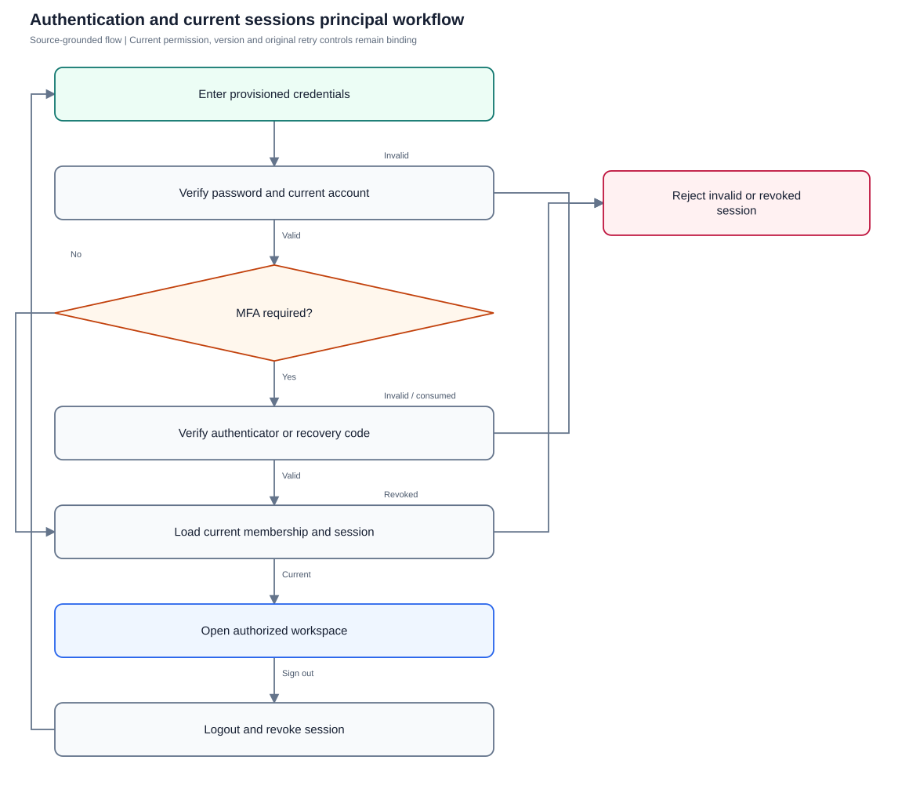
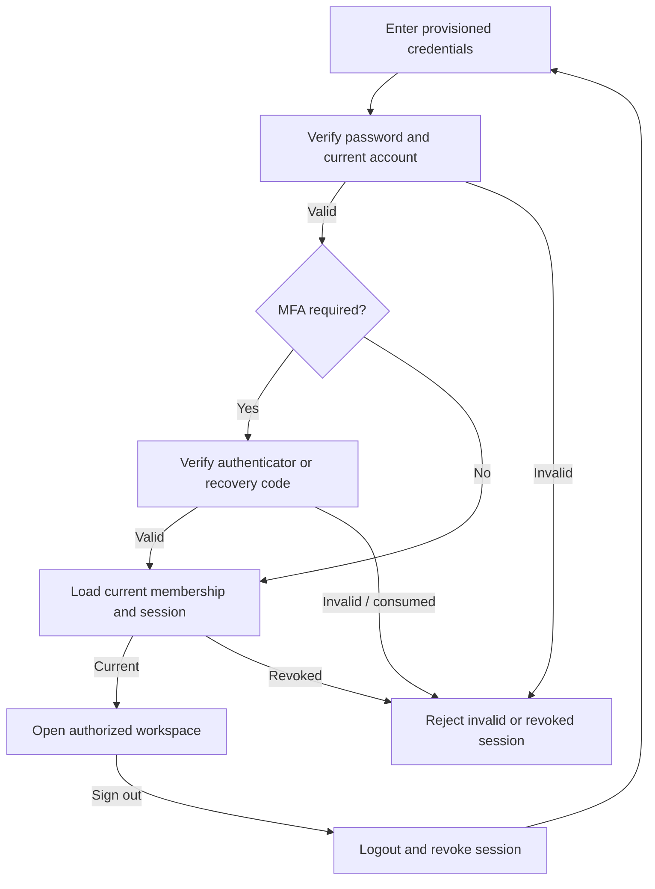

# Authentication and current sessions

Verify real session establishment, MFA, sign-out and current membership boundaries.

**Entry:** Sign-in screen; Settings → My account; POST /api/auth/login; POST /api/auth/mobile-login

**Actors:** Owner A — accountable owner and department member, Engineering; Outsider O — outsider with no QA Alpha membership; Platform operator — platform admin; company authority requires a separate membership

## Main flow

1. Enter provisioned credentials.
2. Complete enabled MFA.
3. Load current company membership.
4. Recheck current session on protected reads and sign out.

[Editable Mermaid](../diagrams/AUTH.mmd)

## Controls and limits

- Browser demo sample sign-in does not prove authentication, MFA, authorization or revocation.
- Mobile token persistence, HTTPS transport and actual background/resume behavior require a qualified native build/device run.

## Proposed manual scenarios

All start **NOT_RUN**. Missing prerequisite = BLOCKED.

### AUTH-001: Sign in establishes a real protected session

**P0 · LOCAL · Web, API**

**Actors:**

- Owner A — accountable owner and department member, Engineering

**Preconditions:**

- Use a separately provisioned isolated server fixture, never the running workspace or historical native fixture.
- Company QA Alpha uses Asia/Kolkata, INR and April financial-year start; QA Beta is a second isolated company.
- Provision named fictional actors and secrets separately; record no passwords, tokens, private source prose or real account identifiers in evidence.
- Begin the manual run as NOT_RUN; a missing server/configuration/device prerequisite is BLOCKED.

**Test data:**

- Owner A has active QA Alpha membership; credentials come from fixture secret storage.

| Step | Action | Expected result |
| --- | --- | --- |
| 1 | Open the server sign-in screen, enter Owner A’s email and provisioned password, and choose Sign in. | Protected workspace opens as Owner A with only his current memberships; POST /api/auth/login succeeds. |
| 2 | Call GET /api/auth/session with the issued cookie; inspect cookie attributes without recording its value. | Session reports Owner A; cookie is HttpOnly and SameSite=Lax, with Secure governed by deployment configuration. |
| 3 | Repeat GET /api/auth/session without a cookie. | HTTP 401; no protected workspace data is returned. |

**Cleanup:** Close draft/recovery controls after recording the result; sign out test sessions. Retain immutable history until evidence review, then discard this isolated fixture through its approved fixture lifecycle.

[Scenario flow](../diagrams/AUTH-001.svg) · [Editable source](../diagrams/AUTH-001.mmd)

**Source:** [docs/API_CONTRACT.md](../../../docs/API_CONTRACT.md), [frontend/src/App.tsx](../../../frontend/src/App.tsx), [frontend/src/store.tsx](../../../frontend/src/store.tsx), [backend/platform/auth.go](../../../backend/platform/auth.go), [frontend/src/components/AuthenticatorSettings.tsx](../../../frontend/src/components/AuthenticatorSettings.tsx)

**Supporting automation:** [backend/platform/platform_test.go](../../../backend/platform/platform_test.go), [backend/platform/mfa_test.go](../../../backend/platform/mfa_test.go), [backend/platform/people_membership_test.go](../../../backend/platform/people_membership_test.go), [mobile/src/AccountScreen.test.tsx](../../../mobile/src/AccountScreen.test.tsx)

### AUTH-002: Invalid credentials cannot enter protected work

**P0 · LOCAL · Web, API**

**Actors:**

- Owner A — accountable owner and department member, Engineering
- Outsider O — outsider with no QA Alpha membership

**Preconditions:**

- Use a separately provisioned isolated server fixture, never the running workspace or historical native fixture.
- Company QA Alpha uses Asia/Kolkata, INR and April financial-year start; QA Beta is a second isolated company.
- Provision named fictional actors and secrets separately; record no passwords, tokens, private source prose or real account identifiers in evidence.
- Begin the manual run as NOT_RUN; a missing server/configuration/device prerequisite is BLOCKED.

**Test data:**

- Invalid-email and wrong-password variants; no secret values in catalog.

| Step | Action | Expected result |
| --- | --- | --- |
| 1 | Submit each invalid variant through Sign in and POST /api/auth/login. | Authentication is denied and sign-in displays the server error; protected workspace does not appear. |
| 2 | Request GET /api/companies without an authenticated session. | HTTP 401, without company directory contents. |

**Cleanup:** Close draft/recovery controls after recording the result; sign out test sessions. Retain immutable history until evidence review, then discard this isolated fixture through its approved fixture lifecycle.

[Scenario flow](../diagrams/AUTH-002.svg) · [Editable source](../diagrams/AUTH-002.mmd)

**Source:** [docs/API_CONTRACT.md](../../../docs/API_CONTRACT.md), [frontend/src/App.tsx](../../../frontend/src/App.tsx), [frontend/src/store.tsx](../../../frontend/src/store.tsx), [backend/platform/auth.go](../../../backend/platform/auth.go), [frontend/src/components/AuthenticatorSettings.tsx](../../../frontend/src/components/AuthenticatorSettings.tsx)

**Supporting automation:** [backend/platform/platform_test.go](../../../backend/platform/platform_test.go), [backend/platform/mfa_test.go](../../../backend/platform/mfa_test.go), [backend/platform/people_membership_test.go](../../../backend/platform/people_membership_test.go), [mobile/src/AccountScreen.test.tsx](../../../mobile/src/AccountScreen.test.tsx)

### AUTH-003: Logout revokes the issued session

**P0 · LOCAL · Web, API**

**Actors:**

- Owner A — accountable owner and department member, Engineering

**Preconditions:**

- Use a separately provisioned isolated server fixture, never the running workspace or historical native fixture.
- Company QA Alpha uses Asia/Kolkata, INR and April financial-year start; QA Beta is a second isolated company.
- Provision named fictional actors and secrets separately; record no passwords, tokens, private source prose or real account identifiers in evidence.
- Begin the manual run as NOT_RUN; a missing server/configuration/device prerequisite is BLOCKED.

**Test data:**

- One signed-in browser plus an isolated API client using that same session.

| Step | Action | Expected result |
| --- | --- | --- |
| 1 | Choose the sign-out control beside Owner A’s name. | POST /api/auth/logout succeeds; sign-in screen replaces the workspace and cookie is cleared. |
| 2 | Attempt GET /api/auth/session with the previously issued session. | HTTP 401; logout is server revocation, not only a client navigation change. |

**Cleanup:** Close draft/recovery controls after recording the result; sign out test sessions. Retain immutable history until evidence review, then discard this isolated fixture through its approved fixture lifecycle.

[Scenario flow](../diagrams/AUTH-003.svg) · [Editable source](../diagrams/AUTH-003.mmd)

**Source:** [docs/API_CONTRACT.md](../../../docs/API_CONTRACT.md), [frontend/src/App.tsx](../../../frontend/src/App.tsx), [frontend/src/store.tsx](../../../frontend/src/store.tsx), [backend/platform/auth.go](../../../backend/platform/auth.go), [frontend/src/components/AuthenticatorSettings.tsx](../../../frontend/src/components/AuthenticatorSettings.tsx)

**Supporting automation:** [backend/platform/platform_test.go](../../../backend/platform/platform_test.go), [backend/platform/mfa_test.go](../../../backend/platform/mfa_test.go), [backend/platform/people_membership_test.go](../../../backend/platform/people_membership_test.go), [mobile/src/AccountScreen.test.tsx](../../../mobile/src/AccountScreen.test.tsx)

### AUTH-004: MFA enrollment gates subsequent sign-in

**P0 · LOCAL_CONFIG · Web, API**

**Actors:**

- Owner A — accountable owner and department member, Engineering

**Preconditions:**

- Use a separately provisioned isolated server fixture, never the running workspace or historical native fixture.
- Company QA Alpha uses Asia/Kolkata, INR and April financial-year start; QA Beta is a second isolated company.
- Provision named fictional actors and secrets separately; record no passwords, tokens, private source prose or real account identifiers in evidence.
- Begin the manual run as NOT_RUN; a missing server/configuration/device prerequisite is BLOCKED.

**Test data:**

- Configured MFA encryption key and an isolated authenticator; second pre-enrollment session.

| Step | Action | Expected result |
| --- | --- | --- |
| 1 | In Settings → My account, supply Current password, choose Set up authenticator, and Confirm authenticator with a fresh code. | MFA becomes enabled; setup secret disappears and one-time recovery codes are offered only in this private session. |
| 2 | Attempt login using only the password; query the second pre-enrollment session. | Login returns 401 mfa_required; other sessions are revoked. |
| 3 | Sign in with a fresh Authenticator code (if enabled). | A real session is established after verification; record the result without secret/code screenshots. |

**Cleanup:** Close draft/recovery controls after recording the result; sign out test sessions. Retain immutable history until evidence review, then discard this isolated fixture through its approved fixture lifecycle.

[Scenario flow](../diagrams/AUTH-004.svg) · [Editable source](../diagrams/AUTH-004.mmd)

**Source:** [docs/API_CONTRACT.md](../../../docs/API_CONTRACT.md), [frontend/src/App.tsx](../../../frontend/src/App.tsx), [frontend/src/store.tsx](../../../frontend/src/store.tsx), [backend/platform/auth.go](../../../backend/platform/auth.go), [frontend/src/components/AuthenticatorSettings.tsx](../../../frontend/src/components/AuthenticatorSettings.tsx)

**Supporting automation:** [backend/platform/platform_test.go](../../../backend/platform/platform_test.go), [backend/platform/mfa_test.go](../../../backend/platform/mfa_test.go), [backend/platform/people_membership_test.go](../../../backend/platform/people_membership_test.go), [mobile/src/AccountScreen.test.tsx](../../../mobile/src/AccountScreen.test.tsx)

### AUTH-005: Consumed MFA codes cannot be replayed

**P0 · LOCAL_CONFIG · Web, API**

**Actors:**

- Owner A — accountable owner and department member, Engineering

**Preconditions:**

- Use a separately provisioned isolated server fixture, never the running workspace or historical native fixture.
- Company QA Alpha uses Asia/Kolkata, INR and April financial-year start; QA Beta is a second isolated company.
- Provision named fictional actors and secrets separately; record no passwords, tokens, private source prose or real account identifiers in evidence.
- Begin the manual run as NOT_RUN; a missing server/configuration/device prerequisite is BLOCKED.

**Test data:**

- Enabled MFA; one current TOTP and one provisioned unused recovery code.

| Step | Action | Expected result |
| --- | --- | --- |
| 1 | POST /api/auth/login using a valid current TOTP, then immediately replay it. | First login succeeds; replay returns HTTP 401. |
| 2 | Sign in using Recovery code (instead of authenticator), then submit the same recovery code again. | First recovery login succeeds; second returns HTTP 401, proving one-time use. |

**Cleanup:** Close draft/recovery controls after recording the result; sign out test sessions. Retain immutable history until evidence review, then discard this isolated fixture through its approved fixture lifecycle.

[Scenario flow](../diagrams/AUTH-005.svg) · [Editable source](../diagrams/AUTH-005.mmd)

**Source:** [docs/API_CONTRACT.md](../../../docs/API_CONTRACT.md), [frontend/src/App.tsx](../../../frontend/src/App.tsx), [frontend/src/store.tsx](../../../frontend/src/store.tsx), [backend/platform/auth.go](../../../backend/platform/auth.go), [frontend/src/components/AuthenticatorSettings.tsx](../../../frontend/src/components/AuthenticatorSettings.tsx)

**Supporting automation:** [backend/platform/platform_test.go](../../../backend/platform/platform_test.go), [backend/platform/mfa_test.go](../../../backend/platform/mfa_test.go), [backend/platform/people_membership_test.go](../../../backend/platform/people_membership_test.go), [mobile/src/AccountScreen.test.tsx](../../../mobile/src/AccountScreen.test.tsx)

### AUTH-006: Enrollment prerequisite and invalid code fail closed

**P1 · LOCAL_CONFIG · Web, API**

**Actors:**

- Owner A — accountable owner and department member, Engineering

**Preconditions:**

- Use a separately provisioned isolated server fixture, never the running workspace or historical native fixture.
- Company QA Alpha uses Asia/Kolkata, INR and April financial-year start; QA Beta is a second isolated company.
- Provision named fictional actors and secrets separately; record no passwords, tokens, private source prose or real account identifiers in evidence.
- Begin the manual run as NOT_RUN; a missing server/configuration/device prerequisite is BLOCKED.

**Test data:**

- Server without MFA encryption configuration, plus a separate configured MFA fixture.

| Step | Action | Expected result |
| --- | --- | --- |
| 1 | Open My account on the unconfigured fixture and GET /api/auth/mfa. | Configuration status explains that the operator must configure the encryption key; enrollment is unavailable. |
| 2 | On the configured fixture, attempt confirmation and enabled-MFA login with an invalid code. | Confirmation/login fail; no MFA bypass or successful session is inferred from an error screen. |

**Cleanup:** Close draft/recovery controls after recording the result; sign out test sessions. Retain immutable history until evidence review, then discard this isolated fixture through its approved fixture lifecycle.

[Scenario flow](../diagrams/AUTH-006.svg) · [Editable source](../diagrams/AUTH-006.mmd)

**Source:** [docs/API_CONTRACT.md](../../../docs/API_CONTRACT.md), [frontend/src/App.tsx](../../../frontend/src/App.tsx), [frontend/src/store.tsx](../../../frontend/src/store.tsx), [backend/platform/auth.go](../../../backend/platform/auth.go), [frontend/src/components/AuthenticatorSettings.tsx](../../../frontend/src/components/AuthenticatorSettings.tsx)

**Supporting automation:** [backend/platform/platform_test.go](../../../backend/platform/platform_test.go), [backend/platform/mfa_test.go](../../../backend/platform/mfa_test.go), [backend/platform/people_membership_test.go](../../../backend/platform/people_membership_test.go), [mobile/src/AccountScreen.test.tsx](../../../mobile/src/AccountScreen.test.tsx)

### AUTH-007: Membership and role headers cannot grant another company

**P0 · LOCAL · Web, API**

**Actors:**

- Owner A — accountable owner and department member, Engineering
- Outsider O — outsider with no QA Alpha membership

**Preconditions:**

- Use a separately provisioned isolated server fixture, never the running workspace or historical native fixture.
- Company QA Alpha uses Asia/Kolkata, INR and April financial-year start; QA Beta is a second isolated company.
- Provision named fictional actors and secrets separately; record no passwords, tokens, private source prose or real account identifiers in evidence.
- Begin the manual run as NOT_RUN; a missing server/configuration/device prerequisite is BLOCKED.

**Test data:**

- Owner A belongs to QA Alpha only; QA Beta company identifier is a fictional fixture alias.

| Step | Action | Expected result |
| --- | --- | --- |
| 1 | Request GET /api/companies/{Birch}/workspace with Owner A’s valid session, adding fabricated role/company headers. | HTTP 403; caller-supplied authority does not confer membership. |
| 2 | Load GET /api/companies and the company selector. | Only current memberships are selectable; Birch data is absent. |

**Cleanup:** Close draft/recovery controls after recording the result; sign out test sessions. Retain immutable history until evidence review, then discard this isolated fixture through its approved fixture lifecycle.

[Scenario flow](../diagrams/AUTH-007.svg) · [Editable source](../diagrams/AUTH-007.mmd)

**Source:** [docs/API_CONTRACT.md](../../../docs/API_CONTRACT.md), [frontend/src/App.tsx](../../../frontend/src/App.tsx), [frontend/src/store.tsx](../../../frontend/src/store.tsx), [backend/platform/auth.go](../../../backend/platform/auth.go), [frontend/src/components/AuthenticatorSettings.tsx](../../../frontend/src/components/AuthenticatorSettings.tsx)

**Supporting automation:** [backend/platform/platform_test.go](../../../backend/platform/platform_test.go), [backend/platform/mfa_test.go](../../../backend/platform/mfa_test.go), [backend/platform/people_membership_test.go](../../../backend/platform/people_membership_test.go), [mobile/src/AccountScreen.test.tsx](../../../mobile/src/AccountScreen.test.tsx)

### AUTH-008: Consequential membership loss invalidates sessions

**P0 · LOCAL · Web, API**

**Actors:**

- Alpha leader — company leadership (founder in QA Alpha; not platform admin)
- Owner A — accountable owner and department member, Engineering

**Preconditions:**

- Use a separately provisioned isolated server fixture, never the running workspace or historical native fixture.
- Company QA Alpha uses Asia/Kolkata, INR and April financial-year start; QA Beta is a second isolated company.
- Provision named fictional actors and secrets separately; record no passwords, tokens, private source prose or real account identifiers in evidence.
- Begin the manual run as NOT_RUN; a missing server/configuration/device prerequisite is BLOCKED.

**Test data:**

- Owner A has two sessions and a registered isolated device; Alpha leader can change company membership.

| Step | Action | Expected result |
| --- | --- | --- |
| 1 | As Alpha leader, PATCH /api/companies/{Aster}/people/{Owner A} with captured expectedVersion and a consequential role/department change. | Membership/access epochs change and affected account sessions/devices are invalidated. |
| 2 | Use each old session to GET /api/auth/session and return to the protected browser. | Old sessions are rejected; fetched work and related recovery state clear; a late prior response cannot restore them. |
| 3 | Authenticate afresh and open QA Alpha. | The new current role/department determines access; prior grants are not reused. |

**Cleanup:** Close draft/recovery controls after recording the result; sign out test sessions. Retain immutable history until evidence review, then discard this isolated fixture through its approved fixture lifecycle.

[Scenario flow](../diagrams/AUTH-008.svg) · [Editable source](../diagrams/AUTH-008.mmd)

**Source:** [docs/API_CONTRACT.md](../../../docs/API_CONTRACT.md), [frontend/src/App.tsx](../../../frontend/src/App.tsx), [frontend/src/store.tsx](../../../frontend/src/store.tsx), [backend/platform/auth.go](../../../backend/platform/auth.go), [frontend/src/components/AuthenticatorSettings.tsx](../../../frontend/src/components/AuthenticatorSettings.tsx)

**Supporting automation:** [backend/platform/platform_test.go](../../../backend/platform/platform_test.go), [backend/platform/mfa_test.go](../../../backend/platform/mfa_test.go), [backend/platform/people_membership_test.go](../../../backend/platform/people_membership_test.go), [mobile/src/AccountScreen.test.tsx](../../../mobile/src/AccountScreen.test.tsx)

### AUTH-009: Unknown login response is reconciled using session read

**P1 · LOCAL · Web, API**

**Actors:**

- Owner A — accountable owner and department member, Engineering

**Preconditions:**

- Use a separately provisioned isolated server fixture, never the running workspace or historical native fixture.
- Company QA Alpha uses Asia/Kolkata, INR and April financial-year start; QA Beta is a second isolated company.
- Provision named fictional actors and secrets separately; record no passwords, tokens, private source prose or real account identifiers in evidence.
- Begin the manual run as NOT_RUN; a missing server/configuration/device prerequisite is BLOCKED.

**Test data:**

- Isolated client may suppress a login response once; no production fault injection.

| Step | Action | Expected result |
| --- | --- | --- |
| 1 | Submit valid login and withhold its response after delivery; reload the server client and GET /api/auth/session. | If the cookie was installed, the current session is loaded; otherwise sign-in remains required. No stale cached identity is presented as authenticated. |
| 2 | Complete a deliberate fresh sign-in when no session exists, then sign out. | Current session is established and revoked normally; evidence records the actual observed branch. |

**Cleanup:** Close draft/recovery controls after recording the result; sign out test sessions. Retain immutable history until evidence review, then discard this isolated fixture through its approved fixture lifecycle.

[Scenario flow](../diagrams/AUTH-009.svg) · [Editable source](../diagrams/AUTH-009.mmd)

**Source:** [docs/API_CONTRACT.md](../../../docs/API_CONTRACT.md), [frontend/src/App.tsx](../../../frontend/src/App.tsx), [frontend/src/store.tsx](../../../frontend/src/store.tsx), [backend/platform/auth.go](../../../backend/platform/auth.go), [frontend/src/components/AuthenticatorSettings.tsx](../../../frontend/src/components/AuthenticatorSettings.tsx)

**Supporting automation:** [frontend/src/store.scopes.test.tsx](../../../frontend/src/store.scopes.test.tsx), [backend/platform/platform_test.go](../../../backend/platform/platform_test.go)

### AUTH-010: Native bearer session and owned device revocation

**P1 · DEVICE · API, Android, iOS**

**Actors:**

- Owner A — accountable owner and department member, Engineering
- Member B — second department member, Engineering

**Preconditions:**

- Use a separately provisioned isolated server fixture, never the running workspace or historical native fixture.
- Company QA Alpha uses Asia/Kolkata, INR and April financial-year start; QA Beta is a second isolated company.
- Provision named fictional actors and secrets separately; record no passwords, tokens, private source prose or real account identifiers in evidence.
- Begin the manual run as NOT_RUN; a missing server/configuration/device prerequisite is BLOCKED.

**Test data:**

- Qualified Android or iOS build; Owner A has independent web and native sessions.

| Step | Action | Expected result |
| --- | --- | --- |
| 1 | Sign in through the native build; request GET /api/auth/session with its bearer credential over HTTPS. | Native protected navigation works; bearer is sent in Authorization, never in a URL or evidence log. |
| 2 | Register a named QA device and revoke it through POST /api/devices/{device}/revoke using its owner session. | Bound native session and registrations are revoked; independent web session remains current. |
| 3 | Attempt protected native refresh with the revoked token and revoke a foreign device identifier. | Refresh is rejected; foreign/unknown device returns 404 without details. |

**Cleanup:** Close draft/recovery controls after recording the result; sign out test sessions. Retain immutable history until evidence review, then discard this isolated fixture through its approved fixture lifecycle.

[Scenario flow](../diagrams/AUTH-010.svg) · [Editable source](../diagrams/AUTH-010.mmd)

**Source:** [docs/API_CONTRACT.md](../../../docs/API_CONTRACT.md), [frontend/src/App.tsx](../../../frontend/src/App.tsx), [frontend/src/store.tsx](../../../frontend/src/store.tsx), [backend/platform/auth.go](../../../backend/platform/auth.go), [frontend/src/components/AuthenticatorSettings.tsx](../../../frontend/src/components/AuthenticatorSettings.tsx)

**Supporting automation:** [backend/platform/communication_devices_test.go](../../../backend/platform/communication_devices_test.go), [mobile/src/AccountScreen.test.tsx](../../../mobile/src/AccountScreen.test.tsx)

