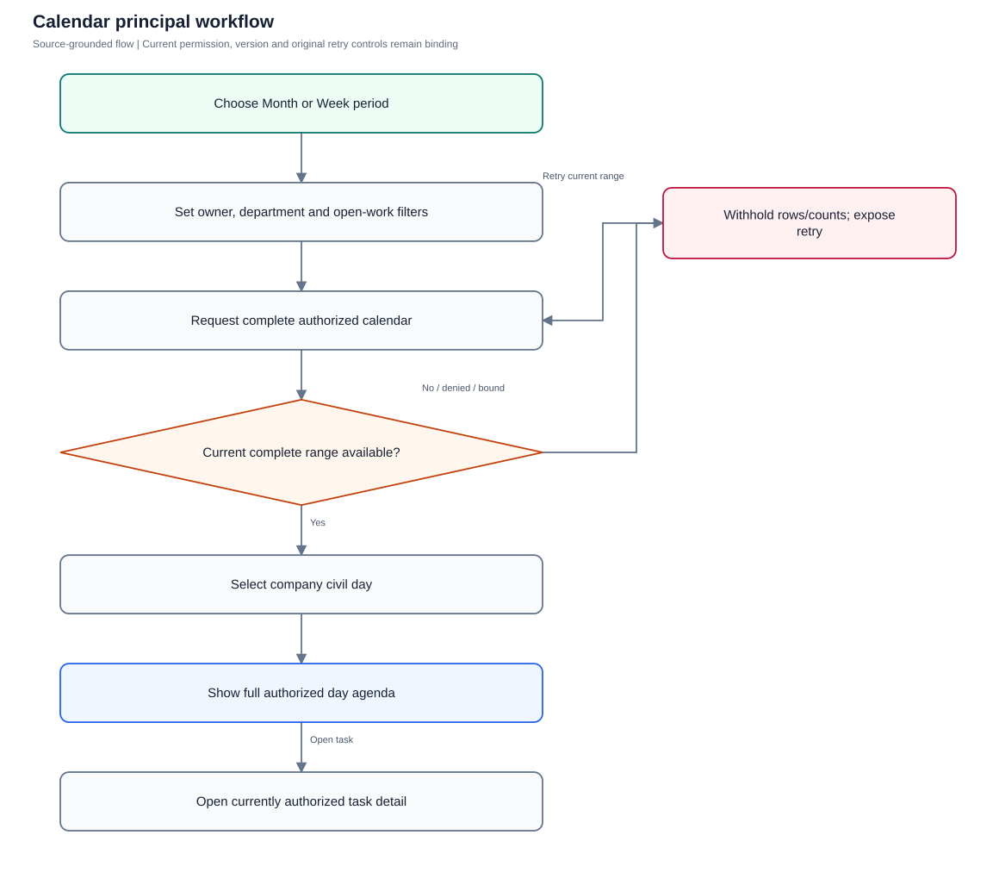
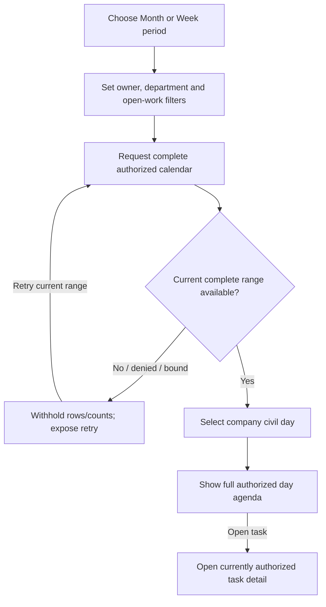

# Calendar

Read complete currently authorized calendar ranges using company civil dates and immutable timed instants.

**Entry:** Calendar; Month / Week; Calendar department / Calendar owner; Open work only

**Actors:** Alpha leader — company leadership (founder in QA Alpha; not platform admin); Owner A — accountable owner and department member, Engineering

## Main flow

1. Choose visible period and source-narrowing filters.
2. Load complete authorized calendar range.
3. Select company civil date and inspect agenda.
4. Open task through current detail authorization.

[Editable Mermaid](../diagrams/CALENDAR.mmd)

## Controls and limits

- Month renders 42 days; Week renders 7. Current API calendar is complete within its bounded request or unavailable, never a first-100 approximation.
- Calendar is read-only; schedule changes require separate explicit schedule controls.
- Demo finite sample is labeled and cannot qualify complete server-calendar coverage.

## Proposed manual scenarios

All start **NOT_RUN**. Missing prerequisite = BLOCKED.

### CALENDAR-001: Month/week navigation and selected-day agenda agree

**P1 · LOCAL · Web, API**

**Actors:**

- Owner A — accountable owner and department member, Engineering

**Preconditions:**

- Use a separately provisioned isolated server fixture, never the running workspace or historical native fixture.
- Company QA Alpha uses Asia/Kolkata, INR and April financial-year start; QA Beta is a second isolated company.
- Provision named fictional actors and secrets separately; record no passwords, tokens, private source prose or real account identifiers in evidence.
- Begin the manual run as NOT_RUN; a missing server/configuration/device prerequisite is BLOCKED.

**Test data:**

- One all-day task due 2026-10-20 and another due 2026-10-21.

| Step | Action | Expected result |
| --- | --- | --- |
| 1 | Choose Month, Previous period, Next period and Today, then Week. | Visible period/selected date updates using company civil dates; week begins Monday and contains seven days. |
| 2 | Choose the due day and open the task label from its agenda. | Day task count and agenda agree for the complete range; detail opens only after current authorization. |

**Cleanup:** Close draft/recovery controls after recording the result; sign out test sessions. Retain immutable history until evidence review, then discard this isolated fixture through its approved fixture lifecycle.

[Scenario flow](../diagrams/CALENDAR-001.svg) · [Editable source](../diagrams/CALENDAR-001.mmd)

**Source:** [docs/PLANNING_AND_GOALS.md](../../../docs/PLANNING_AND_GOALS.md), [docs/API_CONTRACT.md](../../../docs/API_CONTRACT.md), [frontend/src/pages/CalendarWorkload.tsx](../../../frontend/src/pages/CalendarWorkload.tsx), [backend/platform/planning_calendar.go](../../../backend/platform/planning_calendar.go)

**Supporting automation:** [backend/platform/planning_calendar_test.go](../../../backend/platform/planning_calendar_test.go), [frontend/src/pages/CalendarRange.test.tsx](../../../frontend/src/pages/CalendarRange.test.tsx), [frontend/src/pages/CalendarWorkload.test.tsx](../../../frontend/src/pages/CalendarWorkload.test.tsx)

### CALENDAR-002: Owner, department and closed-work filters narrow current results

**P1 · LOCAL · Web, API**

**Actors:**

- Alpha leader — company leadership (founder in QA Alpha; not platform admin)
- Owner A — accountable owner and department member, Engineering

**Preconditions:**

- Use a separately provisioned isolated server fixture, never the running workspace or historical native fixture.
- Company QA Alpha uses Asia/Kolkata, INR and April financial-year start; QA Beta is a second isolated company.
- Provision named fictional actors and secrets separately; record no passwords, tokens, private source prose or real account identifiers in evidence.
- Begin the manual run as NOT_RUN; a missing server/configuration/device prerequisite is BLOCKED.

**Test data:**

- Engineering and Studio tasks; Owner A/Member B owners; todo, done and cancelled statuses.

| Step | Action | Expected result |
| --- | --- | --- |
| 1 | Set Calendar department to Engineering and Calendar owner to Owner A with Open work only checked. | Only Owner A’s independently readable open Engineering deadlines appear. |
| 2 | Uncheck Open work only and select the accepted/cancelled task day. | Authorized closed tasks appear without changing source status; filters never expand source access. |

**Cleanup:** Close draft/recovery controls after recording the result; sign out test sessions. Retain immutable history until evidence review, then discard this isolated fixture through its approved fixture lifecycle.

[Scenario flow](../diagrams/CALENDAR-002.svg) · [Editable source](../diagrams/CALENDAR-002.mmd)

**Source:** [docs/PLANNING_AND_GOALS.md](../../../docs/PLANNING_AND_GOALS.md), [docs/API_CONTRACT.md](../../../docs/API_CONTRACT.md), [frontend/src/pages/CalendarWorkload.tsx](../../../frontend/src/pages/CalendarWorkload.tsx), [backend/platform/planning_calendar.go](../../../backend/platform/planning_calendar.go)

**Supporting automation:** [backend/platform/planning_calendar_test.go](../../../backend/platform/planning_calendar_test.go), [frontend/src/pages/CalendarRange.test.tsx](../../../frontend/src/pages/CalendarRange.test.tsx), [frontend/src/pages/CalendarWorkload.test.tsx](../../../frontend/src/pages/CalendarWorkload.test.tsx)

### CALENDAR-003: Complete calendar includes older rows beyond first task page

**P0 · LOCAL · Web, API**

**Actors:**

- Owner A — accountable owner and department member, Engineering

**Preconditions:**

- Use a separately provisioned isolated server fixture, never the running workspace or historical native fixture.
- Company QA Alpha uses Asia/Kolkata, INR and April financial-year start; QA Beta is a second isolated company.
- Provision named fictional actors and secrets separately; record no passwords, tokens, private source prose or real account identifiers in evidence.
- Begin the manual run as NOT_RUN; a missing server/configuration/device prerequisite is BLOCKED.

**Test data:**

- 107 visible open deadlines on 2026-10-11, including an older task absent from first 100; 2 closed rows; unrelated hidden task.

| Step | Action | Expected result |
| --- | --- | --- |
| 1 | GET /tasks to confirm first-page omission, then GET /planning/calendar?from=2026-10-11&to=2026-10-11&openOnly=true. | Calendar complete=true contains all 107 visible open deadlines including the older row; hidden work is excluded. |
| 2 | Load the same day in Calendar and inspect + more / agenda; repeat API with openOnly=false. | Complete day count/agenda reflects all visible rows; closed variant returns 109. No commitment is mutated by reads. |

**Cleanup:** Close draft/recovery controls after recording the result; sign out test sessions. Retain immutable history until evidence review, then discard this isolated fixture through its approved fixture lifecycle.

[Scenario flow](../diagrams/CALENDAR-003.svg) · [Editable source](../diagrams/CALENDAR-003.mmd)

**Source:** [docs/PLANNING_AND_GOALS.md](../../../docs/PLANNING_AND_GOALS.md), [docs/API_CONTRACT.md](../../../docs/API_CONTRACT.md), [frontend/src/pages/CalendarWorkload.tsx](../../../frontend/src/pages/CalendarWorkload.tsx), [backend/platform/planning_calendar.go](../../../backend/platform/planning_calendar.go)

**Supporting automation:** [backend/platform/planning_calendar_test.go](../../../backend/platform/planning_calendar_test.go), [frontend/src/pages/CalendarRange.test.tsx](../../../frontend/src/pages/CalendarRange.test.tsx), [frontend/src/pages/CalendarWorkload.test.tsx](../../../frontend/src/pages/CalendarWorkload.test.tsx)

### CALENDAR-004: Timed UTC instant uses company date near midnight and DST

**P0 · LOCAL · Web, API**

**Actors:**

- Alpha leader — company leadership (founder in QA Alpha; not platform admin)

**Preconditions:**

- Use a separately provisioned isolated server fixture, never the running workspace or historical native fixture.
- Company QA Alpha uses Asia/Kolkata, INR and April financial-year start; QA Beta is a second isolated company.
- Provision named fictional actors and secrets separately; record no passwords, tokens, private source prose or real account identifiers in evidence.
- Begin the manual run as NOT_RUN; a missing server/configuration/device prerequisite is BLOCKED.

**Test data:**

- Asia/Kolkata instant 2026-10-10T18:45:00.123456Z; New York DST boundary variant.

| Step | Action | Expected result |
| --- | --- | --- |
| 1 | Read 2026-10-11 Calendar in QA Alpha and inspect the timed row. | Timed row is dated 2026-10-11 by company zone; dueAt remains the exact stored UTC instant. |
| 2 | In the New York fixture read 2026-03-08 with instants immediately before/at/after civil-day bounds. | Only instants whose company-local civil date is March 8 appear, including last microsecond; adjacent-day instants are excluded. |

**Cleanup:** Close draft/recovery controls after recording the result; sign out test sessions. Retain immutable history until evidence review, then discard this isolated fixture through its approved fixture lifecycle.

[Scenario flow](../diagrams/CALENDAR-004.svg) · [Editable source](../diagrams/CALENDAR-004.mmd)

**Source:** [docs/PLANNING_AND_GOALS.md](../../../docs/PLANNING_AND_GOALS.md), [docs/API_CONTRACT.md](../../../docs/API_CONTRACT.md), [frontend/src/pages/CalendarWorkload.tsx](../../../frontend/src/pages/CalendarWorkload.tsx), [backend/platform/planning_calendar.go](../../../backend/platform/planning_calendar.go)

**Supporting automation:** [backend/platform/planning_calendar_test.go](../../../backend/platform/planning_calendar_test.go), [frontend/src/pages/CalendarRange.test.tsx](../../../frontend/src/pages/CalendarRange.test.tsx), [frontend/src/pages/CalendarWorkload.test.tsx](../../../frontend/src/pages/CalendarWorkload.test.tsx)

### CALENDAR-005: Invalid/oversized range is unavailable without partial counts

**P0 · LOCAL · Web, API**

**Actors:**

- Alpha leader — company leadership (founder in QA Alpha; not platform admin)

**Preconditions:**

- Use a separately provisioned isolated server fixture, never the running workspace or historical native fixture.
- Company QA Alpha uses Asia/Kolkata, INR and April financial-year start; QA Beta is a second isolated company.
- Provision named fictional actors and secrets separately; record no passwords, tokens, private source prose or real account identifiers in evidence.
- Begin the manual run as NOT_RUN; a missing server/configuration/device prerequisite is BLOCKED.

**Test data:**

- Malformed/reversed dates; >84-day range; 10,001 visible rows on one selected day.

| Step | Action | Expected result |
| --- | --- | --- |
| 1 | Call GET /planning/calendar with each invalid/range-bound variant. | HTTP 422 with no tasks payload; client does not display fabricated complete counts. |
| 2 | Request the day whose authorized selected rows exceed the bound; then a day with no selected rows while oversized rows exist outside it. | Selected oversized day is unavailable; empty selected day remains complete because source/date filters precede the cap. |
| 3 | Restore an ordinary fixture range and choose Retry current calendar range after a controlled read error. | Day counts/tasks appear only when the complete current response is ready. |

**Cleanup:** Close draft/recovery controls after recording the result; sign out test sessions. Retain immutable history until evidence review, then discard this isolated fixture through its approved fixture lifecycle.

[Scenario flow](../diagrams/CALENDAR-005.svg) · [Editable source](../diagrams/CALENDAR-005.mmd)

**Source:** [docs/PLANNING_AND_GOALS.md](../../../docs/PLANNING_AND_GOALS.md), [docs/API_CONTRACT.md](../../../docs/API_CONTRACT.md), [frontend/src/pages/CalendarWorkload.tsx](../../../frontend/src/pages/CalendarWorkload.tsx), [backend/platform/planning_calendar.go](../../../backend/platform/planning_calendar.go)

**Supporting automation:** [backend/platform/planning_calendar_test.go](../../../backend/platform/planning_calendar_test.go), [frontend/src/pages/CalendarRange.test.tsx](../../../frontend/src/pages/CalendarRange.test.tsx), [frontend/src/pages/CalendarWorkload.test.tsx](../../../frontend/src/pages/CalendarWorkload.test.tsx)

### CALENDAR-006: Pending/current-access checks withhold stale calendar rows

**P0 · LOCAL · Web, API**

**Actors:**

- Owner A — accountable owner and department member, Engineering
- Alpha leader — company leadership (founder in QA Alpha; not platform admin)

**Preconditions:**

- Use a separately provisioned isolated server fixture, never the running workspace or historical native fixture.
- Company QA Alpha uses Asia/Kolkata, INR and April financial-year start; QA Beta is a second isolated company.
- Provision named fictional actors and secrets separately; record no passwords, tokens, private source prose or real account identifiers in evidence.
- Begin the manual run as NOT_RUN; a missing server/configuration/device prerequisite is BLOCKED.

**Test data:**

- Owner A viewing deadline; isolated delayed refresh; then confirmed membership/source loss.

| Step | Action | Expected result |
| --- | --- | --- |
| 1 | Delay current range refresh after a scope/filter change and inspect grid and agenda. | Checking state replaces fetched rows/counts; old task labels are not shown as current complete data. |
| 2 | Confirm access loss, release the delayed old response and try the prior task link. | Old response cannot restore lost titles; current read/detail denies access. Local calendar selection is not an authority grant. |

**Cleanup:** Close draft/recovery controls after recording the result; sign out test sessions. Retain immutable history until evidence review, then discard this isolated fixture through its approved fixture lifecycle.

[Scenario flow](../diagrams/CALENDAR-006.svg) · [Editable source](../diagrams/CALENDAR-006.mmd)

**Source:** [docs/PLANNING_AND_GOALS.md](../../../docs/PLANNING_AND_GOALS.md), [docs/API_CONTRACT.md](../../../docs/API_CONTRACT.md), [frontend/src/pages/CalendarWorkload.tsx](../../../frontend/src/pages/CalendarWorkload.tsx), [backend/platform/planning_calendar.go](../../../backend/platform/planning_calendar.go)

**Supporting automation:** [frontend/src/pages/CalendarRange.test.tsx](../../../frontend/src/pages/CalendarRange.test.tsx), [backend/platform/planning_calendar_test.go](../../../backend/platform/planning_calendar_test.go)

