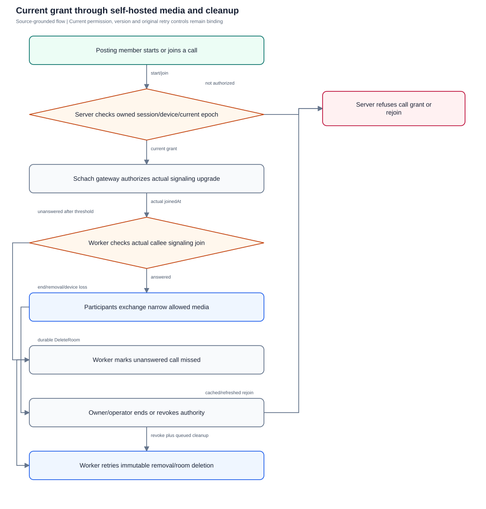
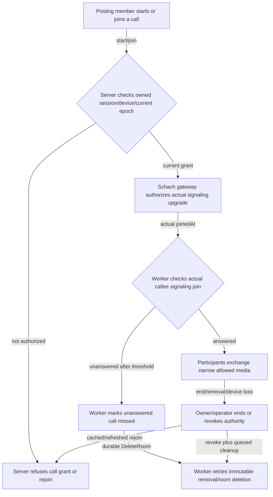

# Self-hosted calling and rollout boundaries

Distinguish current revocable signaling/media behavior from device and production acceptance.

**Entry:** Web: conversation Calls → Start audio call / Start video call / Join call / End call for everyone; Native: Calls tab, Join call and globally mounted ActiveCall; Operator: self-hosted LiveKit, private signaling gateway, durable call cleanup and staged TURN

**Actors:** Owner A: conversation owner and company member in fictional QA Alpha; Member B: company member and selected recipient in QA Alpha; Reviewer R: independent reviewer in QA Alpha; Alpha leader: company administrator outside the private conversation in QA Alpha; Outsider O: member only in fictional QA Beta; Platform operator: platform operator without private conversation membership

## Main flow

1. Current posting participant starts or joins using an owned session-bound device.
2. Schach grants narrow room rights and gates actual provider signaling under current session/device/history epoch.
3. Participants publish/subscribe media; unanswered calls become missed from actual signaling joins.
4. End/revoke closes local authority and queues retryable provider cleanup; operator/device acceptance proves deployment and OS behavior separately.

[Editable Mermaid](../diagrams/CALLS.mmd)

## Controls and limits

- Actual media requires LOCAL_CONFIG with isolated self-hosted LiveKit; token issuance alone is not media/audio acceptance.
- Current foreground incoming path is the active call list and Join action; OS incoming-call surfaces remain an uncompleted DEVICE gate.
- Private LiveKit signaling ingress, trusted TLS, authenticated TURN and deployment capacity are PRODUCTION gates.
- Native foreground service/source and exports do not establish physical background/lock/headset/network outcomes; no signed iOS device acceptance is claimed.

## Proposed manual scenarios

All start **NOT_RUN**. Missing prerequisite = BLOCKED.

### CALLS-001: Unconfigured calls and immutable start retry

**P1 · LOCAL_CONFIG · Web, API**

**Actors:**

- Owner A: conversation owner and company member in fictional QA Alpha
- Member B: company member and selected recipient in QA Alpha
- Reviewer R: independent reviewer in QA Alpha
- Alpha leader: company administrator outside the private conversation in QA Alpha
- Outsider O: member only in fictional QA Beta
- Platform operator: platform operator without private conversation membership

**Preconditions:**

- Use a newly provisioned isolated QA server and fictional accounts; never the running workspace or historical native fixture.
- Record sanitized observations only: no tokens, private prose, raw sensitive screenshots, provider secrets or real company/user identifiers.
- This is a proposed manual scenario with status NOT_RUN. Missing required configuration/build/device/deployment is BLOCKED; automated references are not manual passes.
- Provide separate configured and unconfigured owned fixtures; provider secrets are outside the QA pack.

**Test data:**

- Use authored fictional QA text and newly issued fixture IDs; never paste real conversations or credentials.

| Step | Action | Expected result |
| --- | --- | --- |
| 1 | In a calls-unconfigured fixture select Start audio call. | The unconfigured fixture shows Calling is not configured and never reports connected media. |
| 2 | In a configured fixture start an audio call while dropping only the start/join response in isolated transport. | Unknown setup preserves original kind/retry key and accepted call ID if known. |
| 3 | Choose Retry same call, then fetch available calls and repeat the API retry key with video or another conversation. | Exact retry reuses one call; changed kind/conversation under the same key conflicts. |

**Cleanup:** Close fixture dialogs, discard unsent QA input and remove or archive only the owned disposable fixture through authorized controls; revoke fixture sessions when finished.

[Scenario flow](../diagrams/CALLS-001.svg) · [Editable source](../diagrams/CALLS-001.mmd)

**Source:** [frontend/src/communication/Calls.tsx](../../../frontend/src/communication/Calls.tsx), [backend/platform/communication_calls.go](../../../backend/platform/communication_calls.go)

**Supporting automation:** [frontend/src/communication/Calls.test.tsx](../../../frontend/src/communication/Calls.test.tsx), [backend/platform/communication_calls_test.go](../../../backend/platform/communication_calls_test.go)

### CALLS-002: Current participant and session-owned device are required

**P0 · LOCAL_CONFIG · Web, API**

**Actors:**

- Owner A: conversation owner and company member in fictional QA Alpha
- Member B: company member and selected recipient in QA Alpha
- Reviewer R: independent reviewer in QA Alpha
- Alpha leader: company administrator outside the private conversation in QA Alpha
- Outsider O: member only in fictional QA Beta
- Platform operator: platform operator without private conversation membership

**Preconditions:**

- Use a newly provisioned isolated QA server and fictional accounts; never the running workspace or historical native fixture.
- Record sanitized observations only: no tokens, private prose, raw sensitive screenshots, provider secrets or real company/user identifiers.
- This is a proposed manual scenario with status NOT_RUN. Missing required configuration/build/device/deployment is BLOCKED; automated references are not manual passes.

**Test data:**

- Use authored fictional QA text and newly issued fixture IDs; never paste real conversations or credentials.

| Step | Action | Expected result |
| --- | --- | --- |
| 1 | Owner A starts an audio call; Member B registers an owned web device and requests a token. | An active posting participant with a current owned bound device receives an eligible grant. |
| 2 | As Alpha leader outside the private conversation request token/list; as Member B try a device belonging to Owner A or another session. | Private outsider and wrong device/session requests receive no usable grant or private call metadata. |
| 3 | Change Member B to viewer or archive the conversation in separate fixture variants and request a fresh token. | Viewer/archive posting restrictions prevent new grants. |
| 4 | Inspect only sanitized grant flags and gateway host/path; never persist the token. | Grant permits selected room mic/audio (and camera/screenshare only for video), not room admin/recording/data publishing; URL is Schach signaling gateway. |

**Cleanup:** Close fixture dialogs, discard unsent QA input and remove or archive only the owned disposable fixture through authorized controls; revoke fixture sessions when finished.

[Scenario flow](../diagrams/CALLS-002.svg) · [Editable source](../diagrams/CALLS-002.mmd)

**Source:** [backend/platform/communication_calls.go](../../../backend/platform/communication_calls.go), [backend/platform/communication_devices.go](../../../backend/platform/communication_devices.go)

**Supporting automation:** [backend/platform/communication_calls_test.go](../../../backend/platform/communication_calls_test.go), [backend/platform/communication_access_test.go](../../../backend/platform/communication_access_test.go)

### CALLS-003: Two actual local audio participants join through Schach

**P1 · LOCAL_CONFIG · Web, API**

**Actors:**

- Owner A: conversation owner and company member in fictional QA Alpha
- Member B: company member and selected recipient in QA Alpha
- Reviewer R: independent reviewer in QA Alpha
- Alpha leader: company administrator outside the private conversation in QA Alpha
- Outsider O: member only in fictional QA Beta
- Platform operator: platform operator without private conversation membership

**Preconditions:**

- Use a newly provisioned isolated QA server and fictional accounts; never the running workspace or historical native fixture.
- Record sanitized observations only: no tokens, private prose, raw sensitive screenshots, provider secrets or real company/user identifiers.
- This is a proposed manual scenario with status NOT_RUN. Missing required configuration/build/device/deployment is BLOCKED; automated references are not manual passes.
- Owned self-hosted LiveKit fixture and two microphone-capable browser participants are available.

**Test data:**

- Use authored fictional QA text and newly issued fixture IDs; never paste real conversations or credentials.

| Step | Action | Expected result |
| --- | --- | --- |
| 1 | Owner A selects Start audio call and Member B opens the conversation call list and selects Join audio call. | Both actual signaling upgrades succeed through the authorized gateway; an issued token alone is insufficient. |
| 2 | Both allow browser microphone use and exchange distinct fictional QA phrases. | Both participants publish/subscribe audible media; record observed audio success separately from HTTP success. |
| 3 | Use mute/unmute controls and observe the other participant’s audio, then disconnect one participant. | Mute stops that audio publication and unmute resumes; disconnection ends that participant’s live stream. |
| 4 | Inspect sanitized provider participant count and gateway connection observations. | Provider membership and current client connection agree without logging provider tokens; no production-network claim follows. |

**Cleanup:** Close fixture dialogs, discard unsent QA input and remove or archive only the owned disposable fixture through authorized controls; revoke fixture sessions when finished.

[Scenario flow](../diagrams/CALLS-003.svg) · [Editable source](../diagrams/CALLS-003.mmd)

**Source:** [frontend/src/communication/Calls.tsx](../../../frontend/src/communication/Calls.tsx), [backend/platform/communication_calls.go](../../../backend/platform/communication_calls.go), [verification/runtime/livekit-browser.mjs](../../../verification/runtime/livekit-browser.mjs)

**Supporting automation:** [backend/platform/communication_services_test.go](../../../backend/platform/communication_services_test.go)

### CALLS-004: Local video and desktop screenshare narrow publication

**P1 · LOCAL_CONFIG · Web, API**

**Actors:**

- Owner A: conversation owner and company member in fictional QA Alpha
- Member B: company member and selected recipient in QA Alpha
- Reviewer R: independent reviewer in QA Alpha
- Alpha leader: company administrator outside the private conversation in QA Alpha
- Outsider O: member only in fictional QA Beta
- Platform operator: platform operator without private conversation membership

**Preconditions:**

- Use a newly provisioned isolated QA server and fictional accounts; never the running workspace or historical native fixture.
- Record sanitized observations only: no tokens, private prose, raw sensitive screenshots, provider secrets or real company/user identifiers.
- This is a proposed manual scenario with status NOT_RUN. Missing required configuration/build/device/deployment is BLOCKED; automated references are not manual passes.

**Test data:**

- Use authored fictional QA text and newly issued fixture IDs; never paste real conversations or credentials.

| Step | Action | Expected result |
| --- | --- | --- |
| 1 | Start and join a video call as two current participants with browser camera/mic permission. | Video participants publish/subscribe camera/audio within the granted room. |
| 2 | Enable camera and share a fictional QA screen from desktop; stop the share afterward. | Desktop screenshare is visible to the other participant and stops on explicit stop. |
| 3 | In an audio-call fixture inspect allowed publication sources and attempt camera/screenshare through provider controls. | Audio-call rights allow microphone publication only; video/screen sources are not broadly granted. |
| 4 | Observe the Recording is off notice and absence of recording/transcription actions. | Live-call recording/transcription remains disabled; local media acceptance does not certify native parity. |

**Cleanup:** Close fixture dialogs, discard unsent QA input and remove or archive only the owned disposable fixture through authorized controls; revoke fixture sessions when finished.

[Scenario flow](../diagrams/CALLS-004.svg) · [Editable source](../diagrams/CALLS-004.mmd)

**Source:** [frontend/src/communication/Calls.tsx](../../../frontend/src/communication/Calls.tsx), [backend/platform/communication_calls.go](../../../backend/platform/communication_calls.go)

**Supporting automation:** [backend/platform/communication_calls_test.go](../../../backend/platform/communication_calls_test.go), [backend/platform/communication_services_test.go](../../../backend/platform/communication_services_test.go)

### CALLS-005: Cached and provider-refreshed tokens cannot bypass revocation

**P0 · LOCAL_CONFIG · Web, API**

**Actors:**

- Owner A: conversation owner and company member in fictional QA Alpha
- Member B: company member and selected recipient in QA Alpha
- Reviewer R: independent reviewer in QA Alpha
- Alpha leader: company administrator outside the private conversation in QA Alpha
- Outsider O: member only in fictional QA Beta
- Platform operator: platform operator without private conversation membership

**Preconditions:**

- Use a newly provisioned isolated QA server and fictional accounts; never the running workspace or historical native fixture.
- Record sanitized observations only: no tokens, private prose, raw sensitive screenshots, provider secrets or real company/user identifiers.
- This is a proposed manual scenario with status NOT_RUN. Missing required configuration/build/device/deployment is BLOCKED; automated references are not manual passes.

**Test data:**

- Use authored fictional QA text and newly issued fixture IDs; never paste real conversations or credentials.

| Step | Action | Expected result |
| --- | --- | --- |
| 1 | Join a local call as Member B; retain cached/provider-refreshed JWT only in the fixture’s volatile inspection session. | Current authorized grant initially joins real signaling/media. |
| 2 | Owner A removes Member B from the private conversation; observe gateway disconnect and provider participant cleanup. | Committed access loss invalidates current epoch authority; gateway closes and retryable cleanup removes old media membership. |
| 3 | Attempt rejoin through Schach using both retained tokens and request a fresh token. | Old cached/refreshed tokens and fresh-token request without membership cannot join. |
| 4 | Explicitly re-invite Member B and join with a newly authorized grant; allow delayed old cleanup jobs to complete in the owned fixture. | New grant has an immutable new identity; delayed cleanup for the revoked grant does not remove the new authorized participant. |

**Cleanup:** Close fixture dialogs, discard unsent QA input and remove or archive only the owned disposable fixture through authorized controls; revoke fixture sessions when finished.

[Scenario flow](../diagrams/CALLS-005.svg) · [Editable source](../diagrams/CALLS-005.mmd)

**Source:** [backend/platform/communication_calls.go](../../../backend/platform/communication_calls.go), [backend/platform/call_jobs.go](../../../backend/platform/call_jobs.go)

**Supporting automation:** [backend/platform/communication_calls_test.go](../../../backend/platform/communication_calls_test.go), [backend/platform/communication_review_test.go](../../../backend/platform/communication_review_test.go), [backend/platform/communication_services_test.go](../../../backend/platform/communication_services_test.go)

### CALLS-006: Foreground incoming list and missed outcome use actual join

**P1 · LOCAL_CONFIG · Web, API**

**Actors:**

- Owner A: conversation owner and company member in fictional QA Alpha
- Member B: company member and selected recipient in QA Alpha
- Reviewer R: independent reviewer in QA Alpha
- Alpha leader: company administrator outside the private conversation in QA Alpha
- Outsider O: member only in fictional QA Beta
- Platform operator: platform operator without private conversation membership

**Preconditions:**

- Use a newly provisioned isolated QA server and fictional accounts; never the running workspace or historical native fixture.
- Record sanitized observations only: no tokens, private prose, raw sensitive screenshots, provider secrets or real company/user identifiers.
- This is a proposed manual scenario with status NOT_RUN. Missing required configuration/build/device/deployment is BLOCKED; automated references are not manual passes.
- A separate owned missed-call fixture worker can run; do not change the host clock or running runtime.

**Test data:**

- Use authored fictional QA text and newly issued fixture IDs; never paste real conversations or credentials.

| Step | Action | Expected result |
| --- | --- | --- |
| 1 | Owner A starts a call; Member B opens the foreground conversation Calls controls and refreshes/reopens its active call list. | The implemented foreground list offers Join for an active call; no OS ring/push receipt is assumed. |
| 2 | Member B obtains a token in one fixture but never upgrades signaling; wait past the documented 60-second unanswered threshold and let the owned worker process it. | Token issuance alone does not answer; the unanswered call becomes missed and queues room deletion. |
| 3 | In a separate fixture Member B chooses Join and completes actual signaling before the threshold. | A real callee signaling join prevents that missed timeout. |
| 4 | Refresh call state and let missed-call processing run again. | Missed outcome/cleanup is not duplicated; joined call remains active until explicitly ended. |

**Cleanup:** Close fixture dialogs, discard unsent QA input and remove or archive only the owned disposable fixture through authorized controls; revoke fixture sessions when finished.

[Scenario flow](../diagrams/CALLS-006.svg) · [Editable source](../diagrams/CALLS-006.mmd)

**Source:** [frontend/src/communication/Calls.tsx](../../../frontend/src/communication/Calls.tsx), [mobile/src/Calls.tsx](../../../mobile/src/Calls.tsx), [backend/platform/communication_calls.go](../../../backend/platform/communication_calls.go), [backend/platform/call_jobs.go](../../../backend/platform/call_jobs.go)

**Supporting automation:** [backend/platform/communication_missed_calls_test.go](../../../backend/platform/communication_missed_calls_test.go)

### CALLS-007: End-for-everyone checks role/version and survives provider outage

**P0 · LOCAL_CONFIG · Web, API**

**Actors:**

- Owner A: conversation owner and company member in fictional QA Alpha
- Member B: company member and selected recipient in QA Alpha
- Reviewer R: independent reviewer in QA Alpha
- Alpha leader: company administrator outside the private conversation in QA Alpha
- Outsider O: member only in fictional QA Beta
- Platform operator: platform operator without private conversation membership

**Preconditions:**

- Use a newly provisioned isolated QA server and fictional accounts; never the running workspace or historical native fixture.
- Record sanitized observations only: no tokens, private prose, raw sensitive screenshots, provider secrets or real company/user identifiers.
- This is a proposed manual scenario with status NOT_RUN. Missing required configuration/build/device/deployment is BLOCKED; automated references are not manual passes.

**Test data:**

- Use authored fictional QA text and newly issued fixture IDs; never paste real conversations or credentials.

| Step | Action | Expected result |
| --- | --- | --- |
| 1 | As ordinary participant Member B try End call for everyone; as creator Owner A end with the current call version. | Only creator or conversation manager can end; successful end increments version and revokes grants. |
| 2 | In an owned provider-outage fixture observe the local ended state before provider cleanup can succeed. | Local end is accepted independently of a delayed durable provider deletion job; provider success is not invented. |
| 3 | Attempt fresh and cached-token joins and replay the stale end version. | Ended calls cannot join; stale expectedVersion conflicts. |
| 4 | Restore only that fixture provider and observe queued DeleteRoom retry completion. | Durable operation-specific cleanup removes the room after recovery without reviving the ended call. |

**Cleanup:** Close fixture dialogs, discard unsent QA input and remove or archive only the owned disposable fixture through authorized controls; revoke fixture sessions when finished.

[Scenario flow](../diagrams/CALLS-007.svg) · [Editable source](../diagrams/CALLS-007.mmd)

**Source:** [frontend/src/communication/Calls.tsx](../../../frontend/src/communication/Calls.tsx), [backend/platform/communication_calls.go](../../../backend/platform/communication_calls.go), [backend/platform/call_jobs.go](../../../backend/platform/call_jobs.go)

**Supporting automation:** [backend/platform/communication_remaining_test.go](../../../backend/platform/communication_remaining_test.go), [backend/platform/communication_review_test.go](../../../backend/platform/communication_review_test.go)

### CALLS-008: Physical native permission, privacy and tab lifetime

**P1 · DEVICE · Android, iOS**

**Actors:**

- Owner A: conversation owner and company member in fictional QA Alpha
- Member B: company member and selected recipient in QA Alpha
- Reviewer R: independent reviewer in QA Alpha
- Alpha leader: company administrator outside the private conversation in QA Alpha
- Outsider O: member only in fictional QA Beta
- Platform operator: platform operator without private conversation membership

**Preconditions:**

- Use a newly provisioned isolated QA server and fictional accounts; never the running workspace or historical native fixture.
- Record sanitized observations only: no tokens, private prose, raw sensitive screenshots, provider secrets or real company/user identifiers.
- This is a proposed manual scenario with status NOT_RUN. Missing required configuration/build/device/deployment is BLOCKED; automated references are not manual passes.
- Current native development/evaluation build with matching source/lockfile, physical Android/iOS devices, a second participant and configured LiveKit; Expo Go is insufficient.

**Test data:**

- Use authored fictional QA text and newly issued fixture IDs; never paste real conversations or credentials.

| Step | Action | Expected result |
| --- | --- | --- |
| 1 | On each qualified Android/iOS build open Calls and deny microphone permission, then retry after permitting it. | Denial produces a microphone-required error with audio/service cleanup; no connected-call success is reported. |
| 2 | Join audio with a real second participant; navigate Chats → Work → Calls. | Globally mounted active audio persists through normal tab navigation. |
| 3 | Join video, move the app temporarily to background and return foreground after current authorization. | Camera/screenshare stop on background; foreground controls require current authorization. Device observation decides actual ongoing audio behavior. |
| 4 | Leave the call and inspect mic/media indicators and the Android ongoing-service lifecycle. | Leave releases audio/session/service; source implementation alone is not proof of device privacy or lock behavior. |

**Cleanup:** Close fixture dialogs, discard unsent QA input and remove or archive only the owned disposable fixture through authorized controls; revoke fixture sessions when finished.

[Scenario flow](../diagrams/CALLS-008.svg) · [Editable source](../diagrams/CALLS-008.mmd)

**Source:** [mobile/src/Calls.tsx](../../../mobile/src/Calls.tsx), [mobile/src/Workspace.tsx](../../../mobile/src/Workspace.tsx), [mobile/plugins/withCallService.js](../../../mobile/plugins/withCallService.js), [mobile/README.md](../../../mobile/README.md)

**Supporting automation:** Manual/device/provider gate; no owning automated reference.

### CALLS-009: Staged TLS private signaling and authenticated TURN-only routing

**P0 · PRODUCTION · Web, Android, iOS, Operator**

**Actors:**

- Owner A: conversation owner and company member in fictional QA Alpha
- Member B: company member and selected recipient in QA Alpha
- Reviewer R: independent reviewer in QA Alpha
- Alpha leader: company administrator outside the private conversation in QA Alpha
- Outsider O: member only in fictional QA Beta
- Platform operator: platform operator without private conversation membership

**Preconditions:**

- Use a newly provisioned isolated QA server and fictional accounts; never the running workspace or historical native fixture.
- Record sanitized observations only: no tokens, private prose, raw sensitive screenshots, provider secrets or real company/user identifiers.
- This is a proposed manual scenario with status NOT_RUN. Missing required configuration/build/device/deployment is BLOCKED; automated references are not manual passes.
- Named staged India infrastructure, operator-owned private provider credentials and authenticated TLS TURN; do not deploy or expose ingress during catalog authoring.

**Test data:**

- Use authored fictional QA text and newly issued fixture IDs; never paste real conversations or credentials.

| Step | Action | Expected result |
| --- | --- | --- |
| 1 | On the named staged India deployment inspect edge WebSocket/TLS and provider ingress from an external QA network. | Trusted Schach TLS and upgrade behavior are verified for the actual staged topology. |
| 2 | Attempt direct public reachability of LiveKit signaling 7880; join normally through the Schach gateway. | Provider signaling is externally inaccessible; the Schach gateway remains the required authority path. |
| 3 | Place two authorized participants on a restrictive TURN-only QA network and join media using authenticated TLS TURN. | Actual audio/video travels under staged TURN configuration; record network/provider/build qualification, not a localhost extrapolation. |
| 4 | Remove one participant and attempt cached/refreshed rejoin through every exposed signaling route. | No alternate public provider ingress bypasses current revocation. Missing TLS/private ingress/TURN acceptance is BLOCKED. |

**Cleanup:** Close fixture dialogs, discard unsent QA input and remove or archive only the owned disposable fixture through authorized controls; revoke fixture sessions when finished.

[Scenario flow](../diagrams/CALLS-009.svg) · [Editable source](../diagrams/CALLS-009.mmd)

**Source:** [docs/COMMUNICATION_OPERATIONS.md](../../../docs/COMMUNICATION_OPERATIONS.md), [deploy/compose.livekit.yaml](../../../deploy/compose.livekit.yaml), [deploy/livekit.example.yaml](../../../deploy/livekit.example.yaml), [backend/platform/communication_calls.go](../../../backend/platform/communication_calls.go)

**Supporting automation:** Manual/device/provider gate; no owning automated reference.

### CALLS-010: Physical background push, incoming-call, headset and handover gate

**P1 · DEVICE · Android, iOS, Operator**

**Actors:**

- Owner A: conversation owner and company member in fictional QA Alpha
- Member B: company member and selected recipient in QA Alpha
- Reviewer R: independent reviewer in QA Alpha
- Alpha leader: company administrator outside the private conversation in QA Alpha
- Outsider O: member only in fictional QA Beta
- Platform operator: platform operator without private conversation membership

**Preconditions:**

- Use a newly provisioned isolated QA server and fictional accounts; never the running workspace or historical native fixture.
- Record sanitized observations only: no tokens, private prose, raw sensitive screenshots, provider secrets or real company/user identifiers.
- This is a proposed manual scenario with status NOT_RUN. Missing required configuration/build/device/deployment is BLOCKED; automated references are not manual passes.
- Actual signed Android/iOS builds, organization push credentials, physical devices and staged service; this is explicit unexecuted OS acceptance.

**Test data:**

- Use authored fictional QA text and newly issued fixture IDs; never paste real conversations or credentials.

| Step | Action | Expected result |
| --- | --- | --- |
| 1 | Record physical device/OS, exact signed organization build, push environment and staged network; request notification permission and test denied permission separately. | Only a matching signed build/provider/device qualifies; absence of these prerequisites is BLOCKED. |
| 2 | While foreground, background and locked, have another participant start an incoming call and observe any intended OS surface/push behavior. | Record actual ring/push/open/fallback outcomes. Current source does not establish OS incoming-call surfaces or background receipt; missing expected rollout behavior blocks rollout. |
| 3 | During a joined call switch speaker/headset/Bluetooth, exercise an OS interruption and change Wi-Fi/mobile network. | Document observed audio routing/interruption/recovery on each device; local browser/media proofs do not substitute. |
| 4 | Revoke the device/session while background or locked, then foreground and try to rejoin. | Current access is rechecked and revoked device/session cannot resume. Generic push hints reveal no chat/finance prose. |

**Cleanup:** Close fixture dialogs, discard unsent QA input and remove or archive only the owned disposable fixture through authorized controls; revoke fixture sessions when finished.

[Scenario flow](../diagrams/CALLS-010.svg) · [Editable source](../diagrams/CALLS-010.mmd)

**Source:** [mobile/README.md](../../../mobile/README.md), [docs/COMMUNICATION_OPERATIONS.md](../../../docs/COMMUNICATION_OPERATIONS.md), [mobile/src/Calls.tsx](../../../mobile/src/Calls.tsx), [backend/platform/push_providers.go](../../../backend/platform/push_providers.go), [backend/platform/communication_devices.go](../../../backend/platform/communication_devices.go)

**Supporting automation:** Manual/device/provider gate; no owning automated reference.
