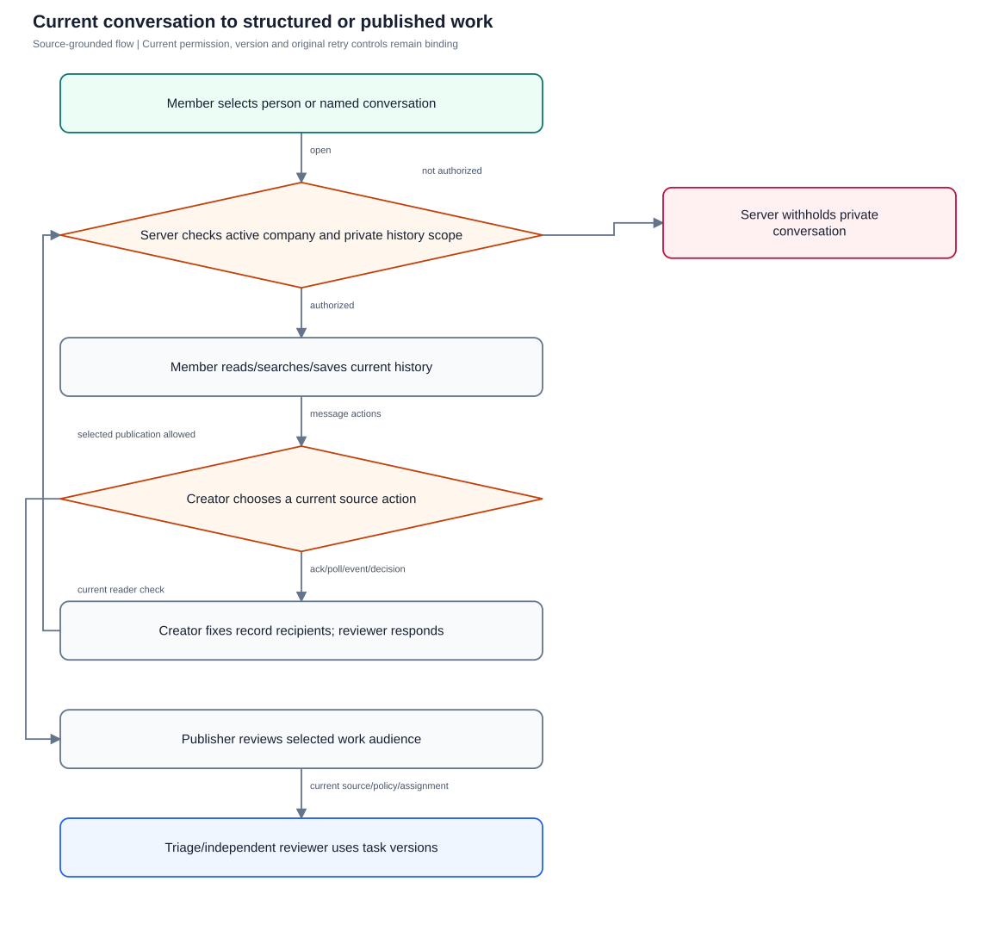
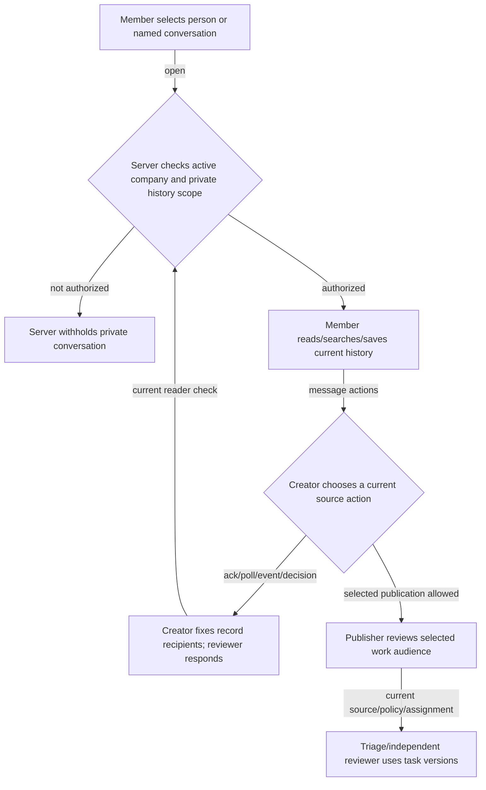

# Connect conversations and work controls

Exercise person-based conversations, current history, daily controls and selected structured/work flows without widening private access.

**Entry:** Web: Connect list, conversation, Message actions, Conversation details, Find messages, Saved messages, Published work; API: company-qualified conversation/history/records/work-actions/intake routes

**Actors:** Owner A: conversation owner and company member in fictional QA Alpha; Member B: company member and selected recipient in QA Alpha; Reviewer R: independent reviewer in QA Alpha; Alpha leader: company administrator outside the private conversation in QA Alpha; Outsider O: member only in fictional QA Beta; Platform operator: platform operator without private conversation membership

## Main flow

1. Member selects a person or named group/channel; server resolves current company and private membership.
2. Member reads ordered history, searches, replies and saves under the current history interval.
3. Creator chooses exact source revisions and fixed record recipients or explicitly publishes reviewed work.
4. Independent reviewer or authorized triage actor decides within existing versioned business controls.

[Editable Mermaid](../diagrams/CONNECT.mmd)

## Controls and limits

- No implemented typing/presence UI was found in the inspected Connect/native sources; no presence case is invented. Read position is a per-user cursor, not a per-person seen receipt.
- Only implemented dm, group and channel kinds are covered; company-readable retained history applies to public company channels.
- Advanced split declarations and selected exports are web/API flows; native parity is not asserted.
- Search uses PostgreSQL full text or escaped SQLite substring matching; use unambiguous single-word fictional terms rather than demand identical ranking.

## Proposed manual scenarios

All start **NOT_RUN**. Missing prerequisite = BLOCKED.

### CONNECT-001: Open and reuse a DM from a person without naming it

**P0 · LOCAL · Web, API**

**Actors:**

- Owner A: conversation owner and company member in fictional QA Alpha
- Member B: company member and selected recipient in QA Alpha
- Reviewer R: independent reviewer in QA Alpha
- Alpha leader: company administrator outside the private conversation in QA Alpha
- Outsider O: member only in fictional QA Beta
- Platform operator: platform operator without private conversation membership

**Preconditions:**

- Use a newly provisioned isolated QA server and fictional accounts; never the running workspace or historical native fixture.
- Record sanitized observations only: no tokens, private prose, raw sensitive screenshots, provider secrets or real company/user identifiers.
- This is a proposed manual scenario with status NOT_RUN. Missing required configuration/build/device/deployment is BLOCKED; automated references are not manual passes.

**Test data:**

- Use authored fictional QA text and newly issued fixture IDs; never paste real conversations or credentials.

| Step | Action | Expected result |
| --- | --- | --- |
| 1 | Owner A opens Connect → Message a person, searches Member B and selects his row without entering a title. | Person selection opens a DM; no Conversation name field or required title blocks creation. |
| 2 | Leave the chat and repeat the same person selection; Member B independently selects Owner A. | Both selections resolve the original conversation and history; no duplicate pair appears. |
| 3 | Using the isolated API fixture, repeat the nameless DM request after placing that DM beyond the currently loaded list page. | The server returns the existing conversation ID even if its row was absent from the loaded list page. |
| 4 | Inspect the authorized conversation metadata from each participant and try the same private detail as Alpha leader. | Each participant sees the other as peerId; no pair key is exposed; Alpha leader receives no private metadata. |

**Cleanup:** Close fixture dialogs, discard unsent QA input and remove or archive only the owned disposable fixture through authorized controls; revoke fixture sessions when finished.

[Scenario flow](../diagrams/CONNECT-001.svg) · [Editable source](../diagrams/CONNECT-001.mmd)

**Source:** [frontend/src/communication/NewConversation.tsx](../../../frontend/src/communication/NewConversation.tsx), [backend/platform/conversations.go](../../../backend/platform/conversations.go), [docs/CONNECT_UX.md](../../../docs/CONNECT_UX.md)

**Supporting automation:** [frontend/src/communication/ConnectUX.test.tsx](../../../frontend/src/communication/ConnectUX.test.tsx), [backend/platform/communication_dm_ux_test.go](../../../backend/platform/communication_dm_ux_test.go)

### CONNECT-002: Named groups and company channel scope

**P1 · LOCAL · Web, API**

**Actors:**

- Owner A: conversation owner and company member in fictional QA Alpha
- Member B: company member and selected recipient in QA Alpha
- Reviewer R: independent reviewer in QA Alpha
- Alpha leader: company administrator outside the private conversation in QA Alpha
- Outsider O: member only in fictional QA Beta
- Platform operator: platform operator without private conversation membership

**Preconditions:**

- Use a newly provisioned isolated QA server and fictional accounts; never the running workspace or historical native fixture.
- Record sanitized observations only: no tokens, private prose, raw sensitive screenshots, provider secrets or real company/user identifiers.
- This is a proposed manual scenario with status NOT_RUN. Missing required configuration/build/device/deployment is BLOCKED; automated references are not manual passes.

**Test data:**

- Use authored fictional QA text and newly issued fixture IDs; never paste real conversations or credentials.

| Step | Action | Expected result |
| --- | --- | --- |
| 1 | Open New conversation → Private group, choose Member B, leave Conversation name blank and attempt creation. | A named group cannot be created with an empty name. |
| 2 | Name the fixture group and create it; open the new Channel form separately. | Group creation succeeds only with a name; Channel offers its own company-readability checkbox. |
| 3 | Create a named channel with Company channel selected; sign in as an active QA Alpha reader outside its selected roster. | The active same-company reader can read retained public-channel history; the private group remains participant-scoped. |
| 4 | Sign in as Outsider O and request the QA Alpha channel detail. | Juniper-only membership confers no QA Alpha channel access. |

**Cleanup:** Close fixture dialogs, discard unsent QA input and remove or archive only the owned disposable fixture through authorized controls; revoke fixture sessions when finished.

[Scenario flow](../diagrams/CONNECT-002.svg) · [Editable source](../diagrams/CONNECT-002.mmd)

**Source:** [frontend/src/communication/NewConversation.tsx](../../../frontend/src/communication/NewConversation.tsx), [backend/platform/conversations.go](../../../backend/platform/conversations.go), [backend/platform/communication_access.go](../../../backend/platform/communication_access.go)

**Supporting automation:** [backend/platform/communication_access_test.go](../../../backend/platform/communication_access_test.go)

### CONNECT-003: Latest history, older pages and reconnect deduplication

**P1 · LOCAL · Web, API**

**Actors:**

- Owner A: conversation owner and company member in fictional QA Alpha
- Member B: company member and selected recipient in QA Alpha
- Reviewer R: independent reviewer in QA Alpha
- Alpha leader: company administrator outside the private conversation in QA Alpha
- Outsider O: member only in fictional QA Beta
- Platform operator: platform operator without private conversation membership

**Preconditions:**

- Use a newly provisioned isolated QA server and fictional accounts; never the running workspace or historical native fixture.
- Record sanitized observations only: no tokens, private prose, raw sensitive screenshots, provider secrets or real company/user identifiers.
- This is a proposed manual scenario with status NOT_RUN. Missing required configuration/build/device/deployment is BLOCKED; automated references are not manual passes.
- Provision more than 100 small fictional messages in the disposable fixture; network interruption belongs only to that fixture.

**Test data:**

- Use authored fictional QA text and newly issued fixture IDs; never paste real conversations or credentials.

| Step | Action | Expected result |
| --- | --- | --- |
| 1 | Open a fictional conversation with more than 100 ordered QA messages; note the newest visible message and use Load older messages. | Initial history is the newest authorized page; older loading adds earlier rows in ascending message order. |
| 2 | While Member B sends another QA message, reconnect Owner A’s isolated browser network/socket and reopen history. | The new message appears once despite reconnect/event overlap; no duplicate IDs or gaps in fetched pages appear. |
| 3 | Member B edits one loaded message and removes another; wait for synchronization or refresh current history. | The higher revision replaces old text; removal yields a scrubbed/tombstoned row rather than stale content. |
| 4 | Scroll through the merged range and open a target from search. | Target navigation resolves current authorized content; event sequence is never treated as a message sequence. |

**Cleanup:** Close fixture dialogs, discard unsent QA input and remove or archive only the owned disposable fixture through authorized controls; revoke fixture sessions when finished.

[Scenario flow](../diagrams/CONNECT-003.svg) · [Editable source](../diagrams/CONNECT-003.mmd)

**Source:** [backend/platform/communication_sync.go](../../../backend/platform/communication_sync.go), [shared/communication/history.ts](../../../shared/communication/history.ts), [frontend/src/communication/Connect.tsx](../../../frontend/src/communication/Connect.tsx)

**Supporting automation:** [backend/platform/communication_remaining_test.go](../../../backend/platform/communication_remaining_test.go), [backend/platform/messages_test.go](../../../backend/platform/messages_test.go), [frontend/src/communication/history.test.ts](../../../frontend/src/communication/history.test.ts)

### CONNECT-004: Visible-bottom read position and actual unread filtering

**P1 · LOCAL · Web, API**

**Actors:**

- Owner A: conversation owner and company member in fictional QA Alpha
- Member B: company member and selected recipient in QA Alpha
- Reviewer R: independent reviewer in QA Alpha
- Alpha leader: company administrator outside the private conversation in QA Alpha
- Outsider O: member only in fictional QA Beta
- Platform operator: platform operator without private conversation membership

**Preconditions:**

- Use a newly provisioned isolated QA server and fictional accounts; never the running workspace or historical native fixture.
- Record sanitized observations only: no tokens, private prose, raw sensitive screenshots, provider secrets or real company/user identifiers.
- This is a proposed manual scenario with status NOT_RUN. Missing required configuration/build/device/deployment is BLOCKED; automated references are not manual passes.

**Test data:**

- Use authored fictional QA text and newly issued fixture IDs; never paste real conversations or credentials.

| Step | Action | Expected result |
| --- | --- | --- |
| 1 | Have Member B send two fixture messages while Owner A is in another conversation; Owner A opens the Unread list filter. | Unread counts derive from current unread messages and include this chat. |
| 2 | Owner A opens the chat and scrolls to the current bottom, then revisits the list. | Viewing the current bottom advances the read cursor and refreshes attention; the count decreases accordingly. |
| 3 | Scroll above the bottom, have Member B send a further message, then select the new-messages control. | The new message can be reached deliberately; acknowledging the new bottom advances to the visible order. |
| 4 | Replay an earlier valid read sequence via the fixture API, then attempt a sequence beyond the current last message. | Earlier reads do not move the cursor backward; out-of-range positions are rejected. No presence or delivery-to-every-device claim follows. |

**Cleanup:** Close fixture dialogs, discard unsent QA input and remove or archive only the owned disposable fixture through authorized controls; revoke fixture sessions when finished.

[Scenario flow](../diagrams/CONNECT-004.svg) · [Editable source](../diagrams/CONNECT-004.mmd)

**Source:** [frontend/src/communication/Connect.tsx](../../../frontend/src/communication/Connect.tsx), [backend/platform/communication_daily.go](../../../backend/platform/communication_daily.go), [backend/platform/communication_controls.go](../../../backend/platform/communication_controls.go)

**Supporting automation:** [frontend/src/communication/ConnectUX.test.tsx](../../../frontend/src/communication/ConnectUX.test.tsx), [mobile/src/NativeConversation.test.tsx](../../../mobile/src/NativeConversation.test.tsx)

### CONNECT-005: Private join-forward and rejoin history intervals

**P0 · LOCAL · Web, API**

**Actors:**

- Owner A: conversation owner and company member in fictional QA Alpha
- Member B: company member and selected recipient in QA Alpha
- Reviewer R: independent reviewer in QA Alpha
- Alpha leader: company administrator outside the private conversation in QA Alpha
- Outsider O: member only in fictional QA Beta
- Platform operator: platform operator without private conversation membership

**Preconditions:**

- Use a newly provisioned isolated QA server and fictional accounts; never the running workspace or historical native fixture.
- Record sanitized observations only: no tokens, private prose, raw sensitive screenshots, provider secrets or real company/user identifiers.
- This is a proposed manual scenario with status NOT_RUN. Missing required configuration/build/device/deployment is BLOCKED; automated references are not manual passes.

**Test data:**

- Use authored fictional QA text and newly issued fixture IDs; never paste real conversations or credentials.

| Step | Action | Expected result |
| --- | --- | --- |
| 1 | Owner A creates a private group, sends a pre-invite QA marker, then invites Member B and sends a post-invite marker. | Member B’s private history starts at the newly authorized interval; the pre-invite message is unavailable. |
| 2 | Member B opens history and searches for both markers; save the visible post-invite message and have Owner A pin it. | Only eligible history appears in search; save/pin remain tied to source readability. |
| 3 | Remove Member B, send another marker, then explicitly re-invite Member B and send a new marker. | Removal closes access; re-invite establishes a new history boundary rather than restoring the old interval. |
| 4 | Member B opens history, search, saved messages, pins and the old message thread using remembered fixture links. | Earlier private markers, old saved/pinned rows and old roots stay withheld; only the new eligible interval is visible. |

**Cleanup:** Close fixture dialogs, discard unsent QA input and remove or archive only the owned disposable fixture through authorized controls; revoke fixture sessions when finished.

[Scenario flow](../diagrams/CONNECT-005.svg) · [Editable source](../diagrams/CONNECT-005.mmd)

**Source:** [backend/platform/conversations.go](../../../backend/platform/conversations.go), [backend/platform/communication_access.go](../../../backend/platform/communication_access.go), [backend/platform/communication_daily.go](../../../backend/platform/communication_daily.go), [backend/platform/communication_controls.go](../../../backend/platform/communication_controls.go)

**Supporting automation:** [backend/platform/communication_access_test.go](../../../backend/platform/communication_access_test.go), [backend/platform/communication_daily_test.go](../../../backend/platform/communication_daily_test.go), [backend/platform/communication_daily_controls_test.go](../../../backend/platform/communication_daily_controls_test.go)

### CONNECT-006: Authorized search, private bookmarks, reminders and published briefing

**P1 · LOCAL · Web, API**

**Actors:**

- Owner A: conversation owner and company member in fictional QA Alpha
- Member B: company member and selected recipient in QA Alpha
- Reviewer R: independent reviewer in QA Alpha
- Alpha leader: company administrator outside the private conversation in QA Alpha
- Outsider O: member only in fictional QA Beta
- Platform operator: platform operator without private conversation membership

**Preconditions:**

- Use a newly provisioned isolated QA server and fictional accounts; never the running workspace or historical native fixture.
- Record sanitized observations only: no tokens, private prose, raw sensitive screenshots, provider secrets or real company/user identifiers.
- This is a proposed manual scenario with status NOT_RUN. Missing required configuration/build/device/deployment is BLOCKED; automated references are not manual passes.

**Test data:**

- Use authored fictional QA text and newly issued fixture IDs; never paste real conversations or credentials.

| Step | Action | Expected result |
| --- | --- | --- |
| 1 | In Find messages, search a unique fictional word present in an eligible message and in a different private conversation Owner A cannot read. | Only current readable matches appear; results do not reveal hidden conversation IDs or prose. |
| 2 | From Message actions choose Save privately and Remind me privately with a future device-local instant; open Saved messages. | Owner A sees her saved row and normalized reminder presentation; its Open conversation action uses current access. |
| 3 | Member B opens his own Saved messages; Owner A opens Pinned messages after an authorized moderator pins the eligible message. | Member B does not inherit Owner A’s bookmark/reminder; pins are shared within eligible conversation history. |
| 4 | Choose Published work briefing before and after publishing one authorized QA request/task from selected text. | Briefing reports visible published work counts/age and notice; private unpublished DM text is not harvested. |

**Cleanup:** Close fixture dialogs, discard unsent QA input and remove or archive only the owned disposable fixture through authorized controls; revoke fixture sessions when finished.

[Scenario flow](../diagrams/CONNECT-006.svg) · [Editable source](../diagrams/CONNECT-006.mmd)

**Source:** [frontend/src/communication/DailyTools.tsx](../../../frontend/src/communication/DailyTools.tsx), [backend/platform/communication_daily.go](../../../backend/platform/communication_daily.go), [backend/platform/communication_exports.go](../../../backend/platform/communication_exports.go)

**Supporting automation:** [backend/platform/communication_daily_test.go](../../../backend/platform/communication_daily_test.go), [backend/platform/communication_exports_test.go](../../../backend/platform/communication_exports_test.go)

### CONNECT-007: Contextual thread, mentions, edit and source withdrawal

**P1 · LOCAL · Web, API**

**Actors:**

- Owner A: conversation owner and company member in fictional QA Alpha
- Member B: company member and selected recipient in QA Alpha
- Reviewer R: independent reviewer in QA Alpha
- Alpha leader: company administrator outside the private conversation in QA Alpha
- Outsider O: member only in fictional QA Beta
- Platform operator: platform operator without private conversation membership

**Preconditions:**

- Use a newly provisioned isolated QA server and fictional accounts; never the running workspace or historical native fixture.
- Record sanitized observations only: no tokens, private prose, raw sensitive screenshots, provider secrets or real company/user identifiers.
- This is a proposed manual scenario with status NOT_RUN. Missing required configuration/build/device/deployment is BLOCKED; automated references are not manual passes.

**Test data:**

- Use authored fictional QA text and newly issued fixture IDs; never paste real conversations or credentials.

| Step | Action | Expected result |
| --- | --- | --- |
| 1 | Open Message actions on a current root and choose Open thread; reply with a fictional participant mention. | Reply is bound to the root ID and stays in the same authorized conversation; mention choices are current readers. |
| 2 | Have Owner A as owner send an allowed all-participant mention, then immediately attempt a second through the fixture API; Member B attempts an all-participant mention. | The owner’s first group-wide mention is allowed; a second within five minutes is rate-limited; ordinary member all-mention is denied. |
| 3 | Open actions on Owner A’s own QA message, edit it and retry a stale expectedRevision through the fixture API. | The current edit advances revision; stale revision conflicts and does not overwrite newer content. |
| 4 | Keep a thread/action dialog open while its root is edited or removed by the author; then remove current membership. | Changed source actions are invalidated; removed roots lose usable private content, and confirmed access loss clears the open thread and reply. |

**Cleanup:** Close fixture dialogs, discard unsent QA input and remove or archive only the owned disposable fixture through authorized controls; revoke fixture sessions when finished.

[Scenario flow](../diagrams/CONNECT-007.svg) · [Editable source](../diagrams/CONNECT-007.mmd)

**Source:** [frontend/src/communication/Connect.tsx](../../../frontend/src/communication/Connect.tsx), [backend/platform/communication_controls.go](../../../backend/platform/communication_controls.go), [backend/platform/messages.go](../../../backend/platform/messages.go)

**Supporting automation:** [frontend/src/communication/ConnectPrivacy.test.tsx](../../../frontend/src/communication/ConnectPrivacy.test.tsx), [frontend/src/communication/ConnectUX.test.tsx](../../../frontend/src/communication/ConnectUX.test.tsx), [backend/platform/messages_test.go](../../../backend/platform/messages_test.go), [backend/platform/communication_daily_controls_test.go](../../../backend/platform/communication_daily_controls_test.go)

### CONNECT-008: Fixed recipients and exact revision acknowledgements

**P0 · LOCAL · Web, API**

**Actors:**

- Owner A: conversation owner and company member in fictional QA Alpha
- Member B: company member and selected recipient in QA Alpha
- Reviewer R: independent reviewer in QA Alpha
- Alpha leader: company administrator outside the private conversation in QA Alpha
- Outsider O: member only in fictional QA Beta
- Platform operator: platform operator without private conversation membership

**Preconditions:**

- Use a newly provisioned isolated QA server and fictional accounts; never the running workspace or historical native fixture.
- Record sanitized observations only: no tokens, private prose, raw sensitive screenshots, provider secrets or real company/user identifiers.
- This is a proposed manual scenario with status NOT_RUN. Missing required configuration/build/device/deployment is BLOCKED; automated references are not manual passes.

**Test data:**

- Use authored fictional QA text and newly issued fixture IDs; never paste real conversations or credentials.

| Step | Action | Expected result |
| --- | --- | --- |
| 1 | On a current QA root choose Request acknowledgement / poll / decision → Acknowledgement request; select Member B only and create it. | Creator selects a fixed eligible audience tied to exact readable source revision. |
| 2 | Open Conversation records as Member B and as unselected current reader Reviewer R. | Member B and creator see the eligible record; Reviewer R’s general conversation access does not expose the selected record/responses. |
| 3 | Member B acknowledges the record; Owner A publishes a new record revision with a reason. | Response belongs to that revision; a new revision resets its fixed recipients’ responses. |
| 4 | Attempt Member B’s old expectedRevision response through the fixture API, then review and acknowledge the new revision. | Old revision returns conflict; a freshly reviewed new revision can be acknowledged. No task acceptance or financial approval occurs. |

**Cleanup:** Close fixture dialogs, discard unsent QA input and remove or archive only the owned disposable fixture through authorized controls; revoke fixture sessions when finished.

[Scenario flow](../diagrams/CONNECT-008.svg) · [Editable source](../diagrams/CONNECT-008.mmd)

**Source:** [frontend/src/communication/Structured.tsx](../../../frontend/src/communication/Structured.tsx), [backend/platform/communication_structured.go](../../../backend/platform/communication_structured.go), [backend/platform/communication_record_revisions.go](../../../backend/platform/communication_record_revisions.go)

**Supporting automation:** [backend/platform/communication_structured_test.go](../../../backend/platform/communication_structured_test.go), [backend/platform/communication_remaining_test.go](../../../backend/platform/communication_remaining_test.go), [backend/platform/communication_review_test.go](../../../backend/platform/communication_review_test.go)

### CONNECT-009: Poll and event deadlines preserve the optional instant

**P1 · LOCAL · Web, API**

**Actors:**

- Owner A: conversation owner and company member in fictional QA Alpha
- Member B: company member and selected recipient in QA Alpha
- Reviewer R: independent reviewer in QA Alpha
- Alpha leader: company administrator outside the private conversation in QA Alpha
- Outsider O: member only in fictional QA Beta
- Platform operator: platform operator without private conversation membership

**Preconditions:**

- Use a newly provisioned isolated QA server and fictional accounts; never the running workspace or historical native fixture.
- Record sanitized observations only: no tokens, private prose, raw sensitive screenshots, provider secrets or real company/user identifiers.
- This is a proposed manual scenario with status NOT_RUN. Missing required configuration/build/device/deployment is BLOCKED; automated references are not manual passes.
- Prepare separate future and expired record fixtures through the isolated fixture owner; do not alter the host clock.

**Test data:**

- Use authored fictional QA text and newly issued fixture IDs; never paste real conversations or credentials.

| Step | Action | Expected result |
| --- | --- | --- |
| 1 | Create a Poll with two distinct fictional options and Member B selected; leave Response deadline blank. | Blank stays blank rather than becoming today or an arbitrary timestamp; only selected current readers receive choices. |
| 2 | Create a second Event / RSVP for a future time in the company timezone; inspect the submitted dueAt in a sanitized fixture observation. | Entered wall time is converted to an explicit UTC instant; an ambiguous repeated time requires selecting an offset. |
| 3 | As Member B vote in the poll and select attending/maybe/declined in the RSVP before its deadline. | Only kind-valid choices are accepted and associated with the current record revision. |
| 4 | In a separately provisioned expired-deadline fixture, attempt a response; also try duplicate poll options and a past deadline on creation. | Late responses conflict; invalid options/deadlines reject without creating an accepted record or changing business approvals. |

**Cleanup:** Close fixture dialogs, discard unsent QA input and remove or archive only the owned disposable fixture through authorized controls; revoke fixture sessions when finished.

[Scenario flow](../diagrams/CONNECT-009.svg) · [Editable source](../diagrams/CONNECT-009.mmd)

**Source:** [frontend/src/communication/Structured.tsx](../../../frontend/src/communication/Structured.tsx), [backend/platform/communication_structured.go](../../../backend/platform/communication_structured.go), [frontend/src/data/deadlines.ts](../../../frontend/src/data/deadlines.ts)

**Supporting automation:** [frontend/src/communication/Structured.test.tsx](../../../frontend/src/communication/Structured.test.tsx), [backend/platform/communication_structured_test.go](../../../backend/platform/communication_structured_test.go)

### CONNECT-010: Reviewed decision requires a current independent source reader

**P0 · LOCAL · Web, API**

**Actors:**

- Owner A: conversation owner and company member in fictional QA Alpha
- Member B: company member and selected recipient in QA Alpha
- Reviewer R: independent reviewer in QA Alpha
- Alpha leader: company administrator outside the private conversation in QA Alpha
- Outsider O: member only in fictional QA Beta
- Platform operator: platform operator without private conversation membership

**Preconditions:**

- Use a newly provisioned isolated QA server and fictional accounts; never the running workspace or historical native fixture.
- Record sanitized observations only: no tokens, private prose, raw sensitive screenshots, provider secrets or real company/user identifiers.
- This is a proposed manual scenario with status NOT_RUN. Missing required configuration/build/device/deployment is BLOCKED; automated references are not manual passes.

**Test data:**

- Use authored fictional QA text and newly issued fixture IDs; never paste real conversations or credentials.

| Step | Action | Expected result |
| --- | --- | --- |
| 1 | Create a Reviewed decision from a current root; inspect reviewer choices and attempt creator-as-reviewer via fixture API. | Self review is excluded and rejected server-side; eligibility requires current source access and non-viewer reviewer role. |
| 2 | Select Reviewer R as independent reviewer and publish; Member B, an unselected reader, opens Conversation records. | Reviewer R is the fixed decision recipient; Member B gains no record authority from conversation readership. |
| 3 | Reviewer R confirms or rejects the reviewed decision; inspect the related task and expense state separately. | Decision state records the response only; task acceptance and expense approval/payment remain unchanged. |
| 4 | In a fresh decision, remove Reviewer R or change her source history before she responds or Owner A publishes a new revision. | Response/edit cannot bypass the reviewer’s lost source authority; stale source/version is not silently refreshed into intent. |

**Cleanup:** Close fixture dialogs, discard unsent QA input and remove or archive only the owned disposable fixture through authorized controls; revoke fixture sessions when finished.

[Scenario flow](../diagrams/CONNECT-010.svg) · [Editable source](../diagrams/CONNECT-010.mmd)

**Source:** [frontend/src/communication/Structured.tsx](../../../frontend/src/communication/Structured.tsx), [backend/platform/communication_structured.go](../../../backend/platform/communication_structured.go), [backend/platform/communication_record_revisions.go](../../../backend/platform/communication_record_revisions.go)

**Supporting automation:** [backend/platform/communication_structured_test.go](../../../backend/platform/communication_structured_test.go), [backend/platform/communication_review_test.go](../../../backend/platform/communication_review_test.go)

### CONNECT-011: Explicit work bundles preserve primary versus split identities

**P1 · LOCAL · Web, API**

**Actors:**

- Owner A: conversation owner and company member in fictional QA Alpha
- Member B: company member and selected recipient in QA Alpha
- Reviewer R: independent reviewer in QA Alpha
- Alpha leader: company administrator outside the private conversation in QA Alpha
- Outsider O: member only in fictional QA Beta
- Platform operator: platform operator without private conversation membership

**Preconditions:**

- Use a newly provisioned isolated QA server and fictional accounts; never the running workspace or historical native fixture.
- Record sanitized observations only: no tokens, private prose, raw sensitive screenshots, provider secrets or real company/user identifiers.
- This is a proposed manual scenario with status NOT_RUN. Missing required configuration/build/device/deployment is BLOCKED; automated references are not manual passes.

**Test data:**

- Use authored fictional QA text and newly issued fixture IDs; never paste real conversations or credentials.

| Step | Action | Expected result |
| --- | --- | --- |
| 1 | With selected publication enabled open Publish request / expense draft, enter two fictional explicit action titles and use Declare separate work actions. | The server creates 2–20 explicit split action IDs; declarations do not assign or approve work. |
| 2 | Open Create task on that root and choose each returned action from Instruction action; preview each current audience and publish authorized work. | Each selected split uses its own server action identity, eligible source revision and business publication controls. |
| 3 | Repeat the exact work-actions request using its original key, then change a title under the same key. | Exact retry returns the same ordered IDs; changed payload conflicts rather than adding another bundle. |
| 4 | Preview/commit the primary instruction once with source A and again with A plus eligible contextual source B via the fixture API. | The primary claim reuses the existing primary task across A versus A+B; contextual sources do not manufacture another instruction. |

**Cleanup:** Close fixture dialogs, discard unsent QA input and remove or archive only the owned disposable fixture through authorized controls; revoke fixture sessions when finished.

[Scenario flow](../diagrams/CONNECT-011.svg) · [Editable source](../diagrams/CONNECT-011.mmd)

**Source:** [frontend/src/communication/WorkflowTools.tsx](../../../frontend/src/communication/WorkflowTools.tsx), [frontend/src/components/MessageTaskConversion.tsx](../../../frontend/src/components/MessageTaskConversion.tsx), [backend/platform/communication_bundles.go](../../../backend/platform/communication_bundles.go), [backend/platform/communication_conversion.go](../../../backend/platform/communication_conversion.go)

**Supporting automation:** [backend/platform/communication_conversion_test.go](../../../backend/platform/communication_conversion_test.go)

### CONNECT-012: Intake triage uses versions and independent task review

**P1 · LOCAL · Web, API**

**Actors:**

- Owner A: conversation owner and company member in fictional QA Alpha
- Member B: company member and selected recipient in QA Alpha
- Reviewer R: independent reviewer in QA Alpha
- Alpha leader: company administrator outside the private conversation in QA Alpha
- Outsider O: member only in fictional QA Beta
- Platform operator: platform operator without private conversation membership

**Preconditions:**

- Use a newly provisioned isolated QA server and fictional accounts; never the running workspace or historical native fixture.
- Record sanitized observations only: no tokens, private prose, raw sensitive screenshots, provider secrets or real company/user identifiers.
- This is a proposed manual scenario with status NOT_RUN. Missing required configuration/build/device/deployment is BLOCKED; automated references are not manual passes.

**Test data:**

- Use authored fictional QA text and newly issued fixture IDs; never paste real conversations or credentials.

| Step | Action | Expected result |
| --- | --- | --- |
| 1 | Publish an Operational intake request from a selected root after Preview audience and explicit audience acknowledgement. | Only the reviewed title/summary become independently visible work; publication itself does not grant private source access. |
| 2 | As authorized department triage actor open Published work, choose an owner, an Independent reviewer and a due date, then Assign. | Assignment runs through the existing task engine; owner/reviewer separation and due-date rules still apply. |
| 3 | With two triage views of the same version, act in one view and attempt assignment/close/reject from the stale view; provide a reason where requested. | The stale expectedVersion conflicts and requires fresh inspection; retries do not create a second primary task. |
| 4 | Inspect the resulting task and intake as an actor without private conversation access. | Authorized work remains readable but private source links/provenance disclose no hidden IDs/counts or original private prose. |

**Cleanup:** Close fixture dialogs, discard unsent QA input and remove or archive only the owned disposable fixture through authorized controls; revoke fixture sessions when finished.

[Scenario flow](../diagrams/CONNECT-012.svg) · [Editable source](../diagrams/CONNECT-012.mmd)

**Source:** [frontend/src/communication/WorkflowTools.tsx](../../../frontend/src/communication/WorkflowTools.tsx), [backend/platform/communication_requests.go](../../../backend/platform/communication_requests.go), [backend/platform/communication_conversion.go](../../../backend/platform/communication_conversion.go)

**Supporting automation:** [backend/platform/communication_finance_test.go](../../../backend/platform/communication_finance_test.go), [backend/platform/communication_conversion_test.go](../../../backend/platform/communication_conversion_test.go)
