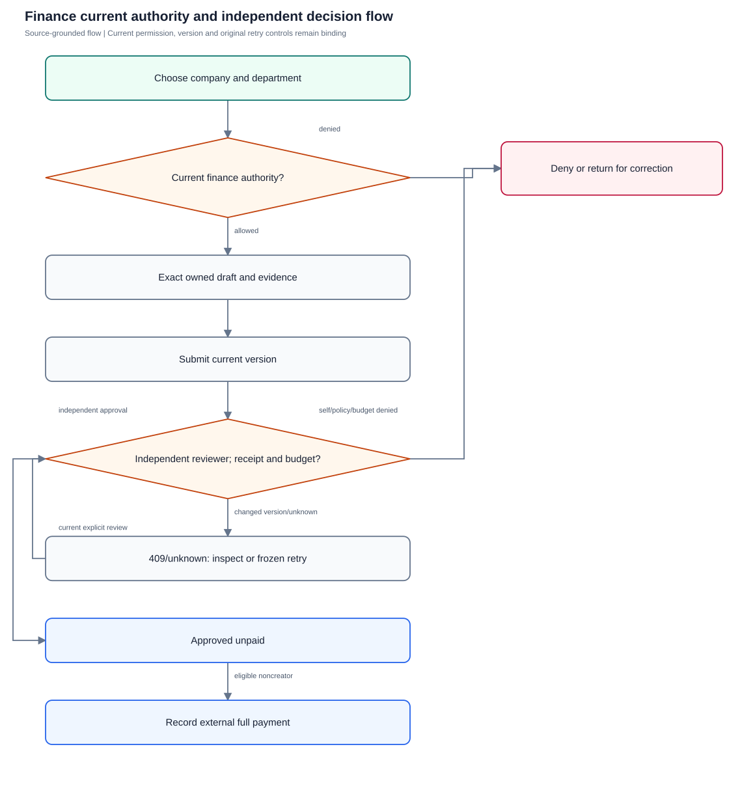
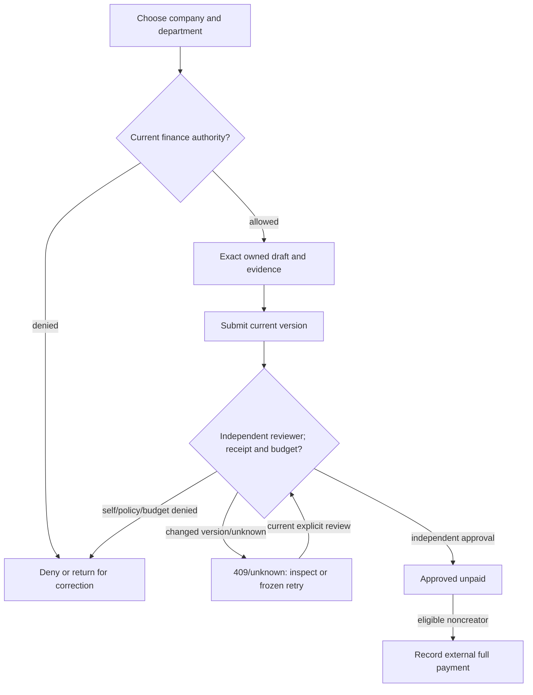

# Finance and reviewed assistance

Validate exact departmental budgets, independent expense decisions and optional private assistance without payment automation.

**Entry:** Web Finance and Settings → Company; Company-relative /budgets, /expense-categories, /expenses, /expense-receipts; Company-relative /finance/intakes, /receipt-extractions, /statement-previews, /statement-imports, /reconciliation

**Actors:** platform admin: operator without company membership; company leadership: QA Alpha founder; owner: QA Alpha expense/task creator; independent reviewer: QA Alpha department head distinct from owner; department member: QA Alpha Engineering member; finance: QA Alpha finance role distinct from owner; outsider: QA Beta member only

## Main flow

1. Select company/department and exact money
2. Save owned draft and append evidence
3. Submit under current category policy
4. Independent reviewer inspects current version, receipt and budget
5. Record external full payment through eligible noncreator
6. Optional clean-source extraction/import needs explicit inspected publication

[Editable Mermaid](../diagrams/FINANCE.mmd)

## Controls and limits

- Every scenario is proposed NOT_RUN; missing provider/scanner/storage prerequisites are BLOCKED, never PASS.
- Current API/code supports reviewed statement imports and full-paid-debit associations/audited unmatch; older FINANCE_GUIDE excludes reconciliation in baseline wording.
- Association unmatch reverses association only; no bank transfer, partial payment, refund, paid-economic reversal or general ledger.
- Physical camera/keyboard/accessibility and native PostgreSQL concurrency require independent qualification.

## Proposed manual scenarios

All start **NOT_RUN**. Missing prerequisite = BLOCKED.

### FINANCE-001: Exact budget, independent expense approval and recorded payment

**P0 · LOCAL · Web, API**

**Actors:**

- platform admin: operator without company membership
- company leadership: QA Alpha founder
- owner: QA Alpha expense/task creator
- independent reviewer: QA Alpha department head distinct from owner
- department member: QA Alpha Engineering member
- finance: QA Alpha finance role distinct from owner
- outsider: QA Beta member only

**Preconditions:**

- Provision a disposable isolated server/API fixture with fictional QA Alpha (INR, Asia/Kolkata, April financial year) and unrelated QA Beta; use separate actor sessions and a controlled 2026-10-12 clock.
- Never mutate the running workspace, restore historical native fixtures or reuse consumed capabilities. Browser demo does not establish backend authorization acceptance.

**Test data:**

- Active Engineering October envelope 2026-10-01–2026-10-31: amountMinor 1000000.
- Expense QA parts: QA Alpha Supplies, invoice QA-F-101, incurred 2026-10-10, amountMinor 123456; payment reference QA-BANK-101.

| Step | Action | Expected result |
| --- | --- | --- |
| 1 | Finance creates envelope; owner saves draft and attaches fictional permitted receipt. | Allocation is INR 10000.00, draft INR 1234.56; draft consumes no budget. |
| 2 | Owner submits; independent reviewer inspects current version, receipt and budget then approves. | Pending exposure becomes approved-unpaid 123456; used 123456, available 876544. |
| 3 | Finance records external full payment dated 2026-10-12 with bank_transfer/reference. | Paid 123456 replaces approved-unpaid; used and availability do not change. App initiates no transfer. |

**Cleanup:** Record sanitized observations without real IDs, credentials, private prose or prompts. Close QA sessions and remove owned temporary downloads; reset/dispose only this isolated fixture through its approved lifecycle, retaining audit history until disposal.

[Scenario flow](../diagrams/FINANCE-001.svg) · [Editable source](../diagrams/FINANCE-001.mmd)

**Source:** [docs/API_CONTRACT.md](../../../docs/API_CONTRACT.md), [docs/FINANCE_GUIDE.md](../../../docs/FINANCE_GUIDE.md), [docs/SECURITY_AND_LIMITATIONS.md](../../../docs/SECURITY_AND_LIMITATIONS.md), [backend/platform/finance_mutations.go](../../../backend/platform/finance_mutations.go)

**Supporting automation:** [backend/platform/finance_test.go](../../../backend/platform/finance_test.go)

### FINANCE-002: Exact minor-unit parsing and invalid monetary inputs

**P0 · LOCAL · Web, API**

**Actors:**

- platform admin: operator without company membership
- company leadership: QA Alpha founder
- owner: QA Alpha expense/task creator
- independent reviewer: QA Alpha department head distinct from owner
- department member: QA Alpha Engineering member
- finance: QA Alpha finance role distinct from owner
- outsider: QA Beta member only

**Preconditions:**

- Provision a disposable isolated server/API fixture with fictional QA Alpha (INR, Asia/Kolkata, April financial year) and unrelated QA Beta; use separate actor sessions and a controlled 2026-10-12 clock.
- Never mutate the running workspace, restore historical native fixtures or reuse consumed capabilities. Browser demo does not establish backend authorization acceptance.

**Test data:**

- Valid text: 0.01→1, 1.2→120, 1234.56→123456, 10000000000.00→1000000000000.
- Invalid text: 1.001,1e3,NaN,1,000,.5,10000000000.01; API invalid expense amountMinor:1234.56,0,-1.

| Step | Action | Expected result |
| --- | --- | --- |
| 1 | Enter valid text in amount control and inspect request/readback. | Every value becomes the exact integer minor units; no binary floating rounding. |
| 2 | Attempt invalid text and direct invalid API expense bodies. | Overprecision/grouping/exponent/overflow are not silently coerced; API rejects noninteger/nonpositive economics. |
| 3 | Export valid expenses and compare maximum/one-cent values against readback. | Exact company currency values remain consistent; no inferred tax or exchange conversion. |

**Cleanup:** Record sanitized observations without real IDs, credentials, private prose or prompts. Close QA sessions and remove owned temporary downloads; reset/dispose only this isolated fixture through its approved lifecycle, retaining audit history until disposal.

[Scenario flow](../diagrams/FINANCE-002.svg) · [Editable source](../diagrams/FINANCE-002.mmd)

**Source:** [docs/API_CONTRACT.md](../../../docs/API_CONTRACT.md), [docs/FINANCE_GUIDE.md](../../../docs/FINANCE_GUIDE.md), [docs/SECURITY_AND_LIMITATIONS.md](../../../docs/SECURITY_AND_LIMITATIONS.md), [backend/platform/finance_money.go](../../../backend/platform/finance_money.go), [frontend/src/data/finance.ts](../../../frontend/src/data/finance.ts)

**Supporting automation:** [backend/platform/finance_money_test.go](../../../backend/platform/finance_money_test.go), [frontend/src/data/finance.test.ts](../../../frontend/src/data/finance.test.ts)

### FINANCE-003: Financial visibility does not grant administration or private work

**P0 · LOCAL · Web, API**

**Actors:**

- platform admin: operator without company membership
- company leadership: QA Alpha founder
- owner: QA Alpha expense/task creator
- independent reviewer: QA Alpha department head distinct from owner
- department member: QA Alpha Engineering member
- finance: QA Alpha finance role distinct from owner
- outsider: QA Beta member only

**Preconditions:**

- Provision a disposable isolated server/API fixture with fictional QA Alpha (INR, Asia/Kolkata, April financial year) and unrelated QA Beta; use separate actor sessions and a controlled 2026-10-12 clock.
- Never mutate the running workspace, restore historical native fixtures or reuse consumed capabilities. Browser demo does not establish backend authorization acceptance.

**Test data:**

- Engineering owner/peer expenses, Operations peer expense and head's own former Operations expense.
- One readable financial expense references a task private from finance.

| Step | Action | Expected result |
| --- | --- | --- |
| 1 | Read finance as finance, Engineering head, member and separately provisioned viewer. | Finance has company scope; head current department plus own historical expenses; member own expenses without balances; viewer no finance. |
| 2 | As finance read linked expense, private task and membership-edit route. | Hidden work IDs/prose are omitted and task access/membership administration remain denied. |
| 3 | Read as operator without QA Alpha membership/outsider; transfer head to Operations and refresh. | No operator/company bypass; current Operations balance is complete, older own expenses remain personal without partial Engineering departmental totals. |

**Cleanup:** Record sanitized observations without real IDs, credentials, private prose or prompts. Close QA sessions and remove owned temporary downloads; reset/dispose only this isolated fixture through its approved lifecycle, retaining audit history until disposal.

[Scenario flow](../diagrams/FINANCE-003.svg) · [Editable source](../diagrams/FINANCE-003.mmd)

**Source:** [docs/API_CONTRACT.md](../../../docs/API_CONTRACT.md), [docs/FINANCE_GUIDE.md](../../../docs/FINANCE_GUIDE.md), [docs/SECURITY_AND_LIMITATIONS.md](../../../docs/SECURITY_AND_LIMITATIONS.md), [backend/platform/finance_workspace.go](../../../backend/platform/finance_workspace.go), [backend/platform/finance.go](../../../backend/platform/finance.go)

**Supporting automation:** [backend/platform/finance_test.go](../../../backend/platform/finance_test.go)

### FINANCE-004: Cross-company references and creator changes fail

**P0 · LOCAL · Web, API**

**Actors:**

- platform admin: operator without company membership
- company leadership: QA Alpha founder
- owner: QA Alpha expense/task creator
- independent reviewer: QA Alpha department head distinct from owner
- department member: QA Alpha Engineering member
- finance: QA Alpha finance role distinct from owner
- outsider: QA Beta member only

**Preconditions:**

- Provision a disposable isolated server/API fixture with fictional QA Alpha (INR, Asia/Kolkata, April financial year) and unrelated QA Beta; use separate actor sessions and a controlled 2026-10-12 clock.
- Never mutate the running workspace, restore historical native fixtures or reuse consumed capabilities. Browser demo does not establish backend authorization acceptance.

**Test data:**

- QA-F-104 valid QA Alpha draft; QA Beta category/department/task/project IDs exist only inside fictional fixture.
- QA Alpha private task in another department provides inconsistent link control.

| Step | Action | Expected result |
| --- | --- | --- |
| 1 | Create drafts with each QA Beta reference or mismatched QA Alpha work/department. | Cross-company/inconsistent references are rejected without partial financial records. |
| 2 | Patch createdBy/companyId or edit valid owner draft as another finance reader. | Ownership is immutable; broad financial read authority does not grant another creator's economic edit. |
| 3 | Switch to QA Beta and request QA Alpha detail/receipts/history. | No QA Alpha economics, identifiers or receipt bytes are disclosed. |

**Cleanup:** Record sanitized observations without real IDs, credentials, private prose or prompts. Close QA sessions and remove owned temporary downloads; reset/dispose only this isolated fixture through its approved lifecycle, retaining audit history until disposal.

[Scenario flow](../diagrams/FINANCE-004.svg) · [Editable source](../diagrams/FINANCE-004.mmd)

**Source:** [docs/API_CONTRACT.md](../../../docs/API_CONTRACT.md), [docs/FINANCE_GUIDE.md](../../../docs/FINANCE_GUIDE.md), [docs/SECURITY_AND_LIMITATIONS.md](../../../docs/SECURITY_AND_LIMITATIONS.md), [backend/platform/finance_mutations.go](../../../backend/platform/finance_mutations.go), [backend/platform/finance_receipts.go](../../../backend/platform/finance_receipts.go)

**Supporting automation:** [backend/platform/finance_test.go](../../../backend/platform/finance_test.go)

### FINANCE-005: Budget boundaries and fiscal settings stay controlled

**P1 · LOCAL · Web, API**

**Actors:**

- platform admin: operator without company membership
- company leadership: QA Alpha founder
- owner: QA Alpha expense/task creator
- independent reviewer: QA Alpha department head distinct from owner
- department member: QA Alpha Engineering member
- finance: QA Alpha finance role distinct from owner
- outsider: QA Beta member only

**Preconditions:**

- Provision a disposable isolated server/API fixture with fictional QA Alpha (INR, Asia/Kolkata, April financial year) and unrelated QA Beta; use separate actor sessions and a controlled 2026-10-12 clock.
- Never mutate the running workspace, restore historical native fixtures or reuse consumed capabilities. Browser demo does not establish backend authorization acceptance.

**Test data:**

- Engineering October envelope 2026-10-01–2026-10-31 amountMinor1000000.
- Overlap 2026-10-31–2026-11-15; cross-year 2027-03-31–2027-04-01; reason: Reviewed allocation reduction despite retained commitments.

| Step | Action | Expected result |
| --- | --- | --- |
| 1 | Create draft October and attempt overlapping/cross-fiscal-year envelopes. | Inclusive overlaps fail for draft/active/closed envelopes; one envelope cannot cross fiscal year. |
| 2 | Activate, attempt department/date edit, close and retry boundary edits. | Activated boundaries remain frozen after closure; closing preserves prior obligations. |
| 3 | Reduce below approved spend with meaningful reason; attempt currency/fiscal-month edits after finance record. | Permitted reasoned reduction retains negative availability/audit; company economics settings are locked. |

**Cleanup:** Record sanitized observations without real IDs, credentials, private prose or prompts. Close QA sessions and remove owned temporary downloads; reset/dispose only this isolated fixture through its approved lifecycle, retaining audit history until disposal.

[Scenario flow](../diagrams/FINANCE-005.svg) · [Editable source](../diagrams/FINANCE-005.mmd)

**Source:** [docs/API_CONTRACT.md](../../../docs/API_CONTRACT.md), [docs/FINANCE_GUIDE.md](../../../docs/FINANCE_GUIDE.md), [docs/SECURITY_AND_LIMITATIONS.md](../../../docs/SECURITY_AND_LIMITATIONS.md), [backend/platform/finance.go](../../../backend/platform/finance.go)

**Supporting automation:** [backend/platform/finance_test.go](../../../backend/platform/finance_test.go)

### FINANCE-006: Missing receipt exception and changed category policy need independent review

**P0 · LOCAL · Web, API**

**Actors:**

- platform admin: operator without company membership
- company leadership: QA Alpha founder
- owner: QA Alpha expense/task creator
- independent reviewer: QA Alpha department head distinct from owner
- department member: QA Alpha Engineering member
- finance: QA Alpha finance role distinct from owner
- outsider: QA Beta member only

**Preconditions:**

- Provision a disposable isolated server/API fixture with fictional QA Alpha (INR, Asia/Kolkata, April financial year) and unrelated QA Beta; use separate actor sessions and a controlled 2026-10-12 clock.
- Never mutate the running workspace, restore historical native fixtures or reuse consumed capabilities. Browser demo does not establish backend authorization acceptance.

**Test data:**

- QA-F-106 amountMinor120000; exception: Original supplier invoice was lost in transit.
- Approval note: I independently verified the replacement supplier statement; short Unicode control: 四五六七.

| Step | Action | Expected result |
| --- | --- | --- |
| 1 | Submit required-receipt draft without evidence, then attempt short exception and valid explanation. | Missing evidence blocks submission; Unicode character length applies; meaningful explanation permits submission. |
| 2 | Reviewer approves without note, then explicitly enters independent acceptance note. | Exception approval requires note; recorded explanation and reviewer note remain distinct. |
| 3 | Submit second expense when receipt policy off, turn policy on before approval and attempt approval. | Approval rechecks current policy and rejects missing evidence/exception. |

**Cleanup:** Record sanitized observations without real IDs, credentials, private prose or prompts. Close QA sessions and remove owned temporary downloads; reset/dispose only this isolated fixture through its approved lifecycle, retaining audit history until disposal.

[Scenario flow](../diagrams/FINANCE-006.svg) · [Editable source](../diagrams/FINANCE-006.mmd)

**Source:** [docs/API_CONTRACT.md](../../../docs/API_CONTRACT.md), [docs/FINANCE_GUIDE.md](../../../docs/FINANCE_GUIDE.md), [docs/SECURITY_AND_LIMITATIONS.md](../../../docs/SECURITY_AND_LIMITATIONS.md), [backend/platform/finance_mutations.go](../../../backend/platform/finance_mutations.go)

**Supporting automation:** [backend/platform/finance_test.go](../../../backend/platform/finance_test.go)

### FINANCE-007: Receipt append changes inspected version and blocks stale decision

**P0 · LOCAL · Web, API**

**Actors:**

- platform admin: operator without company membership
- company leadership: QA Alpha founder
- owner: QA Alpha expense/task creator
- independent reviewer: QA Alpha department head distinct from owner
- department member: QA Alpha Engineering member
- finance: QA Alpha finance role distinct from owner
- outsider: QA Beta member only

**Preconditions:**

- Provision a disposable isolated server/API fixture with fictional QA Alpha (INR, Asia/Kolkata, April financial year) and unrelated QA Beta; use separate actor sessions and a controlled 2026-10-12 clock.
- Never mutate the running workspace, restore historical native fixtures or reuse consumed capabilities. Browser demo does not establish backend authorization acceptance.

**Test data:**

- QA-F-107 submitted version N; reviewer already viewing it.
- Owner appends fictional replacement supplier receipt after review opens.

| Step | Action | Expected result |
| --- | --- | --- |
| 1 | Reviewer retains intended approval; owner appends evidence. | Append-only receipt is retained and expense increments to N+1. |
| 2 | Submit approval with N and refresh selected detail. | 409 prevents stale acceptance; new evidence hides during current recheck and must be inspected. |
| 3 | Reviewer reconciles evidence/budget deliberately and approves current version. | Only new reviewed decision succeeds; no automatic latest-version replay. |

**Cleanup:** Record sanitized observations without real IDs, credentials, private prose or prompts. Close QA sessions and remove owned temporary downloads; reset/dispose only this isolated fixture through its approved lifecycle, retaining audit history until disposal.

[Scenario flow](../diagrams/FINANCE-007.svg) · [Editable source](../diagrams/FINANCE-007.mmd)

**Source:** [docs/API_CONTRACT.md](../../../docs/API_CONTRACT.md), [docs/FINANCE_GUIDE.md](../../../docs/FINANCE_GUIDE.md), [docs/SECURITY_AND_LIMITATIONS.md](../../../docs/SECURITY_AND_LIMITATIONS.md), [backend/platform/finance_receipts.go](../../../backend/platform/finance_receipts.go), [frontend/src/pages/Finance.tsx](../../../frontend/src/pages/Finance.tsx)

**Supporting automation:** [backend/platform/finance_test.go](../../../backend/platform/finance_test.go), [frontend/src/finance.ui.test.tsx](../../../frontend/src/finance.ui.test.tsx)

### FINANCE-008: Creator cannot approve, reject or pay; paid fields remain final

**P0 · LOCAL · Web, API**

**Actors:**

- platform admin: operator without company membership
- company leadership: QA Alpha founder
- owner: QA Alpha expense/task creator
- independent reviewer: QA Alpha department head distinct from owner
- department member: QA Alpha Engineering member
- finance: QA Alpha finance role distinct from owner
- outsider: QA Beta member only

**Preconditions:**

- Provision a disposable isolated server/API fixture with fictional QA Alpha (INR, Asia/Kolkata, April financial year) and unrelated QA Beta; use separate actor sessions and a controlled 2026-10-12 clock.
- Never mutate the running workspace, restore historical native fixtures or reuse consumed capabilities. Browser demo does not establish backend authorization acceptance.

**Test data:**

- Leadership creator QA-F-108 amountMinor250000 incurred2026-10-10.
- Invalid paid dates2026-10-09/2026-10-13; valid2026-10-12, bank_transfer, QA-PAY-108.

| Step | Action | Expected result |
| --- | --- | --- |
| 1 | Creator submits and tries approve/reject; separate finance approves. | Creator is denied even as founder; independent eligible finance may approve. |
| 2 | Creator attempts pay; finance attempts invalid dates then valid full payment. | Self-payment denied; date/reference/method rules enforced; recorded acknowledgement performs no money transfer. |
| 3 | Try paid amount/vendor/status edits and void, then append receipt as creator. | Paid economics/finality preserved; permitted evidence remains append-only and versioned, without refund/reversal. |

**Cleanup:** Record sanitized observations without real IDs, credentials, private prose or prompts. Close QA sessions and remove owned temporary downloads; reset/dispose only this isolated fixture through its approved lifecycle, retaining audit history until disposal.

[Scenario flow](../diagrams/FINANCE-008.svg) · [Editable source](../diagrams/FINANCE-008.mmd)

**Source:** [docs/API_CONTRACT.md](../../../docs/API_CONTRACT.md), [docs/FINANCE_GUIDE.md](../../../docs/FINANCE_GUIDE.md), [docs/SECURITY_AND_LIMITATIONS.md](../../../docs/SECURITY_AND_LIMITATIONS.md), [backend/platform/finance_mutations.go](../../../backend/platform/finance_mutations.go)

**Supporting automation:** [backend/platform/finance_test.go](../../../backend/platform/finance_test.go)

### FINANCE-009: Concurrent approval and explicit budget override

**P0 · LOCAL · Web, API**

**Actors:**

- platform admin: operator without company membership
- company leadership: QA Alpha founder
- owner: QA Alpha expense/task creator
- independent reviewer: QA Alpha department head distinct from owner
- department member: QA Alpha Engineering member
- finance: QA Alpha finance role distinct from owner
- outsider: QA Beta member only

**Preconditions:**

- Provision a disposable isolated server/API fixture with fictional QA Alpha (INR, Asia/Kolkata, April financial year) and unrelated QA Beta; use separate actor sessions and a controlled 2026-10-12 clock.
- Never mutate the running workspace, restore historical native fixtures or reuse consumed capabilities. Browser demo does not establish backend authorization acceptance.
- Use isolated multi-session concurrency control; native PostgreSQL multi-connection acceptance remains separate deployment qualification.

**Test data:**

- Active amountMinor100000; two submitted expenses70000 each.
- Override reason: Approved essential replacement despite visible October allocation overrun.

| Step | Action | Expected result |
| --- | --- | --- |
| 1 | Two QA reviewers concurrently approve against same inspected available capacity. | Company/current membership/version/capacity fence allows at most one ordinary approval. |
| 2 | Department head attempts remaining expense with override reason. | Head cannot override missing/closed/insufficient budget. |
| 3 | Finance reviews current overrun and explicitly overrides remaining approval. | Used140000, available-40000 and reason/actor audit remain; allocation is not invented. |

**Cleanup:** Record sanitized observations without real IDs, credentials, private prose or prompts. Close QA sessions and remove owned temporary downloads; reset/dispose only this isolated fixture through its approved lifecycle, retaining audit history until disposal.

[Scenario flow](../diagrams/FINANCE-009.svg) · [Editable source](../diagrams/FINANCE-009.mmd)

**Source:** [docs/API_CONTRACT.md](../../../docs/API_CONTRACT.md), [docs/FINANCE_GUIDE.md](../../../docs/FINANCE_GUIDE.md), [docs/SECURITY_AND_LIMITATIONS.md](../../../docs/SECURITY_AND_LIMITATIONS.md), [backend/platform/finance_mutations.go](../../../backend/platform/finance_mutations.go)

**Supporting automation:** [backend/platform/finance_test.go](../../../backend/platform/finance_test.go)

### FINANCE-010: Lost acknowledgement retries only frozen canonical create intent

**P0 · LOCAL · Web, API**

**Actors:**

- platform admin: operator without company membership
- company leadership: QA Alpha founder
- owner: QA Alpha expense/task creator
- independent reviewer: QA Alpha department head distinct from owner
- department member: QA Alpha Engineering member
- finance: QA Alpha finance role distinct from owner
- outsider: QA Beta member only

**Preconditions:**

- Provision a disposable isolated server/API fixture with fictional QA Alpha (INR, Asia/Kolkata, April financial year) and unrelated QA Beta; use separate actor sessions and a controlled 2026-10-12 clock.
- Never mutate the running workspace, restore historical native fixtures or reuse consumed capabilities. Browser demo does not establish backend authorization acceptance.

**Test data:**

- QA-F-110 amountMinor130050; retryKey qa-finance-110-create.
- Changed intent control uses same key with amountMinor130051.

| Step | Action | Expected result |
| --- | --- | --- |
| 1 | Create draft and drop response after commit using isolated client fault control. | UI retains unknown outcome and exact key/body in RAM; no assumption of uncommitted write. |
| 2 | Retry identical body/key, then changed amount under key. | Canonical ID returns without duplication; changed intent conflicts. |
| 3 | Revoke actor membership/destination rights and retry original body. | Current authority denies canonical replay/disclosure and clears affected private state. |

**Cleanup:** Record sanitized observations without real IDs, credentials, private prose or prompts. Close QA sessions and remove owned temporary downloads; reset/dispose only this isolated fixture through its approved lifecycle, retaining audit history until disposal.

[Scenario flow](../diagrams/FINANCE-010.svg) · [Editable source](../diagrams/FINANCE-010.mmd)

**Source:** [docs/API_CONTRACT.md](../../../docs/API_CONTRACT.md), [docs/FINANCE_GUIDE.md](../../../docs/FINANCE_GUIDE.md), [docs/SECURITY_AND_LIMITATIONS.md](../../../docs/SECURITY_AND_LIMITATIONS.md), [backend/platform/finance_mutations.go](../../../backend/platform/finance_mutations.go)

**Supporting automation:** [backend/platform/finance_retries_test.go](../../../backend/platform/finance_retries_test.go)

### FINANCE-011: Missing scanner/OCR preserves manual entry and withholds scratch

**P0 · LOCAL_CONFIG · Web, API**

**Actors:**

- platform admin: operator without company membership
- company leadership: QA Alpha founder
- owner: QA Alpha expense/task creator
- independent reviewer: QA Alpha department head distinct from owner
- department member: QA Alpha Engineering member
- finance: QA Alpha finance role distinct from owner
- outsider: QA Beta member only

**Preconditions:**

- Provision a disposable isolated server/API fixture with fictional QA Alpha (INR, Asia/Kolkata, April financial year) and unrelated QA Beta; use separate actor sessions and a controlled 2026-10-12 clock.
- Never mutate the running workspace, restore historical native fixtures or reuse consumed capabilities. Browser demo does not establish backend authorization acceptance.
- No provider/scanner is started by this authoring task. Missing live-qualification prerequisite is BLOCKED.

**Test data:**

- New qa-finance-111.txt containing fictional vendor/amount; exact fixture size/hash computed privately.
- Operator-provisioned isolated scanner outage, separately OCR disabled/missing; unsupported PDF extraction.

| Step | Action | Expected result |
| --- | --- | --- |
| 1 | Stage/finalize receipt in missing-scanner fixture and inspect current status. | Safe recoverable scan failure occurs without clean/quarantined byte disclosure. |
| 2 | Request extraction before clean assessment, with unavailable OCR or unsupported PDF. | Fails closed; no fabricated extraction success, cloud fallback or automatic installation. |
| 3 | Save manual exact draft with ordinary evidence/exception and cancel intake. | Manual entry remains available; cancellation denies scratch and never submits/approves/pays. |

**Cleanup:** Record sanitized observations without real IDs, credentials, private prose or prompts. Close QA sessions and remove owned temporary downloads; reset/dispose only this isolated fixture through its approved lifecycle, retaining audit history until disposal.

[Scenario flow](../diagrams/FINANCE-011.svg) · [Editable source](../diagrams/FINANCE-011.mmd)

**Source:** [docs/API_CONTRACT.md](../../../docs/API_CONTRACT.md), [docs/FINANCE_GUIDE.md](../../../docs/FINANCE_GUIDE.md), [docs/SECURITY_AND_LIMITATIONS.md](../../../docs/SECURITY_AND_LIMITATIONS.md), [backend/platform/finance_assistance_runtime.go](../../../backend/platform/finance_assistance_runtime.go), [backend/platform/finance_receipt_intakes.go](../../../backend/platform/finance_receipt_intakes.go), [backend/platform/finance_receipt_extractions.go](../../../backend/platform/finance_receipt_extractions.go)

**Supporting automation:** [backend/platform/finance_scan_outcome_test.go](../../../backend/platform/finance_scan_outcome_test.go), [backend/platform/finance_assistance_provider_test.go](../../../backend/platform/finance_assistance_provider_test.go)

### FINANCE-012: Reviewed extraction creates only one draft and explicit evidence copy

**P0 · LOCAL_CONFIG · Web, API**

**Actors:**

- platform admin: operator without company membership
- company leadership: QA Alpha founder
- owner: QA Alpha expense/task creator
- independent reviewer: QA Alpha department head distinct from owner
- department member: QA Alpha Engineering member
- finance: QA Alpha finance role distinct from owner
- outsider: QA Beta member only

**Preconditions:**

- Provision a disposable isolated server/API fixture with fictional QA Alpha (INR, Asia/Kolkata, April financial year) and unrelated QA Beta; use separate actor sessions and a controlled 2026-10-12 clock.
- Never mutate the running workspace, restore historical native fixtures or reuse consumed capabilities. Browser demo does not establish backend authorization acceptance.
- Operator separately provisions fresh private storage/clean scanner/OCR; never use a completed native consumed capability.

**Test data:**

- qa-finance-112.png: QA Alpha Supplier QA invoice112,2026-10-10,INR1300.50.
- Human fields: QA replacement parts,amountMinor130050,actual Engineering category; each listed uncertainty confirmed.

| Step | Action | Expected result |
| --- | --- | --- |
| 1 | Reserve/stage exact bytes, obtain clean assessment, explicitly opt into local extraction. | Candidates remain private suggestions; processing creates no expense. |
| 2 | Inspect original/uncertainties, enter exact fields and preview finance audience; try acceptance without copyEvidence. | Audience/destination are explicit and incomplete uncertainty/evidence-publication confirmation blocks write. |
| 3 | Confirm copyEvidence=true/current result revision/stable key and repeat exact acceptance. | One draft plus independently retained receipt copy commit atomically; canonical replay same ID; submission/approval/payment remain separate. |

**Cleanup:** Record sanitized observations without real IDs, credentials, private prose or prompts. Close QA sessions and remove owned temporary downloads; reset/dispose only this isolated fixture through its approved lifecycle, retaining audit history until disposal.

[Scenario flow](../diagrams/FINANCE-012.svg) · [Editable source](../diagrams/FINANCE-012.mmd)

**Source:** [docs/API_CONTRACT.md](../../../docs/API_CONTRACT.md), [docs/FINANCE_GUIDE.md](../../../docs/FINANCE_GUIDE.md), [docs/SECURITY_AND_LIMITATIONS.md](../../../docs/SECURITY_AND_LIMITATIONS.md), [backend/platform/finance_extraction_acceptance.go](../../../backend/platform/finance_extraction_acceptance.go)

**Supporting automation:** [backend/platform/finance_extraction_acceptance_test.go](../../../backend/platform/finance_extraction_acceptance_test.go)

### FINANCE-013: Queued/ready extraction rechecks source, target and original session

**P0 · LOCAL_CONFIG · Web, API**

**Actors:**

- platform admin: operator without company membership
- company leadership: QA Alpha founder
- owner: QA Alpha expense/task creator
- independent reviewer: QA Alpha department head distinct from owner
- department member: QA Alpha Engineering member
- finance: QA Alpha finance role distinct from owner
- outsider: QA Beta member only

**Preconditions:**

- Provision a disposable isolated server/API fixture with fictional QA Alpha (INR, Asia/Kolkata, April financial year) and unrelated QA Beta; use separate actor sessions and a controlled 2026-10-12 clock.
- Never mutate the running workspace, restore historical native fixtures or reuse consumed capabilities. Browser demo does not establish backend authorization acceptance.

**Test data:**

- New QA-F-113 clean intake targets owner draft versionN.
- Fresh variants: owner destination loss, target no longer eligible, original session logout.

| Step | Action | Expected result |
| --- | --- | --- |
| 1 | Queue while isolated provider budget held; revoke source/destination before releasing wait. | Current authority is checked after wait and denied content is not sent to provider. |
| 2 | Allow separate job to process, then revoke original session/target before read or acceptance. | Candidate disclosure/acceptance denied; no stale receipt/economics copied. |
| 3 | Log in again and request old job, then deliberately start fresh permitted selection. | New session cannot revive original-session handle; fresh reviewed source is distinct. |

**Cleanup:** Record sanitized observations without real IDs, credentials, private prose or prompts. Close QA sessions and remove owned temporary downloads; reset/dispose only this isolated fixture through its approved lifecycle, retaining audit history until disposal.

[Scenario flow](../diagrams/FINANCE-013.svg) · [Editable source](../diagrams/FINANCE-013.mmd)

**Source:** [docs/API_CONTRACT.md](../../../docs/API_CONTRACT.md), [docs/FINANCE_GUIDE.md](../../../docs/FINANCE_GUIDE.md), [docs/SECURITY_AND_LIMITATIONS.md](../../../docs/SECURITY_AND_LIMITATIONS.md), [backend/platform/finance_receipt_extractions.go](../../../backend/platform/finance_receipt_extractions.go)

**Supporting automation:** [backend/platform/finance_provider_boundaries_test.go](../../../backend/platform/finance_provider_boundaries_test.go), [backend/platform/finance_assistance_runtime_test.go](../../../backend/platform/finance_assistance_runtime_test.go)

### FINANCE-014: Capture binds selected bytes once and frozen retry never recaptures

**P1 · LOCAL_CONFIG · Web, API**

**Actors:**

- platform admin: operator without company membership
- company leadership: QA Alpha founder
- owner: QA Alpha expense/task creator
- independent reviewer: QA Alpha department head distinct from owner
- department member: QA Alpha Engineering member
- finance: QA Alpha finance role distinct from owner
- outsider: QA Beta member only

**Preconditions:**

- Provision a disposable isolated server/API fixture with fictional QA Alpha (INR, Asia/Kolkata, April financial year) and unrelated QA Beta; use separate actor sessions and a controlled 2026-10-12 clock.
- Never mutate the running workspace, restore historical native fixtures or reuse consumed capabilities. Browser demo does not establish backend authorization acceptance.
- Use new fixture bytes and private intake storage; physical camera acceptance needs a separately recorded DEVICE run.

**Test data:**

- receipt capture:true for Engineering, qa-finance-114-reserve.
- qa-camera-114.png fictional byte fixture; inspected version,exact size/hash,qa-finance-114-bind.

| Step | Action | Expected result |
| --- | --- | --- |
| 1 | Reserve capture, try prebind upload and cancel another unused reservation. | Real zero-byte private identity charges10MiB; unbound upload409; cancelled identity cannot bind/stage. |
| 2 | Bind one selected return, lose acknowledgement and repeat exact body/key. | Canonical bind reuses identity without expiry renewal or new camera capture. |
| 3 | Try changed hash/file under frozen key or second bind, then stage exact original bytes. | Changed/rebound intent denied; only exact bound content stages. API control does not certify physical camera/chooser. |

**Cleanup:** Record sanitized observations without real IDs, credentials, private prose or prompts. Close QA sessions and remove owned temporary downloads; reset/dispose only this isolated fixture through its approved lifecycle, retaining audit history until disposal.

[Scenario flow](../diagrams/FINANCE-014.svg) · [Editable source](../diagrams/FINANCE-014.mmd)

**Source:** [docs/API_CONTRACT.md](../../../docs/API_CONTRACT.md), [docs/FINANCE_GUIDE.md](../../../docs/FINANCE_GUIDE.md), [docs/SECURITY_AND_LIMITATIONS.md](../../../docs/SECURITY_AND_LIMITATIONS.md), [backend/platform/finance_capture.go](../../../backend/platform/finance_capture.go), [backend/platform/finance_receipt_intakes.go](../../../backend/platform/finance_receipt_intakes.go)

**Supporting automation:** [backend/platform/finance_capture_test.go](../../../backend/platform/finance_capture_test.go)

### FINANCE-015: Current duplicate pair access and reasoned dismissal preserve invoice validator

**P1 · LOCAL · Web, API**

**Actors:**

- platform admin: operator without company membership
- company leadership: QA Alpha founder
- owner: QA Alpha expense/task creator
- independent reviewer: QA Alpha department head distinct from owner
- department member: QA Alpha Engineering member
- finance: QA Alpha finance role distinct from owner
- outsider: QA Beta member only

**Preconditions:**

- Provision a disposable isolated server/API fixture with fictional QA Alpha (INR, Asia/Kolkata, April financial year) and unrelated QA Beta; use separate actor sessions and a controlled 2026-10-12 clock.
- Never mutate the running workspace, restore historical native fixtures or reuse consumed capabilities. Browser demo does not establish backend authorization acceptance.

**Test data:**

- QA Alpha Supplier invoiceQA-DUP-115; normalized case/whitespace equivalent and near-match distinct invoice.
- Dismissal: Supplier confirmed distinct services despite similar total; inaccessible peer control.

| Step | Action | Expected result |
| --- | --- | --- |
| 1 | Review current pairs and deliberately page100-peer comparisons. | Only accessible sources compared; no hidden peer data/count/hash; cursor bound to source/review/basis. |
| 2 | Inspect near-match and dismiss with short then meaningful reason. | Short reason rejected; inspected-version dismissal retains human judgment only. |
| 3 | Attempt exact normalized nonvoid vendor/invoice duplicate after dismissal; revoke one source and reopen candidate. | Original duplicate validator still rejects; source loss withholds both cached pair details. |

**Cleanup:** Record sanitized observations without real IDs, credentials, private prose or prompts. Close QA sessions and remove owned temporary downloads; reset/dispose only this isolated fixture through its approved lifecycle, retaining audit history until disposal.

[Scenario flow](../diagrams/FINANCE-015.svg) · [Editable source](../diagrams/FINANCE-015.mmd)

**Source:** [docs/API_CONTRACT.md](../../../docs/API_CONTRACT.md), [docs/FINANCE_GUIDE.md](../../../docs/FINANCE_GUIDE.md), [docs/SECURITY_AND_LIMITATIONS.md](../../../docs/SECURITY_AND_LIMITATIONS.md), [backend/platform/finance_duplicates.go](../../../backend/platform/finance_duplicates.go)

**Supporting automation:** [backend/platform/finance_duplicates_test.go](../../../backend/platform/finance_duplicates_test.go), [backend/platform/finance_assistance_pagination_test.go](../../../backend/platform/finance_assistance_pagination_test.go)

### FINANCE-016: Statement explicit mapping, duplicate occurrences and exact aggregate

**P0 · LOCAL_CONFIG · Web, API**

**Actors:**

- platform admin: operator without company membership
- company leadership: QA Alpha founder
- owner: QA Alpha expense/task creator
- independent reviewer: QA Alpha department head distinct from owner
- department member: QA Alpha Engineering member
- finance: QA Alpha finance role distinct from owner
- outsider: QA Beta member only

**Preconditions:**

- Provision a disposable isolated server/API fixture with fictional QA Alpha (INR, Asia/Kolkata, April financial year) and unrelated QA Beta; use separate actor sessions and a controlled 2026-10-12 clock.
- Never mutate the running workspace, restore historical native fixtures or reuse consumed capabilities. Browser demo does not establish backend authorization acceptance.
- Fresh private intake storage and clean scanner must be separately configured; author does not invoke providers.

**Test data:**

- CSV date;amount then10/10/2026;-1.300,50 twice and10/10/2026;+10,00.
- Explicit header=true,semicolon,date col0 DD/MM/YYYY,signed col1,decimal comma,grouping dot,debit negative.
- Large control10000 rows each-10000000000.00 totals debit10000000000000000 minor units.

| Step | Action | Expected result |
| --- | --- | --- |
| 1 | Finance stages/clean-scans CSV and selects every mapping; inspect all normalized review pages. | Three distinct ordinals persist: -130050,-130050,+1000; debit260100,credit1000,net-259100. |
| 2 | Try missing mapping,1e3/1.001/zero input,10001 rows and valid large-total control. | Errors block import rather than infer locale/sign; record bound enforced and above-JavaScript-safe totals remain exact. |
| 3 | After deliberate full review import current revision and read retained rows/export as finance/member. | Independent normalized evidence retains equal occurrences; current finance-only read enforced and formula-safe export exact. |

**Cleanup:** Record sanitized observations without real IDs, credentials, private prose or prompts. Close QA sessions and remove owned temporary downloads; reset/dispose only this isolated fixture through its approved lifecycle, retaining audit history until disposal.

[Scenario flow](../diagrams/FINANCE-016.svg) · [Editable source](../diagrams/FINANCE-016.mmd)

**Source:** [docs/API_CONTRACT.md](../../../docs/API_CONTRACT.md), [docs/FINANCE_GUIDE.md](../../../docs/FINANCE_GUIDE.md), [docs/SECURITY_AND_LIMITATIONS.md](../../../docs/SECURITY_AND_LIMITATIONS.md), [backend/platform/finance_statements.go](../../../backend/platform/finance_statements.go)

**Supporting automation:** [backend/platform/finance_statements_test.go](../../../backend/platform/finance_statements_test.go)

### FINANCE-017: Statement frozen acceptance, deliberate reimport and scratch/session loss

**P0 · LOCAL_CONFIG · Web, API**

**Actors:**

- platform admin: operator without company membership
- company leadership: QA Alpha founder
- owner: QA Alpha expense/task creator
- independent reviewer: QA Alpha department head distinct from owner
- department member: QA Alpha Engineering member
- finance: QA Alpha finance role distinct from owner
- outsider: QA Beta member only

**Preconditions:**

- Provision a disposable isolated server/API fixture with fictional QA Alpha (INR, Asia/Kolkata, April financial year) and unrelated QA Beta; use separate actor sessions and a controlled 2026-10-12 clock.
- Never mutate the running workspace, restore historical native fixtures or reuse consumed capabilities. Browser demo does not establish backend authorization acceptance.

**Test data:**

- QA-STMT-117 revision1 with equal debit rows;qa-finance-117-import.
- Repeat-file reason: Deliberately retaining separately reviewed duplicate source for QA comparison.

| Step | Action | Expected result |
| --- | --- | --- |
| 1 | Import and drop acknowledgement; retry exact body/key; try changing accepted reason or remapping while attempt unknown. | Canonical import once; accepted intent immutable. UI freezes unknown attempt and disables re-preview/remapping until outcome/authority reconciled. |
| 2 | Stage same file in fresh preview; try reimport without reason then explicit reason after inspecting every row. | Repeated file requires deliberate meaningful explanation; same accepted preview cannot produce another import. |
| 3 | Expire/cancel scratch or logout original session; read private preview and retained imports, then demote finance. | Private preview denied on expiry/session loss; retained rows/totals survive scratch expiry but current finance rights gate each retained read. |

**Cleanup:** Record sanitized observations without real IDs, credentials, private prose or prompts. Close QA sessions and remove owned temporary downloads; reset/dispose only this isolated fixture through its approved lifecycle, retaining audit history until disposal.

[Scenario flow](../diagrams/FINANCE-017.svg) · [Editable source](../diagrams/FINANCE-017.mmd)

**Source:** [docs/API_CONTRACT.md](../../../docs/API_CONTRACT.md), [docs/FINANCE_GUIDE.md](../../../docs/FINANCE_GUIDE.md), [docs/SECURITY_AND_LIMITATIONS.md](../../../docs/SECURITY_AND_LIMITATIONS.md), [backend/platform/finance_statements.go](../../../backend/platform/finance_statements.go), [backend/platform/finance_assistance_runtime.go](../../../backend/platform/finance_assistance_runtime.go), [frontend/src/pages/Finance.tsx](../../../frontend/src/pages/Finance.tsx), [frontend/src/components/StatementImportReview.tsx](../../../frontend/src/components/StatementImportReview.tsx)

**Supporting automation:** [backend/platform/finance_statements_test.go](../../../backend/platform/finance_statements_test.go), [frontend/src/finance.ui.test.tsx](../../../frontend/src/finance.ui.test.tsx), [frontend/src/components/StatementImportRecovery.test.tsx](../../../frontend/src/components/StatementImportRecovery.test.tsx)

### FINANCE-018: Full paid-debit matching, finance creator scope and audited unmatch

**P0 · LOCAL · Web, API**

**Actors:**

- platform admin: operator without company membership
- company leadership: QA Alpha founder
- owner: QA Alpha expense/task creator
- independent reviewer: QA Alpha department head distinct from owner
- department member: QA Alpha Engineering member
- finance: QA Alpha finance role distinct from owner
- outsider: QA Beta member only

**Preconditions:**

- Provision a disposable isolated server/API fixture with fictional QA Alpha (INR, Asia/Kolkata, April financial year) and unrelated QA Beta; use separate actor sessions and a controlled 2026-10-12 clock.
- Never mutate the running workspace, restore historical native fixtures or reuse consumed capabilities. Browser demo does not establish backend authorization acceptance.

**Test data:**

- Statement row signedAmountMinor-130050 INR; independently paid expenseamountMinor130050,referenceQA-118.
- Finance matcher is also expense creator but a separate eligible actor already approved/recorded payment.
- Reason: Verified this full debit against recorded external payment.

| Step | Action | Expected result |
| --- | --- | --- |
| 1 | Finance deliberately selects current row/paid expense; try credit,partial100000,unpaid/cross-currency controls. | Only full negative row/current paid expense/same currency passes. Match handler does not forbid finance creator of independently paid expense; approve/reject/pay creator restrictions remain. |
| 2 | Commit versions/reason/key and concurrently try another active allocation for same row/expense. | Unique active row and expense association; canonical repeat same result, no changed payment economics/transfer. |
| 3 | Unmatch current allocation with reason, repeat frozen unmatch and page over20 decisions. | Audited association becomes inactive without reversal of payment; replay never reactivates; deliberate100-item history pages complete. |

**Cleanup:** Record sanitized observations without real IDs, credentials, private prose or prompts. Close QA sessions and remove owned temporary downloads; reset/dispose only this isolated fixture through its approved lifecycle, retaining audit history until disposal.

[Scenario flow](../diagrams/FINANCE-018.svg) · [Editable source](../diagrams/FINANCE-018.mmd)

**Source:** [docs/API_CONTRACT.md](../../../docs/API_CONTRACT.md), [docs/FINANCE_GUIDE.md](../../../docs/FINANCE_GUIDE.md), [docs/SECURITY_AND_LIMITATIONS.md](../../../docs/SECURITY_AND_LIMITATIONS.md), [backend/platform/finance_reconciliation.go](../../../backend/platform/finance_reconciliation.go), [backend/platform/finance_reconciliation_history.go](../../../backend/platform/finance_reconciliation_history.go)

**Supporting automation:** [backend/platform/finance_reconciliation_test.go](../../../backend/platform/finance_reconciliation_test.go), [backend/platform/finance_assistance_concurrency_test.go](../../../backend/platform/finance_assistance_concurrency_test.go)

