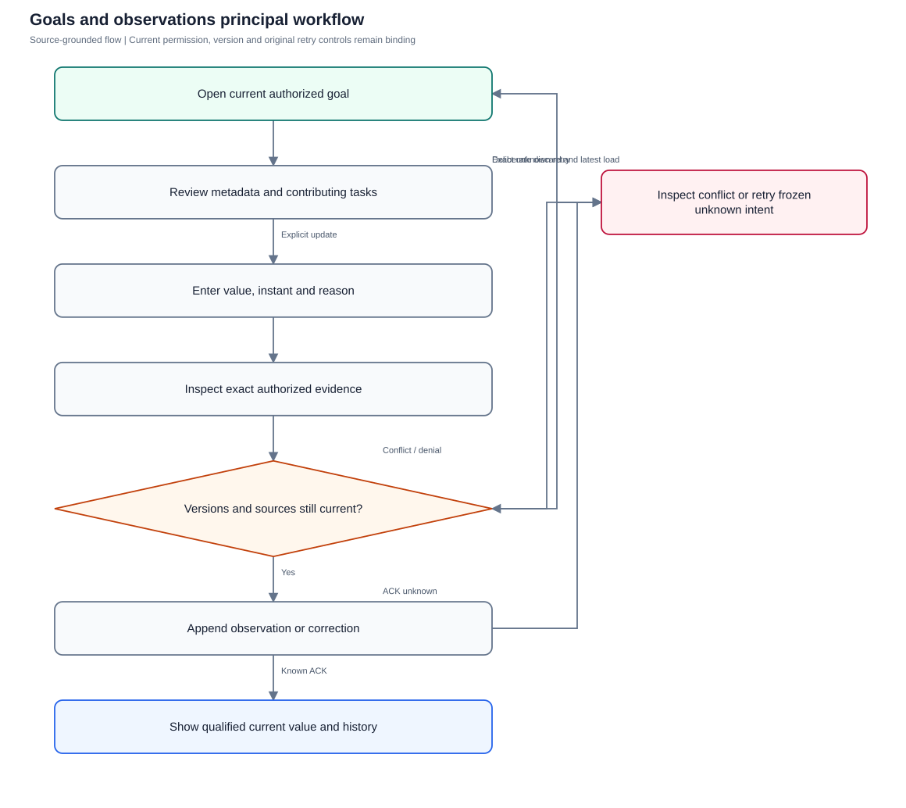
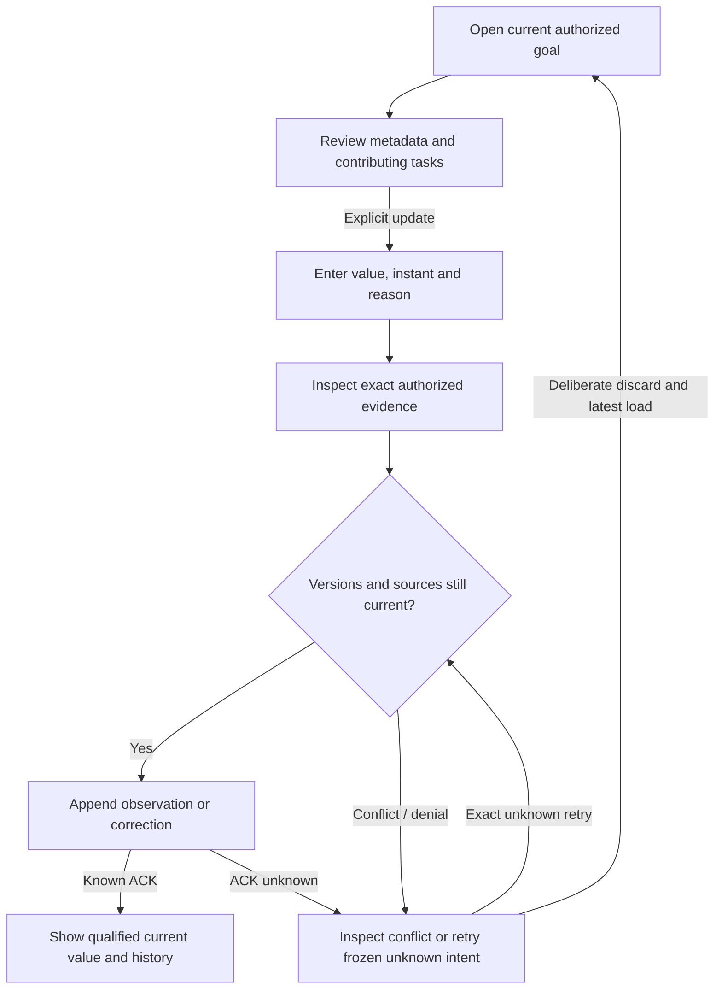

# Goals and observations

Maintain goal metadata and append-only observed results with exact authorized evidence and personal reminders.

**Entry:** Goals → New measured goal; Open goal → Update measured result; Edit metadata; My reminder preference

**Actors:** Alpha leader — company leadership (founder in QA Alpha; not platform admin); Owner A — accountable owner and department member, Engineering; Member B — second department member, Engineering

## Main flow

1. Create reviewed metadata and explicit starting observation where supplied.
2. Inspect authorized current goal and contributing tasks.
3. Capture observed value, instant, reason and reviewed evidence.
4. Append observation/correction; inspect history and qualified current result.
5. Reconcile versions or retry exact unknown intent; reminders remain personal.

[Editable Mermaid](../diagrams/GOALS.mmd)

## Controls and limits

- Task completion and AI suggestions never fabricate a measured business result.
- Legacy current values are labeled with unknown earlier history; unavailable evidence does not reveal private IDs/body.
- Measurement/reminder server capabilities are absent from finite browser demo.

## Proposed manual scenarios

All start **NOT_RUN**. Missing prerequisite = BLOCKED.

### GOALS-001: Create reviewed goal with explicit observed business value

**P1 · LOCAL · Web, API**

**Actors:**

- Alpha leader — company leadership (founder in QA Alpha; not platform admin)
- Owner A — accountable owner and department member, Engineering

**Preconditions:**

- Use a separately provisioned isolated server fixture, never the running workspace or historical native fixture.
- Company QA Alpha uses Asia/Kolkata, INR and April financial-year start; QA Beta is a second isolated company.
- Provision named fictional actors and secrets separately; record no passwords, tokens, private source prose or real account identifiers in evidence.
- Begin the manual run as NOT_RUN; a missing server/configuration/device prerequisite is BLOCKED.

**Test data:**

- QA coverage goal; owner Owner A; baseline 20, target 80, unit percent; initial observed value 25 at 2026-10-12T08:00:00Z; reason Reviewed fictional coverage measurement.

| Step | Action | Expected result |
| --- | --- | --- |
| 1 | As Alpha leader choose New measured goal and enter metadata, contributing task and explicit initial/new measured value, observation time and reason. | Current owner/tasks and valid observation fields are reviewed separately; blank business value is not inferred from tasks. |
| 2 | Choose Save reviewed goal and Open QA coverage goal. | Goal metadata and initial observation are recorded; raw current 25 and bounded attainment appear with an observation history entry. |

**Cleanup:** Close draft/recovery controls after recording the result; sign out test sessions. Retain immutable history until evidence review, then discard this isolated fixture through its approved fixture lifecycle.

[Scenario flow](../diagrams/GOALS-001.svg) · [Editable source](../diagrams/GOALS-001.mmd)

**Source:** [docs/PLANNING_AND_GOALS.md](../../../docs/PLANNING_AND_GOALS.md), [docs/API_CONTRACT.md](../../../docs/API_CONTRACT.md), [frontend/src/components/MeasuredGoals.tsx](../../../frontend/src/components/MeasuredGoals.tsx), [frontend/src/components/GoalMeasurementForm.tsx](../../../frontend/src/components/GoalMeasurementForm.tsx), [frontend/src/components/GoalMetadataForm.tsx](../../../frontend/src/components/GoalMetadataForm.tsx), [backend/platform/goal_measurements.go](../../../backend/platform/goal_measurements.go), [backend/platform/goal_evidence.go](../../../backend/platform/goal_evidence.go), [backend/platform/goal_reminders.go](../../../backend/platform/goal_reminders.go)

**Supporting automation:** [backend/platform/goal_measurements_test.go](../../../backend/platform/goal_measurements_test.go), [backend/platform/goal_evidence_test.go](../../../backend/platform/goal_evidence_test.go), [backend/platform/goal_reminders_test.go](../../../backend/platform/goal_reminders_test.go), [frontend/src/components/GoalRecovery.test.tsx](../../../frontend/src/components/GoalRecovery.test.tsx), [frontend/src/components/GoalEvidenceRecovery.test.tsx](../../../frontend/src/components/GoalEvidenceRecovery.test.tsx), [mobile/src/GoalEvidenceRecovery.test.tsx](../../../mobile/src/GoalEvidenceRecovery.test.tsx)

### GOALS-002: Contributing task acceptance does not update measured result

**P0 · LOCAL · Web, API**

**Actors:**

- Owner A — accountable owner and department member, Engineering
- Reviewer R — currently eligible independent reviewer; never owner of the reviewed work

**Preconditions:**

- Use a separately provisioned isolated server fixture, never the running workspace or historical native fixture.
- Company QA Alpha uses Asia/Kolkata, INR and April financial-year start; QA Beta is a second isolated company.
- Provision named fictional actors and secrets separately; record no passwords, tokens, private source prose or real account identifiers in evidence.
- Begin the manual run as NOT_RUN; a missing server/configuration/device prerequisite is BLOCKED.

**Test data:**

- QA coverage goal current 25; linked required-review task ready for acceptance.

| Step | Action | Expected result |
| --- | --- | --- |
| 1 | Have the owner submit and independent reviewer accept the contributing task through TASKS. | Task becomes done with its own acceptance; no automatic goal measurement is generated. |
| 2 | Open goal and GET its measurements history. | Current stays 25 until explicit observation; contributing task link remains readable under separate source scope. |

**Cleanup:** Close draft/recovery controls after recording the result; sign out test sessions. Retain immutable history until evidence review, then discard this isolated fixture through its approved fixture lifecycle.

[Scenario flow](../diagrams/GOALS-002.svg) · [Editable source](../diagrams/GOALS-002.mmd)

**Source:** [docs/PLANNING_AND_GOALS.md](../../../docs/PLANNING_AND_GOALS.md), [docs/API_CONTRACT.md](../../../docs/API_CONTRACT.md), [frontend/src/components/MeasuredGoals.tsx](../../../frontend/src/components/MeasuredGoals.tsx), [frontend/src/components/GoalMeasurementForm.tsx](../../../frontend/src/components/GoalMeasurementForm.tsx), [frontend/src/components/GoalMetadataForm.tsx](../../../frontend/src/components/GoalMetadataForm.tsx), [backend/platform/goal_measurements.go](../../../backend/platform/goal_measurements.go), [backend/platform/goal_evidence.go](../../../backend/platform/goal_evidence.go), [backend/platform/goal_reminders.go](../../../backend/platform/goal_reminders.go)

**Supporting automation:** [backend/platform/goal_measurements_test.go](../../../backend/platform/goal_measurements_test.go), [backend/platform/goal_evidence_test.go](../../../backend/platform/goal_evidence_test.go), [backend/platform/goal_reminders_test.go](../../../backend/platform/goal_reminders_test.go), [frontend/src/components/GoalRecovery.test.tsx](../../../frontend/src/components/GoalRecovery.test.tsx), [frontend/src/components/GoalEvidenceRecovery.test.tsx](../../../frontend/src/components/GoalEvidenceRecovery.test.tsx), [mobile/src/GoalEvidenceRecovery.test.tsx](../../../mobile/src/GoalEvidenceRecovery.test.tsx)

### GOALS-003: Append a dated observation with current authorized evidence

**P1 · LOCAL · Web, API**

**Actors:**

- Owner A — accountable owner and department member, Engineering

**Preconditions:**

- Use a separately provisioned isolated server fixture, never the running workspace or historical native fixture.
- Company QA Alpha uses Asia/Kolkata, INR and April financial-year start; QA Beta is a second isolated company.
- Provision named fictional actors and secrets separately; record no passwords, tokens, private source prose or real account identifiers in evidence.
- Begin the manual run as NOT_RUN; a missing server/configuration/device prerequisite is BLOCKED.

**Test data:**

- Value 40 at 2026-10-12T09:00:00Z; reason Reviewed fictional coverage run; safe task comment/evidence source.

| Step | Action | Expected result |
| --- | --- | --- |
| 1 | Choose Update measured result, enter value/observation time/reason and inspect current evidence preview before selecting it. | Reviewed source identity/revision/hash and current goal version are captured; fetched evidence is shown only while currently authorized. |
| 2 | Save the measured result and inspect current goal/history. | Append-only observation records author, effective instant, reason and exact evidence basis; current value updates according to effective ordering. |

**Cleanup:** Close draft/recovery controls after recording the result; sign out test sessions. Retain immutable history until evidence review, then discard this isolated fixture through its approved fixture lifecycle.

[Scenario flow](../diagrams/GOALS-003.svg) · [Editable source](../diagrams/GOALS-003.mmd)

**Source:** [docs/PLANNING_AND_GOALS.md](../../../docs/PLANNING_AND_GOALS.md), [docs/API_CONTRACT.md](../../../docs/API_CONTRACT.md), [frontend/src/components/MeasuredGoals.tsx](../../../frontend/src/components/MeasuredGoals.tsx), [frontend/src/components/GoalMeasurementForm.tsx](../../../frontend/src/components/GoalMeasurementForm.tsx), [frontend/src/components/GoalMetadataForm.tsx](../../../frontend/src/components/GoalMetadataForm.tsx), [backend/platform/goal_measurements.go](../../../backend/platform/goal_measurements.go), [backend/platform/goal_evidence.go](../../../backend/platform/goal_evidence.go), [backend/platform/goal_reminders.go](../../../backend/platform/goal_reminders.go)

**Supporting automation:** [backend/platform/goal_measurements_test.go](../../../backend/platform/goal_measurements_test.go), [backend/platform/goal_evidence_test.go](../../../backend/platform/goal_evidence_test.go), [backend/platform/goal_reminders_test.go](../../../backend/platform/goal_reminders_test.go), [frontend/src/components/GoalRecovery.test.tsx](../../../frontend/src/components/GoalRecovery.test.tsx), [frontend/src/components/GoalEvidenceRecovery.test.tsx](../../../frontend/src/components/GoalEvidenceRecovery.test.tsx), [mobile/src/GoalEvidenceRecovery.test.tsx](../../../mobile/src/GoalEvidenceRecovery.test.tsx)

### GOALS-004: Corrections retain history and do not replace newer observation

**P0 · LOCAL · Web, API**

**Actors:**

- Owner A — accountable owner and department member, Engineering

**Preconditions:**

- Use a separately provisioned isolated server fixture, never the running workspace or historical native fixture.
- Company QA Alpha uses Asia/Kolkata, INR and April financial-year start; QA Beta is a second isolated company.
- Provision named fictional actors and secrets separately; record no passwords, tokens, private source prose or real account identifiers in evidence.
- Begin the manual run as NOT_RUN; a missing server/configuration/device prerequisite is BLOCKED.

**Test data:**

- Old observation value 40; newer observation 55; correction of old value to 42 with a reason.

| Step | Action | Expected result |
| --- | --- | --- |
| 1 | Use history correction control for the older observation and record value 42 with captured versions. | A correction is appended; old observation remains traceable and is not rewritten. |
| 2 | Inspect current result and history after correction. | Newer 55 remains current; history shows correction relationship and chronology rather than an invented replacement of the latest outcome. |

**Cleanup:** Close draft/recovery controls after recording the result; sign out test sessions. Retain immutable history until evidence review, then discard this isolated fixture through its approved fixture lifecycle.

[Scenario flow](../diagrams/GOALS-004.svg) · [Editable source](../diagrams/GOALS-004.mmd)

**Source:** [docs/PLANNING_AND_GOALS.md](../../../docs/PLANNING_AND_GOALS.md), [docs/API_CONTRACT.md](../../../docs/API_CONTRACT.md), [frontend/src/components/MeasuredGoals.tsx](../../../frontend/src/components/MeasuredGoals.tsx), [frontend/src/components/GoalMeasurementForm.tsx](../../../frontend/src/components/GoalMeasurementForm.tsx), [frontend/src/components/GoalMetadataForm.tsx](../../../frontend/src/components/GoalMetadataForm.tsx), [backend/platform/goal_measurements.go](../../../backend/platform/goal_measurements.go), [backend/platform/goal_evidence.go](../../../backend/platform/goal_evidence.go), [backend/platform/goal_reminders.go](../../../backend/platform/goal_reminders.go)

**Supporting automation:** [backend/platform/goal_measurements_test.go](../../../backend/platform/goal_measurements_test.go), [backend/platform/goal_evidence_test.go](../../../backend/platform/goal_evidence_test.go), [backend/platform/goal_reminders_test.go](../../../backend/platform/goal_reminders_test.go), [frontend/src/components/GoalRecovery.test.tsx](../../../frontend/src/components/GoalRecovery.test.tsx), [frontend/src/components/GoalEvidenceRecovery.test.tsx](../../../frontend/src/components/GoalEvidenceRecovery.test.tsx), [mobile/src/GoalEvidenceRecovery.test.tsx](../../../mobile/src/GoalEvidenceRecovery.test.tsx)

### GOALS-005: Lower-is-better and out-of-target values preserve raw values

**P1 · LOCAL · Web, API**

**Actors:**

- Alpha leader — company leadership (founder in QA Alpha; not platform admin)
- Owner A — accountable owner and department member, Engineering

**Preconditions:**

- Use a separately provisioned isolated server fixture, never the running workspace or historical native fixture.
- Company QA Alpha uses Asia/Kolkata, INR and April financial-year start; QA Beta is a second isolated company.
- Provision named fictional actors and secrets separately; record no passwords, tokens, private source prose or real account identifiers in evidence.
- Begin the manual run as NOT_RUN; a missing server/configuration/device prerequisite is BLOCKED.

**Test data:**

- Defect rate baseline 12, target 3; values 15 and 1; legacy goal without measurement history.

| Step | Action | Expected result |
| --- | --- | --- |
| 1 | Read each goal/current result through detail. | Lower-is-better is labeled; attainment is bounded 0–100 while raw 15/1 remain visible. |
| 2 | Open legacy current goal and its history. | Current recorded before measurement history / earlier history unknown is shown; coverage boundary is qualified and observations are not invented. |

**Cleanup:** Close draft/recovery controls after recording the result; sign out test sessions. Retain immutable history until evidence review, then discard this isolated fixture through its approved fixture lifecycle.

[Scenario flow](../diagrams/GOALS-005.svg) · [Editable source](../diagrams/GOALS-005.mmd)

**Source:** [docs/PLANNING_AND_GOALS.md](../../../docs/PLANNING_AND_GOALS.md), [docs/API_CONTRACT.md](../../../docs/API_CONTRACT.md), [frontend/src/components/MeasuredGoals.tsx](../../../frontend/src/components/MeasuredGoals.tsx), [frontend/src/components/GoalMeasurementForm.tsx](../../../frontend/src/components/GoalMeasurementForm.tsx), [frontend/src/components/GoalMetadataForm.tsx](../../../frontend/src/components/GoalMetadataForm.tsx), [backend/platform/goal_measurements.go](../../../backend/platform/goal_measurements.go), [backend/platform/goal_evidence.go](../../../backend/platform/goal_evidence.go), [backend/platform/goal_reminders.go](../../../backend/platform/goal_reminders.go)

**Supporting automation:** [backend/platform/goal_measurements_test.go](../../../backend/platform/goal_measurements_test.go), [backend/platform/goal_evidence_test.go](../../../backend/platform/goal_evidence_test.go), [backend/platform/goal_reminders_test.go](../../../backend/platform/goal_reminders_test.go), [frontend/src/components/GoalRecovery.test.tsx](../../../frontend/src/components/GoalRecovery.test.tsx), [frontend/src/components/GoalEvidenceRecovery.test.tsx](../../../frontend/src/components/GoalEvidenceRecovery.test.tsx), [mobile/src/GoalEvidenceRecovery.test.tsx](../../../mobile/src/GoalEvidenceRecovery.test.tsx)

### GOALS-006: Evidence revision/hash conflict requires deliberate review

**P0 · LOCAL · Web, API**

**Actors:**

- Owner A — accountable owner and department member, Engineering
- Alpha leader — company leadership (founder in QA Alpha; not platform admin)

**Preconditions:**

- Use a separately provisioned isolated server fixture, never the running workspace or historical native fixture.
- Company QA Alpha uses Asia/Kolkata, INR and April financial-year start; QA Beta is a second isolated company.
- Provision named fictional actors and secrets separately; record no passwords, tokens, private source prose or real account identifiers in evidence.
- Begin the manual run as NOT_RUN; a missing server/configuration/device prerequisite is BLOCKED.

**Test data:**

- Reviewed task-comment evidence hash; separately edited source before observation send.

| Step | Action | Expected result |
| --- | --- | --- |
| 1 | Capture evidence preview and then change that source in another authorized fixture session; submit the original observation. | HTTP 409; changed source is not silently accepted or substituted. |
| 2 | Discard submitted intent deliberately, load current goal/version and evidence preview, then author a fresh reviewed observation. | Fresh intent carries current exact hash/revision; history later qualifies changed_since_measurement without copying former source prose. |

**Cleanup:** Close draft/recovery controls after recording the result; sign out test sessions. Retain immutable history until evidence review, then discard this isolated fixture through its approved fixture lifecycle.

[Scenario flow](../diagrams/GOALS-006.svg) · [Editable source](../diagrams/GOALS-006.mmd)

**Source:** [docs/PLANNING_AND_GOALS.md](../../../docs/PLANNING_AND_GOALS.md), [docs/API_CONTRACT.md](../../../docs/API_CONTRACT.md), [frontend/src/components/MeasuredGoals.tsx](../../../frontend/src/components/MeasuredGoals.tsx), [frontend/src/components/GoalMeasurementForm.tsx](../../../frontend/src/components/GoalMeasurementForm.tsx), [frontend/src/components/GoalMetadataForm.tsx](../../../frontend/src/components/GoalMetadataForm.tsx), [backend/platform/goal_measurements.go](../../../backend/platform/goal_measurements.go), [backend/platform/goal_evidence.go](../../../backend/platform/goal_evidence.go), [backend/platform/goal_reminders.go](../../../backend/platform/goal_reminders.go)

**Supporting automation:** [backend/platform/goal_measurements_test.go](../../../backend/platform/goal_measurements_test.go), [backend/platform/goal_evidence_test.go](../../../backend/platform/goal_evidence_test.go), [backend/platform/goal_reminders_test.go](../../../backend/platform/goal_reminders_test.go), [frontend/src/components/GoalRecovery.test.tsx](../../../frontend/src/components/GoalRecovery.test.tsx), [frontend/src/components/GoalEvidenceRecovery.test.tsx](../../../frontend/src/components/GoalEvidenceRecovery.test.tsx), [mobile/src/GoalEvidenceRecovery.test.tsx](../../../mobile/src/GoalEvidenceRecovery.test.tsx)

### GOALS-007: Private evidence remains opaque to leadership and denied retry

**P0 · LOCAL · Web, API**

**Actors:**

- Owner A — accountable owner and department member, Engineering
- Alpha leader — company leadership (founder in QA Alpha; not platform admin)

**Preconditions:**

- Use a separately provisioned isolated server fixture, never the running workspace or historical native fixture.
- Company QA Alpha uses Asia/Kolkata, INR and April financial-year start; QA Beta is a second isolated company.
- Provision named fictional actors and secrets separately; record no passwords, tokens, private source prose or real account identifiers in evidence.
- Begin the manual run as NOT_RUN; a missing server/configuration/device prerequisite is BLOCKED.

**Test data:**

- Owner A reads fictional private evidence; Alpha leader has company leadership but no source interval.

| Step | Action | Expected result |
| --- | --- | --- |
| 1 | As Owner A append observation using authorized private evidence; as Alpha leader read goal measurement history. | Alpha leader sees authorized goal result/reason but evidence_unavailable, without private source IDs/body/filenames. |
| 2 | Remove Owner A’s current source membership and replay the original measurement request. | Replay returns current-source denial, not a grant; affected recovery/evidence state clears and late results cannot restore it. |

**Cleanup:** Close draft/recovery controls after recording the result; sign out test sessions. Retain immutable history until evidence review, then discard this isolated fixture through its approved fixture lifecycle.

[Scenario flow](../diagrams/GOALS-007.svg) · [Editable source](../diagrams/GOALS-007.mmd)

**Source:** [docs/PLANNING_AND_GOALS.md](../../../docs/PLANNING_AND_GOALS.md), [docs/API_CONTRACT.md](../../../docs/API_CONTRACT.md), [frontend/src/components/MeasuredGoals.tsx](../../../frontend/src/components/MeasuredGoals.tsx), [frontend/src/components/GoalMeasurementForm.tsx](../../../frontend/src/components/GoalMeasurementForm.tsx), [frontend/src/components/GoalMetadataForm.tsx](../../../frontend/src/components/GoalMetadataForm.tsx), [backend/platform/goal_measurements.go](../../../backend/platform/goal_measurements.go), [backend/platform/goal_evidence.go](../../../backend/platform/goal_evidence.go), [backend/platform/goal_reminders.go](../../../backend/platform/goal_reminders.go)

**Supporting automation:** [backend/platform/goal_measurements_test.go](../../../backend/platform/goal_measurements_test.go), [backend/platform/goal_evidence_test.go](../../../backend/platform/goal_evidence_test.go), [backend/platform/goal_reminders_test.go](../../../backend/platform/goal_reminders_test.go), [frontend/src/components/GoalRecovery.test.tsx](../../../frontend/src/components/GoalRecovery.test.tsx), [frontend/src/components/GoalEvidenceRecovery.test.tsx](../../../frontend/src/components/GoalEvidenceRecovery.test.tsx), [mobile/src/GoalEvidenceRecovery.test.tsx](../../../mobile/src/GoalEvidenceRecovery.test.tsx)

### GOALS-008: Unknown observation retries frozen body while version conflict rebases only deliberately

**P0 · LOCAL · Web, API**

**Actors:**

- Owner A — accountable owner and department member, Engineering
- Alpha leader — company leadership (founder in QA Alpha; not platform admin)

**Preconditions:**

- Use a separately provisioned isolated server fixture, never the running workspace or historical native fixture.
- Company QA Alpha uses Asia/Kolkata, INR and April financial-year start; QA Beta is a second isolated company.
- Provision named fictional actors and secrets separately; record no passwords, tokens, private source prose or real account identifiers in evidence.
- Begin the manual run as NOT_RUN; a missing server/configuration/device prerequisite is BLOCKED.

**Test data:**

- One-time lost measurement ACK; same key/target/value/instant/reason/evidence hashes/versions.

| Step | Action | Expected result |
| --- | --- | --- |
| 1 | Suppress measurement ACK then choose Retry same measurement after a same-principal graph refresh. | Original exact attempt remains frozen; retry produces one canonical observation, preserving ordered evidence/body and captured versions. |
| 2 | Cause a genuine goal version conflict on a new observation and inspect recovery. | Discard submitted intent and edit loads latest value/version deliberately; no transport-unknown attempt is silently rebased. |
| 3 | Confirm actor/session/company loss during pending recovery. | Relevant authored/recovery state clears and late ACK callbacks are sealed. |

**Cleanup:** Close draft/recovery controls after recording the result; sign out test sessions. Retain immutable history until evidence review, then discard this isolated fixture through its approved fixture lifecycle.

[Scenario flow](../diagrams/GOALS-008.svg) · [Editable source](../diagrams/GOALS-008.mmd)

**Source:** [docs/PLANNING_AND_GOALS.md](../../../docs/PLANNING_AND_GOALS.md), [docs/API_CONTRACT.md](../../../docs/API_CONTRACT.md), [frontend/src/components/MeasuredGoals.tsx](../../../frontend/src/components/MeasuredGoals.tsx), [frontend/src/components/GoalMeasurementForm.tsx](../../../frontend/src/components/GoalMeasurementForm.tsx), [frontend/src/components/GoalMetadataForm.tsx](../../../frontend/src/components/GoalMetadataForm.tsx), [backend/platform/goal_measurements.go](../../../backend/platform/goal_measurements.go), [backend/platform/goal_evidence.go](../../../backend/platform/goal_evidence.go), [backend/platform/goal_reminders.go](../../../backend/platform/goal_reminders.go)

**Supporting automation:** [backend/platform/goal_measurements_test.go](../../../backend/platform/goal_measurements_test.go), [backend/platform/goal_evidence_test.go](../../../backend/platform/goal_evidence_test.go), [backend/platform/goal_reminders_test.go](../../../backend/platform/goal_reminders_test.go), [frontend/src/components/GoalRecovery.test.tsx](../../../frontend/src/components/GoalRecovery.test.tsx), [frontend/src/components/GoalEvidenceRecovery.test.tsx](../../../frontend/src/components/GoalEvidenceRecovery.test.tsx), [mobile/src/GoalEvidenceRecovery.test.tsx](../../../mobile/src/GoalEvidenceRecovery.test.tsx)

### GOALS-009: Metadata handover preserves facts and personal reminders

**P0 · LOCAL · Web, API**

**Actors:**

- Alpha leader — company leadership (founder in QA Alpha; not platform admin)
- Owner A — accountable owner and department member, Engineering
- Member B — second department member, Engineering

**Preconditions:**

- Use a separately provisioned isolated server fixture, never the running workspace or historical native fixture.
- Company QA Alpha uses Asia/Kolkata, INR and April financial-year start; QA Beta is a second isolated company.
- Provision named fictional actors and secrets separately; record no passwords, tokens, private source prose or real account identifiers in evidence.
- Begin the manual run as NOT_RUN; a missing server/configuration/device prerequisite is BLOCKED.

**Test data:**

- Owner Owner A with enabled reminder; new owner Member B; measured current 55.

| Step | Action | Expected result |
| --- | --- | --- |
| 1 | As Alpha leader choose Edit metadata and transfer owner to Member B with captured version and Metadata reason. | Ownership metadata changes once; observations, evidence basis and current measured value remain unchanged. |
| 2 | As Member B open My reminder preference; as former owner retry an old preference capability. | Owner A’s personal preference does not transfer; old owner capability is denied under current eligibility. Member B configures her own preference explicitly. |

**Cleanup:** Close draft/recovery controls after recording the result; sign out test sessions. Retain immutable history until evidence review, then discard this isolated fixture through its approved fixture lifecycle.

[Scenario flow](../diagrams/GOALS-009.svg) · [Editable source](../diagrams/GOALS-009.mmd)

**Source:** [docs/PLANNING_AND_GOALS.md](../../../docs/PLANNING_AND_GOALS.md), [docs/API_CONTRACT.md](../../../docs/API_CONTRACT.md), [frontend/src/components/MeasuredGoals.tsx](../../../frontend/src/components/MeasuredGoals.tsx), [frontend/src/components/GoalMeasurementForm.tsx](../../../frontend/src/components/GoalMeasurementForm.tsx), [frontend/src/components/GoalMetadataForm.tsx](../../../frontend/src/components/GoalMetadataForm.tsx), [backend/platform/goal_measurements.go](../../../backend/platform/goal_measurements.go), [backend/platform/goal_evidence.go](../../../backend/platform/goal_evidence.go), [backend/platform/goal_reminders.go](../../../backend/platform/goal_reminders.go)

**Supporting automation:** [backend/platform/goal_measurements_test.go](../../../backend/platform/goal_measurements_test.go), [backend/platform/goal_evidence_test.go](../../../backend/platform/goal_evidence_test.go), [backend/platform/goal_reminders_test.go](../../../backend/platform/goal_reminders_test.go), [frontend/src/components/GoalRecovery.test.tsx](../../../frontend/src/components/GoalRecovery.test.tsx), [frontend/src/components/GoalEvidenceRecovery.test.tsx](../../../frontend/src/components/GoalEvidenceRecovery.test.tsx), [mobile/src/GoalEvidenceRecovery.test.tsx](../../../mobile/src/GoalEvidenceRecovery.test.tsx)

### GOALS-010: Reminder timezone, versions and cadence remain explicit

**P1 · LOCAL · Web, API**

**Actors:**

- Owner A — accountable owner and department member, Engineering

**Preconditions:**

- Use a separately provisioned isolated server fixture, never the running workspace or historical native fixture.
- Company QA Alpha uses Asia/Kolkata, INR and April financial-year start; QA Beta is a second isolated company.
- Provision named fictional actors and secrets separately; record no passwords, tokens, private source prose or real account identifiers in evidence.
- Begin the manual run as NOT_RUN; a missing server/configuration/device prerequisite is BLOCKED.

**Test data:**

- Weekly Monday reminder at 09:30 company local time; invalid month-day 29 variant; two editing sessions.

| Step | Action | Expected result |
| --- | --- | --- |
| 1 | As current owner open My reminder preference, select enable/cadence/time/reason and Save my reminder preference. | Preference is personal, uses company-local timing and current expectedVersion; invalid cadence/day/time combinations fail validation. |
| 2 | Save a concurrent preference change, then submit stale form; separately lose a valid save ACK and Retry same preference. | Stale version requires deliberate current preference load; unknown retry retains exact body/key/version and does not create duplicate occurrences. |

**Cleanup:** Close draft/recovery controls after recording the result; sign out test sessions. Retain immutable history until evidence review, then discard this isolated fixture through its approved fixture lifecycle.

[Scenario flow](../diagrams/GOALS-010.svg) · [Editable source](../diagrams/GOALS-010.mmd)

**Source:** [docs/PLANNING_AND_GOALS.md](../../../docs/PLANNING_AND_GOALS.md), [docs/API_CONTRACT.md](../../../docs/API_CONTRACT.md), [frontend/src/components/MeasuredGoals.tsx](../../../frontend/src/components/MeasuredGoals.tsx), [frontend/src/components/GoalMeasurementForm.tsx](../../../frontend/src/components/GoalMeasurementForm.tsx), [frontend/src/components/GoalMetadataForm.tsx](../../../frontend/src/components/GoalMetadataForm.tsx), [backend/platform/goal_measurements.go](../../../backend/platform/goal_measurements.go), [backend/platform/goal_evidence.go](../../../backend/platform/goal_evidence.go), [backend/platform/goal_reminders.go](../../../backend/platform/goal_reminders.go)

**Supporting automation:** [backend/platform/goal_reminders_test.go](../../../backend/platform/goal_reminders_test.go), [frontend/src/components/GoalReminderPreferences.test.tsx](../../../frontend/src/components/GoalReminderPreferences.test.tsx)

