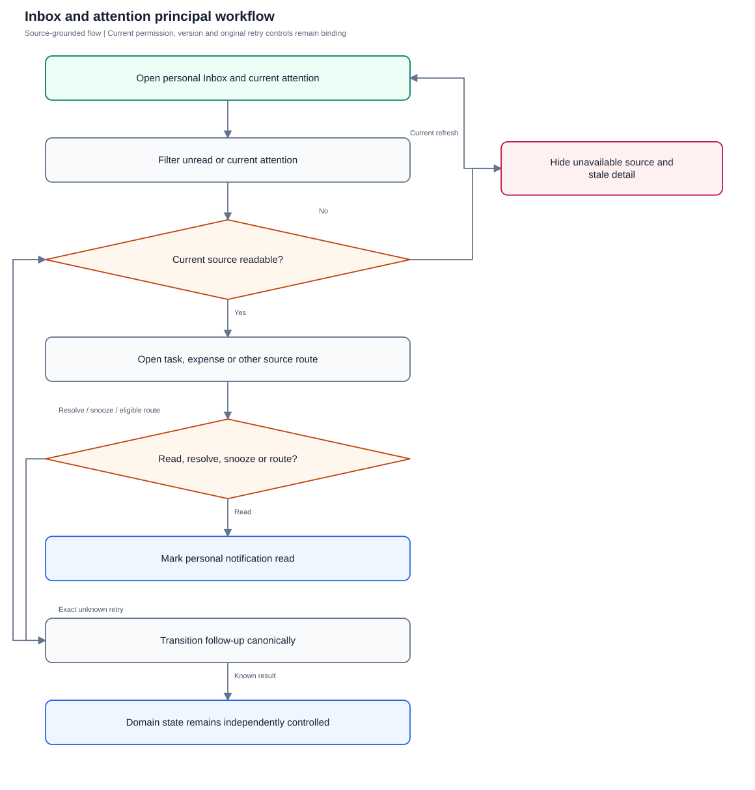
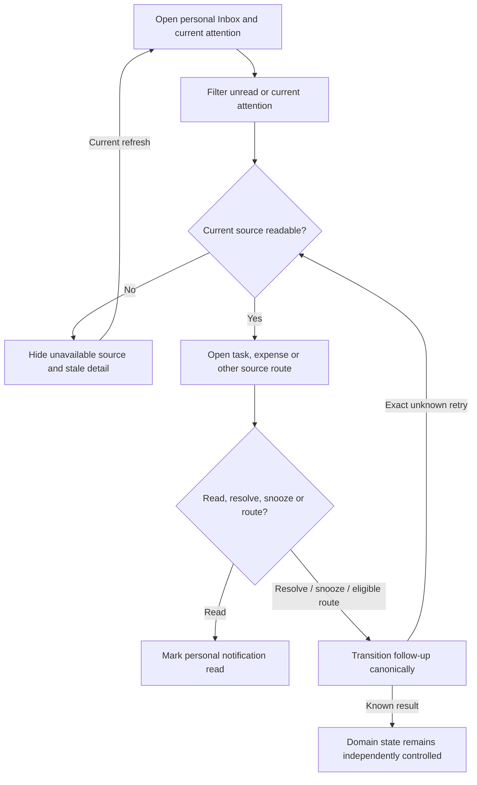

# Inbox and attention

Read personal notifications and act on currently authorized attention without converting follow-up controls into task/finance approval.

**Entry:** Inbox → All updates / Unread; Mark all read; Action required attention list; Open task / Open expense

**Actors:** Owner A — accountable owner and department member, Engineering; Reviewer R — currently eligible independent reviewer; never owner of the reviewed work; Finance F — company Finance; work access remains assignment scoped; Alpha leader — company leadership (founder in QA Alpha; not platform admin); Member B — second department member, Engineering

## Main flow

1. Load personal notifications and current authorized attention.
2. Filter unread/current attention.
3. Open independently authorized business source.
4. Mark notifications read or transition attention separately.
5. Let domain acceptance supersede source episodes; retry canonical attention intent.

[Editable Mermaid](../diagrams/INBOX.mmd)

## Controls and limits

- Notifications and attention are distinct models; marking read/resolve/snooze/route never accepts a task, approves/pays an expense or makes a structured decision.
- Some source kinds intentionally have no route/decide capability; ready report links remain recipient-bound and cannot be rerouted.

## Proposed manual scenarios

All start **NOT_RUN**. Missing prerequisite = BLOCKED.

### INBOX-001: Unread notification filters and per-item read stay personal

**P1 · LOCAL · Web, API**

**Actors:**

- Owner A — accountable owner and department member, Engineering
- Member B — second department member, Engineering

**Preconditions:**

- Use a separately provisioned isolated server fixture, never the running workspace or historical native fixture.
- Company QA Alpha uses Asia/Kolkata, INR and April financial-year start; QA Beta is a second isolated company.
- Provision named fictional actors and secrets separately; record no passwords, tokens, private source prose or real account identifiers in evidence.
- Begin the manual run as NOT_RUN; a missing server/configuration/device prerequisite is BLOCKED.

**Test data:**

- Owner A: assignment, comment and reminder; Member B: separate unread assignment.

| Step | Action | Expected result |
| --- | --- | --- |
| 1 | Open Inbox → Unread and choose Mark {notification title} as read on one Owner A update. | That update becomes read and leaves Owner A’s unread filter; Member B’s notification state is unchanged. |
| 2 | Switch All updates and inspect newest-first order and counts. | Read update remains in All updates; counts and order reflect only Owner A’s authorized personal notifications. |

**Cleanup:** Close draft/recovery controls after recording the result; sign out test sessions. Retain immutable history until evidence review, then discard this isolated fixture through its approved fixture lifecycle.

[Scenario flow](../diagrams/INBOX-001.svg) · [Editable source](../diagrams/INBOX-001.mmd)

**Source:** [docs/USER_GUIDE.md](../../../docs/USER_GUIDE.md), [docs/API_CONTRACT.md](../../../docs/API_CONTRACT.md), [frontend/src/pages/InboxSettings.tsx](../../../frontend/src/pages/InboxSettings.tsx), [frontend/src/components/AttentionInbox.tsx](../../../frontend/src/components/AttentionInbox.tsx), [backend/platform/attention_access.go](../../../backend/platform/attention_access.go), [backend/platform/attention_transitions.go](../../../backend/platform/attention_transitions.go)

**Supporting automation:** [backend/platform/attention_access_test.go](../../../backend/platform/attention_access_test.go), [backend/platform/attention_transitions_test.go](../../../backend/platform/attention_transitions_test.go), [backend/platform/attention_producers_test.go](../../../backend/platform/attention_producers_test.go), [frontend/src/pages/Attention.test.tsx](../../../frontend/src/pages/Attention.test.tsx), [mobile/src/AttentionInbox.test.tsx](../../../mobile/src/AttentionInbox.test.tsx), [mobile/src/AttentionRoutes.test.tsx](../../../mobile/src/AttentionRoutes.test.tsx)

### INBOX-002: Mark all read is an explicit current-user operation

**P1 · LOCAL · Web, API**

**Actors:**

- Owner A — accountable owner and department member, Engineering
- Member B — second department member, Engineering

**Preconditions:**

- Use a separately provisioned isolated server fixture, never the running workspace or historical native fixture.
- Company QA Alpha uses Asia/Kolkata, INR and April financial-year start; QA Beta is a second isolated company.
- Provision named fictional actors and secrets separately; record no passwords, tokens, private source prose or real account identifiers in evidence.
- Begin the manual run as NOT_RUN; a missing server/configuration/device prerequisite is BLOCKED.

**Test data:**

- Owner A has three unread updates; Member B has two unread.

| Step | Action | Expected result |
| --- | --- | --- |
| 1 | As Owner A choose Mark all read and inspect POST /notifications/read ids=[]. | All current-user notifications become read; button disables when none remain. |
| 2 | Query/inspect Member B’s Inbox separately. | Member B’s updates remain unread; empty ids does not mark another user/company’s mailbox. |

**Cleanup:** Close draft/recovery controls after recording the result; sign out test sessions. Retain immutable history until evidence review, then discard this isolated fixture through its approved fixture lifecycle.

[Scenario flow](../diagrams/INBOX-002.svg) · [Editable source](../diagrams/INBOX-002.mmd)

**Source:** [docs/USER_GUIDE.md](../../../docs/USER_GUIDE.md), [docs/API_CONTRACT.md](../../../docs/API_CONTRACT.md), [frontend/src/pages/InboxSettings.tsx](../../../frontend/src/pages/InboxSettings.tsx), [frontend/src/components/AttentionInbox.tsx](../../../frontend/src/components/AttentionInbox.tsx), [backend/platform/attention_access.go](../../../backend/platform/attention_access.go), [backend/platform/attention_transitions.go](../../../backend/platform/attention_transitions.go)

**Supporting automation:** [backend/platform/attention_access_test.go](../../../backend/platform/attention_access_test.go), [backend/platform/attention_transitions_test.go](../../../backend/platform/attention_transitions_test.go), [backend/platform/attention_producers_test.go](../../../backend/platform/attention_producers_test.go), [frontend/src/pages/Attention.test.tsx](../../../frontend/src/pages/Attention.test.tsx), [mobile/src/AttentionInbox.test.tsx](../../../mobile/src/AttentionInbox.test.tsx), [mobile/src/AttentionRoutes.test.tsx](../../../mobile/src/AttentionRoutes.test.tsx)

### INBOX-003: Task and expense links use the correct independently authorized routes

**P0 · LOCAL · Web, API**

**Actors:**

- Owner A — accountable owner and department member, Engineering
- Finance F — company Finance; work access remains assignment scoped

**Preconditions:**

- Use a separately provisioned isolated server fixture, never the running workspace or historical native fixture.
- Company QA Alpha uses Asia/Kolkata, INR and April financial-year start; QA Beta is a second isolated company.
- Provision named fictional actors and secrets separately; record no passwords, tokens, private source prose or real account identifiers in evidence.
- Begin the manual run as NOT_RUN; a missing server/configuration/device prerequisite is BLOCKED.

**Test data:**

- Task assignment and expense review notifications; Finance F reviews an expense with a hidden linked task.

| Step | Action | Expected result |
| --- | --- | --- |
| 1 | Choose Open task on a readable assignment and Open expense on the expense update. | Each opens its corresponding route and marks the update read; expense does not use the task detail route. |
| 2 | As Finance F inspect the expense’s linked work and attempt hidden task detail. | Current expense review is readable, but financial references do not expose hidden task body/evidence. |

**Cleanup:** Close draft/recovery controls after recording the result; sign out test sessions. Retain immutable history until evidence review, then discard this isolated fixture through its approved fixture lifecycle.

[Scenario flow](../diagrams/INBOX-003.svg) · [Editable source](../diagrams/INBOX-003.mmd)

**Source:** [docs/USER_GUIDE.md](../../../docs/USER_GUIDE.md), [docs/API_CONTRACT.md](../../../docs/API_CONTRACT.md), [frontend/src/pages/InboxSettings.tsx](../../../frontend/src/pages/InboxSettings.tsx), [frontend/src/components/AttentionInbox.tsx](../../../frontend/src/components/AttentionInbox.tsx), [backend/platform/attention_access.go](../../../backend/platform/attention_access.go), [backend/platform/attention_transitions.go](../../../backend/platform/attention_transitions.go)

**Supporting automation:** [frontend/src/pages/Attention.test.tsx](../../../frontend/src/pages/Attention.test.tsx), [backend/platform/read_scopes_test.go](../../../backend/platform/read_scopes_test.go), [backend/platform/finance_test.go](../../../backend/platform/finance_test.go)

### INBOX-004: Stale or foreign attention targets return no source content

**P0 · LOCAL · Web, API**

**Actors:**

- Owner A — accountable owner and department member, Engineering
- Reviewer R — currently eligible independent reviewer; never owner of the reviewed work
- Alpha leader — company leadership (founder in QA Alpha; not platform admin)

**Preconditions:**

- Use a separately provisioned isolated server fixture, never the running workspace or historical native fixture.
- Company QA Alpha uses Asia/Kolkata, INR and April financial-year start; QA Beta is a second isolated company.
- Provision named fictional actors and secrets separately; record no passwords, tokens, private source prose or real account identifiers in evidence.
- Begin the manual run as NOT_RUN; a missing server/configuration/device prerequisite is BLOCKED.

**Test data:**

- Old notification task moved out of Owner A’s access; attention item belongs to Reviewer R.

| Step | Action | Expected result |
| --- | --- | --- |
| 1 | Click Owner A’s old Open task update after current workspace refresh. | Client reports task no longer available in current access scope; old notification is not a read grant. |
| 2 | GET Reviewer R’s /attention/{item} as Owner A, then request an own item whose source access was revoked. | HTTP 404 without source details in both unauthorized cases; current authority is checked on every projection/replay. |

**Cleanup:** Close draft/recovery controls after recording the result; sign out test sessions. Retain immutable history until evidence review, then discard this isolated fixture through its approved fixture lifecycle.

[Scenario flow](../diagrams/INBOX-004.svg) · [Editable source](../diagrams/INBOX-004.mmd)

**Source:** [docs/USER_GUIDE.md](../../../docs/USER_GUIDE.md), [docs/API_CONTRACT.md](../../../docs/API_CONTRACT.md), [frontend/src/pages/InboxSettings.tsx](../../../frontend/src/pages/InboxSettings.tsx), [frontend/src/components/AttentionInbox.tsx](../../../frontend/src/components/AttentionInbox.tsx), [backend/platform/attention_access.go](../../../backend/platform/attention_access.go), [backend/platform/attention_transitions.go](../../../backend/platform/attention_transitions.go)

**Supporting automation:** [backend/platform/attention_access_test.go](../../../backend/platform/attention_access_test.go), [backend/platform/attention_transitions_test.go](../../../backend/platform/attention_transitions_test.go), [backend/platform/attention_producers_test.go](../../../backend/platform/attention_producers_test.go), [frontend/src/pages/Attention.test.tsx](../../../frontend/src/pages/Attention.test.tsx), [mobile/src/AttentionInbox.test.tsx](../../../mobile/src/AttentionInbox.test.tsx), [mobile/src/AttentionRoutes.test.tsx](../../../mobile/src/AttentionRoutes.test.tsx)

### INBOX-005: Resolve attention changes only follow-up state

**P0 · LOCAL · Web, API**

**Actors:**

- Owner A — accountable owner and department member, Engineering
- Reviewer R — currently eligible independent reviewer; never owner of the reviewed work
- Finance F — company Finance; work access remains assignment scoped

**Preconditions:**

- Use a separately provisioned isolated server fixture, never the running workspace or historical native fixture.
- Company QA Alpha uses Asia/Kolkata, INR and April financial-year start; QA Beta is a second isolated company.
- Provision named fictional actors and secrets separately; record no passwords, tokens, private source prose or real account identifiers in evidence.
- Begin the manual run as NOT_RUN; a missing server/configuration/device prerequisite is BLOCKED.

**Test data:**

- Open attention for todo task; separate expense-review attention.

| Step | Action | Expected result |
| --- | --- | --- |
| 1 | Open attention, enter Resolution reason and resolve the episode. | Attention resolves once with captured expectedVersion/retryKey. |
| 2 | Reopen domain task/expense and inspect status/history. | Task remains todo and expense remains pending as applicable; resolve is neither acceptance nor financial approval/payment. |

**Cleanup:** Close draft/recovery controls after recording the result; sign out test sessions. Retain immutable history until evidence review, then discard this isolated fixture through its approved fixture lifecycle.

[Scenario flow](../diagrams/INBOX-005.svg) · [Editable source](../diagrams/INBOX-005.mmd)

**Source:** [docs/USER_GUIDE.md](../../../docs/USER_GUIDE.md), [docs/API_CONTRACT.md](../../../docs/API_CONTRACT.md), [frontend/src/pages/InboxSettings.tsx](../../../frontend/src/pages/InboxSettings.tsx), [frontend/src/components/AttentionInbox.tsx](../../../frontend/src/components/AttentionInbox.tsx), [backend/platform/attention_access.go](../../../backend/platform/attention_access.go), [backend/platform/attention_transitions.go](../../../backend/platform/attention_transitions.go)

**Supporting automation:** [backend/platform/attention_access_test.go](../../../backend/platform/attention_access_test.go), [backend/platform/attention_transitions_test.go](../../../backend/platform/attention_transitions_test.go), [backend/platform/attention_producers_test.go](../../../backend/platform/attention_producers_test.go), [frontend/src/pages/Attention.test.tsx](../../../frontend/src/pages/Attention.test.tsx), [mobile/src/AttentionInbox.test.tsx](../../../mobile/src/AttentionInbox.test.tsx), [mobile/src/AttentionRoutes.test.tsx](../../../mobile/src/AttentionRoutes.test.tsx)

### INBOX-006: Snooze uses explicit future instant and rejects business fields

**P0 · LOCAL · Web, API**

**Actors:**

- Owner A — accountable owner and department member, Engineering

**Preconditions:**

- Use a separately provisioned isolated server fixture, never the running workspace or historical native fixture.
- Company QA Alpha uses Asia/Kolkata, INR and April financial-year start; QA Beta is a second isolated company.
- Provision named fictional actors and secrets separately; record no passwords, tokens, private source prose or real account identifiers in evidence.
- Begin the manual run as NOT_RUN; a missing server/configuration/device prerequisite is BLOCKED.

**Test data:**

- Tomorrow 09:00 Asia/Kolkata; past instant; repeated local-time variant.

| Step | Action | Expected result |
| --- | --- | --- |
| 1 | Choose snooze, enter Snooze until and select Choose exact instant when ambiguous. | Valid future UTC instant is recorded; past/nonexistent/ambiguous-unselected times are rejected. |
| 2 | POST attention transition with an extra approval field. | Validation rejects unknown business-decision input; domain state remains unchanged. |
| 3 | Retry an identical already-committed snooze after its time has elapsed. | Canonical replay returns original result rather than revalidating it as a fresh past-time request. |

**Cleanup:** Close draft/recovery controls after recording the result; sign out test sessions. Retain immutable history until evidence review, then discard this isolated fixture through its approved fixture lifecycle.

[Scenario flow](../diagrams/INBOX-006.svg) · [Editable source](../diagrams/INBOX-006.mmd)

**Source:** [docs/USER_GUIDE.md](../../../docs/USER_GUIDE.md), [docs/API_CONTRACT.md](../../../docs/API_CONTRACT.md), [frontend/src/pages/InboxSettings.tsx](../../../frontend/src/pages/InboxSettings.tsx), [frontend/src/components/AttentionInbox.tsx](../../../frontend/src/components/AttentionInbox.tsx), [backend/platform/attention_access.go](../../../backend/platform/attention_access.go), [backend/platform/attention_transitions.go](../../../backend/platform/attention_transitions.go)

**Supporting automation:** [backend/platform/attention_access_test.go](../../../backend/platform/attention_access_test.go), [backend/platform/attention_transitions_test.go](../../../backend/platform/attention_transitions_test.go), [backend/platform/attention_producers_test.go](../../../backend/platform/attention_producers_test.go), [frontend/src/pages/Attention.test.tsx](../../../frontend/src/pages/Attention.test.tsx), [mobile/src/AttentionInbox.test.tsx](../../../mobile/src/AttentionInbox.test.tsx), [mobile/src/AttentionRoutes.test.tsx](../../../mobile/src/AttentionRoutes.test.tsx)

### INBOX-007: Route requires eligible source reader and does not reassign work

**P0 · LOCAL · Web, API**

**Actors:**

- Owner A — accountable owner and department member, Engineering
- Reviewer R — currently eligible independent reviewer; never owner of the reviewed work
- Member B — second department member, Engineering

**Preconditions:**

- Use a separately provisioned isolated server fixture, never the running workspace or historical native fixture.
- Company QA Alpha uses Asia/Kolkata, INR and April financial-year start; QA Beta is a second isolated company.
- Provision named fictional actors and secrets separately; record no passwords, tokens, private source prose or real account identifiers in evidence.
- Begin the manual run as NOT_RUN; a missing server/configuration/device prerequisite is BLOCKED.

**Test data:**

- Task attention route from Owner A to currently eligible Reviewer R; Member B has no source read; structured record has fixed recipients.

| Step | Action | Expected result |
| --- | --- | --- |
| 1 | Choose Route to Reviewer R with Routing reason; inspect task owner after route. | A follow-up episode goes to eligible Reviewer R; task owner remains Owner A. |
| 2 | Attempt route to Member B without task access, and a fixed-recipient structured record to its creator outside recipient list. | Ineligible/nonrecipient routing is denied; current source visibility or company rank alone does not expand a fixed response audience. |

**Cleanup:** Close draft/recovery controls after recording the result; sign out test sessions. Retain immutable history until evidence review, then discard this isolated fixture through its approved fixture lifecycle.

[Scenario flow](../diagrams/INBOX-007.svg) · [Editable source](../diagrams/INBOX-007.mmd)

**Source:** [docs/USER_GUIDE.md](../../../docs/USER_GUIDE.md), [docs/API_CONTRACT.md](../../../docs/API_CONTRACT.md), [frontend/src/pages/InboxSettings.tsx](../../../frontend/src/pages/InboxSettings.tsx), [frontend/src/components/AttentionInbox.tsx](../../../frontend/src/components/AttentionInbox.tsx), [backend/platform/attention_access.go](../../../backend/platform/attention_access.go), [backend/platform/attention_transitions.go](../../../backend/platform/attention_transitions.go)

**Supporting automation:** [backend/platform/attention_access_test.go](../../../backend/platform/attention_access_test.go), [backend/platform/attention_transitions_test.go](../../../backend/platform/attention_transitions_test.go), [backend/platform/attention_producers_test.go](../../../backend/platform/attention_producers_test.go), [frontend/src/pages/Attention.test.tsx](../../../frontend/src/pages/Attention.test.tsx), [mobile/src/AttentionInbox.test.tsx](../../../mobile/src/AttentionInbox.test.tsx), [mobile/src/AttentionRoutes.test.tsx](../../../mobile/src/AttentionRoutes.test.tsx)

### INBOX-008: Unknown attention transition retries exact canonical episode

**P0 · LOCAL · Web, API**

**Actors:**

- Owner A — accountable owner and department member, Engineering
- Reviewer R — currently eligible independent reviewer; never owner of the reviewed work
- Alpha leader — company leadership (founder in QA Alpha; not platform admin)

**Preconditions:**

- Use a separately provisioned isolated server fixture, never the running workspace or historical native fixture.
- Company QA Alpha uses Asia/Kolkata, INR and April financial-year start; QA Beta is a second isolated company.
- Provision named fictional actors and secrets separately; record no passwords, tokens, private source prose or real account identifiers in evidence.
- Begin the manual run as NOT_RUN; a missing server/configuration/device prerequisite is BLOCKED.

**Test data:**

- One-time lost resolve/route ACK; captured key, version, recipient/reason; later task acceptance.

| Step | Action | Expected result |
| --- | --- | --- |
| 1 | Suppress one transition ACK and use its retry control with original exact submitted fields. | One result episode/version is returned; altered reason/recipient under the same key conflicts. |
| 2 | Complete the source task independently, then replay the previously successful transition; try a new transition afterward. | Authorized canonical replay retains its original result; new closed/superseded episode action conflicts, never reopens task work. |
| 3 | Remove current source authority and replay again. | Current denial prevents replay disclosure and clears affected recovery; late prior ACK does not repopulate it. |

**Cleanup:** Close draft/recovery controls after recording the result; sign out test sessions. Retain immutable history until evidence review, then discard this isolated fixture through its approved fixture lifecycle.

[Scenario flow](../diagrams/INBOX-008.svg) · [Editable source](../diagrams/INBOX-008.mmd)

**Source:** [docs/USER_GUIDE.md](../../../docs/USER_GUIDE.md), [docs/API_CONTRACT.md](../../../docs/API_CONTRACT.md), [frontend/src/pages/InboxSettings.tsx](../../../frontend/src/pages/InboxSettings.tsx), [frontend/src/components/AttentionInbox.tsx](../../../frontend/src/components/AttentionInbox.tsx), [backend/platform/attention_access.go](../../../backend/platform/attention_access.go), [backend/platform/attention_transitions.go](../../../backend/platform/attention_transitions.go)

**Supporting automation:** [backend/platform/attention_access_test.go](../../../backend/platform/attention_access_test.go), [backend/platform/attention_transitions_test.go](../../../backend/platform/attention_transitions_test.go), [backend/platform/attention_producers_test.go](../../../backend/platform/attention_producers_test.go), [frontend/src/pages/Attention.test.tsx](../../../frontend/src/pages/Attention.test.tsx), [mobile/src/AttentionInbox.test.tsx](../../../mobile/src/AttentionInbox.test.tsx), [mobile/src/AttentionRoutes.test.tsx](../../../mobile/src/AttentionRoutes.test.tsx)

### INBOX-009: Attention pagination scopes before limits and protects private provenance

**P0 · LOCAL · Web, API**

**Actors:**

- Owner A — accountable owner and department member, Engineering
- Alpha leader — company leadership (founder in QA Alpha; not platform admin)

**Preconditions:**

- Use a separately provisioned isolated server fixture, never the running workspace or historical native fixture.
- Company QA Alpha uses Asia/Kolkata, INR and April financial-year start; QA Beta is a second isolated company.
- Provision named fictional actors and secrets separately; record no passwords, tokens, private source prose or real account identifiers in evidence.
- Begin the manual run as NOT_RUN; a missing server/configuration/device prerequisite is BLOCKED.

**Test data:**

- 101 invisible structured items preceding one readable task item; published intake with private conversation source.

| Step | Action | Expected result |
| --- | --- | --- |
| 1 | GET /attention?limit=1 as the recipient of the reachable task episode. | Readable task item is returned; invisible sources do not consume the visible limit. |
| 2 | Read a published intake attention detail as authorized company leadership without private interval. | Published work summary is visible where independently allowed; private conversation/message IDs, source revisions and body remain absent. |

**Cleanup:** Close draft/recovery controls after recording the result; sign out test sessions. Retain immutable history until evidence review, then discard this isolated fixture through its approved fixture lifecycle.

[Scenario flow](../diagrams/INBOX-009.svg) · [Editable source](../diagrams/INBOX-009.mmd)

**Source:** [docs/USER_GUIDE.md](../../../docs/USER_GUIDE.md), [docs/API_CONTRACT.md](../../../docs/API_CONTRACT.md), [frontend/src/pages/InboxSettings.tsx](../../../frontend/src/pages/InboxSettings.tsx), [frontend/src/components/AttentionInbox.tsx](../../../frontend/src/components/AttentionInbox.tsx), [backend/platform/attention_access.go](../../../backend/platform/attention_access.go), [backend/platform/attention_transitions.go](../../../backend/platform/attention_transitions.go)

**Supporting automation:** [backend/platform/attention_access_test.go](../../../backend/platform/attention_access_test.go), [backend/platform/attention_transitions_test.go](../../../backend/platform/attention_transitions_test.go), [backend/platform/attention_producers_test.go](../../../backend/platform/attention_producers_test.go), [frontend/src/pages/Attention.test.tsx](../../../frontend/src/pages/Attention.test.tsx), [mobile/src/AttentionInbox.test.tsx](../../../mobile/src/AttentionInbox.test.tsx), [mobile/src/AttentionRoutes.test.tsx](../../../mobile/src/AttentionRoutes.test.tsx)

### INBOX-010: Report-ready and finance-assistance attention retain source restrictions

**P0 · LOCAL · Web, API**

**Actors:**

- Owner A — accountable owner and department member, Engineering
- Finance F — company Finance; work access remains assignment scoped
- Alpha leader — company leadership (founder in QA Alpha; not platform admin)

**Preconditions:**

- Use a separately provisioned isolated server fixture, never the running workspace or historical native fixture.
- Company QA Alpha uses Asia/Kolkata, INR and April financial-year start; QA Beta is a second isolated company.
- Provision named fictional actors and secrets separately; record no passwords, tokens, private source prose or real account identifiers in evidence.
- Begin the manual run as NOT_RUN; a missing server/configuration/device prerequisite is BLOCKED.

**Test data:**

- Recipient-bound ready report; extraction requester item; duplicate item requiring both source reads; reconciliation finance item.

| Step | Action | Expected result |
| --- | --- | --- |
| 1 | Open each attention source as its current eligible actor and inspect available actions. | Ready report opens only while artifact and full sources are authorized; finance sources follow requester/both-source/finance scope respectively. |
| 2 | Attempt route/decide for ready report and finance assistance sources; revoke one required source or membership epoch and refresh. | Unsupported route/decide is unavailable/denied; revoked artifacts/details disappear. Attention resolve/snooze never accepts extraction, dismisses duplicate or matches reconciliation. |

**Cleanup:** Close draft/recovery controls after recording the result; sign out test sessions. Retain immutable history until evidence review, then discard this isolated fixture through its approved fixture lifecycle.

[Scenario flow](../diagrams/INBOX-010.svg) · [Editable source](../diagrams/INBOX-010.mmd)

**Source:** [docs/API_CONTRACT.md](../../../docs/API_CONTRACT.md), [backend/platform/attention_access.go](../../../backend/platform/attention_access.go), [backend/platform/finance_assistance_attention_test.go](../../../backend/platform/finance_assistance_attention_test.go), [backend/platform/report_export_jobs_test.go](../../../backend/platform/report_export_jobs_test.go)

**Supporting automation:** [backend/platform/finance_assistance_attention_test.go](../../../backend/platform/finance_assistance_attention_test.go), [backend/platform/people_output_lifecycle_test.go](../../../backend/platform/people_output_lifecycle_test.go), [backend/platform/report_export_jobs_test.go](../../../backend/platform/report_export_jobs_test.go)

