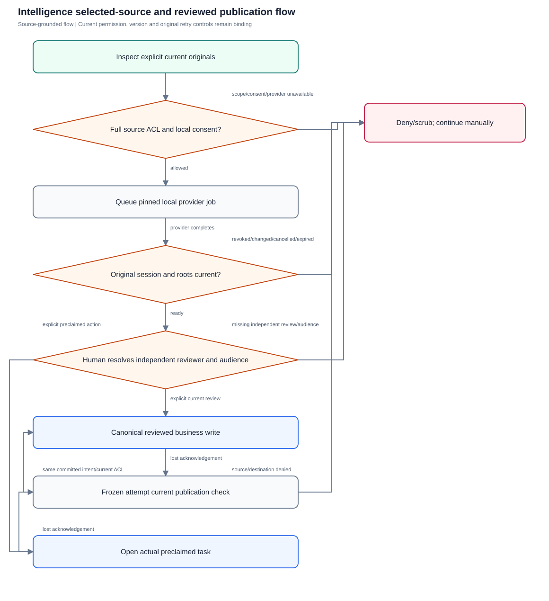
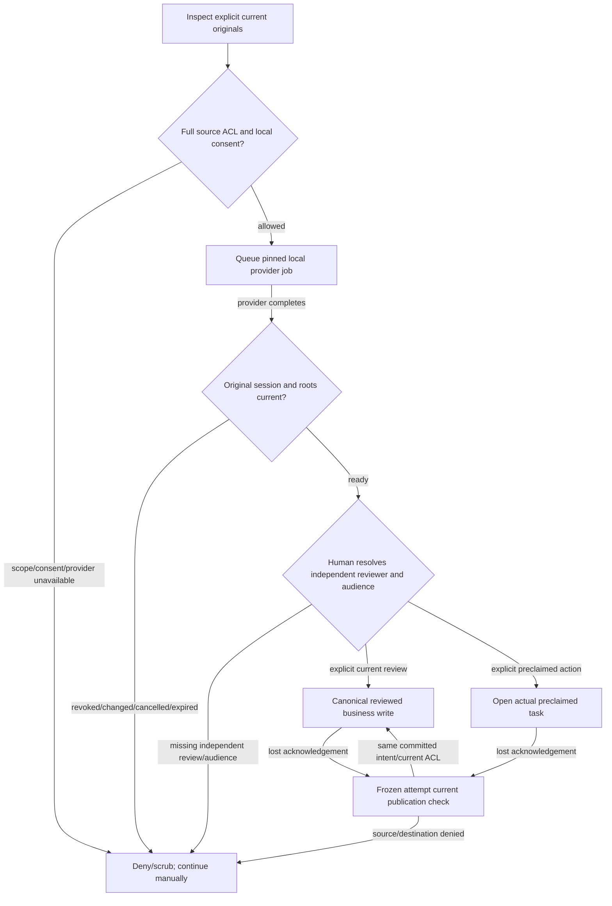

# Grounded selected-source intelligence

Validate local consent, exact current selected provenance, private bounded jobs, deterministic facts and explicit reviewed canonical publication.

**Entry:** Company-relative /intelligence/capabilities and /selection-preview; Company-relative /intelligence/jobs, /jobs/{id}, /cancel, /task-preview, /publication-access; Web selected conversation/report source review and canonical task/expense/intake routes

**Actors:** platform admin: operator without company membership; company leadership: QA Alpha founder; owner: QA Alpha expense/task creator; independent reviewer: QA Alpha department head distinct from owner; department member: QA Alpha Engineering member; finance: QA Alpha finance role distinct from owner; outsider: QA Beta member only

## Main flow

1. Select and inspect explicit readable originals
2. Preview exact source binding and accept current local-processing notice
3. Queue pinned provider job under original session and bounded capacity
4. Reauthorize every selected/expanded root before processing and disclosure
5. Inspect citations and deterministic facts; resolve human owner/reviewer/deadline/economics
6. Review complete current audience and confirm canonical business write
7. Keep unknown frozen attempts in scoped RAM; independent current publication check gates retry

[Editable Mermaid](../diagrams/INTELLIGENCE.mmd)

## Controls and limits

- Every case is NOT_RUN and LOCAL_CONFIG; author has not started/invoked a provider. Fresh separately provisioned capacity is required.
- Deterministic/test-provider regressions are references, never live-provider or manual PASS. Do not reuse completed native consumed capabilities.
- Citations indicate provenance only; factual/language quality, physical devices, production latency/capacity and supply-chain completeness need separate qualification.
- Raw result expiry/revocation differs from reviewed independently retained business records; current complete source/destination ACL still gates replay.
- Authored review/unknown intent stays scoped RAM only, without persisted source/result cache.

## Proposed manual scenarios

All start **NOT_RUN**. Missing prerequisite = BLOCKED.

### INTELLIGENCE-001: Inspected explicit selection and current consent precede inference

**P0 · LOCAL_CONFIG · Web, API**

**Actors:**

- platform admin: operator without company membership
- company leadership: QA Alpha founder
- owner: QA Alpha expense/task creator
- independent reviewer: QA Alpha department head distinct from owner
- department member: QA Alpha Engineering member
- finance: QA Alpha finance role distinct from owner
- outsider: QA Beta member only

**Preconditions:**

- Provision a disposable isolated server/API fixture with fictional QA Alpha (INR, Asia/Kolkata, April financial year) and unrelated QA Beta; use separate actor sessions and a controlled 2026-10-12 clock.
- Never mutate the running workspace, restore historical native fixtures or reuse consumed capabilities. Browser demo does not establish backend authorization acceptance.
- Operator must separately provision fresh isolated provider/scanner/private storage and capacity prerequisites; authoring does not start or invoke providers. Missing prerequisite is BLOCKED.

**Test data:**

- Fictional QA task packing-check narrative;current inspected version/content binding.
- optIn accepted:true,policyVersion local-selected-v1;fresh scoped retryKey.

| Step | Action | Expected result |
| --- | --- | --- |
| 1 | Open conversation/Reports without generation;GET capabilities then selection-preview. | Opening/preview performs no inference;exact originals/bindings and limitations visible. |
| 2 | POST job without accepted opt-in,wrong policy or missing stable key. | Invalid input refused;navigation alone never sends selected prose to inference. |
| 3 | Inspect original and notice,then explicitly enqueue exact preview hash/selection/consent. | Only chosen sources queued under original session/provider identity;no business records created. |

**Cleanup:** Record sanitized observations without real IDs, credentials, private prose or prompts. Close QA sessions and remove owned temporary downloads; reset/dispose only this isolated fixture through its approved lifecycle, retaining audit history until disposal.

[Scenario flow](../diagrams/INTELLIGENCE-001.svg) · [Editable source](../diagrams/INTELLIGENCE-001.mmd)

**Source:** [docs/API_CONTRACT.md](../../../docs/API_CONTRACT.md), [docs/intelligence-local.md](../../../docs/intelligence-local.md), [docs/SECURITY_AND_LIMITATIONS.md](../../../docs/SECURITY_AND_LIMITATIONS.md), [backend/platform/intelligence_sources.go](../../../backend/platform/intelligence_sources.go), [backend/platform/intelligence_jobs.go](../../../backend/platform/intelligence_jobs.go)

**Supporting automation:** [backend/platform/intelligence_sources_test.go](../../../backend/platform/intelligence_sources_test.go), [backend/platform/intelligence_jobs_test.go](../../../backend/platform/intelligence_jobs_test.go)

### INTELLIGENCE-002: Missing or wrong pinned provider has no remote fallback

**P0 · LOCAL_CONFIG · Web, API**

**Actors:**

- platform admin: operator without company membership
- company leadership: QA Alpha founder
- owner: QA Alpha expense/task creator
- independent reviewer: QA Alpha department head distinct from owner
- department member: QA Alpha Engineering member
- finance: QA Alpha finance role distinct from owner
- outsider: QA Beta member only

**Preconditions:**

- Provision a disposable isolated server/API fixture with fictional QA Alpha (INR, Asia/Kolkata, April financial year) and unrelated QA Beta; use separate actor sessions and a controlled 2026-10-12 clock.
- Never mutate the running workspace, restore historical native fixtures or reuse consumed capabilities. Browser demo does not establish backend authorization acceptance.
- Operator must separately provision fresh isolated provider/scanner/private storage and capacity prerequisites; authoring does not start or invoke providers. Missing prerequisite is BLOCKED.

**Test data:**

- Operator-provisioned variants:disabled,missing model/executable,wrong Ollama version/digest,remote descriptor/redirect/proxy.
- Identity pins from intelligence-local.md;Ollama0.40.2/qwen3:4b;Whisper package/model checksums.

| Step | Action | Expected result |
| --- | --- | --- |
| 1 | GET capabilities in each unavailable configuration and use normal task/finance/report. | Affected operations unavailable/provider_unavailable;ordinary workflow remains available. |
| 2 | Try explicitly consented job while unavailable. | 503 provider_unavailable;selected content not sent to unverified provider;no install/model pull/cloud fallback. |
| 3 | With fresh valid provider inspect result identity and isolated routing controls before content send. | providerIdentity matches verified pin/config;proxies/redirects/remote descriptors refused before source disclosure;no private prompts/keys logged in QA docs. |

**Cleanup:** Record sanitized observations without real IDs, credentials, private prose or prompts. Close QA sessions and remove owned temporary downloads; reset/dispose only this isolated fixture through its approved lifecycle, retaining audit history until disposal.

[Scenario flow](../diagrams/INTELLIGENCE-002.svg) · [Editable source](../diagrams/INTELLIGENCE-002.mmd)

**Source:** [docs/API_CONTRACT.md](../../../docs/API_CONTRACT.md), [docs/intelligence-local.md](../../../docs/intelligence-local.md), [docs/SECURITY_AND_LIMITATIONS.md](../../../docs/SECURITY_AND_LIMITATIONS.md), [backend/platform/intelligence_providers.go](../../../backend/platform/intelligence_providers.go), [backend/platform/intelligence_ollama.go](../../../backend/platform/intelligence_ollama.go), [backend/platform/intelligence_whisper.go](../../../backend/platform/intelligence_whisper.go)

**Supporting automation:** [backend/platform/intelligence_providers_test.go](../../../backend/platform/intelligence_providers_test.go), [backend/platform/intelligence_ollama_test.go](../../../backend/platform/intelligence_ollama_test.go), [backend/platform/intelligence_real_provider_test.go](../../../backend/platform/intelligence_real_provider_test.go)

### INTELLIGENCE-003: Source version change never silently substitutes latest originals

**P0 · LOCAL_CONFIG · Web, API**

**Actors:**

- platform admin: operator without company membership
- company leadership: QA Alpha founder
- owner: QA Alpha expense/task creator
- independent reviewer: QA Alpha department head distinct from owner
- department member: QA Alpha Engineering member
- finance: QA Alpha finance role distinct from owner
- outsider: QA Beta member only

**Preconditions:**

- Provision a disposable isolated server/API fixture with fictional QA Alpha (INR, Asia/Kolkata, April financial year) and unrelated QA Beta; use separate actor sessions and a controlled 2026-10-12 clock.
- Never mutate the running workspace, restore historical native fixtures or reuse consumed capabilities. Browser demo does not establish backend authorization acceptance.
- Operator must separately provision fresh isolated provider/scanner/private storage and capacity prerequisites; authoring does not start or invoke providers. Missing prerequisite is BLOCKED.

**Test data:**

- Inspected task/message versionN;authorized later body/titleN+1.
- Captured expectedVersion/revision/contentHash/selectionHash;separate ready-result change variant.

| Step | Action | Expected result |
| --- | --- | --- |
| 1 | Inspect/select N then second actor edits before enqueue. | Selection remains bound to inspected original;source now newer. |
| 2 | Enqueue old binding or read ready result after contributing original changes. | Exact-current conflict/invalidation instead of processing/disclosing silent latest replacement. |
| 3 | Explicitly inspect N+1,preview/reselect and consent;choose report original versus explicit latest. | Fresh deliberate generation distinct;fetched private content hides during recheck and authored review never auto-replays against new version. |

**Cleanup:** Record sanitized observations without real IDs, credentials, private prose or prompts. Close QA sessions and remove owned temporary downloads; reset/dispose only this isolated fixture through its approved lifecycle, retaining audit history until disposal.

[Scenario flow](../diagrams/INTELLIGENCE-003.svg) · [Editable source](../diagrams/INTELLIGENCE-003.mmd)

**Source:** [docs/API_CONTRACT.md](../../../docs/API_CONTRACT.md), [docs/intelligence-local.md](../../../docs/intelligence-local.md), [docs/SECURITY_AND_LIMITATIONS.md](../../../docs/SECURITY_AND_LIMITATIONS.md), [backend/platform/intelligence_sources.go](../../../backend/platform/intelligence_sources.go), [backend/platform/intelligence_reads.go](../../../backend/platform/intelligence_reads.go), [frontend/src/pages/GoalsReports.tsx](../../../frontend/src/pages/GoalsReports.tsx)

**Supporting automation:** [backend/platform/intelligence_sources_test.go](../../../backend/platform/intelligence_sources_test.go), [frontend/src/pages/Reports.intelligence.test.tsx](../../../frontend/src/pages/Reports.intelligence.test.tsx)

### INTELLIGENCE-004: Leadership, finance and operator cannot bypass company/private source ACL

**P0 · LOCAL_CONFIG · Web, API**

**Actors:**

- platform admin: operator without company membership
- company leadership: QA Alpha founder
- owner: QA Alpha expense/task creator
- independent reviewer: QA Alpha department head distinct from owner
- department member: QA Alpha Engineering member
- finance: QA Alpha finance role distinct from owner
- outsider: QA Beta member only

**Preconditions:**

- Provision a disposable isolated server/API fixture with fictional QA Alpha (INR, Asia/Kolkata, April financial year) and unrelated QA Beta; use separate actor sessions and a controlled 2026-10-12 clock.
- Never mutate the running workspace, restore historical native fixtures or reuse consumed capabilities. Browser demo does not establish backend authorization acceptance.
- Operator must separately provision fresh isolated provider/scanner/private storage and capacity prerequisites; authoring does not start or invoke providers. Missing prerequisite is BLOCKED.

**Test data:**

- Private QA Alpha owner/member conversation excludes leadership/finance.
- QA Beta task/message;readable wrapper with inaccessible nested evidence/wrong parent.

| Step | Action | Expected result |
| --- | --- | --- |
| 1 | Preview private/foreign roots as leadership,finance,outsider,operator without QA Alpha membership. | No private existence/content or cross-company bypass from role. |
| 2 | Select wrapper with hidden nested comment/media/goal-measurement root or altered parent. | Every expanded root and actual parent checked;outer visibility does not grant private content. |
| 3 | Generate authorized owner job;read job/history/result as reviewer/finance/other company. | Raw results requester-private;other readers receive no private labels/prose/derived IDs. |

**Cleanup:** Record sanitized observations without real IDs, credentials, private prose or prompts. Close QA sessions and remove owned temporary downloads; reset/dispose only this isolated fixture through its approved lifecycle, retaining audit history until disposal.

[Scenario flow](../diagrams/INTELLIGENCE-004.svg) · [Editable source](../diagrams/INTELLIGENCE-004.mmd)

**Source:** [docs/API_CONTRACT.md](../../../docs/API_CONTRACT.md), [docs/intelligence-local.md](../../../docs/intelligence-local.md), [docs/SECURITY_AND_LIMITATIONS.md](../../../docs/SECURITY_AND_LIMITATIONS.md), [backend/platform/intelligence_sources.go](../../../backend/platform/intelligence_sources.go), [backend/platform/intelligence_reads.go](../../../backend/platform/intelligence_reads.go)

**Supporting automation:** [backend/platform/intelligence_sources_test.go](../../../backend/platform/intelligence_sources_test.go), [backend/platform/intelligence_fix1_test.go](../../../backend/platform/intelligence_fix1_test.go)

### INTELLIGENCE-005: Citations bind selected originals and model text stays inert

**P0 · LOCAL_CONFIG · Web, API**

**Actors:**

- platform admin: operator without company membership
- company leadership: QA Alpha founder
- owner: QA Alpha expense/task creator
- independent reviewer: QA Alpha department head distinct from owner
- department member: QA Alpha Engineering member
- finance: QA Alpha finance role distinct from owner
- outsider: QA Beta member only

**Preconditions:**

- Provision a disposable isolated server/API fixture with fictional QA Alpha (INR, Asia/Kolkata, April financial year) and unrelated QA Beta; use separate actor sessions and a controlled 2026-10-12 clock.
- Never mutate the running workspace, restore historical native fixtures or reuse consumed capabilities. Browser demo does not establish backend authorization acceptance.
- Operator must separately provision fresh isolated provider/scanner/private storage and capacity prerequisites; authoring does not start or invoke providers. Missing prerequisite is BLOCKED.
- Scripted schema fault adapter is test-only;do not infer real-model correctness from deterministic fake outputs.

**Test data:**

- Two fictional packing-check messages;benign fictional URL https://invalid.example/qa and command-looking text.
- Isolated output variants:unknown/empty/duplicate source keys,duplicateJSONkey,unsupported field.

| Step | Action | Expected result |
| --- | --- | --- |
| 1 | Generate summary and open each citation through current exact-source access. | Claims cite selected keys with supported confidence;provenance is not proof of correctness or general thread access. |
| 2 | Provide invalid schema/citation outputs through isolated test adapter. | Strict independent schema returns invalid_output rather than success/uncited malformed result. |
| 3 | Render URL/command-like text and revoke original before opening citation. | Plain text never executes tools/links/shares/downloads automatically;citation cannot expose stale denied original. |

**Cleanup:** Record sanitized observations without real IDs, credentials, private prose or prompts. Close QA sessions and remove owned temporary downloads; reset/dispose only this isolated fixture through its approved lifecycle, retaining audit history until disposal.

[Scenario flow](../diagrams/INTELLIGENCE-005.svg) · [Editable source](../diagrams/INTELLIGENCE-005.mmd)

**Source:** [docs/API_CONTRACT.md](../../../docs/API_CONTRACT.md), [docs/intelligence-local.md](../../../docs/intelligence-local.md), [docs/SECURITY_AND_LIMITATIONS.md](../../../docs/SECURITY_AND_LIMITATIONS.md), [backend/platform/intelligence_schema.go](../../../backend/platform/intelligence_schema.go), [frontend/src/data/intelligence.ts](../../../frontend/src/data/intelligence.ts)

**Supporting automation:** [backend/platform/intelligence_schema_test.go](../../../backend/platform/intelligence_schema_test.go), [backend/platform/intelligence_sources_test.go](../../../backend/platform/intelligence_sources_test.go)

### INTELLIGENCE-006: Financial explanations use exact server-rendered deterministic facts

**P0 · LOCAL_CONFIG · Web, API**

**Actors:**

- platform admin: operator without company membership
- company leadership: QA Alpha founder
- owner: QA Alpha expense/task creator
- independent reviewer: QA Alpha department head distinct from owner
- department member: QA Alpha Engineering member
- finance: QA Alpha finance role distinct from owner
- outsider: QA Beta member only

**Preconditions:**

- Provision a disposable isolated server/API fixture with fictional QA Alpha (INR, Asia/Kolkata, April financial year) and unrelated QA Beta; use separate actor sessions and a controlled 2026-10-12 clock.
- Never mutate the running workspace, restore historical native fixtures or reuse consumed capabilities. Browser demo does not establish backend authorization acceptance.
- Operator must separately provision fresh isolated provider/scanner/private storage and capacity prerequisites; authoring does not start or invoke providers. Missing prerequisite is BLOCKED.

**Test data:**

- Expense amountMinor130050,INR,draft,2026-10-10.
- Invalid model arbitrary money INR99999/unsupported comparison relation.

| Step | Action | Expected result |
| --- | --- | --- |
| 1 | Inspect expense_fields/economics and explicitly request report_explanation. | Recorded exact INR1300.50/status/date fact;no inferred conversion/tax/settlement. |
| 2 | Use isolated allowlisted amount-fact output then arbitrary text/money/relations. | Accepted value server-rendered exactly;unsupported model money prose/relations/fields rejected. |
| 3 | Compare business state before/after;revoke source/finance access and read result/citation. | No economics/approval/goal observation mutation;current loss withholds result. |

**Cleanup:** Record sanitized observations without real IDs, credentials, private prose or prompts. Close QA sessions and remove owned temporary downloads; reset/dispose only this isolated fixture through its approved lifecycle, retaining audit history until disposal.

[Scenario flow](../diagrams/INTELLIGENCE-006.svg) · [Editable source](../diagrams/INTELLIGENCE-006.mmd)

**Source:** [docs/API_CONTRACT.md](../../../docs/API_CONTRACT.md), [docs/intelligence-local.md](../../../docs/intelligence-local.md), [docs/SECURITY_AND_LIMITATIONS.md](../../../docs/SECURITY_AND_LIMITATIONS.md), [backend/platform/intelligence_facts.go](../../../backend/platform/intelligence_facts.go), [backend/platform/intelligence_schema.go](../../../backend/platform/intelligence_schema.go)

**Supporting automation:** [backend/platform/intelligence_facts_test.go](../../../backend/platform/intelligence_facts_test.go)

### INTELLIGENCE-007: Current/historical report semantics and denominators are explicit

**P0 · LOCAL_CONFIG · Web, API**

**Actors:**

- platform admin: operator without company membership
- company leadership: QA Alpha founder
- owner: QA Alpha expense/task creator
- independent reviewer: QA Alpha department head distinct from owner
- department member: QA Alpha Engineering member
- finance: QA Alpha finance role distinct from owner
- outsider: QA Beta member only

**Preconditions:**

- Provision a disposable isolated server/API fixture with fictional QA Alpha (INR, Asia/Kolkata, April financial year) and unrelated QA Beta; use separate actor sessions and a controlled 2026-10-12 clock.
- Never mutate the running workspace, restore historical native fixtures or reuse consumed capabilities. Browser demo does not establish backend authorization acceptance.
- Operator must separately provision fresh isolated provider/scanner/private storage and capacity prerequisites; authoring does not start or invoke providers. Missing prerequisite is BLOCKED.

**Test data:**

- Current snapshot frozenOct1–12,Asia/Kolkata,metricVersion;original2/3 met,current zero-denominator control.
- Historical2acceptance episodes/1unique task,observed gap;legacy snapshot lacking period metadata.

| Step | Action | Expected result |
| --- | --- | --- |
| 1 | Inspect/select report_current and separate report_snapshot originals. | Explanations state producer basis/frozen period and distinguish current cohort from historical episodes/unique tasks. |
| 2 | Inspect original/current punctuality and zero-denominator/gap facts. | Separate server numerator/denominator/rate/deadline definitions;zero/missing rate unavailable,coverage disclosed. |
| 3 | Explain legacy missing-period snapshot and attempt arbitrary causal comparison/latest substitution. | Legacy period explicitly unavailable;unsupported relation rejected and original never replaced by latest silently. |

**Cleanup:** Record sanitized observations without real IDs, credentials, private prose or prompts. Close QA sessions and remove owned temporary downloads; reset/dispose only this isolated fixture through its approved lifecycle, retaining audit history until disposal.

[Scenario flow](../diagrams/INTELLIGENCE-007.svg) · [Editable source](../diagrams/INTELLIGENCE-007.mmd)

**Source:** [docs/API_CONTRACT.md](../../../docs/API_CONTRACT.md), [docs/intelligence-local.md](../../../docs/intelligence-local.md), [docs/SECURITY_AND_LIMITATIONS.md](../../../docs/SECURITY_AND_LIMITATIONS.md), [backend/platform/intelligence_facts.go](../../../backend/platform/intelligence_facts.go), [backend/platform/report_reads.go](../../../backend/platform/report_reads.go)

**Supporting automation:** [backend/platform/intelligence_facts_test.go](../../../backend/platform/intelligence_facts_test.go), [backend/platform/intelligence_fix1_test.go](../../../backend/platform/intelligence_fix1_test.go), [backend/platform/intelligence_real_provider_test.go](../../../backend/platform/intelligence_real_provider_test.go)

### INTELLIGENCE-008: Exact record citations and indirect roots remain currently authorized

**P0 · LOCAL_CONFIG · Web, API**

**Actors:**

- platform admin: operator without company membership
- company leadership: QA Alpha founder
- owner: QA Alpha expense/task creator
- independent reviewer: QA Alpha department head distinct from owner
- department member: QA Alpha Engineering member
- finance: QA Alpha finance role distinct from owner
- outsider: QA Beta member only

**Preconditions:**

- Provision a disposable isolated server/API fixture with fictional QA Alpha (INR, Asia/Kolkata, April financial year) and unrelated QA Beta; use separate actor sessions and a controlled 2026-10-12 clock.
- Never mutate the running workspace, restore historical native fixtures or reuse consumed capabilities. Browser demo does not establish backend authorization acceptance.
- Operator must separately provision fresh isolated provider/scanner/private storage and capacity prerequisites; authoring does not start or invoke providers. Missing prerequisite is BLOCKED.

**Test data:**

- Fictional record/content_responses with two responses.
- Goal measurement private-message root;report off-page task and outside-period dependency.

| Step | Action | Expected result |
| --- | --- | --- |
| 1 | Inspect exact record/evidence originals then select/generate. | Bindings include actual record/responses/indirect roots;record citation opens exact record rather than wider conversation. |
| 2 | Revoke contributing private interval or off-page report source/reference while container readable. | Derived output invalidates despite readable outer goal/report/record;complete roots required. |
| 3 | Alter citation parent/delete record and inspect history. | No fallback to unrelated/latest record;history only neutral metadata,never source/result prose. |

**Cleanup:** Record sanitized observations without real IDs, credentials, private prose or prompts. Close QA sessions and remove owned temporary downloads; reset/dispose only this isolated fixture through its approved lifecycle, retaining audit history until disposal.

[Scenario flow](../diagrams/INTELLIGENCE-008.svg) · [Editable source](../diagrams/INTELLIGENCE-008.mmd)

**Source:** [docs/API_CONTRACT.md](../../../docs/API_CONTRACT.md), [docs/intelligence-local.md](../../../docs/intelligence-local.md), [docs/SECURITY_AND_LIMITATIONS.md](../../../docs/SECURITY_AND_LIMITATIONS.md), [backend/platform/intelligence_sources.go](../../../backend/platform/intelligence_sources.go), [backend/platform/intelligence_reads.go](../../../backend/platform/intelligence_reads.go)

**Supporting automation:** [backend/platform/intelligence_fix1_test.go](../../../backend/platform/intelligence_fix1_test.go), [backend/platform/intelligence_sources_test.go](../../../backend/platform/intelligence_sources_test.go)

### INTELLIGENCE-009: Frozen enqueue replay and quotas bind provider and consented intent

**P0 · LOCAL_CONFIG · Web, API**

**Actors:**

- platform admin: operator without company membership
- company leadership: QA Alpha founder
- owner: QA Alpha expense/task creator
- independent reviewer: QA Alpha department head distinct from owner
- department member: QA Alpha Engineering member
- finance: QA Alpha finance role distinct from owner
- outsider: QA Beta member only

**Preconditions:**

- Provision a disposable isolated server/API fixture with fictional QA Alpha (INR, Asia/Kolkata, April financial year) and unrelated QA Beta; use separate actor sessions and a controlled 2026-10-12 clock.
- Never mutate the running workspace, restore historical native fixtures or reuse consumed capabilities. Browser demo does not establish backend authorization acceptance.
- Operator must separately provision fresh isolated provider/scanner/private storage and capacity prerequisites; authoring does not start or invoke providers. Missing prerequisite is BLOCKED.

**Test data:**

- Inspected summary selection,qa-intelligence-009.
- 10active jobs actor/100company;changed source/operation/key intent and provider identity controls.

| Step | Action | Expected result |
| --- | --- | --- |
| 1 | Enqueue then lose acknowledgement;retry exact selection/hash/consent/key. | 202 same canonical job;no duplicate invocation or extended source/session lifetime. |
| 2 | Change source/operation under key or verified identity before replay. | Changed intent conflicts;identity mismatch provider unavailable instead of different-model replacement. |
| 3 | Fill isolated active quota then request new job;retire eligible jobs and retry deliberately. | queue_full429 at actor10/company100;bounded queue and current actor authority preserved. |

**Cleanup:** Record sanitized observations without real IDs, credentials, private prose or prompts. Close QA sessions and remove owned temporary downloads; reset/dispose only this isolated fixture through its approved lifecycle, retaining audit history until disposal.

[Scenario flow](../diagrams/INTELLIGENCE-009.svg) · [Editable source](../diagrams/INTELLIGENCE-009.mmd)

**Source:** [docs/API_CONTRACT.md](../../../docs/API_CONTRACT.md), [docs/intelligence-local.md](../../../docs/intelligence-local.md), [docs/SECURITY_AND_LIMITATIONS.md](../../../docs/SECURITY_AND_LIMITATIONS.md), [backend/platform/intelligence_jobs.go](../../../backend/platform/intelligence_jobs.go)

**Supporting automation:** [backend/platform/intelligence_jobs_test.go](../../../backend/platform/intelligence_jobs_test.go), [backend/platform/intelligence_lifecycle_test.go](../../../backend/platform/intelligence_lifecycle_test.go)

### INTELLIGENCE-010: Queue, final commit and ready reads reject source/session revocation

**P0 · LOCAL_CONFIG · Web, API**

**Actors:**

- platform admin: operator without company membership
- company leadership: QA Alpha founder
- owner: QA Alpha expense/task creator
- independent reviewer: QA Alpha department head distinct from owner
- department member: QA Alpha Engineering member
- finance: QA Alpha finance role distinct from owner
- outsider: QA Beta member only

**Preconditions:**

- Provision a disposable isolated server/API fixture with fictional QA Alpha (INR, Asia/Kolkata, April financial year) and unrelated QA Beta; use separate actor sessions and a controlled 2026-10-12 clock.
- Never mutate the running workspace, restore historical native fixtures or reuse consumed capabilities. Browser demo does not establish backend authorization acceptance.
- Operator must separately provision fresh isolated provider/scanner/private storage and capacity prerequisites; authoring does not start or invoke providers. Missing prerequisite is BLOCKED.

**Test data:**

- Fresh phases:provider-budget wait,running precommit,ready before read.
- Loss variants:source reassignment,original logout,company/private membership departure.

| Step | Action | Expected result |
| --- | --- | --- |
| 1 | Queue explicit job,hold isolated budget and revoke original authority before release. | Current all-source/session checks after wait prevent denied content reaching provider. |
| 2 | Revoke running job before final commit or ready job beforeGET. | Final fence blocks stale result;reads authorize before loading resultJSON and retire/scrub unavailable output. |
| 3 | Leave/rejoin private interval or log in afresh and use old raw handle. | New interval/login never revives old raw results;fresh explicit current selection required. |

**Cleanup:** Record sanitized observations without real IDs, credentials, private prose or prompts. Close QA sessions and remove owned temporary downloads; reset/dispose only this isolated fixture through its approved lifecycle, retaining audit history until disposal.

[Scenario flow](../diagrams/INTELLIGENCE-010.svg) · [Editable source](../diagrams/INTELLIGENCE-010.mmd)

**Source:** [docs/API_CONTRACT.md](../../../docs/API_CONTRACT.md), [docs/intelligence-local.md](../../../docs/intelligence-local.md), [docs/SECURITY_AND_LIMITATIONS.md](../../../docs/SECURITY_AND_LIMITATIONS.md), [backend/platform/intelligence_runtime.go](../../../backend/platform/intelligence_runtime.go), [backend/platform/intelligence_reads.go](../../../backend/platform/intelligence_reads.go), [backend/platform/intelligence_invalidation.go](../../../backend/platform/intelligence_invalidation.go)

**Supporting automation:** [backend/platform/intelligence_lifecycle_test.go](../../../backend/platform/intelligence_lifecycle_test.go), [backend/platform/intelligence_runtime_test.go](../../../backend/platform/intelligence_runtime_test.go)

### INTELLIGENCE-011: Cancellation and stale leases cannot resurrect disclosure

**P0 · LOCAL_CONFIG · Web, API**

**Actors:**

- platform admin: operator without company membership
- company leadership: QA Alpha founder
- owner: QA Alpha expense/task creator
- independent reviewer: QA Alpha department head distinct from owner
- department member: QA Alpha Engineering member
- finance: QA Alpha finance role distinct from owner
- outsider: QA Beta member only

**Preconditions:**

- Provision a disposable isolated server/API fixture with fictional QA Alpha (INR, Asia/Kolkata, April financial year) and unrelated QA Beta; use separate actor sessions and a controlled 2026-10-12 clock.
- Never mutate the running workspace, restore historical native fixtures or reuse consumed capabilities. Browser demo does not establish backend authorization acceptance.
- Operator must separately provision fresh isolated provider/scanner/private storage and capacity prerequisites; authoring does not start or invoke providers. Missing prerequisite is BLOCKED.

**Test data:**

- Fresh queued/running summary and transcription scratch jobs.
- Ollama120s,transcription180s;three transient attempts,5/30s delays.

| Step | Action | Expected result |
| --- | --- | --- |
| 1 | POST cancel while isolated worker queued/running. | Immediate cancellation fence withholds output regardless provider completion. |
| 2 | Release delayed old lease/worker and request result/stale completion. | Stale lease cannot renew/publish;readers close,subprocess group terminates/joins,owned scratch cleans. |
| 3 | Observe controlled invocation timeout/transient backoff and shutdown. | Lease renewal never extends deadline;attempts bounded;worker/maintenance join without cancelled-result resurrection. |

**Cleanup:** Record sanitized observations without real IDs, credentials, private prose or prompts. Close QA sessions and remove owned temporary downloads; reset/dispose only this isolated fixture through its approved lifecycle, retaining audit history until disposal.

[Scenario flow](../diagrams/INTELLIGENCE-011.svg) · [Editable source](../diagrams/INTELLIGENCE-011.mmd)

**Source:** [docs/API_CONTRACT.md](../../../docs/API_CONTRACT.md), [docs/intelligence-local.md](../../../docs/intelligence-local.md), [docs/SECURITY_AND_LIMITATIONS.md](../../../docs/SECURITY_AND_LIMITATIONS.md), [backend/platform/intelligence_runtime.go](../../../backend/platform/intelligence_runtime.go), [backend/platform/intelligence_whisper.go](../../../backend/platform/intelligence_whisper.go)

**Supporting automation:** [backend/platform/intelligence_runtime_test.go](../../../backend/platform/intelligence_runtime_test.go), [backend/platform/intelligence_lifecycle_test.go](../../../backend/platform/intelligence_lifecycle_test.go)

### INTELLIGENCE-012: TTL/disabled maintenance scrub raw content but retain neutral provenance

**P0 · LOCAL_CONFIG · Web, API**

**Actors:**

- platform admin: operator without company membership
- company leadership: QA Alpha founder
- owner: QA Alpha expense/task creator
- independent reviewer: QA Alpha department head distinct from owner
- department member: QA Alpha Engineering member
- finance: QA Alpha finance role distinct from owner
- outsider: QA Beta member only

**Preconditions:**

- Provision a disposable isolated server/API fixture with fictional QA Alpha (INR, Asia/Kolkata, April financial year) and unrelated QA Beta; use separate actor sessions and a controlled 2026-10-12 clock.
- Never mutate the running workspace, restore historical native fixtures or reuse consumed capabilities. Browser demo does not establish backend authorization acceptance.
- Operator must separately provision fresh isolated provider/scanner/private storage and capacity prerequisites; authoring does not start or invoke providers. Missing prerequisite is BLOCKED.

**Test data:**

- Raw expiry minimum24h/source/parent-transcript/original-session expiry;task due date control.
- Validated nonsymlink0700 scratch root with owned job/lease marker;unrelated/live-lease/symlink controls.

| Step | Action | Expected result |
| --- | --- | --- |
| 1 | Generate over short-retention source/transcript and compare effective expiry. | Earliest capability lifetime governs;due dates not expiry;retries do not renew lifetime. |
| 2 | Controlled expiry then startup/periodic maintenance with nil/disabled/missing provider. | Raw bytes retired/scrubbed even unavailable inference;neutral durable identifiers/status/provenance retained without prose. |
| 3 | Inspect scratch controls/history/expired result and separately absent-root setup. | Only aged owned marked scratch swept;live/unrelated/symlink targets untouched;history neutral and raw denied;old filesystem root never inferred. |

**Cleanup:** Record sanitized observations without real IDs, credentials, private prose or prompts. Close QA sessions and remove owned temporary downloads; reset/dispose only this isolated fixture through its approved lifecycle, retaining audit history until disposal.

[Scenario flow](../diagrams/INTELLIGENCE-012.svg) · [Editable source](../diagrams/INTELLIGENCE-012.mmd)

**Source:** [docs/API_CONTRACT.md](../../../docs/API_CONTRACT.md), [docs/intelligence-local.md](../../../docs/intelligence-local.md), [docs/SECURITY_AND_LIMITATIONS.md](../../../docs/SECURITY_AND_LIMITATIONS.md), [backend/platform/intelligence_runtime.go](../../../backend/platform/intelligence_runtime.go), [backend/platform/intelligence_jobs.go](../../../backend/platform/intelligence_jobs.go)

**Supporting automation:** [backend/platform/intelligence_fix1_test.go](../../../backend/platform/intelligence_fix1_test.go), [backend/platform/intelligence_lifecycle_test.go](../../../backend/platform/intelligence_lifecycle_test.go)

### INTELLIGENCE-013: Selected-content and actual token overflow never truncate sources

**P0 · LOCAL_CONFIG · Web, API**

**Actors:**

- platform admin: operator without company membership
- company leadership: QA Alpha founder
- owner: QA Alpha expense/task creator
- independent reviewer: QA Alpha department head distinct from owner
- department member: QA Alpha Engineering member
- finance: QA Alpha finance role distinct from owner
- outsider: QA Beta member only

**Preconditions:**

- Provision a disposable isolated server/API fixture with fictional QA Alpha (INR, Asia/Kolkata, April financial year) and unrelated QA Beta; use separate actor sessions and a controlled 2026-10-12 clock.
- Never mutate the running workspace, restore historical native fixtures or reuse consumed capabilities. Browser demo does not establish backend authorization acceptance.
- Operator must separately provision fresh isolated provider/scanner/private storage and capacity prerequisites; authoring does not start or invoke providers. Missing prerequisite is BLOCKED.
- Real provider qualification requires fresh capacity independent from every retained provider consumer;not executed during documentation authoring.

**Test data:**

- Limits50sources/1000expanded/65536bytes/20000scalars.
- 6144actual input tokens/1024output/8192context;51-source,multibyte and real-token boundary controls.

| Step | Action | Expected result |
| --- | --- | --- |
| 1 | Attempt explicit source/expanded-root/byte/scalar over-limit selection. | source_too_large terminal;no dropped roots/partial visible-page processing. |
| 2 | Separately qualify real pinned provider actual-token boundary/overflow. | Actual token counts enforce6144/1024;characters not falsely presented as tokens. |
| 3 | Inspect overflow UI and retry only deliberately narrower inspected selection. | No auto-truncation/chunking/context shifting/cloud fallback/silent replacement;manual continuation available. |

**Cleanup:** Record sanitized observations without real IDs, credentials, private prose or prompts. Close QA sessions and remove owned temporary downloads; reset/dispose only this isolated fixture through its approved lifecycle, retaining audit history until disposal.

[Scenario flow](../diagrams/INTELLIGENCE-013.svg) · [Editable source](../diagrams/INTELLIGENCE-013.mmd)

**Source:** [docs/API_CONTRACT.md](../../../docs/API_CONTRACT.md), [docs/intelligence-local.md](../../../docs/intelligence-local.md), [docs/SECURITY_AND_LIMITATIONS.md](../../../docs/SECURITY_AND_LIMITATIONS.md), [backend/platform/intelligence_sources.go](../../../backend/platform/intelligence_sources.go), [backend/platform/intelligence_ollama.go](../../../backend/platform/intelligence_ollama.go)

**Supporting automation:** [backend/platform/intelligence_sources_test.go](../../../backend/platform/intelligence_sources_test.go), [backend/platform/intelligence_real_provider_test.go](../../../backend/platform/intelligence_real_provider_test.go)

### INTELLIGENCE-014: Selected clean attached audio transcription never records live calls

**P0 · LOCAL_CONFIG · Web, API**

**Actors:**

- platform admin: operator without company membership
- company leadership: QA Alpha founder
- owner: QA Alpha expense/task creator
- independent reviewer: QA Alpha department head distinct from owner
- department member: QA Alpha Engineering member
- finance: QA Alpha finance role distinct from owner
- outsider: QA Beta member only

**Preconditions:**

- Provision a disposable isolated server/API fixture with fictional QA Alpha (INR, Asia/Kolkata, April financial year) and unrelated QA Beta; use separate actor sessions and a controlled 2026-10-12 clock.
- Never mutate the running workspace, restore historical native fixtures or reuse consumed capabilities. Browser demo does not establish backend authorization acceptance.
- Operator must separately provision fresh isolated provider/scanner/private storage and capacity prerequisites; authoring does not start or invoke providers. Missing prerequisite is BLOCKED.

**Test data:**

- New fictionalQA.wav20sEnglish packing checklist,clean/readable.
- Invalid:twoaudios,video,>25MiB,>600s,unscanned media.

| Step | Action | Expected result |
| --- | --- | --- |
| 1 | Inspect one clean attached audio identity and explicitly consent transcript. | Hash-bound/audio-only bounded probing of chosen original;live calls remain unrecorded/untranscribed. |
| 2 | Try invalid fixtures then valid independently qualified pinned Whisper run. | Count/media/scan/size/duration fail closed;valid bounded timestamp segments cite source/providerIdentity without remote fallback. |
| 3 | Cancel/revoke media midprocess or expire parent before derived summary read. | Subprocess/scratch/result disclosure withheld;derived result cannot outlive parent/root. No device/language accuracy claim. |

**Cleanup:** Record sanitized observations without real IDs, credentials, private prose or prompts. Close QA sessions and remove owned temporary downloads; reset/dispose only this isolated fixture through its approved lifecycle, retaining audit history until disposal.

[Scenario flow](../diagrams/INTELLIGENCE-014.svg) · [Editable source](../diagrams/INTELLIGENCE-014.mmd)

**Source:** [docs/API_CONTRACT.md](../../../docs/API_CONTRACT.md), [docs/intelligence-local.md](../../../docs/intelligence-local.md), [docs/SECURITY_AND_LIMITATIONS.md](../../../docs/SECURITY_AND_LIMITATIONS.md), [backend/platform/intelligence_whisper.go](../../../backend/platform/intelligence_whisper.go), [backend/platform/intelligence_sources.go](../../../backend/platform/intelligence_sources.go)

**Supporting automation:** [backend/platform/intelligence_whisper_test.go](../../../backend/platform/intelligence_whisper_test.go), [backend/platform/intelligence_real_provider_test.go](../../../backend/platform/intelligence_real_provider_test.go)

### INTELLIGENCE-015: Human task review resolves fields and current audience before first write

**P0 · LOCAL_CONFIG · Web, API**

**Actors:**

- platform admin: operator without company membership
- company leadership: QA Alpha founder
- owner: QA Alpha expense/task creator
- independent reviewer: QA Alpha department head distinct from owner
- department member: QA Alpha Engineering member
- finance: QA Alpha finance role distinct from owner
- outsider: QA Beta member only

**Preconditions:**

- Provision a disposable isolated server/API fixture with fictional QA Alpha (INR, Asia/Kolkata, April financial year) and unrelated QA Beta; use separate actor sessions and a controlled 2026-10-12 clock.
- Never mutate the running workspace, restore historical native fixtures or reuse consumed capabilities. Browser demo does not establish backend authorization acceptance.
- Operator must separately provision fresh isolated provider/scanner/private storage and capacity prerequisites; authoring does not start or invoke providers. Missing prerequisite is BLOCKED.

**Test data:**

- QA stock-check candidate with unresolved model identity/date fields.
- Human owner departmentmember,distinct independent reviewer,due2026-10-20,Engineering,current project.

| Step | Action | Expected result |
| --- | --- | --- |
| 1 | Generate action_draft and open candidate review. | Inert suggestions create no task;human resolves owner/reviewer/deadline. |
| 2 | Try canonical create without valid audience review;then fill fields and exact task-preview. | 409 until complete current payload/audience reviewed;ordinary task owner/reviewer/reference validation remains. |
| 3 | Confirm exact basis/hash/key then change source/audience before separate first-write control. | One canonical task with provenance;changed current proof blocks new first write and requires reinspection. |

**Cleanup:** Record sanitized observations without real IDs, credentials, private prose or prompts. Close QA sessions and remove owned temporary downloads; reset/dispose only this isolated fixture through its approved lifecycle, retaining audit history until disposal.

[Scenario flow](../diagrams/INTELLIGENCE-015.svg) · [Editable source](../diagrams/INTELLIGENCE-015.mmd)

**Source:** [docs/API_CONTRACT.md](../../../docs/API_CONTRACT.md), [docs/intelligence-local.md](../../../docs/intelligence-local.md), [docs/SECURITY_AND_LIMITATIONS.md](../../../docs/SECURITY_AND_LIMITATIONS.md), [backend/platform/intelligence_publication.go](../../../backend/platform/intelligence_publication.go)

**Supporting automation:** [backend/platform/intelligence_publication_test.go](../../../backend/platform/intelligence_publication_test.go)

### INTELLIGENCE-016: Private publication requires every contributing original and one allowed scope

**P0 · LOCAL_CONFIG · Web, API**

**Actors:**

- platform admin: operator without company membership
- company leadership: QA Alpha founder
- owner: QA Alpha expense/task creator
- independent reviewer: QA Alpha department head distinct from owner
- department member: QA Alpha Engineering member
- finance: QA Alpha finance role distinct from owner
- outsider: QA Beta member only

**Preconditions:**

- Provision a disposable isolated server/API fixture with fictional QA Alpha (INR, Asia/Kolkata, April financial year) and unrelated QA Beta; use separate actor sessions and a controlled 2026-10-12 clock.
- Never mutate the running workspace, restore historical native fixtures or reuse consumed capabilities. Browser demo does not establish backend authorization acceptance.
- Operator must separately provision fresh isolated provider/scanner/private storage and capacity prerequisites; authoring does not start or invoke providers. Missing prerequisite is BLOCKED.

**Test data:**

- Two fictional messages in one private conversation with publication permitted.
- Second private conversation control;human-selected anchor and current existing instruction action.

| Step | Action | Expected result |
| --- | --- | --- |
| 1 | Generate then preview conversion omitting one contributor or selecting wrong conversation. | Every private root must match complete authorized publication scope;omission/wrong destination refused. |
| 2 | Inspect complete sources/audience/purpose/action and confirm exact reviewed conversion. | Human chooses anchor/existing action;model supplies neither;ordinary canonical conversation conversion authority applies. |
| 3 | Generate across two private conversations and try business publication. | Combined-private selection read-only;no task/expense/intake disclosure even as company leadership. |

**Cleanup:** Record sanitized observations without real IDs, credentials, private prose or prompts. Close QA sessions and remove owned temporary downloads; reset/dispose only this isolated fixture through its approved lifecycle, retaining audit history until disposal.

[Scenario flow](../diagrams/INTELLIGENCE-016.svg) · [Editable source](../diagrams/INTELLIGENCE-016.mmd)

**Source:** [docs/API_CONTRACT.md](../../../docs/API_CONTRACT.md), [docs/intelligence-local.md](../../../docs/intelligence-local.md), [docs/SECURITY_AND_LIMITATIONS.md](../../../docs/SECURITY_AND_LIMITATIONS.md), [backend/platform/intelligence_publication.go](../../../backend/platform/intelligence_publication.go)

**Supporting automation:** [backend/platform/intelligence_publication_test.go](../../../backend/platform/intelligence_publication_test.go)

### INTELLIGENCE-017: Reviewed expense suggestion remains draft with ordinary independent finance controls

**P0 · LOCAL_CONFIG · Web, API**

**Actors:**

- platform admin: operator without company membership
- company leadership: QA Alpha founder
- owner: QA Alpha expense/task creator
- independent reviewer: QA Alpha department head distinct from owner
- department member: QA Alpha Engineering member
- finance: QA Alpha finance role distinct from owner
- outsider: QA Beta member only

**Preconditions:**

- Provision a disposable isolated server/API fixture with fictional QA Alpha (INR, Asia/Kolkata, April financial year) and unrelated QA Beta; use separate actor sessions and a controlled 2026-10-12 clock.
- Never mutate the running workspace, restore historical native fixtures or reuse consumed capabilities. Browser demo does not establish backend authorization acceptance.
- Operator must separately provision fresh isolated provider/scanner/private storage and capacity prerequisites; authoring does not start or invoke providers. Missing prerequisite is BLOCKED.

**Test data:**

- QA travel narrative;human amountMinor130050 INR,actual Engineering/category,2026-10-10,permitted evidence.
- Owner creator;separatefinance approver/payment-recorder.

| Step | Action | Expected result |
| --- | --- | --- |
| 1 | Inspect originals and resolve exact money/destination/evidence/current audience. | Model not financial authority;reviewed explicit economics feed canonical draft only. |
| 2 | Confirm draft publication;try evidence/submission bypass and creator approval/payment. | Draft created only;receipt/submission/budget/version and no-self-approve/reject/pay enforced. |
| 3 | Independent reviewer checks current policy/version/budget;eligiblefinance records external full payment. | Ordinary controlled workflow unchanged;no transfer/settlement inference/paid-economic or goal-observation mutation. |

**Cleanup:** Record sanitized observations without real IDs, credentials, private prose or prompts. Close QA sessions and remove owned temporary downloads; reset/dispose only this isolated fixture through its approved lifecycle, retaining audit history until disposal.

[Scenario flow](../diagrams/INTELLIGENCE-017.svg) · [Editable source](../diagrams/INTELLIGENCE-017.mmd)

**Source:** [docs/API_CONTRACT.md](../../../docs/API_CONTRACT.md), [docs/intelligence-local.md](../../../docs/intelligence-local.md), [docs/SECURITY_AND_LIMITATIONS.md](../../../docs/SECURITY_AND_LIMITATIONS.md), [docs/FINANCE_GUIDE.md](../../../docs/FINANCE_GUIDE.md), [backend/platform/intelligence_publication.go](../../../backend/platform/intelligence_publication.go), [backend/platform/communication_finance.go](../../../backend/platform/communication_finance.go)

**Supporting automation:** [backend/platform/intelligence_publication_test.go](../../../backend/platform/intelligence_publication_test.go), [backend/platform/communication_finance_test.go](../../../backend/platform/communication_finance_test.go), [backend/platform/finance_test.go](../../../backend/platform/finance_test.go)

### INTELLIGENCE-018: Unknown canonical publication replays frozen intent after raw expiry under current ACL

**P0 · LOCAL_CONFIG · Web, API**

**Actors:**

- platform admin: operator without company membership
- company leadership: QA Alpha founder
- owner: QA Alpha expense/task creator
- independent reviewer: QA Alpha department head distinct from owner
- department member: QA Alpha Engineering member
- finance: QA Alpha finance role distinct from owner
- outsider: QA Beta member only

**Preconditions:**

- Provision a disposable isolated server/API fixture with fictional QA Alpha (INR, Asia/Kolkata, April financial year) and unrelated QA Beta; use separate actor sessions and a controlled 2026-10-12 clock.
- Never mutate the running workspace, restore historical native fixtures or reuse consumed capabilities. Browser demo does not establish backend authorization acceptance.
- Operator must separately provision fresh isolated provider/scanner/private storage and capacity prerequisites; authoring does not start or invoke providers. Missing prerequisite is BLOCKED.

**Test data:**

- Reviewed task candidate;qa-intelligence-018-publish;exact request/basis in scopedRAM.
- Raw expires/scrubs;selected source later readable version change;current-source loss control.

| Step | Action | Expected result |
| --- | --- | --- |
| 1 | Commit reviewed write then drop acknowledgement;navigate candidate reviews and refresh authority. | Unknown exact body/key/basis retained per candidate inRAM;no disk result cache/latest-field replacement. |
| 2 | After rawexpiry/source readable edit call publication-access then retry identical canonical write. | Current minimal publication provenance authorizes committed same-intent recovery without expired prose;sameID no duplicate. |
| 3 | Try new first write after expiry and old frozen replay after source/destination loss. | Expired raw cannot create fresh business write;current loss denies replay/disclosure and clears affected scope. Rawexpiry alone never abandons unknown intent. |

**Cleanup:** Record sanitized observations without real IDs, credentials, private prose or prompts. Close QA sessions and remove owned temporary downloads; reset/dispose only this isolated fixture through its approved lifecycle, retaining audit history until disposal.

[Scenario flow](../diagrams/INTELLIGENCE-018.svg) · [Editable source](../diagrams/INTELLIGENCE-018.mmd)

**Source:** [docs/API_CONTRACT.md](../../../docs/API_CONTRACT.md), [docs/intelligence-local.md](../../../docs/intelligence-local.md), [docs/SECURITY_AND_LIMITATIONS.md](../../../docs/SECURITY_AND_LIMITATIONS.md), [backend/platform/intelligence_publication.go](../../../backend/platform/intelligence_publication.go), [frontend/src/data/intelligence.ts](../../../frontend/src/data/intelligence.ts)

**Supporting automation:** [backend/platform/intelligence_publication_test.go](../../../backend/platform/intelligence_publication_test.go), [frontend/src/pages/Reports.intelligence.test.tsx](../../../frontend/src/pages/Reports.intelligence.test.tsx)

### INTELLIGENCE-019: Explicit preclaimed instruction action opens actual existing task without overwrite

**P0 · LOCAL_CONFIG · Web, API**

**Actors:**

- platform admin: operator without company membership
- company leadership: QA Alpha founder
- owner: QA Alpha expense/task creator
- independent reviewer: QA Alpha department head distinct from owner
- department member: QA Alpha Engineering member
- finance: QA Alpha finance role distinct from owner
- outsider: QA Beta member only

**Preconditions:**

- Provision a disposable isolated server/API fixture with fictional QA Alpha (INR, Asia/Kolkata, April financial year) and unrelated QA Beta; use separate actor sessions and a controlled 2026-10-12 clock.
- Never mutate the running workspace, restore historical native fixtures or reuse consumed capabilities. Browser demo does not establish backend authorization acceptance.
- Operator must separately provision fresh isolated provider/scanner/private storage and capacity prerequisites; authoring does not start or invoke providers. Missing prerequisite is BLOCKED.

**Test data:**

- Private QA instruction primary already claimed by QA existing task;human-created alternate action.
- Reviewed candidate proposes QA new title that must not overwrite existingprimary.

| Step | Action | Expected result |
| --- | --- | --- |
| 1 | Choose selected anchor/primaryaction and preview current publication. | Previewexisting/existingTaskId describes actual task;no generated action identity. |
| 2 | Confirm exact audience review;publish primary and inspect task;explicitly choose alternate for separate review. | Primary returnsexisting without applying authored fields;alternate maycreate with separate review/outcome. |
| 3 | Lose primaryack,expire raw,publication-access/replay then revoke root and repeat. | Minimalexisting outcome supports lostack replay after rawexpiry;currentroot loss denies;no duplicate task/action claims. |

**Cleanup:** Record sanitized observations without real IDs, credentials, private prose or prompts. Close QA sessions and remove owned temporary downloads; reset/dispose only this isolated fixture through its approved lifecycle, retaining audit history until disposal.

[Scenario flow](../diagrams/INTELLIGENCE-019.svg) · [Editable source](../diagrams/INTELLIGENCE-019.mmd)

**Source:** [docs/API_CONTRACT.md](../../../docs/API_CONTRACT.md), [docs/intelligence-local.md](../../../docs/intelligence-local.md), [docs/SECURITY_AND_LIMITATIONS.md](../../../docs/SECURITY_AND_LIMITATIONS.md), [backend/platform/intelligence_publication.go](../../../backend/platform/intelligence_publication.go), [backend/platform/intelligence_models.go](../../../backend/platform/intelligence_models.go)

**Supporting automation:** [backend/platform/intelligence_fix1_test.go](../../../backend/platform/intelligence_fix1_test.go)

### INTELLIGENCE-020: Generated text grants no ordinary business or private-disclosure authority

**P0 · LOCAL_CONFIG · Web, API**

**Actors:**

- platform admin: operator without company membership
- company leadership: QA Alpha founder
- owner: QA Alpha expense/task creator
- independent reviewer: QA Alpha department head distinct from owner
- department member: QA Alpha Engineering member
- finance: QA Alpha finance role distinct from owner
- outsider: QA Beta member only

**Preconditions:**

- Provision a disposable isolated server/API fixture with fictional QA Alpha (INR, Asia/Kolkata, April financial year) and unrelated QA Beta; use separate actor sessions and a controlled 2026-10-12 clock.
- Never mutate the running workspace, restore historical native fixtures or reuse consumed capabilities. Browser demo does not establish backend authorization acceptance.
- Operator must separately provision fresh isolated provider/scanner/private storage and capacity prerequisites; authoring does not start or invoke providers. Missing prerequisite is BLOCKED.

**Test data:**

- Destinations task,expense draft,intake request;fictional selected suggestion.
- Negative current audience:viewer destination,foreign company,finance lacking private-publication rights,changed policy.

| Step | Action | Expected result |
| --- | --- | --- |
| 1 | Inspect originals and complete destination-specific review as current authorized owner. | Suggestion grants no role/create/private-existence rights;canonical destination/source policy controls authority. |
| 2 | Try negative audience/company/policy or stale reviewhash after membershipchange. | Complete current audience/business authorization rejects without partial business records. |
| 3 | Confirm valid current payload/audience and inspect record/audit as permitted readers. | Only reviewed independently retained record enters ordinaryACL;raw job owner-only;citations not factual guarantees. |

**Cleanup:** Record sanitized observations without real IDs, credentials, private prose or prompts. Close QA sessions and remove owned temporary downloads; reset/dispose only this isolated fixture through its approved lifecycle, retaining audit history until disposal.

[Scenario flow](../diagrams/INTELLIGENCE-020.svg) · [Editable source](../diagrams/INTELLIGENCE-020.mmd)

**Source:** [docs/API_CONTRACT.md](../../../docs/API_CONTRACT.md), [docs/intelligence-local.md](../../../docs/intelligence-local.md), [docs/SECURITY_AND_LIMITATIONS.md](../../../docs/SECURITY_AND_LIMITATIONS.md), [backend/platform/intelligence_publication.go](../../../backend/platform/intelligence_publication.go)

**Supporting automation:** [backend/platform/intelligence_publication_test.go](../../../backend/platform/intelligence_publication_test.go), [backend/platform/intelligence_fix1_test.go](../../../backend/platform/intelligence_fix1_test.go)
