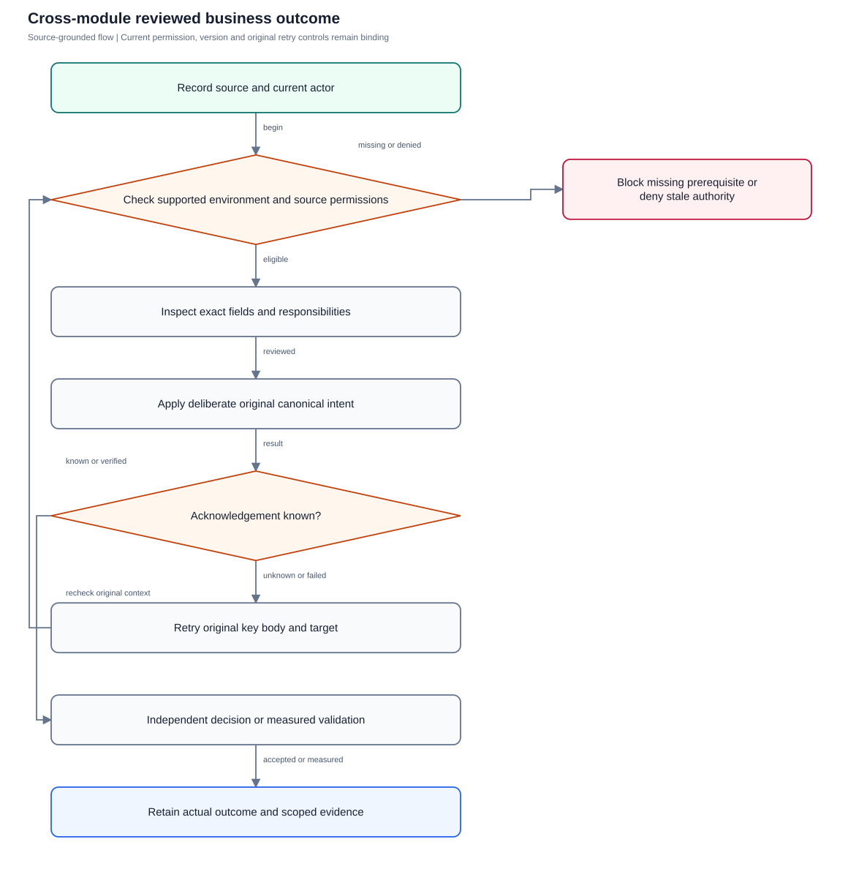
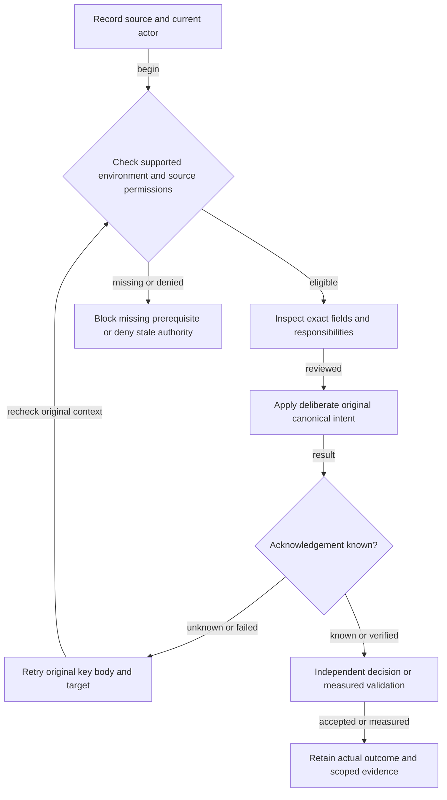

# Cross-module end-to-end journeys

Follow complete business outcomes across modules while retaining current source and independent controls.

**Entry:** People, Connect, Projects, Finance and current-source workflows

**Actors:** QA operator; Alpha leader; Owner A; Member B; Reviewer R; Finance F

## Main flow

1. Prepare owned fictional current actors and sources.
2. Inspect the named environment/fields/audience.
3. Commit deliberate canonical intent or supported setup.
4. Check genuine result and independently eligible decisions.
5. Retain scoped evidence, classify gates and clean only owned resources.

[Editable Mermaid](../diagrams/JOURNEYS.mmd)

## Controls and limits

- No candidate/task/token proves financial approval, goal outcome, actual media or production acceptance.
- Missing provider/device/region/restore prerequisites remain BLOCKED; no retained fixture replay.

## Proposed manual scenarios

All start **NOT_RUN**. Missing prerequisite = BLOCKED.

### JOURNEYS-001: People onboarding to accountable task and reports

**P0 · LOCAL · Web, API, Operator**

**Actors:**

- Alpha leader
- Owner A
- Reviewer R

**Preconditions:**

- New disposable fictional QA fixture; never the retained workspace at port 8080 or historical native fixture.
- Record source/build/environment and current roles; missing prerequisite is BLOCKED.
- People credential retry active key ID and matching keyring are configured by start-isolated-qa.sh or an equivalent isolated fixture; preserve those exact test keys across replay/restart. Otherwise onboarding is BLOCKED.

**Test data:**

- Unique QA run prefix and current eligible QA Alpha/QA Beta actors.

| Step | Action | Expected result |
| --- | --- | --- |
| 1 | Leader prepares valid department, manager and current template. | Graph/current choices valid; no automatic private membership. |
| 2 | Review fresh onboarding preview and apply once. | Onecanonical membership/template task; secret stays private, no email invitation claim. |
| 3 | New Owner A signs in and inspects My work/task originals. | Only current authorized work with original commitments. |
| 4 | Complete prerequisites and checklist and submit required-review work. | Inreview is not acceptance; progress alone not approval. |
| 5 | Independent Reviewer R accepts the current version; inspect Project/Inbox/current Reports, then select and read a task_history_v1 capture containing that acceptance. | Historical capture shows one acceptance episode with the exact original deadline metric. Current accepted-task counts and punctuality remain distinct from episode metrics; progress or a summary tile alone is not an episode. |

**Cleanup:** Clear injected faults/editors; retain audited canonical fixture data and private keys until signoff. Stop/reset only verified owned QA resources.

[Scenario flow](../diagrams/JOURNEYS-001.svg) · [Editable source](../diagrams/JOURNEYS-001.mmd)

**Source:** [docs/PEOPLE_ADMINISTRATION.md](../../../docs/PEOPLE_ADMINISTRATION.md), [docs/USER_GUIDE.md](../../../docs/USER_GUIDE.md), [backend/platform/tasks.go](../../../backend/platform/tasks.go)

**Supporting automation:** [backend/platform/people_onboarding_test.go](../../../backend/platform/people_onboarding_test.go), [backend/platform/platform_test.go](../../../backend/platform/platform_test.go)

### JOURNEYS-002: Private message disclosure to separately retained reviewed task

**P0 · LOCAL · Web, API, Operator**

**Actors:**

- Owner A
- Member B
- Alpha leader
- Reviewer R

**Preconditions:**

- New disposable fictional QA fixture; never the retained workspace at port 8080 or historical native fixture.
- Record source/build/environment and current roles; missing prerequisite is BLOCKED.

**Test data:**

- Unique QA run prefix and current eligible QA Alpha/QA Beta actors.

| Step | Action | Expected result |
| --- | --- | --- |
| 1 | A/B reopen existing private DM; excluded leader checks denial. | No name/duplicate DM; rank gives no private chat access. |
| 2 | Select current message and inspect Create task and disclosure preview. | Message-derived title itself discloses text. |
| 3 | Review/rewrite exact title and optional excerpt plus broader readers. | Unchecked excerpt does not make private title safe. |
| 4 | Publish current policy and source once and independently review task. | Canonical task created once; no automatic acceptance. |
| 5 | Remove source access and read task as ordinary retained-task reader. | New private reads/actions denied; retained task keeps its own ACL with no replayed source prose. |

**Cleanup:** Clear injected faults/editors; retain audited canonical fixture data and private keys until signoff. Stop/reset only verified owned QA resources.

[Scenario flow](../diagrams/JOURNEYS-002.svg) · [Editable source](../diagrams/JOURNEYS-002.mmd)

**Source:** [docs/CONNECT_UX.md](../../../docs/CONNECT_UX.md), [docs/COMMUNICATION_IMPLEMENTATION.md](../../../docs/COMMUNICATION_IMPLEMENTATION.md), [backend/platform/conversations.go](../../../backend/platform/conversations.go)

**Supporting automation:** [backend/platform/communication_review_test.go](../../../backend/platform/communication_review_test.go), [backend/platform/communication_access_test.go](../../../backend/platform/communication_access_test.go), [backend/platform/communication_conversion_test.go](../../../backend/platform/communication_conversion_test.go)

### JOURNEYS-003: Task dependency to separate milestone acceptance and observed goal

**P0 · LOCAL · Web, API, Operator**

**Actors:**

- Alpha leader
- Owner A
- Reviewer R

**Preconditions:**

- New disposable fictional QA fixture; never the retained workspace at port 8080 or historical native fixture.
- Record source/build/environment and current roles; missing prerequisite is BLOCKED.

**Test data:**

- Unique QA run prefix and current eligible QA Alpha/QA Beta actors.

| Step | Action | Expected result |
| --- | --- | --- |
| 1 | Create Project P/prerequisite/successor/milestone with captured versions. | Graph/scope/independent actors valid. |
| 2 | Attempt required submission with incomplete prerequisite. | Required guard blocks false completion. |
| 3 | Complete prerequisites and independently accept tasks. | Real task acceptance separate from 100% progress. |
| 4 | Review milestone independently against current criteria and versions. | Separate human milestone acceptance, not automatic task-derived approval. |
| 5 | Reopen/change a captured task before stale milestone decision; inspect Goal G. | Stale milestone decision needs fresh review; Goal value never inferred from task completion. |

**Cleanup:** Clear injected faults/editors; retain audited canonical fixture data and private keys until signoff. Stop/reset only verified owned QA resources.

[Scenario flow](../diagrams/JOURNEYS-003.svg) · [Editable source](../diagrams/JOURNEYS-003.mmd)

**Source:** [docs/API_CONTRACT.md](../../../docs/API_CONTRACT.md), [docs/PLANNING_AND_GOALS.md](../../../docs/PLANNING_AND_GOALS.md), [frontend/src/pages/Projects.tsx](../../../frontend/src/pages/Projects.tsx)

**Supporting automation:** [backend/platform/platform_test.go](../../../backend/platform/platform_test.go)

### JOURNEYS-004: Same-date timed revision and five-minute-late original commitment

**P0 · LOCAL · Web, API, Operator**

**Actors:**

- Owner A
- Reviewer R

**Preconditions:**

- New disposable fictional QA fixture; never the retained workspace at port 8080 or historical native fixture.
- Record source/build/environment and current roles; missing prerequisite is BLOCKED.

**Test data:**

- Use measured wait in disposable QA; original future deadline / revised future deadline both today.

| Step | Action | Expected result |
| --- | --- | --- |
| 1 | Create Timed T due shortly ahead today in Asia/Kolkata. | One original UTC instant/zone recorded. |
| 2 | Revise same-date instant with reason/current version. | Original unchanged; revision flagged on same date. |
| 3 | Independent Reviewer R accepts at original deadline+5 minutes before revised instant. | Actual acceptance late against original / on time against current; no clock/history forging. |
| 4 | Read current report including that civil day. | Exact original/current rates and denominators reflect that record. |
| 5 | Export same original snapshot and compare deadlines/rates. | Frozen rows and formula protection agree; no latest-token substitution. |

**Cleanup:** Clear injected faults/editors; retain audited canonical fixture data and private keys until signoff. Stop/reset only verified owned QA resources.

[Scenario flow](../diagrams/JOURNEYS-004.svg) · [Editable source](../diagrams/JOURNEYS-004.mmd)

**Source:** [backend/platform/deadlines.go](../../../backend/platform/deadlines.go), [backend/platform/report_reads.go](../../../backend/platform/report_reads.go), [frontend/src/pages/GoalsReports.tsx](../../../frontend/src/pages/GoalsReports.tsx)

**Supporting automation:** [backend/platform/deadlines_test.go](../../../backend/platform/deadlines_test.go), [verification/runtime/reports_smoke.mjs](../../../verification/runtime/reports_smoke.mjs)

### JOURNEYS-005: Budgeted expense to independent payment and department totals

**P0 · LOCAL · Web, API, Operator**

**Actors:**

- Owner A
- Finance F
- Alpha leader

**Preconditions:**

- New disposable fictional QA fixture; never the retained workspace at port 8080 or historical native fixture.
- Record source/build/environment and current roles; missing prerequisite is BLOCKED.

**Test data:**

- Active Engineering envelope amountMinor 1000000 for a nonoverlapping period containing the expense date; no other spending in this fixture.
- Expense amountMinor 123456 INR; fictional vendor/invoice, receipt or meaningful exception, current versions, independent Finance F, and valid fictional external-payment date/method/reference.

| Step | Action | Expected result |
| --- | --- | --- |
| 1 | Financial authority prepares the active INR Engineering budget and eligible category. | Current nonoverlapping fiscal boundaries and amountMinor 1000000 validated. |
| 2 | Owner A saves a 1234.56 INR draft with receipt or a meaningful evidence exception. | Exactly 123456 minor units; draft is neither approved nor paid. |
| 3 | Owner A submits and attempts self-approval or payment; inspect pending and envelope totals. | Submitted economics locked and creator approval/rejection/payment denied; pending 123456, used 0 and available 1000000 in the fresh fixture. |
| 4 | Independent Finance F reviews current budget, policy, evidence and version and approves. | Approved-unpaid/used 123456, available 876544. Evidence exception requires independent acceptance note; override is relevant only to a separate deliberately insufficient-budget variant. |
| 5 | After a fictional external payment, Finance F records the full payment; inspect totals and immutable paid economics. | Paid 123456, approved-unpaid 0, used 123456 and available 876544 unchanged; no funds moved or double counting. Paid amount cannot be rewritten. |

**Cleanup:** Clear injected faults/editors; retain audited canonical fixture data and private keys until signoff. Stop/reset only verified owned QA resources.

[Scenario flow](../diagrams/JOURNEYS-005.svg) · [Editable source](../diagrams/JOURNEYS-005.mmd)

**Source:** [backend/platform/finance.go](../../../backend/platform/finance.go), [docs/FINANCE_GUIDE.md](../../../docs/FINANCE_GUIDE.md)

**Supporting automation:** [backend/platform/finance_test.go](../../../backend/platform/finance_test.go), [verification/finance_flow.py](../../../verification/finance_flow.py)

### JOURNEYS-006: Receipt suggestion to human reviewed canonical draft with unknownACK

**P0 · LOCAL_CONFIG · Web, API, Operator**

**Actors:**

- Owner A
- Finance F
- QA operator

**Preconditions:**

- New disposable fictional QA fixture; never the retained workspace at port 8080 or historical native fixture.
- Record source/build/environment and current roles; missing prerequisite is BLOCKED.
- Private finance intake storage, clean configured scanner, separately configured verified OCR and original live session/source/destination binding; absence of a positive capability is BLOCKED.

**Test data:**

- Unique QA run prefix and current eligible QA Alpha/QA Beta actors.

| Step | Action | Expected result |
| --- | --- | --- |
| 1 | Stage a harmless private receipt and complete clean scanner assessment. | Current original session/source/capture required; clean scanner result alone does not authorize OCR. |
| 2 | Owner A deliberately opts into extraction using the current live session/source/destination binding; inspect the current result revision and every uncertainty. | Extraction is opt-in and suggests fields; it neither submits, approves nor pays. |
| 3 | Review and deliberately enter exact amountMinor, category, date and destination; inspect the complete finance audience and explicitly choose copyEvidence=true. | Human-reviewed fields, current result revision, exact minor units and complete audience are captured; no blind provider write. |
| 4 | Lose postcommit ACK thenretry original key, body and target. | Onecanonicaldraft/evidencecopy, no autoapproval/payment. |
| 5 | Expire/revoke scratch and read retainedexpense throughfinanceACL. | Scratchneverrenews; independentlyretained businessrecord has ordinarypermission/lifetime. |

**Cleanup:** Clear injected faults/editors; retain audited canonical fixture data and private keys until signoff. Stop/reset only verified owned QA resources.

[Scenario flow](../diagrams/JOURNEYS-006.svg) · [Editable source](../diagrams/JOURNEYS-006.mmd)

**Source:** [docs/API_CONTRACT.md](../../../docs/API_CONTRACT.md), [backend/platform/finance_assistance_runtime.go](../../../backend/platform/finance_assistance_runtime.go)

**Supporting automation:** [verification/runtime/finance_assistance_fixture.py](../../../verification/runtime/finance_assistance_fixture.py), [verification/runtime/finance_assistance_smoke.mjs](../../../verification/runtime/finance_assistance_smoke.mjs)

### JOURNEYS-007: CSV distinct occurrence import to full payment association and audited unmatch

**P0 · LOCAL_CONFIG · Web, API, Operator**

**Actors:**

- Finance F
- Independent payment recorder
- QA operator

**Preconditions:**

- New disposable fictional QA fixture; never the retained workspace at port 8080 or historical native fixture.
- Record source/build/environment and current roles; missing prerequisite is BLOCKED.

**Test data:**

- Fictional CSV containing two identical negative INR debits -1234.56; explicitly select delimiter/header/date/decimal/grouping/sign and column mapping.
- One independently approved and externally paid expense amountMinor 123456 INR; current row/expense/allocation versions and meaningful review reasons.

| Step | Action | Expected result |
| --- | --- | --- |
| 1 | Stage scanned fictional CSV with two identical negative debits; explicitly map delimiter/header/date/decimal/grouping/sign and all required columns. | Two distinct logical ordinals remain; no guessed bank interpretation. |
| 2 | Review both normalized occurrences and debit total; lose only the post-import acknowledgement using the supported owned harness. | Debit 246912 minor units; mapping/key/body frozen while acknowledgement is unknown. |
| 3 | Retry the original key/body/mapping then refresh the current imported rows. | One canonical import on exact retry, without duplicate occurrence import. |
| 4 | With current finance pair access and captured row/expense versions, associate one full debit to the paid expense using a meaningful reason. | One full-debit association and second equal occurrence unmatched; no funds transfer. Matching does not invent creator exclusion: approve/reject/pay retain independent actor exclusions. |
| 5 | With captured allocation version and reason, perform audited unmatch; separately lose current pair access and attempt a new stale association. | Only association reverses; paid amount unchanged and audit retained. New association after access loss denied. |

**Cleanup:** Clear injected faults/editors; retain audited canonical fixture data and private keys until signoff. Stop/reset only verified owned QA resources.

[Scenario flow](../diagrams/JOURNEYS-007.svg) · [Editable source](../diagrams/JOURNEYS-007.mmd)

**Source:** [backend/platform/finance_statements.go](../../../backend/platform/finance_statements.go), [backend/platform/finance_reconciliation.go](../../../backend/platform/finance_reconciliation.go)

**Supporting automation:** [backend/platform/finance_reconciliation_test.go](../../../backend/platform/finance_reconciliation_test.go), [verification/runtime/finance_assistance_smoke.mjs](../../../verification/runtime/finance_assistance_smoke.mjs)

### JOURNEYS-008: Saved report to public Inbox and isolated departed recipient

**P0 · LOCAL_CONFIG · Web, API, Operator**

**Actors:**

- Saved report owner
- Owner A recipient
- Member B recipient
- QA operator

**Preconditions:**

- New disposable fictional QA fixture; never the retained workspace at port 8080 or historical native fixture.
- Record source/build/environment and current roles; missing prerequisite is BLOCKED.
- Dedicated private REPORT_ARTIFACT_ROOT with active owned report worker/maintenance/delivery loops; eligible saved-definition owner and authorized A/B sources. B is unrelated to the owner and A sources. Missing storage blocks positive artifact/delivery checks.

**Test data:**

- Unique QA run prefix and current eligible QA Alpha/QA Beta actors.

| Step | Action | Expected result |
| --- | --- | --- |
| 1 | Save the current definition with eligible owner, recipients A/B and an observed qualified period. | Explicit save validates all recipients; no fabricated history. |
| 2 | Run the due schedule/generation/delivery; A reads ordinary company-relative GET /attention and opens the IDs-only recipient-bound report_ready job link. | One current ready, unexpired recipient-bound report link visible; A cannot route or escalate report_ready. |
| 3 | Replay the same occurrence/delivery after an owned worker restart. | No duplicate canonical job, artifact or link. |
| 4 | Depart or suspend only unrelated recipient B; inspect A’s previous authorized artifact/link and the next occurrence. | B denied independently; still-eligible owner and A preserve A’s prior output/link and next occurrence. |
| 5 | In separate fixtures test owner departure/demotion, complete source loss, definition revision, schedule version, explicit A removal and expiry before a fresh read. | Each affected output is invalidated under the corresponding owner/source/version/removal/expiry control. B-only loss is not complete source loss. |

**Cleanup:** Clear injected faults/editors; retain audited canonical fixture data and private keys until signoff. Stop/reset only verified owned QA resources.

[Scenario flow](../diagrams/JOURNEYS-008.svg) · [Editable source](../diagrams/JOURNEYS-008.mmd)

**Source:** [backend/platform/saved_reports.go](../../../backend/platform/saved_reports.go), [backend/platform/report_schedules.go](../../../backend/platform/report_schedules.go), [backend/platform/attention_scopes.go](../../../backend/platform/attention_scopes.go)

**Supporting automation:** [backend/platform/reporting_final_test.go](../../../backend/platform/reporting_final_test.go), [verification/runtime/final_reporting_runtime.py](../../../verification/runtime/final_reporting_runtime.py)

### JOURNEYS-009: Grounded candidate to deliberately reviewed canonical work

**P0 · LOCAL_CONFIG · Web, API, Operator**

**Actors:**

- Owner A
- Reviewer R
- QA operator

**Preconditions:**

- New disposable fictional QA fixture; never the retained workspace at port 8080 or historical native fixture.
- Record source/build/environment and current roles; missing prerequisite is BLOCKED.
- Verified pinned local provider identity, fresh isolated provider capacity and accepted current local-processing policy; inspect exact source revision/version/hash and selection-preview hash.

**Test data:**

- Unique QA run prefix and current eligible QA Alpha/QA Beta actors.

| Step | Action | Expected result |
| --- | --- | --- |
| 1 | Inspect exact current source revision/version/hash and selection-preview hash; explicitly accept the current local-processing policy. | Only explicit selected sources and policy consent; no whole-company inference or substitution of latest tokens. |
| 2 | Run the verified pinned local provider with fresh isolated capacity; inspect citations and current source authorization. | Candidate grounded only in selected sources; invalid output fails closed. |
| 3 | For a private task candidate, select an anchor and current existing instruction action; review all contributing originals, complete audience and exact edited payload/hash. | Candidate is not assignment or approval; normal task guards and reviewed disclosure apply. |
| 4 | Publish deliberate canonical intent. If acknowledgement is unknown, preserve original request/key/body and check current publication-access before canonical replay. | One canonical publication/task, with independent review. Raw expiry alone does not abandon an unknown committed publication; current provenance/ACL gates the frozen retry. |
| 5 | Test raw expiry separately from source/session revocation; read any separately retained task through its ordinary ACL. | Expired raw job cannot support a new first write; still-readable originals may be deliberately selected for fresh generation. Source/session revocation denies raw disclosure and current-authorized replay. Retained task follows ordinary ACL; no raw TTL renewal. |

**Cleanup:** Clear injected faults/editors; retain audited canonical fixture data and private keys until signoff. Stop/reset only verified owned QA resources.

[Scenario flow](../diagrams/JOURNEYS-009.svg) · [Editable source](../diagrams/JOURNEYS-009.mmd)

**Source:** [docs/intelligence-local.md](../../../docs/intelligence-local.md), [backend/platform/intelligence_sources.go](../../../backend/platform/intelligence_sources.go)

**Supporting automation:** [backend/platform/intelligence_publication_test.go](../../../backend/platform/intelligence_publication_test.go), [verification/runtime/intelligence_smoke.mjs](../../../verification/runtime/intelligence_smoke.mjs)

### JOURNEYS-010: Departure handover retires private outputs without changing money or other membership

**P0 · LOCAL · Web, API, Operator**

**Actors:**

- Alpha leader
- Member B
- Replacement owners/reviewers
- Private source participants

**Preconditions:**

- New disposable fictional QA fixture; never the retained workspace at port 8080 or historical native fixture.
- Record source/build/environment and current roles; missing prerequisite is BLOCKED.

**Test data:**

- Unique QA run prefix and current eligible QA Alpha/QA Beta actors.

| Step | Action | Expected result |
| --- | --- | --- |
| 1 | Create B’s complete handover and Alpha/Beta memberships and original facts. | Current obligations/originals/paid facts recorded privately. |
| 2 | Leader inspects departure preview, replacements and opaque private blockers. | Rank gives no private prose / bypass operation. |
| 3 | Resolve in-review milestone separately and source obligations only through authorized participants. | No automatic milestone/private decision close. |
| 4 | Fresh preview and canonical handover and departure apply. | Atomic metadata handover; money/acceptedfacts/original deadlines unchanged; route is not payment. |
| 5 | B tries stale Alpha grants, signs in for QA Beta, explicitly rejoins Alpha. | Alpha old grant retired; Beta membership preserved with fresh account authentication; rejoin never revives old private interval / raw output. |

**Cleanup:** Clear injected faults/editors; retain audited canonical fixture data and private keys until signoff. Stop/reset only verified owned QA resources.

[Scenario flow](../diagrams/JOURNEYS-010.svg) · [Editable source](../diagrams/JOURNEYS-010.mmd)

**Source:** [docs/PEOPLE_ADMINISTRATION.md](../../../docs/PEOPLE_ADMINISTRATION.md), [docs/SECURITY_AND_LIMITATIONS.md](../../../docs/SECURITY_AND_LIMITATIONS.md)

**Supporting automation:** [backend/platform/people_departure_test.go](../../../backend/platform/people_departure_test.go), [backend/platform/people_output_lifecycle_test.go](../../../backend/platform/people_output_lifecycle_test.go)

### JOURNEYS-011: Native draft survives allowed checks and clears on genuine source loss

**P0 · DEVICE · Web, API, Operator**

**Actors:**

- Owner A on qualified native build
- Authorized revocation operator

**Preconditions:**

- New disposable fictional QA fixture; never the retained workspace at port 8080 or historical native fixture.
- Record source/build/environment and current roles; missing prerequisite is BLOCKED.

**Test data:**

- Unique QA run prefix and current eligible QA Alpha/QA Beta actors.

| Step | Action | Expected result |
| --- | --- | --- |
| 1 | Open exact-source native editor over trusted HTTPS and type a QA draft with keyboard. | Actual actor/source/focus/cursor/IME measurable. |
| 2 | Trigger foreground/current-source pending check across an ordinary refresh. | Authored same-scope controls remain; fetched private content / options withheld / send disabled. |
| 3 | Complete positive original-source check and return through Back or the picker. | Original value / cursor / inspected version survive allowed navigation; no latest reselection. |
| 4 | Authorized operator genuinely revokes the source and releases late held response. | Affected private content / recovery / capture clear; stale callbacks cannot restore. |
| 5 | Repeat at enlarged font with actual owning-target measurements. | No hidden action / keyboard trap; native 44dp owners measured, not inferred from CSS. |

**Cleanup:** Clear injected faults/editors; retain audited canonical fixture data and private keys until signoff. Stop/reset only verified owned QA resources.

[Scenario flow](../diagrams/JOURNEYS-011.svg) · [Editable source](../diagrams/JOURNEYS-011.mmd)

**Source:** [mobile/src/Workspace.tsx](../../../mobile/src/Workspace.tsx), [mobile/src/ConnectUI.tsx](../../../mobile/src/ConnectUI.tsx), [mobile/src/PeopleScreen.tsx](../../../mobile/src/PeopleScreen.tsx)

**Supporting automation:** [mobile/src/Workspace.test.tsx](../../../mobile/src/Workspace.test.tsx), [mobile/src/PeopleFlows.test.tsx](../../../mobile/src/PeopleFlows.test.tsx)

### JOURNEYS-012: Real calls/background notification follow source grants and actual media

**P0 · PRODUCTION · Web, API, Operator**

**Actors:**

- Owner A
- Member B
- Source revocation operator
- Device operator

**Preconditions:**

- New disposable fictional QA fixture; never the retained workspace at port 8080 or historical native fixture.
- Record source/build/environment and current roles; missing prerequisite is BLOCKED.

**Test data:**

- Unique QA run prefix and current eligible QA Alpha/QA Beta actors.

| Step | Action | Expected result |
| --- | --- | --- |
| 1 | Configure named staged LiveKit/TURN/push and signed physical clients and trusted HTTPS. | Real provider / device / network matrix recorded; token alone not media. |
| 2 | A calls and B answers; verify actual two-way audio/video. | Provider join distinguishes answer; actual media observed. |
| 3 | Repeat background, lock and network handoff; genuinely remove participant source access. | Old source grants / push / rejoin revoked under current checks. |
| 4 | Inspect unanswered missed-call outcome and actual background push separately. | Deduplication / current recipient / source authority and actual delivery observed independently. |
| 5 | Confirm disabled call recording and transcription; review selected clean voice attachment separately. | No disabled capture success invented; attachment assistance has its own consent / provider gate. |

**Cleanup:** Clear injected faults/editors; retain audited canonical fixture data and private keys until signoff. Stop/reset only verified owned QA resources.

[Scenario flow](../diagrams/JOURNEYS-012.svg) · [Editable source](../diagrams/JOURNEYS-012.mmd)

**Source:** [backend/platform/communication_calls.go](../../../backend/platform/communication_calls.go), [backend/platform/call_provider.go](../../../backend/platform/call_provider.go), [docs/COMMUNICATION_OPERATIONS.md](../../../docs/COMMUNICATION_OPERATIONS.md)

**Supporting automation:** [backend/platform/communication_calls_test.go](../../../backend/platform/communication_calls_test.go), [verification/runtime/livekit-browser.mjs](../../../verification/runtime/livekit-browser.mjs)
