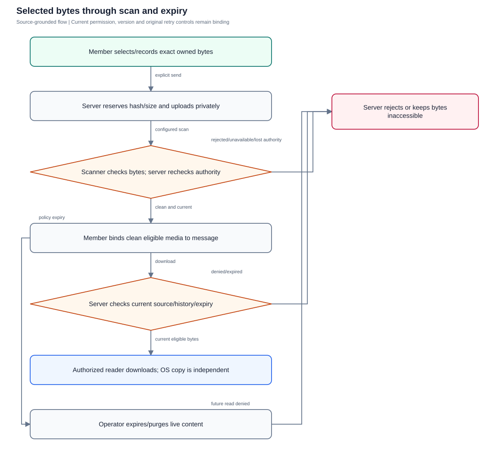
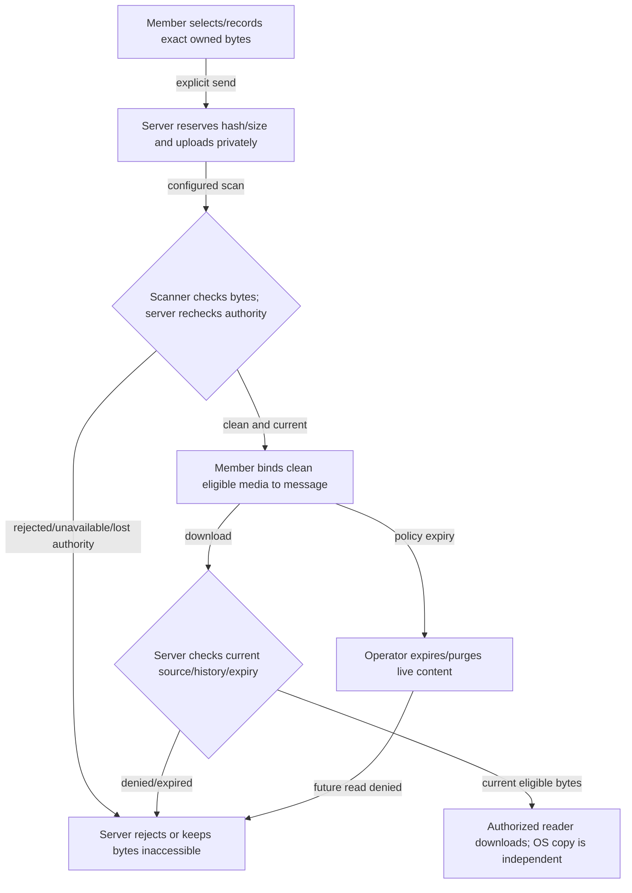

# Private files and voice media

Verify reserved exact bytes, fail-closed scanning, current download authority, retention and explicitly selected audio assistance.

**Entry:** Connect → Attachments & voice notes; media download action; API: conversation media reservation/upload/finalize/download; Operator: isolated scanner/storage/retention controls; local attached-audio assistance

**Actors:** Owner A: conversation owner and company member in fictional QA Alpha; Member B: company member and selected recipient in QA Alpha; Reviewer R: independent reviewer in QA Alpha; Alpha leader: company administrator outside the private conversation in QA Alpha; Outsider O: member only in fictional QA Beta; Platform operator: platform operator without private conversation membership

## Main flow

1. Member selects or records a file and freezes its upload identity/hash.
2. Server reserves and uploads private bytes; configured scanner determines clean or rejected state after fresh authorization.
3. Member sends only eligible clean media; reader download checks current source/history/expiry.
4. Operator expires/purges live media; reviewed business copies and deliberately shared files have independent lifetimes.

[Editable Mermaid](../diagrams/MEDIA.mmd)

## Controls and limits

- Use LOCAL_CONFIG for storage/scanner/provider-bound acceptance; missing scanner/provider is BLOCKED, never a clean result.
- Chat media currently streams io.Copy inside withCommunicationTransaction; no report-style per-chunk fencing or interruption guarantee is claimed.
- Attached-audio opt-in assistance is separate from disabled live-call recording/transcription. No inference or provider execution is performed during catalog authorship.
- Exported/shared bytes, backups and published business copies cannot be remotely recalled by removing chat source.

## Proposed manual scenarios

All start **NOT_RUN**. Missing prerequisite = BLOCKED.

### MEDIA-001: Select clean attachment, scan and send

**P1 · LOCAL_CONFIG · Web, API**

**Actors:**

- Owner A: conversation owner and company member in fictional QA Alpha
- Member B: company member and selected recipient in QA Alpha
- Reviewer R: independent reviewer in QA Alpha
- Alpha leader: company administrator outside the private conversation in QA Alpha
- Outsider O: member only in fictional QA Beta
- Platform operator: platform operator without private conversation membership

**Preconditions:**

- Use a newly provisioned isolated QA server and fictional accounts; never the running workspace or historical native fixture.
- Record sanitized observations only: no tokens, private prose, raw sensitive screenshots, provider secrets or real company/user identifiers.
- This is a proposed manual scenario with status NOT_RUN. Missing required configuration/build/device/deployment is BLOCKED; automated references are not manual passes.
- Private media storage and a configured scanner are available in the owned isolated fixture.

**Test data:**

- Use authored fictional QA text and newly issued fixture IDs; never paste real conversations or credentials.

| Step | Action | Expected result |
| --- | --- | --- |
| 1 | Open Attachments & voice notes, choose a small fictional TXT/PDF/image file and inspect its name/size preview. | Selection is a preview and does not yet create an accepted message. |
| 2 | Select Send selected media with configured private storage and scanner. | The UI shows Uploading and scanning; clean finalization precedes attaching media to a message. |
| 3 | Observe reservation, upload, finalize and message acceptance in sanitized fixture metadata; Member B downloads the attachment. | One media reservation/message is accepted and the authorized reader receives the selected exact bytes with attachment disposition. |
| 4 | Cancel a second unsent selection and inspect the conversation again. | Canceled selection adds no message; the prior accepted attachment remains usable. |

**Cleanup:** Close fixture dialogs, discard unsent QA input and remove or archive only the owned disposable fixture through authorized controls; revoke fixture sessions when finished.

[Scenario flow](../diagrams/MEDIA-001.svg) · [Editable source](../diagrams/MEDIA-001.mmd)

**Source:** [frontend/src/communication/MediaComposer.tsx](../../../frontend/src/communication/MediaComposer.tsx), [backend/platform/communication_media.go](../../../backend/platform/communication_media.go), [backend/platform/messages.go](../../../backend/platform/messages.go)

**Supporting automation:** [backend/platform/communication_media_test.go](../../../backend/platform/communication_media_test.go), [frontend/src/communication/MediaComposer.test.tsx](../../../frontend/src/communication/MediaComposer.test.tsx)

### MEDIA-002: Quarantined bytes never become readable before scan

**P1 · LOCAL_CONFIG · Web, API**

**Actors:**

- Owner A: conversation owner and company member in fictional QA Alpha
- Member B: company member and selected recipient in QA Alpha
- Reviewer R: independent reviewer in QA Alpha
- Alpha leader: company administrator outside the private conversation in QA Alpha
- Outsider O: member only in fictional QA Beta
- Platform operator: platform operator without private conversation membership

**Preconditions:**

- Use a newly provisioned isolated QA server and fictional accounts; never the running workspace or historical native fixture.
- Record sanitized observations only: no tokens, private prose, raw sensitive screenshots, provider secrets or real company/user identifiers.
- This is a proposed manual scenario with status NOT_RUN. Missing required configuration/build/device/deployment is BLOCKED; automated references are not manual passes.

**Test data:**

- Use authored fictional QA text and newly issued fixture IDs; never paste real conversations or credentials.

| Step | Action | Expected result |
| --- | --- | --- |
| 1 | Reserve and upload a fictional allowed file without calling finalize through the isolated API. | Reservation/upload leaves media unclean; no accepted chat attachment is implied. |
| 2 | Attempt uploader and Member B downloads and attempt binding its media ID to a message. | Non-clean downloads are unavailable and unclean media cannot be published as a sent attachment. |
| 3 | Finalize with the configured clean scanner, then bind the exact media ID and fetch as Member B. | Clean state and authorized message binding allow current readers to download; guessed or unrelated reservations remain unavailable. |

**Cleanup:** Close fixture dialogs, discard unsent QA input and remove or archive only the owned disposable fixture through authorized controls; revoke fixture sessions when finished.

[Scenario flow](../diagrams/MEDIA-002.svg) · [Editable source](../diagrams/MEDIA-002.mmd)

**Source:** [backend/platform/communication_media.go](../../../backend/platform/communication_media.go), [backend/platform/messages.go](../../../backend/platform/messages.go)

**Supporting automation:** [backend/platform/communication_media_test.go](../../../backend/platform/communication_media_test.go)

### MEDIA-003: Scanner rejection and outage fail closed

**P0 · LOCAL_CONFIG · Web, API**

**Actors:**

- Owner A: conversation owner and company member in fictional QA Alpha
- Member B: company member and selected recipient in QA Alpha
- Reviewer R: independent reviewer in QA Alpha
- Alpha leader: company administrator outside the private conversation in QA Alpha
- Outsider O: member only in fictional QA Beta
- Platform operator: platform operator without private conversation membership

**Preconditions:**

- Use a newly provisioned isolated QA server and fictional accounts; never the running workspace or historical native fixture.
- Record sanitized observations only: no tokens, private prose, raw sensitive screenshots, provider secrets or real company/user identifiers.
- This is a proposed manual scenario with status NOT_RUN. Missing required configuration/build/device/deployment is BLOCKED; automated references are not manual passes.
- Separate QA scanner rejection/outage environments are provisioned; never stop or inject into the running workspace scanner.

**Test data:**

- Use authored fictional QA text and newly issued fixture IDs; never paste real conversations or credentials.

| Step | Action | Expected result |
| --- | --- | --- |
| 1 | In a disposable scanner fixture select a standard harmless scanner-test artifact owned by QA and send it. | Configured rejection produces an error and no accepted clean attachment. |
| 2 | Inspect the visible scan error and attempt direct media download/publication. | Rejected bytes remain inaccessible; no task/expense evidence copy can bypass clean eligibility. |
| 3 | Use a separately configured unavailable scanner fixture and attempt finalization of a harmless file. | Unavailable scanning rejects or refuses finalization; no fallback marks bytes clean. |
| 4 | Restore scanner availability and inspect the rejected reservation and UI retry outcome; begin a fresh permitted selection when needed. | Rejected state is not assumed recoverable by repeating finalize; record the actual conflict/error and use a newly authorized reservation for a fresh attempt. |

**Cleanup:** Close fixture dialogs, discard unsent QA input and remove or archive only the owned disposable fixture through authorized controls; revoke fixture sessions when finished.

[Scenario flow](../diagrams/MEDIA-003.svg) · [Editable source](../diagrams/MEDIA-003.mmd)

**Source:** [backend/platform/communication_media.go](../../../backend/platform/communication_media.go), [backend/platform/communication_review_test.go](../../../backend/platform/communication_review_test.go), [docs/COMMUNICATION_OPERATIONS.md](../../../docs/COMMUNICATION_OPERATIONS.md)

**Supporting automation:** [backend/platform/communication_media_test.go](../../../backend/platform/communication_media_test.go), [backend/platform/communication_services_test.go](../../../backend/platform/communication_services_test.go)

### MEDIA-004: Upload hash, size, format and quota boundaries

**P1 · LOCAL_CONFIG · Web, API**

**Actors:**

- Owner A: conversation owner and company member in fictional QA Alpha
- Member B: company member and selected recipient in QA Alpha
- Reviewer R: independent reviewer in QA Alpha
- Alpha leader: company administrator outside the private conversation in QA Alpha
- Outsider O: member only in fictional QA Beta
- Platform operator: platform operator without private conversation membership

**Preconditions:**

- Use a newly provisioned isolated QA server and fictional accounts; never the running workspace or historical native fixture.
- Record sanitized observations only: no tokens, private prose, raw sensitive screenshots, provider secrets or real company/user identifiers.
- This is a proposed manual scenario with status NOT_RUN. Missing required configuration/build/device/deployment is BLOCKED; automated references are not manual passes.
- Configure explicit low quotas only in a disposable media fixture; accepted chat limit differs from 10-MiB task/receipt evidence limits.

**Test data:**

- Use authored fictional QA text and newly issued fixture IDs; never paste real conversations or credentials.

| Step | Action | Expected result |
| --- | --- | --- |
| 1 | Select an empty or over-25-MiB fixture file in the browser, then try a mismatched extension/content file through the API. | Zero/oversize or unsupported mismatched content is refused; no clean attachment results. |
| 2 | Reserve an allowed exact size/hash and upload different bytes or a different size. | Hash/size mismatch cannot finalize as the originally selected file. |
| 3 | Repeat the exact reservation key/body, then reuse that key with changed hash/name/size. | Exact retry reuses the reservation; changed intent conflicts. |
| 4 | In a separately provisioned low-quota fixture, retain quarantined/rejected reservations and attempt another reservation. | All non-purged reserved bytes count toward per-user/company quota; rejected/quarantined bytes do not disappear from quota before cleanup. |

**Cleanup:** Close fixture dialogs, discard unsent QA input and remove or archive only the owned disposable fixture through authorized controls; revoke fixture sessions when finished.

[Scenario flow](../diagrams/MEDIA-004.svg) · [Editable source](../diagrams/MEDIA-004.mmd)

**Source:** [frontend/src/communication/MediaComposer.tsx](../../../frontend/src/communication/MediaComposer.tsx), [backend/platform/communication_media.go](../../../backend/platform/communication_media.go), [backend/platform/media_jobs.go](../../../backend/platform/media_jobs.go)

**Supporting automation:** [backend/platform/communication_media_test.go](../../../backend/platform/communication_media_test.go)

### MEDIA-005: Unknown upload/send acknowledgement retries exact media intent

**P1 · LOCAL_CONFIG · Web, API**

**Actors:**

- Owner A: conversation owner and company member in fictional QA Alpha
- Member B: company member and selected recipient in QA Alpha
- Reviewer R: independent reviewer in QA Alpha
- Alpha leader: company administrator outside the private conversation in QA Alpha
- Outsider O: member only in fictional QA Beta
- Platform operator: platform operator without private conversation membership

**Preconditions:**

- Use a newly provisioned isolated QA server and fictional accounts; never the running workspace or historical native fixture.
- Record sanitized observations only: no tokens, private prose, raw sensitive screenshots, provider secrets or real company/user identifiers.
- This is a proposed manual scenario with status NOT_RUN. Missing required configuration/build/device/deployment is BLOCKED; automated references are not manual passes.

**Test data:**

- Use authored fictional QA text and newly issued fixture IDs; never paste real conversations or credentials.

| Step | Action | Expected result |
| --- | --- | --- |
| 1 | Choose a small fictional file, start Send selected media and drop one response only in the isolated fixture transport. | The client retains its original selected file, reservation and message identity; unknown acknowledgement is not displayed as accepted. |
| 2 | Observe Retry same media message and attempt selecting a different attachment while the pending intent exists. | New selection is disabled while retry intent exists; pending content is not silently substituted. |
| 3 | Restore transport and choose Retry same media message; fetch current authorized history. | Resume uses original reservation/hash/message identity and results in one accepted media message. |
| 4 | Try changed bytes under the same API upload/send identity in a separate negative request. | Payload-bound identities reject changed bytes/body/media bindings instead of creating a misleading duplicate. |

**Cleanup:** Close fixture dialogs, discard unsent QA input and remove or archive only the owned disposable fixture through authorized controls; revoke fixture sessions when finished.

[Scenario flow](../diagrams/MEDIA-005.svg) · [Editable source](../diagrams/MEDIA-005.mmd)

**Source:** [frontend/src/communication/MediaComposer.tsx](../../../frontend/src/communication/MediaComposer.tsx), [mobile/src/Media.tsx](../../../mobile/src/Media.tsx), [backend/platform/communication_media.go](../../../backend/platform/communication_media.go), [backend/platform/messages.go](../../../backend/platform/messages.go)

**Supporting automation:** [frontend/src/communication/MediaComposer.test.tsx](../../../frontend/src/communication/MediaComposer.test.tsx), [backend/platform/messages_test.go](../../../backend/platform/messages_test.go), [backend/platform/communication_media_test.go](../../../backend/platform/communication_media_test.go)

### MEDIA-006: Voice preview, discard and selected send

**P1 · LOCAL_CONFIG · Web, API**

**Actors:**

- Owner A: conversation owner and company member in fictional QA Alpha
- Member B: company member and selected recipient in QA Alpha
- Reviewer R: independent reviewer in QA Alpha
- Alpha leader: company administrator outside the private conversation in QA Alpha
- Outsider O: member only in fictional QA Beta
- Platform operator: platform operator without private conversation membership

**Preconditions:**

- Use a newly provisioned isolated QA server and fictional accounts; never the running workspace or historical native fixture.
- Record sanitized observations only: no tokens, private prose, raw sensitive screenshots, provider secrets or real company/user identifiers.
- This is a proposed manual scenario with status NOT_RUN. Missing required configuration/build/device/deployment is BLOCKED; automated references are not manual passes.
- Browser microphone and configured private storage/scanner are available; native microphone acceptance is separately DEVICE-gated.

**Test data:**

- Use authored fictional QA text and newly issued fixture IDs; never paste real conversations or credentials.

| Step | Action | Expected result |
| --- | --- | --- |
| 1 | Allow microphone permission and choose Record voice note; speak only a fictional QA sentence, then stop. | Stopping releases recording tracks and creates a local preview. |
| 2 | Play the Voice note preview before sending and inspect current history. | Preview is playable without an accepted server message or automatic transcription. |
| 3 | Discard/cancel the preview, then create a fresh short voice note and choose Send selected media. | Discard adds no message; sending a new note follows the same scanning/reservation controls as other media. |
| 4 | Open another conversation while a new recording is active. | Leaving the mounted media component stops recording and releases tracks; no old conversation recording is silently sent. |

**Cleanup:** Close fixture dialogs, discard unsent QA input and remove or archive only the owned disposable fixture through authorized controls; revoke fixture sessions when finished.

[Scenario flow](../diagrams/MEDIA-006.svg) · [Editable source](../diagrams/MEDIA-006.mmd)

**Source:** [frontend/src/communication/MediaComposer.tsx](../../../frontend/src/communication/MediaComposer.tsx), [backend/platform/communication_media.go](../../../backend/platform/communication_media.go)

**Supporting automation:** [frontend/src/communication/MediaComposer.test.tsx](../../../frontend/src/communication/MediaComposer.test.tsx)

### MEDIA-007: Removal/rejoin revokes future attachment access

**P0 · LOCAL_CONFIG · Web, API**

**Actors:**

- Owner A: conversation owner and company member in fictional QA Alpha
- Member B: company member and selected recipient in QA Alpha
- Reviewer R: independent reviewer in QA Alpha
- Alpha leader: company administrator outside the private conversation in QA Alpha
- Outsider O: member only in fictional QA Beta
- Platform operator: platform operator without private conversation membership

**Preconditions:**

- Use a newly provisioned isolated QA server and fictional accounts; never the running workspace or historical native fixture.
- Record sanitized observations only: no tokens, private prose, raw sensitive screenshots, provider secrets or real company/user identifiers.
- This is a proposed manual scenario with status NOT_RUN. Missing required configuration/build/device/deployment is BLOCKED; automated references are not manual passes.

**Test data:**

- Use authored fictional QA text and newly issued fixture IDs; never paste real conversations or credentials.

| Step | Action | Expected result |
| --- | --- | --- |
| 1 | Member B downloads an eligible clean bound attachment and keeps only a disposable QA copy. | Only current authorized clean bytes are downloaded initially. |
| 2 | Owner A removes the attachment’s source message; Member B follows its remembered download URL. | A removed parent message makes a fresh download unavailable. |
| 3 | In a separate private group remove and re-invite Member B after sending a newer marker; request the old attachment URL again. | The new private history interval does not restore old source media access. |
| 4 | Compare the app’s denied future download with the previously downloaded copy. | The app can deny future reads; previously delivered/copied bytes remain outside revocation and must be deleted by QA. |

**Cleanup:** Delete all downloaded fictional QA copies; remove owned fixture attachments and revoke fixture sessions.

[Scenario flow](../diagrams/MEDIA-007.svg) · [Editable source](../diagrams/MEDIA-007.mmd)

**Source:** [backend/platform/communication_media.go](../../../backend/platform/communication_media.go), [backend/platform/communication_access.go](../../../backend/platform/communication_access.go), [docs/SECURITY_AND_LIMITATIONS.md](../../../docs/SECURITY_AND_LIMITATIONS.md)

**Supporting automation:** [backend/platform/communication_media_test.go](../../../backend/platform/communication_media_test.go), [backend/platform/communication_access_test.go](../../../backend/platform/communication_access_test.go)

### MEDIA-008: Expiry and retention scrub live content while keeping retry tombstones

**P1 · LOCAL_CONFIG · Web, API**

**Actors:**

- Owner A: conversation owner and company member in fictional QA Alpha
- Member B: company member and selected recipient in QA Alpha
- Reviewer R: independent reviewer in QA Alpha
- Alpha leader: company administrator outside the private conversation in QA Alpha
- Outsider O: member only in fictional QA Beta
- Platform operator: platform operator without private conversation membership

**Preconditions:**

- Use a newly provisioned isolated QA server and fictional accounts; never the running workspace or historical native fixture.
- Record sanitized observations only: no tokens, private prose, raw sensitive screenshots, provider secrets or real company/user identifiers.
- This is a proposed manual scenario with status NOT_RUN. Missing required configuration/build/device/deployment is BLOCKED; automated references are not manual passes.
- Prepare owned pre-expired synthetic media/text fixtures and an isolated retention worker; do not restore historical fixture or alter host time.

**Test data:**

- Use authored fictional QA text and newly issued fixture IDs; never paste real conversations or credentials.

| Step | Action | Expected result |
| --- | --- | --- |
| 1 | Use an isolated pre-expired clean media/message fixture before asynchronous cleanup; request download and task/expense conversion preview. | Expiry itself denies media read/copy before cleanup; waiting for the worker is not an authorization requirement. |
| 2 | Run only the fixture owner’s scheduled retention/cleanup acceptance step and refresh chat, structured records and saved projections. | Live message/revision/record response content is scrubbed; expired media is purged by cleanup and is unavailable. |
| 3 | Replay the exact original send identity after content expiry. | Retained non-content retry identity prevents recreating the purged instruction or duplicate content. |
| 4 | Inspect independently published QA business evidence and any authorized exported copy separately. | Existing published business evidence/export copies follow independent ownership/retention and are not claimed erased. |

**Cleanup:** Close fixture dialogs, discard unsent QA input and remove or archive only the owned disposable fixture through authorized controls; revoke fixture sessions when finished.

[Scenario flow](../diagrams/MEDIA-008.svg) · [Editable source](../diagrams/MEDIA-008.mmd)

**Source:** [backend/platform/communication_retention.go](../../../backend/platform/communication_retention.go), [backend/platform/media_jobs.go](../../../backend/platform/media_jobs.go), [backend/platform/communication_media.go](../../../backend/platform/communication_media.go), [docs/COMMUNICATION_OPERATIONS.md](../../../docs/COMMUNICATION_OPERATIONS.md)

**Supporting automation:** [backend/platform/communication_retention_test.go](../../../backend/platform/communication_retention_test.go), [backend/platform/communication_review_test.go](../../../backend/platform/communication_review_test.go)

### MEDIA-009: Only reviewed eligible media creates an independent business copy

**P1 · LOCAL_CONFIG · Web, API**

**Actors:**

- Owner A: conversation owner and company member in fictional QA Alpha
- Member B: company member and selected recipient in QA Alpha
- Reviewer R: independent reviewer in QA Alpha
- Alpha leader: company administrator outside the private conversation in QA Alpha
- Outsider O: member only in fictional QA Beta
- Platform operator: platform operator without private conversation membership

**Preconditions:**

- Use a newly provisioned isolated QA server and fictional accounts; never the running workspace or historical native fixture.
- Record sanitized observations only: no tokens, private prose, raw sensitive screenshots, provider secrets or real company/user identifiers.
- This is a proposed manual scenario with status NOT_RUN. Missing required configuration/build/device/deployment is BLOCKED; automated references are not manual passes.

**Test data:**

- Use authored fictional QA text and newly issued fixture IDs; never paste real conversations or credentials.

| Step | Action | Expected result |
| --- | --- | --- |
| 1 | Attach a clean QA file to a selected-publication source and explicitly select it as evidence for a task or expense draft through the supported publication surface/API. | Only current readable media belonging to selected source messages is eligible; unselected attachments are not automatically copied. |
| 2 | Preview the current business audience and acknowledge publication before committing. | Commit rechecks source/policy/destination authority and creates only reviewed evidence in the business record. |
| 3 | Remove the original chat message and fetch its original attachment URL; inspect the authorized business evidence route separately. | Future chat reads are denied; the selected business copy remains independently authorized. |
| 4 | Try the same publication with a separately expired or rejected source media ID. | Expired/rejected media cannot be copied even when cleanup has not yet run. |

**Cleanup:** Close fixture dialogs, discard unsent QA input and remove or archive only the owned disposable fixture through authorized controls; revoke fixture sessions when finished.

[Scenario flow](../diagrams/MEDIA-009.svg) · [Editable source](../diagrams/MEDIA-009.mmd)

**Source:** [backend/platform/communication_conversion.go](../../../backend/platform/communication_conversion.go), [backend/platform/communication_finance.go](../../../backend/platform/communication_finance.go), [backend/platform/communication_media.go](../../../backend/platform/communication_media.go)

**Supporting automation:** [backend/platform/communication_review_test.go](../../../backend/platform/communication_review_test.go), [backend/platform/communication_finance_test.go](../../../backend/platform/communication_finance_test.go)

### MEDIA-010: Selected attached-audio assistance stays separate from disabled call recording

**P1 · LOCAL_CONFIG · Web, API, Operator**

**Actors:**

- Owner A: conversation owner and company member in fictional QA Alpha
- Member B: company member and selected recipient in QA Alpha
- Reviewer R: independent reviewer in QA Alpha
- Alpha leader: company administrator outside the private conversation in QA Alpha
- Outsider O: member only in fictional QA Beta
- Platform operator: platform operator without private conversation membership

**Preconditions:**

- Use a newly provisioned isolated QA server and fictional accounts; never the running workspace or historical native fixture.
- Record sanitized observations only: no tokens, private prose, raw sensitive screenshots, provider secrets or real company/user identifiers.
- This is a proposed manual scenario with status NOT_RUN. Missing required configuration/build/device/deployment is BLOCKED; automated references are not manual passes.
- Requires opt-in local assistance and a bounded attached-audio provider configured in a new fixture; no inference is executed while authoring this catalog.

**Test data:**

- Use authored fictional QA text and newly issued fixture IDs; never paste real conversations or credentials.

| Step | Action | Expected result |
| --- | --- | --- |
| 1 | Attach a clean fictional audio note and open the local assistance source-selection surface; explicitly opt in and select that single attached audio source. | Only a currently readable clean attached audio selection is offered; microphone/call capture is not the source. |
| 2 | With the bounded configured local audio provider, submit only that selected audio for assistance and inspect source association without exporting raw output. | Assistance is scoped to the exact selected attachment and configured local provider; no cloud fallback or call recording is implied. |
| 3 | Try selecting a non-clean, expired, removed or unreadable attachment as an audio source. | Ineligible media is withheld/rejected rather than sent to the provider. |
| 4 | Open an active call and inspect available controls and notices. | Call recording/transcription stays disabled with Recording off; no recording/transcription acceptance is inferred from attached-audio assistance. |

**Cleanup:** Close fixture dialogs, discard unsent QA input and remove or archive only the owned disposable fixture through authorized controls; revoke fixture sessions when finished.

[Scenario flow](../diagrams/MEDIA-010.svg) · [Editable source](../diagrams/MEDIA-010.mmd)

**Source:** [backend/platform/intelligence_sources.go](../../../backend/platform/intelligence_sources.go), [backend/platform/intelligence_whisper.go](../../../backend/platform/intelligence_whisper.go), [frontend/src/communication/Calls.tsx](../../../frontend/src/communication/Calls.tsx), [mobile/README.md](../../../mobile/README.md), [docs/SECURITY_AND_LIMITATIONS.md](../../../docs/SECURITY_AND_LIMITATIONS.md)

**Supporting automation:** [backend/platform/intelligence_sources_test.go](../../../backend/platform/intelligence_sources_test.go), [backend/platform/intelligence_whisper_test.go](../../../backend/platform/intelligence_whisper_test.go)

