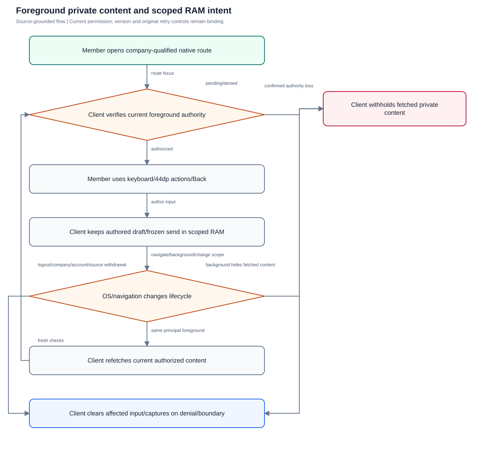
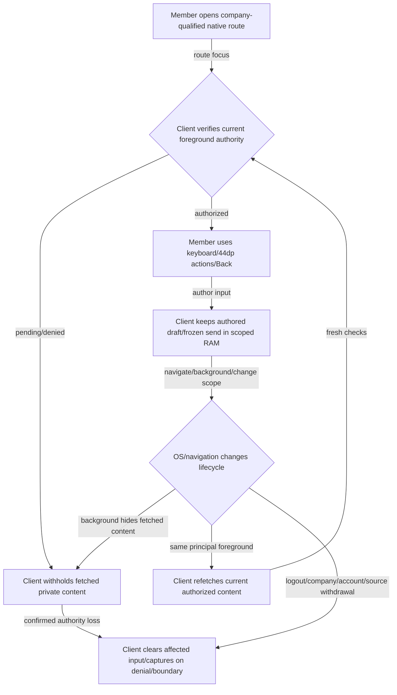

# Native usability and private-content lifecycle

Qualify phone interaction, scoped RAM intent, current foreground authority and owned-file cleanup without offline private persistence.

**Entry:** Native Sign in and company switch; Chats → person picker → conversation route → composer/message-action sheets; More/Work/Calls and OS background/Back/share boundaries

**Actors:** Owner A: conversation owner and company member in fictional QA Alpha; Member B: company member and selected recipient in QA Alpha; Reviewer R: independent reviewer in QA Alpha; Alpha leader: company administrator outside the private conversation in QA Alpha; Outsider O: member only in fictional QA Beta; Platform operator: platform operator without private conversation membership

## Main flow

1. Member signs into a trusted origin and opens a company-qualified route.
2. Native keyboard/scroll/focus keep the fixed composer and 44dp Action controls reachable.
3. Temporary navigation/background preserves authored scoped RAM intent while fetched private content is withheld.
4. Fresh foreground authorization permits redisplay; confirmed boundary/source withdrawal clears affected intent and owned captures.

[Editable Mermaid](../diagrams/MOBILE.mmd)

## Controls and limits

- DEVICE cases require physical acceptance or specifically recorded emulator qualification with exact build; DOM tests/Hermes exports do not prove layout, keyboard, accessibility or OS behavior.
- 44dp minimum describes native Action controls. Browser widths/CSS pixels are separate and never counted as physical target dimensions.
- Authored drafts/frozen sends may survive only in process RAM; fetched history/quotes are separately withheld. Process death is not offline synchronization.
- Temporary owned capture/download cache is an explicit file exception; deliberately shared OS copies cannot be recalled.

## Proposed manual scenarios

All start **NOT_RUN**. Missing prerequisite = BLOCKED.

### MOBILE-001: Trusted native sign-in, company binding and denied release origin

**P0 · DEVICE · Android, iOS**

**Actors:**

- Owner A: conversation owner and company member in fictional QA Alpha
- Member B: company member and selected recipient in QA Alpha
- Reviewer R: independent reviewer in QA Alpha
- Alpha leader: company administrator outside the private conversation in QA Alpha
- Outsider O: member only in fictional QA Beta
- Platform operator: platform operator without private conversation membership

**Preconditions:**

- Use a newly provisioned isolated QA server and fictional accounts; never the running workspace or historical native fixture.
- Record sanitized observations only: no tokens, private prose, raw sensitive screenshots, provider secrets or real company/user identifiers.
- This is a proposed manual scenario with status NOT_RUN. Missing required configuration/build/device/deployment is BLOCKED; automated references are not manual passes.

**Test data:**

- Use authored fictional QA text and newly issued fixture IDs; never paste real conversations or credentials.

| Step | Action | Expected result |
| --- | --- | --- |
| 1 | On a release fixture install the exact qualified build and enter the actual isolated trusted HTTPS origin in Sign in. | Sign in remains reachable; secure session is stored using platform secure storage without credentials in URLs. |
| 2 | Complete the fictional account’s sign-in/MFA if enabled and open QA Alpha Chats. | Routes and requests bind to current user/company; no other company content appears. |
| 3 | Attempt HTTP, URL credentials, a path/query or fragment as a release server origin. | Unsafe origins are rejected with a secure-origin error rather than accepted as release transport. |
| 4 | On a separate fresh release device restore only a developer HTTP endpoint/session setting and launch. | Unsafe retained origin is rejected and its stored token removed; no existing historical native fixture is reused. |

**Cleanup:** Close fixture dialogs, discard unsent QA input and remove or archive only the owned disposable fixture through authorized controls; revoke fixture sessions when finished.

[Scenario flow](../diagrams/MOBILE-001.svg) · [Editable source](../diagrams/MOBILE-001.mmd)

**Source:** [mobile/src/client.ts](../../../mobile/src/client.ts), [mobile/src/app/login.tsx](../../../mobile/src/app/login.tsx), [mobile/README.md](../../../mobile/README.md)

**Supporting automation:** [mobile/src/client.test.ts](../../../mobile/src/client.test.ts)

### MOBILE-002: Phone keyboard leaves composer and sheets reachable

**P1 · DEVICE · Android, iOS**

**Actors:**

- Owner A: conversation owner and company member in fictional QA Alpha
- Member B: company member and selected recipient in QA Alpha
- Reviewer R: independent reviewer in QA Alpha
- Alpha leader: company administrator outside the private conversation in QA Alpha
- Outsider O: member only in fictional QA Beta
- Platform operator: platform operator without private conversation membership

**Preconditions:**

- Use a newly provisioned isolated QA server and fictional accounts; never the running workspace or historical native fixture.
- Record sanitized observations only: no tokens, private prose, raw sensitive screenshots, provider secrets or real company/user identifiers.
- This is a proposed manual scenario with status NOT_RUN. Missing required configuration/build/device/deployment is BLOCKED; automated references are not manual passes.

**Test data:**

- Use authored fictional QA text and newly issued fixture IDs; never paste real conversations or credentials.

| Step | Action | Expected result |
| --- | --- | --- |
| 1 | At supported phone size open a long private chat and focus Message composer beneath the company header. | KeyboardFrame accounts for the measured screen origin/safe area; fixed composer stays above the keyboard. |
| 2 | Type a multiline fictional draft and scroll history while the keyboard stays open. | History scrolls independently and authored text is visible without covering Send. |
| 3 | Open a message-action or structured-creation sheet and focus its lower input; select its primary action. | Sheet inputs/actions remain reachable with handled keyboard taps; no clipping traps the primary action. |
| 4 | Dismiss the keyboard and navigate back to the conversation list. | Keyboard dismissal restores usable layout and back navigation; record physical keyboard/OS/build separately. |

**Cleanup:** Close fixture dialogs, discard unsent QA input and remove or archive only the owned disposable fixture through authorized controls; revoke fixture sessions when finished.

[Scenario flow](../diagrams/MOBILE-002.svg) · [Editable source](../diagrams/MOBILE-002.mmd)

**Source:** [mobile/src/KeyboardFrame.tsx](../../../mobile/src/KeyboardFrame.tsx), [mobile/src/ConnectUI.tsx](../../../mobile/src/ConnectUI.tsx), [mobile/src/NativeConversation.tsx](../../../mobile/src/NativeConversation.tsx), [mobile/src/NativeComposer.tsx](../../../mobile/src/NativeComposer.tsx)

**Supporting automation:** [mobile/src/KeyboardFrame.test.tsx](../../../mobile/src/KeyboardFrame.test.tsx)

### MOBILE-003: Enlarged text and native 44dp target geometry

**P1 · DEVICE · Android, iOS**

**Actors:**

- Owner A: conversation owner and company member in fictional QA Alpha
- Member B: company member and selected recipient in QA Alpha
- Reviewer R: independent reviewer in QA Alpha
- Alpha leader: company administrator outside the private conversation in QA Alpha
- Outsider O: member only in fictional QA Beta
- Platform operator: platform operator without private conversation membership

**Preconditions:**

- Use a newly provisioned isolated QA server and fictional accounts; never the running workspace or historical native fixture.
- Record sanitized observations only: no tokens, private prose, raw sensitive screenshots, provider secrets or real company/user identifiers.
- This is a proposed manual scenario with status NOT_RUN. Missing required configuration/build/device/deployment is BLOCKED; automated references are not manual passes.

**Test data:**

- Use authored fictional QA text and newly issued fixture IDs; never paste real conversations or credentials.

| Step | Action | Expected result |
| --- | --- | --- |
| 1 | Set each supported device’s enlarged accessibility text size and open Auth, Connect list and a long conversation. | App-owned content remains readable and actions reachable without horizontal clipping that prevents task completion. |
| 2 | Inspect person names, message metadata, unread badge and multiline draft around narrow safe areas. | Long content wraps/scrolls; composer and sheet controls remain reachable at enlarged text. |
| 3 | Measure native Action targets for Back/Close/Send and structured recipient/reviewer controls using qualified device geometry. | App-owned Action controls retain at least 44dp height/width; parent clipping must not shrink usable bounds. Record any failing non-Action controls rather than assume coverage. |
| 4 | Use assistive navigation to inspect action labels, disabled/selected states and focus order. | Accessible button labels/states match visible actions and focus follows usable route/sheet order. |

**Cleanup:** Close fixture dialogs, discard unsent QA input and remove or archive only the owned disposable fixture through authorized controls; revoke fixture sessions when finished.

[Scenario flow](../diagrams/MOBILE-003.svg) · [Editable source](../diagrams/MOBILE-003.mmd)

**Source:** [mobile/src/ConnectUI.tsx](../../../mobile/src/ConnectUI.tsx), [mobile/src/app/login.tsx](../../../mobile/src/app/login.tsx), [mobile/src/Structured.tsx](../../../mobile/src/Structured.tsx), [mobile/README.md](../../../mobile/README.md)

**Supporting automation:** [mobile/src/NativeConversation.test.tsx](../../../mobile/src/NativeConversation.test.tsx), [mobile/src/Structured.test.tsx](../../../mobile/src/Structured.test.tsx)

### MOBILE-004: Route focus, Back and retained unfocused conversation

**P1 · DEVICE · Android, iOS**

**Actors:**

- Owner A: conversation owner and company member in fictional QA Alpha
- Member B: company member and selected recipient in QA Alpha
- Reviewer R: independent reviewer in QA Alpha
- Alpha leader: company administrator outside the private conversation in QA Alpha
- Outsider O: member only in fictional QA Beta
- Platform operator: platform operator without private conversation membership

**Preconditions:**

- Use a newly provisioned isolated QA server and fictional accounts; never the running workspace or historical native fixture.
- Record sanitized observations only: no tokens, private prose, raw sensitive screenshots, provider secrets or real company/user identifiers.
- This is a proposed manual scenario with status NOT_RUN. Missing required configuration/build/device/deployment is BLOCKED; automated references are not manual passes.

**Test data:**

- Use authored fictional QA text and newly issued fixture IDs; never paste real conversations or credentials.

| Step | Action | Expected result |
| --- | --- | --- |
| 1 | Open conversation A, then return to Chats and open conversation B; leave the old route retained by navigation. | Only focused company-qualified route owns its selected conversation; old routes do not cancel B. |
| 2 | Use Back, reopen A and open/close a message-action sheet using native Back/Close. | Back/list/chat transitions stay consistent and sheet closure respects busy states. |
| 3 | While A is open, revoke A’s membership through the fixture owner and navigate Back then revisit its remembered route. | Confirmed revocation clears selection; remembered route does not reopen A without fresh authority. |
| 4 | Observe B after the unfocused A route unmounts or updates. | An unfocused retained A route cannot clear or replace B’s current selection. |

**Cleanup:** Close fixture dialogs, discard unsent QA input and remove or archive only the owned disposable fixture through authorized controls; revoke fixture sessions when finished.

[Scenario flow](../diagrams/MOBILE-004.svg) · [Editable source](../diagrams/MOBILE-004.mmd)

**Source:** [mobile/src/app/chat/[id].tsx](../../../mobile/src/app/chat/[id].tsx), [mobile/src/ConnectUI.tsx](../../../mobile/src/ConnectUI.tsx), [mobile/src/Workspace.tsx](../../../mobile/src/Workspace.tsx)

**Supporting automation:** [mobile/src/ConversationRoute.test.tsx](../../../mobile/src/ConversationRoute.test.tsx), [mobile/src/NativeConversation.test.tsx](../../../mobile/src/NativeConversation.test.tsx)

### MOBILE-005: Offline errors preserve recoverable authored intent without false acceptance

**P1 · DEVICE · Android, iOS**

**Actors:**

- Owner A: conversation owner and company member in fictional QA Alpha
- Member B: company member and selected recipient in QA Alpha
- Reviewer R: independent reviewer in QA Alpha
- Alpha leader: company administrator outside the private conversation in QA Alpha
- Outsider O: member only in fictional QA Beta
- Platform operator: platform operator without private conversation membership

**Preconditions:**

- Use a newly provisioned isolated QA server and fictional accounts; never the running workspace or historical native fixture.
- Record sanitized observations only: no tokens, private prose, raw sensitive screenshots, provider secrets or real company/user identifiers.
- This is a proposed manual scenario with status NOT_RUN. Missing required configuration/build/device/deployment is BLOCKED; automated references are not manual passes.

**Test data:**

- Use authored fictional QA text and newly issued fixture IDs; never paste real conversations or credentials.

| Step | Action | Expected result |
| --- | --- | --- |
| 1 | Write an unsent fictional draft with reply/mention choices in A; disconnect only the owned device from the fixture server. | Authored draft is scoped RAM input; no private offline database is introduced. |
| 2 | Attempt send and let a history poll/search fail; inspect pending/error presentation. | Recoverable transport failure retains exact intent but is not shown as accepted; current unread/read state is not fabricated. |
| 3 | Restore transport while current membership is unchanged; reopen A and explicitly resume the intended send. | Current authorization precedes resumption; one intended send can succeed with its original identity. |
| 4 | Read current server history and verify no invented accepted/read state during the offline interval. | History reconciles to actual server acceptance; fetched stale content is not used as offline authority. |

**Cleanup:** Close fixture dialogs, discard unsent QA input and remove or archive only the owned disposable fixture through authorized controls; revoke fixture sessions when finished.

[Scenario flow](../diagrams/MOBILE-005.svg) · [Editable source](../diagrams/MOBILE-005.mmd)

**Source:** [mobile/src/NativeComposer.tsx](../../../mobile/src/NativeComposer.tsx), [mobile/src/NativeConversation.tsx](../../../mobile/src/NativeConversation.tsx), [mobile/src/client.ts](../../../mobile/src/client.ts), [shared/communication/drafts.ts](../../../shared/communication/drafts.ts)

**Supporting automation:** [mobile/src/NativeConversation.test.tsx](../../../mobile/src/NativeConversation.test.tsx), [mobile/src/NativeComposer.test.tsx](../../../mobile/src/NativeComposer.test.tsx), [mobile/src/client.test.ts](../../../mobile/src/client.test.ts)

### MOBILE-006: Unknown send ACK remains frozen across A to B to A

**P0 · DEVICE · Android, iOS**

**Actors:**

- Owner A: conversation owner and company member in fictional QA Alpha
- Member B: company member and selected recipient in QA Alpha
- Reviewer R: independent reviewer in QA Alpha
- Alpha leader: company administrator outside the private conversation in QA Alpha
- Outsider O: member only in fictional QA Beta
- Platform operator: platform operator without private conversation membership

**Preconditions:**

- Use a newly provisioned isolated QA server and fictional accounts; never the running workspace or historical native fixture.
- Record sanitized observations only: no tokens, private prose, raw sensitive screenshots, provider secrets or real company/user identifiers.
- This is a proposed manual scenario with status NOT_RUN. Missing required configuration/build/device/deployment is BLOCKED; automated references are not manual passes.

**Test data:**

- Use authored fictional QA text and newly issued fixture IDs; never paste real conversations or credentials.

| Step | Action | Expected result |
| --- | --- | --- |
| 1 | Send a fictional reply with selected mention chips in A and drop only its response in the owned fixture transport. | Unknown acceptance preserves original key/body/reply/mention choices and does not report a second new send. |
| 2 | Navigate normally A → B → A while the pending send is unknown. | Normal same-company navigation preserves A’s isolated RAM pending intent without exposing it in B. |
| 3 | Try editing/replacing the pending intent, then deliberately retry after fresh authority. | Retry uses the exact original frozen payload; new prose is not substituted into that identity. |
| 4 | Observe a confirmed send followed by an unrelated thread/history fetch outage. | Accepted send retires pending intent even if a later read fails; history can be reconciled without sending again. |

**Cleanup:** Close fixture dialogs, discard unsent QA input and remove or archive only the owned disposable fixture through authorized controls; revoke fixture sessions when finished.

[Scenario flow](../diagrams/MOBILE-006.svg) · [Editable source](../diagrams/MOBILE-006.mmd)

**Source:** [mobile/src/NativeComposer.tsx](../../../mobile/src/NativeComposer.tsx), [mobile/src/NativeConversation.tsx](../../../mobile/src/NativeConversation.tsx), [shared/communication/drafts.ts](../../../shared/communication/drafts.ts)

**Supporting automation:** [mobile/src/NativeComposer.test.tsx](../../../mobile/src/NativeComposer.test.tsx), [mobile/src/NativeConversation.test.tsx](../../../mobile/src/NativeConversation.test.tsx)

### MOBILE-007: Background withholds fetched private history until fresh foreground authorization

**P0 · DEVICE · Android, iOS**

**Actors:**

- Owner A: conversation owner and company member in fictional QA Alpha
- Member B: company member and selected recipient in QA Alpha
- Reviewer R: independent reviewer in QA Alpha
- Alpha leader: company administrator outside the private conversation in QA Alpha
- Outsider O: member only in fictional QA Beta
- Platform operator: platform operator without private conversation membership

**Preconditions:**

- Use a newly provisioned isolated QA server and fictional accounts; never the running workspace or historical native fixture.
- Record sanitized observations only: no tokens, private prose, raw sensitive screenshots, provider secrets or real company/user identifiers.
- This is a proposed manual scenario with status NOT_RUN. Missing required configuration/build/device/deployment is BLOCKED; automated references are not manual passes.

**Test data:**

- Use authored fictional QA text and newly issued fixture IDs; never paste real conversations or credentials.

| Step | Action | Expected result |
| --- | --- | --- |
| 1 | Open a private thread/record/evidence and type a separate fictional authored draft; delay a current read response in the fixture. | Fetched private content and authored intent have distinct lifecycle boundaries. |
| 2 | Background the app, allow the delayed response to arrive and return foreground with identity/metadata responses still delayed. | Old request generation is canceled/discarded; fetched private content stays hidden and inaccessible to assistive controls while background or authorization pending. |
| 3 | Complete fresh session/company/membership/source authorization with unchanged rights. | Only fresh current fetched content may redisplay; scoped authored RAM draft/pending send can resume unchanged. |
| 4 | Repeat with membership removed while background. | Confirmed access loss clears affected draft/capture/pending source content and withheld private views do not reappear. |

**Cleanup:** Close fixture dialogs, discard unsent QA input and remove or archive only the owned disposable fixture through authorized controls; revoke fixture sessions when finished.

[Scenario flow](../diagrams/MOBILE-007.svg) · [Editable source](../diagrams/MOBILE-007.mmd)

**Source:** [mobile/src/Workspace.tsx](../../../mobile/src/Workspace.tsx), [mobile/src/client.ts](../../../mobile/src/client.ts), [mobile/src/NativeConversation.tsx](../../../mobile/src/NativeConversation.tsx), [mobile/src/Structured.tsx](../../../mobile/src/Structured.tsx)

**Supporting automation:** [mobile/src/Workspace.test.tsx](../../../mobile/src/Workspace.test.tsx), [mobile/src/NativeConversation.test.tsx](../../../mobile/src/NativeConversation.test.tsx), [mobile/src/client.test.ts](../../../mobile/src/client.test.ts)

### MOBILE-008: Authored input is RAM only and process death loses it

**P1 · DEVICE · Android, iOS**

**Actors:**

- Owner A: conversation owner and company member in fictional QA Alpha
- Member B: company member and selected recipient in QA Alpha
- Reviewer R: independent reviewer in QA Alpha
- Alpha leader: company administrator outside the private conversation in QA Alpha
- Outsider O: member only in fictional QA Beta
- Platform operator: platform operator without private conversation membership

**Preconditions:**

- Use a newly provisioned isolated QA server and fictional accounts; never the running workspace or historical native fixture.
- Record sanitized observations only: no tokens, private prose, raw sensitive screenshots, provider secrets or real company/user identifiers.
- This is a proposed manual scenario with status NOT_RUN. Missing required configuration/build/device/deployment is BLOCKED; automated references are not manual passes.
- Sandbox inspection must record only allowed key/file metadata, never bearer credentials or raw private data.

**Test data:**

- Use authored fictional QA text and newly issued fixture IDs; never paste real conversations or credentials.

| Step | Action | Expected result |
| --- | --- | --- |
| 1 | Type distinct fictional drafts in two chats and a structured/publication form without sending. | Drafts remain unsent and scoped to original route/form. |
| 2 | Navigate normally among these same-company routes and return. | Same-company input returns from RAM with original pending identities; it never appears in another chat. |
| 3 | Inspect only sanitized storage-key/file metadata in the owned device sandbox; distinguish secure session storage and owned temporary media cache. | Private draft/history prose is not persisted to AsyncStorage/localStorage/plaintext disk; secure session and intentional temporary files are explicit separate mechanisms. |
| 4 | Terminate/relaunch only the disposable app process and reauthorize. | Unsent RAM drafts are lost on process death; no silent offline resend or restored private cache occurs. |

**Cleanup:** Close fixture dialogs, discard unsent QA input and remove or archive only the owned disposable fixture through authorized controls; revoke fixture sessions when finished.

[Scenario flow](../diagrams/MOBILE-008.svg) · [Editable source](../diagrams/MOBILE-008.mmd)

**Source:** [shared/communication/drafts.ts](../../../shared/communication/drafts.ts), [mobile/src/ramInput.ts](../../../mobile/src/ramInput.ts), [mobile/src/conversationDrafts.ts](../../../mobile/src/conversationDrafts.ts), [mobile/src/client.ts](../../../mobile/src/client.ts), [mobile/README.md](../../../mobile/README.md)

**Supporting automation:** [mobile/src/conversationDrafts.test.ts](../../../mobile/src/conversationDrafts.test.ts), [mobile/src/client.test.ts](../../../mobile/src/client.test.ts)

### MOBILE-009: Logout and company/account/origin boundaries clear affected intent

**P0 · DEVICE · Android, iOS**

**Actors:**

- Owner A: conversation owner and company member in fictional QA Alpha
- Member B: company member and selected recipient in QA Alpha
- Reviewer R: independent reviewer in QA Alpha
- Alpha leader: company administrator outside the private conversation in QA Alpha
- Outsider O: member only in fictional QA Beta
- Platform operator: platform operator without private conversation membership

**Preconditions:**

- Use a newly provisioned isolated QA server and fictional accounts; never the running workspace or historical native fixture.
- Record sanitized observations only: no tokens, private prose, raw sensitive screenshots, provider secrets or real company/user identifiers.
- This is a proposed manual scenario with status NOT_RUN. Missing required configuration/build/device/deployment is BLOCKED; automated references are not manual passes.

**Test data:**

- Use authored fictional QA text and newly issued fixture IDs; never paste real conversations or credentials.

| Step | Action | Expected result |
| --- | --- | --- |
| 1 | Create a fictional draft and selected capture in QA Alpha; delay a read/send response in the fixture. | Original drafts/captures and in-flight generation are owned by their exact company/user/origin. |
| 2 | Switch company and deliver the old response; open the new company’s chats and publication forms. | Boundary cancels old generation and clears affected private intent; delayed response cannot populate the new company. |
| 3 | Repeat with logout during network failure and with a new account/server sign-in. | Logout clears secure token even offline; new account/origin cannot inherit private content or old request results. |
| 4 | Return to the original authorized company and inspect drafts/captures. | Cleared private drafts/captures are not resurrected merely by returning. |

**Cleanup:** Close fixture dialogs, discard unsent QA input and remove or archive only the owned disposable fixture through authorized controls; revoke fixture sessions when finished.

[Scenario flow](../diagrams/MOBILE-009.svg) · [Editable source](../diagrams/MOBILE-009.mmd)

**Source:** [mobile/src/client.ts](../../../mobile/src/client.ts), [mobile/src/Workspace.tsx](../../../mobile/src/Workspace.tsx), [mobile/src/capture.ts](../../../mobile/src/capture.ts), [shared/communication/drafts.ts](../../../shared/communication/drafts.ts)

**Supporting automation:** [mobile/src/client.test.ts](../../../mobile/src/client.test.ts), [mobile/src/Workspace.test.tsx](../../../mobile/src/Workspace.test.tsx), [mobile/src/conversationDrafts.test.ts](../../../mobile/src/conversationDrafts.test.ts)

### MOBILE-010: Edited or removed source withdraws only affected native review intent

**P1 · DEVICE · Android, iOS**

**Actors:**

- Owner A: conversation owner and company member in fictional QA Alpha
- Member B: company member and selected recipient in QA Alpha
- Reviewer R: independent reviewer in QA Alpha
- Alpha leader: company administrator outside the private conversation in QA Alpha
- Outsider O: member only in fictional QA Beta
- Platform operator: platform operator without private conversation membership

**Preconditions:**

- Use a newly provisioned isolated QA server and fictional accounts; never the running workspace or historical native fixture.
- Record sanitized observations only: no tokens, private prose, raw sensitive screenshots, provider secrets or real company/user identifiers.
- This is a proposed manual scenario with status NOT_RUN. Missing required configuration/build/device/deployment is BLOCKED; automated references are not manual passes.

**Test data:**

- Use authored fictional QA text and newly issued fixture IDs; never paste real conversations or credentials.

| Step | Action | Expected result |
| --- | --- | --- |
| 1 | Open a thread/publication/structured form bound to current root A and keep a separate pending authored reply to unchanged root B. | Both views retain exact selected source identity/revision; sources are fetched content, not private offline copies. |
| 2 | Have the author edit A, then let source synchronization/refetch finish. | Affected A source choices/review are invalidated rather than silently refreshed into existing frozen intent. |
| 3 | Repeat with removal/expiry of A and use its remembered source target. | Removed/expired A is scrubbed/unavailable; stale publication/response cannot proceed from retained prose. |
| 4 | Deliver an unrelated message-created event or an unchanged freshly fetched B revision. | Unrelated or unchanged B events do not cancel its valid frozen reply; withdrawal is source-specific while confirmed broader denial clears scope. |

**Cleanup:** Close fixture dialogs, discard unsent QA input and remove or archive only the owned disposable fixture through authorized controls; revoke fixture sessions when finished.

[Scenario flow](../diagrams/MOBILE-010.svg) · [Editable source](../diagrams/MOBILE-010.mmd)

**Source:** [mobile/src/NativeConversation.tsx](../../../mobile/src/NativeConversation.tsx), [mobile/src/Publication.tsx](../../../mobile/src/Publication.tsx), [mobile/src/Structured.tsx](../../../mobile/src/Structured.tsx), [shared/communication/history.ts](../../../shared/communication/history.ts), [shared/communication/drafts.ts](../../../shared/communication/drafts.ts)

**Supporting automation:** [mobile/src/NativeConversation.test.tsx](../../../mobile/src/NativeConversation.test.tsx), [mobile/src/Publication.test.tsx](../../../mobile/src/Publication.test.tsx), [mobile/src/Structured.test.tsx](../../../mobile/src/Structured.test.tsx)

### MOBILE-011: Camera/picker owned files survive normal return and clear on denial

**P1 · DEVICE · Android, iOS**

**Actors:**

- Owner A: conversation owner and company member in fictional QA Alpha
- Member B: company member and selected recipient in QA Alpha
- Reviewer R: independent reviewer in QA Alpha
- Alpha leader: company administrator outside the private conversation in QA Alpha
- Outsider O: member only in fictional QA Beta
- Platform operator: platform operator without private conversation membership

**Preconditions:**

- Use a newly provisioned isolated QA server and fictional accounts; never the running workspace or historical native fixture.
- Record sanitized observations only: no tokens, private prose, raw sensitive screenshots, provider secrets or real company/user identifiers.
- This is a proposed manual scenario with status NOT_RUN. Missing required configuration/build/device/deployment is BLOCKED; automated references are not manual passes.

**Test data:**

- Use authored fictional QA text and newly issued fixture IDs; never paste real conversations or credentials.

| Step | Action | Expected result |
| --- | --- | --- |
| 1 | Select Chat photo or Choose attachment; record destination and deny camera/picker permission in one fixture variant. | Denied/canceled capture gives no accepted upload; capture destination is explicit. |
| 2 | Allow capture in another variant and return from normal camera background after fresh authorization. | Selected exact bytes bind to the original authorized capture owner only after fresh scope validation. |
| 3 | Discard the unsent preview; repeat with a selected file while company/session or confirmed source access changes. | Discard removes only owned cache bytes; confirmed boundary removes affected captures rather than attaching them to a new scope. |
| 4 | Simulate a delayed chooser result after its owning route/scope changed. | Late stale result is rejected and owned temporary file cleaned; no other app/user file is deleted. |

**Cleanup:** Close fixture dialogs, discard unsent QA input and remove or archive only the owned disposable fixture through authorized controls; revoke fixture sessions when finished.

[Scenario flow](../diagrams/MOBILE-011.svg) · [Editable source](../diagrams/MOBILE-011.mmd)

**Source:** [mobile/src/CaptureControl.tsx](../../../mobile/src/CaptureControl.tsx), [mobile/src/captureOwner.ts](../../../mobile/src/captureOwner.ts), [mobile/src/capture.ts](../../../mobile/src/capture.ts), [mobile/src/Media.tsx](../../../mobile/src/Media.tsx)

**Supporting automation:** [mobile/src/capture.test.ts](../../../mobile/src/capture.test.ts), [mobile/src/captureAdapter.test.ts](../../../mobile/src/captureAdapter.test.ts), [mobile/src/CaptureControl.test.tsx](../../../mobile/src/CaptureControl.test.tsx)

### MOBILE-012: Download share-sheet cleanup and independent OS copy exception

**P1 · DEVICE · Android, iOS**

**Actors:**

- Owner A: conversation owner and company member in fictional QA Alpha
- Member B: company member and selected recipient in QA Alpha
- Reviewer R: independent reviewer in QA Alpha
- Alpha leader: company administrator outside the private conversation in QA Alpha
- Outsider O: member only in fictional QA Beta
- Platform operator: platform operator without private conversation membership

**Preconditions:**

- Use a newly provisioned isolated QA server and fictional accounts; never the running workspace or historical native fixture.
- Record sanitized observations only: no tokens, private prose, raw sensitive screenshots, provider secrets or real company/user identifiers.
- This is a proposed manual scenario with status NOT_RUN. Missing required configuration/build/device/deployment is BLOCKED; automated references are not manual passes.
- Physical share/picker implementation and configured media/scanner fixture; choose only a disposable QA destination app.

**Test data:**

- Use authored fictional QA text and newly issued fixture IDs; never paste real conversations or credentials.

| Step | Action | Expected result |
| --- | --- | --- |
| 1 | As authorized reader download a clean fictional attachment and open the OS share sheet. | Download uses authenticated current route; bearer remains in headers and the file is temporary until deliberately shared. |
| 2 | Cancel sharing and inspect owned download-cache metadata after the operation returns. | finally cleanup deletes the owned download cache file after share completion/cancel. |
| 3 | Repeat and deliberately share to a QA-owned destination app; remove the source or revoke conversation access afterward. | External deliberate copy remains independently owned and cannot be remotely recalled; source revocation only controls future app reads. |
| 4 | Attempt a fresh download, and exercise unsupported sharing or a generation change during download. | Future revoked read fails; errors/generation change still clean owned cache files. A download already delivered in-flight is not claimed erased. |

**Cleanup:** Delete deliberate QA copies in the destination app; verify owned download cache cleanup and revoke fixture sessions.

[Scenario flow](../diagrams/MOBILE-012.svg) · [Editable source](../diagrams/MOBILE-012.mmd)

**Source:** [mobile/src/Media.tsx](../../../mobile/src/Media.tsx), [backend/platform/communication_media.go](../../../backend/platform/communication_media.go), [mobile/README.md](../../../mobile/README.md), [docs/SECURITY_AND_LIMITATIONS.md](../../../docs/SECURITY_AND_LIMITATIONS.md)

**Supporting automation:** [backend/platform/communication_media_test.go](../../../backend/platform/communication_media_test.go)

