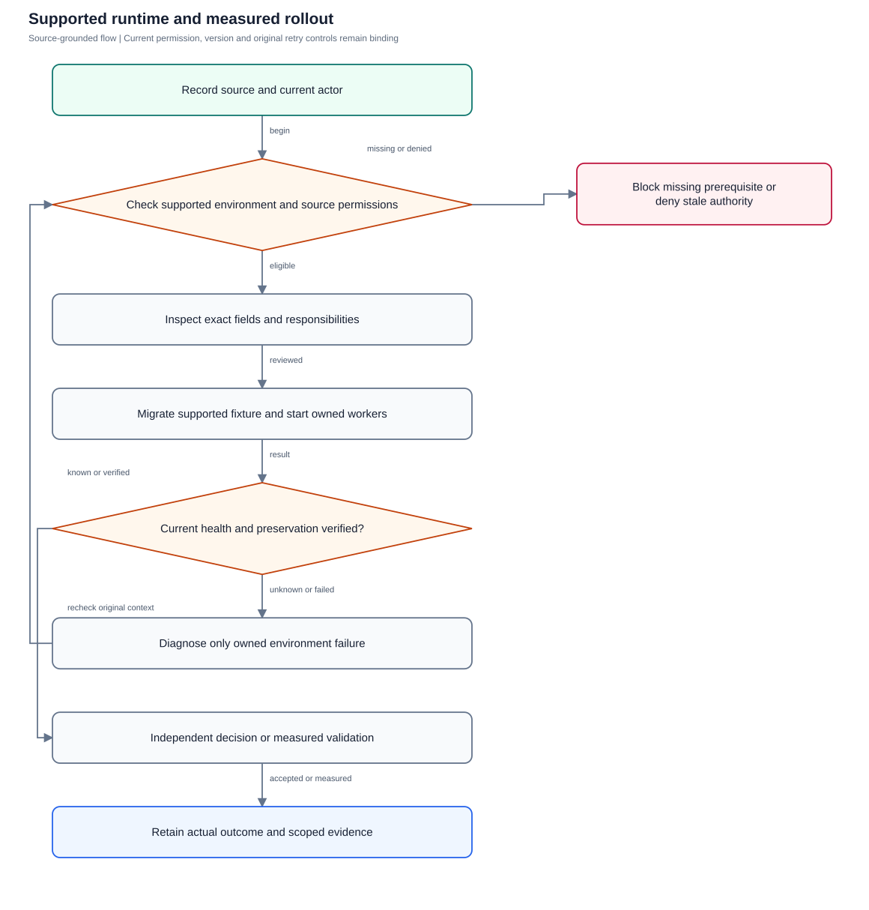
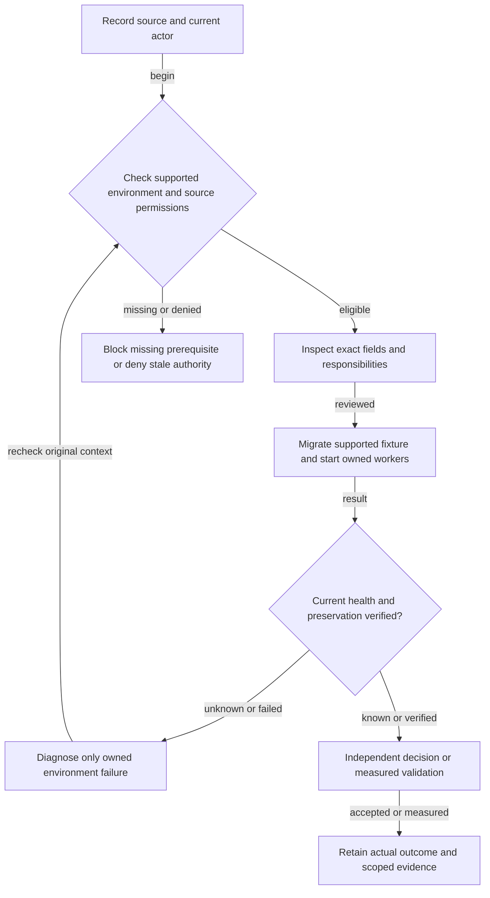

# Runtime, migration, backup and deployment

Prove supported runtime and private preservation separately from production acceptance.

**Entry:** Operator environment tools

**Actors:** QA operator; Alpha leader; Owner A; Member B; Reviewer R; Finance F

## Main flow

1. Prepare owned fictional current actors and sources.
2. Inspect the named environment/fields/audience.
3. Commit deliberate canonical intent or supported setup.
4. Check genuine result and independently eligible decisions.
5. Retain scoped evidence, classify gates and clean only owned resources.

[Editable Mermaid](../diagrams/OPERATIONS.mmd)

## Controls and limits

- No candidate/task/token proves financial approval, goal outcome, actual media or production acceptance.
- Missing provider/device/region/restore prerequisites remain BLOCKED; no retained fixture replay.

## Proposed manual scenarios

All start **NOT_RUN**. Missing prerequisite = BLOCKED.

### OPERATIONS-001: Build and start an isolated fictional instance

**P0 · LOCAL · Web, API, Operator**

**Actors:**

- QA operator

**Preconditions:**

- New disposable fictional QA fixture; never the retained workspace at port 8080 or historical native fixture.
- Record source/build/environment and current roles; missing prerequisite is BLOCKED.

**Test data:**

- Unique QA run prefix and current eligible QA Alpha/QA Beta actors.

| Step | Action | Expected result |
| --- | --- | --- |
| 1 | Check toolchains and pinned frontend dependencies. | Missing tool is an environment blocker. |
| 2 | Run start-isolated-qa.sh on port 9080. | New private DB/storage/keys only; existing port 8080 untouched. |
| 3 | Read /api/health and sign in. | HTTP 200 JSON with ok:true and real API-mode sign-in. |
| 4 | Check private run directory/config permissions without displaying secrets. | Directory mode 0700, secret files mode 0600; no inherited production/provider secrets. |

**Cleanup:** Clear injected faults/editors; retain audited canonical fixture data and private keys until signoff. Stop/reset only verified owned QA resources.

[Scenario flow](../diagrams/OPERATIONS-001.svg) · [Editable source](../diagrams/OPERATIONS-001.mmd)

**Source:** [docs/qa/tools/start-isolated-qa.sh](../../../docs/qa/tools/start-isolated-qa.sh), [backend/cmd/server/main.go](../../../backend/cmd/server/main.go), [backend/platform/seed.go](../../../backend/platform/seed.go)

**Supporting automation:** [backend/platform/platform_test.go](../../../backend/platform/platform_test.go)

### OPERATIONS-002: Restart retains business records and original recovery keys

**P0 · LOCAL_CONFIG · Web, API, Operator**

**Actors:**

- QA operator

**Preconditions:**

- New disposable fictional QA fixture; never the retained workspace at port 8080 or historical native fixture.
- Record source/build/environment and current roles; missing prerequisite is BLOCKED.

**Test data:**

- Unique QA run prefix and current eligible QA Alpha/QA Beta actors.

| Step | Action | Expected result |
| --- | --- | --- |
| 1 | Create known task/expense; record originals/minor units/versions privately. | Baseline reflects real committed records. |
| 2 | Gracefully stop the verified QA process. | Only owned test process stops. |
| 3 | Run its private restart.sh with the same database and keys. | No reset/reseed/key rotation. |
| 4 | Sign in and inspect retained records/canonical result. | Original deadlines/money/history unchanged; no duplicate canonical result. |

**Cleanup:** Clear injected faults/editors; retain audited canonical fixture data and private keys until signoff. Stop/reset only verified owned QA resources.

[Scenario flow](../diagrams/OPERATIONS-002.svg) · [Editable source](../diagrams/OPERATIONS-002.mmd)

**Source:** [docs/PEOPLE_ADMINISTRATION.md](../../../docs/PEOPLE_ADMINISTRATION.md), [backend/platform/people_credentials.go](../../../backend/platform/people_credentials.go), [backend/cmd/server/main.go](../../../backend/cmd/server/main.go)

**Supporting automation:** [backend/platform/platform_test.go](../../../backend/platform/platform_test.go)

### OPERATIONS-003: Full supported native PostgreSQL migration upgrade

**P0 · LOCAL_CONFIG · Web, API, Operator**

**Actors:**

- QA operator

**Preconditions:**

- New disposable fictional QA fixture; never the retained workspace at port 8080 or historical native fixture.
- Record source/build/environment and current roles; missing prerequisite is BLOCKED.

**Test data:**

- Unique QA run prefix and current eligible QA Alpha/QA Beta actors.

| Step | Action | Expected result |
| --- | --- | --- |
| 1 | Provision owned disposable native PostgreSQL/database/schema. | No production/sibling data selected. |
| 2 | Compare all 59 migration pairs in both trees. | 118 up/down filenames per tree match; old checksums immutable. |
| 3 | Run current checksummed numbered migration owner. | Reach version 59 with no GORM/numbered PostgreSQL mixing. |
| 4 | Repeat owner and populated-upgrade regressions on owned fixtures. | Idempotent inventory, typed original records preserved; only owned fixture resources cleaned. |

**Cleanup:** Clear injected faults/editors; retain audited canonical fixture data and private keys until signoff. Stop/reset only verified owned QA resources.

[Scenario flow](../diagrams/OPERATIONS-003.svg) · [Editable source](../diagrams/OPERATIONS-003.mmd)

**Source:** [backend/migrations/runner.go](../../../backend/migrations/runner.go), [backend/cmd/migrate/main.go](../../../backend/cmd/migrate/main.go), [encore/README.md](../../../encore/README.md)

**Supporting automation:** [backend/platform/migration_runner_test.go](../../../backend/platform/migration_runner_test.go)

### OPERATIONS-004: Production startup refuses unsafe modes

**P1 · LOCAL_CONFIG · Web, API, Operator**

**Actors:**

- QA operator

**Preconditions:**

- New disposable fictional QA fixture; never the retained workspace at port 8080 or historical native fixture.
- Record source/build/environment and current roles; missing prerequisite is BLOCKED.

**Test data:**

- Unique QA run prefix and current eligible QA Alpha/QA Beta actors.

| Step | Action | Expected result |
| --- | --- | --- |
| 1 | Try production with SQLite/missing DATABASE_URL in owned test path. | Startup refuses unsupported production database. |
| 2 | Using owned PostgreSQL, try insecure cookies or non-HTTPS allowed origins. | Startup fails closed. |
| 3 | Try explicit demo seeding in production. | Demo seed rejected; no fictional production users created. |
| 4 | Restore documented staging configuration. | Proceed only with actual PostgreSQL/TLS/origin prerequisites; separate network checks still required. |

**Cleanup:** Clear injected faults/editors; retain audited canonical fixture data and private keys until signoff. Stop/reset only verified owned QA resources.

[Scenario flow](../diagrams/OPERATIONS-004.svg) · [Editable source](../diagrams/OPERATIONS-004.mmd)

**Source:** [docs/OPERATIONS.md](../../../docs/OPERATIONS.md), [backend/cmd/server/main.go](../../../backend/cmd/server/main.go)

**Supporting automation:** [backend/platform/platform_test.go](../../../backend/platform/platform_test.go)

### OPERATIONS-005: Coordinated backup/restore preserves records and does not renew grants

**P1 · LOCAL_CONFIG · Web, API, Operator**

**Actors:**

- QA operator

**Preconditions:**

- New disposable fictional QA fixture; never the retained workspace at port 8080 or historical native fixture.
- Record source/build/environment and current roles; missing prerequisite is BLOCKED.

**Test data:**

- Unique QA run prefix and current eligible QA Alpha/QA Beta actors.

| Step | Action | Expected result |
| --- | --- | --- |
| 1 | Create known fictional task/paid expense/media/report; capture current grants. | Original commitments, money, accepted facts and expiry known. |
| 2 | Stop QA writers and back up DB/stores/keys together. | Consistent private checkpoint includes storage/key dependencies. |
| 3 | Restore only to a separate owned test directory. | No live overwrite or key replacement. |
| 4 | Check integrity/typed original rows and source/expiry authorization. | Values preserved; expired/revoked grants do not revive or duplicate work. |
| 5 | Measure backup age and elapsed restore. | Actual RPO/RTO recorded; 15-minute RPO / four-hour RTO / 35-day retention remain proposed targets until measured. |

**Cleanup:** Clear injected faults/editors; retain audited canonical fixture data and private keys until signoff. Stop/reset only verified owned QA resources.

[Scenario flow](../diagrams/OPERATIONS-005.svg) · [Editable source](../diagrams/OPERATIONS-005.mmd)

**Source:** [docs/OPERATIONS.md](../../../docs/OPERATIONS.md), [docs/COMMUNICATION_OPERATIONS.md](../../../docs/COMMUNICATION_OPERATIONS.md), [docs/reports-storage.md](../../../docs/reports-storage.md)

**Supporting automation:** [verification/runtime/standalone_smoke.py](../../../verification/runtime/standalone_smoke.py)

### OPERATIONS-006: Worker lifecycle remains independent of five-minute automation scan

**P0 · LOCAL_CONFIG · Web, API, Operator**

**Actors:**

- QA operator

**Preconditions:**

- New disposable fictional QA fixture; never the retained workspace at port 8080 or historical native fixture.
- Record source/build/environment and current roles; missing prerequisite is BLOCKED.

**Test data:**

- Unique QA run prefix and current eligible QA Alpha/QA Beta actors.

| Step | Action | Expected result |
| --- | --- | --- |
| 1 | Start owned app with DISABLE_SCHEDULER=true. | Work automation scan disabled, independent leased/maintenance workers retain documented lifecycle. |
| 2 | Exercise separately configured report/communication queues. | Queues progress with ordinary source/lease checks. |
| 3 | Restart with DISABLE_SCHEDULER=false and run recurring/reminder fixture. | Work scheduler active; repeated triggers do not duplicate successors/reminders. |
| 4 | Gracefully stop owned instance. | Workers join; unrelated processes untouched. |

**Cleanup:** Clear injected faults/editors; retain audited canonical fixture data and private keys until signoff. Stop/reset only verified owned QA resources.

[Scenario flow](../diagrams/OPERATIONS-006.svg) · [Editable source](../diagrams/OPERATIONS-006.mmd)

**Source:** [backend/cmd/server/main.go](../../../backend/cmd/server/main.go), [backend/platform/communication_runtime.go](../../../backend/platform/communication_runtime.go), [backend/platform/report_runtime.go](../../../backend/platform/report_runtime.go)

**Supporting automation:** [backend/platform/platform_test.go](../../../backend/platform/platform_test.go), [backend/platform/report_schedules_test.go](../../../backend/platform/report_schedules_test.go)

### OPERATIONS-007: Optional provider absence leaves manual workflows available

**P0 · LOCAL · Web, API, Operator**

**Actors:**

- QA operator

**Preconditions:**

- New disposable fictional QA fixture; never the retained workspace at port 8080 or historical native fixture.
- Record source/build/environment and current roles; missing prerequisite is BLOCKED.

**Test data:**

- Unique QA run prefix and current eligible QA Alpha/QA Beta actors.

| Step | Action | Expected result |
| --- | --- | --- |
| 1 | Start QA without scanner/OCR/intelligence/LiveKit/push credentials. | Ordinary app starts; optional capability truthfully unavailable. |
| 2 | Read ordinary task/chat/manual finance/report screens. | Authorized manual flows remain usable; no demo fallback. |
| 3 | Attempt unavailable optional operation. | No fake result/cloud/download fallback. |
| 4 | Explicitly configure verified isolated provider before positive cases. | Availability follows real loader checks; quality/capacity/device acceptance remains separate. |

**Cleanup:** Clear injected faults/editors; retain audited canonical fixture data and private keys until signoff. Stop/reset only verified owned QA resources.

[Scenario flow](../diagrams/OPERATIONS-007.svg) · [Editable source](../diagrams/OPERATIONS-007.mmd)

**Source:** [backend/platform/intelligence_providers.go](../../../backend/platform/intelligence_providers.go), [backend/platform/finance_assistance_runtime.go](../../../backend/platform/finance_assistance_runtime.go), [backend/platform/communication_runtime.go](../../../backend/platform/communication_runtime.go)

**Supporting automation:** [backend/platform/intelligence_runtime_test.go](../../../backend/platform/intelligence_runtime_test.go), [backend/platform/finance_assistance_runtime_test.go](../../../backend/platform/finance_assistance_runtime_test.go)

### OPERATIONS-008: Actual standalone and Encore adapters share the controls

**P1 · LOCAL_CONFIG · Web, API, Operator**

**Actors:**

- QA operator

**Preconditions:**

- New disposable fictional QA fixture; never the retained workspace at port 8080 or historical native fixture.
- Record source/build/environment and current roles; missing prerequisite is BLOCKED.

**Test data:**

- Unique QA run prefix and current eligible QA Alpha/QA Beta actors.

| Step | Action | Expected result |
| --- | --- | --- |
| 1 | Prepare distinct owned adapter fixtures and complete numbered inventory. | Ports/schemas/secrets belong only to this run. |
| 2 | Run actual analyzer/export/runtime owning gates. | Ordinary Go wrapper build is not Encore runtime acceptance. |
| 3 | Compare public login/scope/CSV/worker delivery/restart checks. | Both use same source/session/recipient/version/idempotency controls. |
| 4 | Dispose only recorded owned resources. | Sibling DB/container/provider unchanged; raw logs stay private. |

**Cleanup:** Clear injected faults/editors; retain audited canonical fixture data and private keys until signoff. Stop/reset only verified owned QA resources.

[Scenario flow](../diagrams/OPERATIONS-008.svg) · [Editable source](../diagrams/OPERATIONS-008.mmd)

**Source:** [encore/README.md](../../../encore/README.md), [verification/runtime/README.md](../../../verification/runtime/README.md)

**Supporting automation:** [verification/runtime/encore_export_smoke.py](../../../verification/runtime/encore_export_smoke.py), [verification/runtime/final_reporting_runtime.py](../../../verification/runtime/final_reporting_runtime.py)

### OPERATIONS-009: Routine metrics omit private source and credentials

**P1 · LOCAL · Web, API, Operator**

**Actors:**

- QA operator

**Preconditions:**

- New disposable fictional QA fixture; never the retained workspace at port 8080 or historical native fixture.
- Record source/build/environment and current roles; missing prerequisite is BLOCKED.

**Test data:**

- Unique QA run prefix and current eligible QA Alpha/QA Beta actors.

| Step | Action | Expected result |
| --- | --- | --- |
| 1 | Use an owned MetricSink/debug collector. | Collector is private and uses documented metrics contract. |
| 2 | Perform authorized and denied QA reads. | Status/bytes/query count/duration observable. |
| 3 | Inspect routine route measurements, not raw private diagnostics. | Templates only; no raw URLs/IDs/private prose/session/provider data. |
| 4 | Share sanitized aggregate then remove collector. | Reviewed team summary contains no secret-bearing logs. |

**Cleanup:** Clear injected faults/editors; retain audited canonical fixture data and private keys until signoff. Stop/reset only verified owned QA resources.

[Scenario flow](../diagrams/OPERATIONS-009.svg) · [Editable source](../diagrams/OPERATIONS-009.mmd)

**Source:** [backend/platform/server.go](../../../backend/platform/server.go), [docs/OPERATIONS.md](../../../docs/OPERATIONS.md), [docs/SECURITY_AND_LIMITATIONS.md](../../../docs/SECURITY_AND_LIMITATIONS.md)

**Supporting automation:** [backend/platform/platform_test.go](../../../backend/platform/platform_test.go)

### OPERATIONS-010: India network/capacity and recovery acceptance is measured

**P1 · PRODUCTION · Web, API, Operator**

**Actors:**

- QA operator

**Preconditions:**

- New disposable fictional QA fixture; never the retained workspace at port 8080 or historical native fixture.
- Record source/build/environment and current roles; missing prerequisite is BLOCKED.

**Test data:**

- Unique QA run prefix and current eligible QA Alpha/QA Beta actors.

| Step | Action | Expected result |
| --- | --- | --- |
| 1 | Provision named India staging TLS / private ingress / least privilege settings. | Evidence identifies region/endpoints/certificates, not local assumptions. |
| 2 | Measure agreed users/devices/query/provider workload. | Real latency/queue/errors/resources recorded; process-local budget does not prove cross-replica admission. |
| 3 | Exercise approved restore and call/TURN/push matrix. | Each gate has separate observed results. |
| 4 | Compare actual results to agreed limits and record blockers. | No production signoff for blocked/unmeasured behavior. |

**Cleanup:** Clear injected faults/editors; retain audited canonical fixture data and private keys until signoff. Stop/reset only verified owned QA resources.

[Scenario flow](../diagrams/OPERATIONS-010.svg) · [Editable source](../diagrams/OPERATIONS-010.mmd)

**Source:** [docs/OPERATIONS.md](../../../docs/OPERATIONS.md), [docs/COMMUNICATION_OPERATIONS.md](../../../docs/COMMUNICATION_OPERATIONS.md), [docs/intelligence-local.md](../../../docs/intelligence-local.md)

**Supporting automation:** [verification/runtime/data_read_load.sh](../../../verification/runtime/data_read_load.sh), [backend/platform/communication_load_test.go](../../../backend/platform/communication_load_test.go)
