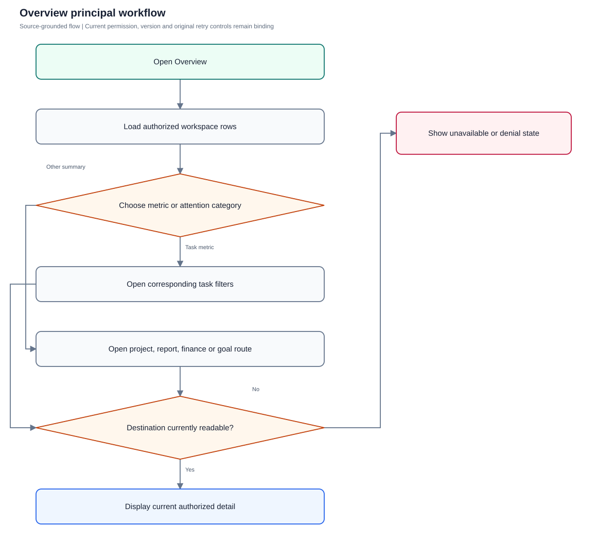
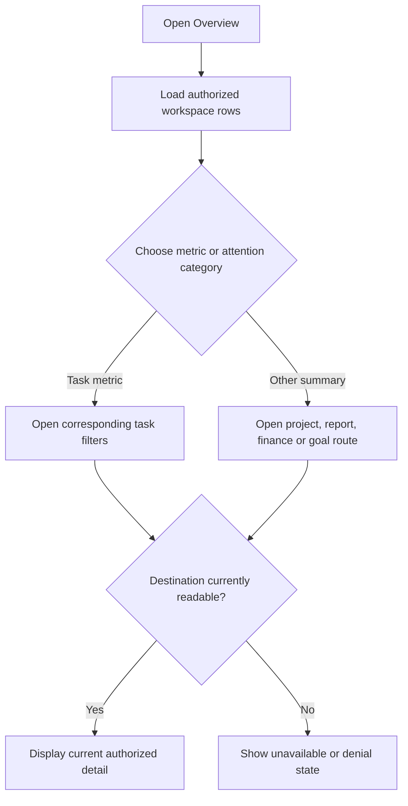

# Overview

Read scoped work metrics and follow existing task, project, report, finance and goal routes.

**Entry:** Overview sidebar entry; Open commitments; Overdue tasks; Awaiting review

**Actors:** Alpha leader — company leadership (founder in QA Alpha; not platform admin); Owner A — accountable owner and department member, Engineering; Finance F — company Finance; work access remains assignment scoped

## Main flow

1. Load current scoped workspace.
2. Inspect metric or attention category.
3. Navigate to its existing filtered destination.
4. Open an independently authorized detail.

[Editable Mermaid](../diagrams/OVERVIEW.mmd)

## Controls and limits

- Overview metrics use authorized workspace rows supplied to this page; do not assume historical or complete paginated report totals.
- Standalone Overview scenarios are read/filter/navigation checks; task writes belong to TASKS.

## Proposed manual scenarios

All start **NOT_RUN**. Missing prerequisite = BLOCKED.

### OVERVIEW-001: Metric cards open the matching task filters

**P1 · LOCAL · Web, API**

**Actors:**

- Alpha leader — company leadership (founder in QA Alpha; not platform admin)
- Owner A — accountable owner and department member, Engineering

**Preconditions:**

- Use a separately provisioned isolated server fixture, never the running workspace or historical native fixture.
- Company QA Alpha uses Asia/Kolkata, INR and April financial-year start; QA Beta is a second isolated company.
- Provision named fictional actors and secrets separately; record no passwords, tokens, private source prose or real account identifiers in evidence.
- Begin the manual run as NOT_RUN; a missing server/configuration/device prerequisite is BLOCKED.

**Test data:**

- Scoped fixtures: one overdue open task, one in-review task, one blocked task, one accepted task.

| Step | Action | Expected result |
| --- | --- | --- |
| 1 | Open Overview and click Overdue tasks. | All tasks opens with Filter deadline set to overdue; accepted/cancelled tasks do not enter the overdue set. |
| 2 | Return and click Awaiting review, then Open commitments. | Each opens All tasks with in_review and open status filters respectively; counts are assessed against the authorized page input. |

**Cleanup:** Close draft/recovery controls after recording the result; sign out test sessions. Retain immutable history until evidence review, then discard this isolated fixture through its approved fixture lifecycle.

[Scenario flow](../diagrams/OVERVIEW-001.svg) · [Editable source](../diagrams/OVERVIEW-001.mmd)

**Source:** [docs/USER_GUIDE.md](../../../docs/USER_GUIDE.md), [frontend/src/pages/Overview.tsx](../../../frontend/src/pages/Overview.tsx), [frontend/src/App.tsx](../../../frontend/src/App.tsx), [frontend/src/store.tsx](../../../frontend/src/store.tsx)

**Supporting automation:** [frontend/src/ui.test.tsx](../../../frontend/src/ui.test.tsx), [frontend/src/access.ui.test.tsx](../../../frontend/src/access.ui.test.tsx), [frontend/src/store.scopes.test.tsx](../../../frontend/src/store.scopes.test.tsx), [backend/platform/read_scopes_test.go](../../../backend/platform/read_scopes_test.go)

### OVERVIEW-002: Attention tabs and View all retain the selected category

**P1 · LOCAL · Web, API**

**Actors:**

- Alpha leader — company leadership (founder in QA Alpha; not platform admin)

**Preconditions:**

- Use a separately provisioned isolated server fixture, never the running workspace or historical native fixture.
- Company QA Alpha uses Asia/Kolkata, INR and April financial-year start; QA Beta is a second isolated company.
- Provision named fictional actors and secrets separately; record no passwords, tokens, private source prose or real account identifiers in evidence.
- Begin the manual run as NOT_RUN; a missing server/configuration/device prerequisite is BLOCKED.

**Test data:**

- Six visible blocked tasks and a task both overdue and blocked.

| Step | Action | Expected result |
| --- | --- | --- |
| 1 | Select Needs your attention → Blocked, then View all or See more tasks. | Preview shows at most five blocked rows; destination preserves blocked status and exposes the remaining authorized rows. |
| 2 | Compare Needs your attention distinct-task total to the union of overdue, blocked and in_review tasks. | A task satisfying multiple categories is counted once in the distinct total. |

**Cleanup:** Close draft/recovery controls after recording the result; sign out test sessions. Retain immutable history until evidence review, then discard this isolated fixture through its approved fixture lifecycle.

[Scenario flow](../diagrams/OVERVIEW-002.svg) · [Editable source](../diagrams/OVERVIEW-002.mmd)

**Source:** [docs/USER_GUIDE.md](../../../docs/USER_GUIDE.md), [frontend/src/pages/Overview.tsx](../../../frontend/src/pages/Overview.tsx), [frontend/src/App.tsx](../../../frontend/src/App.tsx), [frontend/src/store.tsx](../../../frontend/src/store.tsx)

**Supporting automation:** [frontend/src/ui.test.tsx](../../../frontend/src/ui.test.tsx), [frontend/src/access.ui.test.tsx](../../../frontend/src/access.ui.test.tsx), [frontend/src/store.scopes.test.tsx](../../../frontend/src/store.scopes.test.tsx), [backend/platform/read_scopes_test.go](../../../backend/platform/read_scopes_test.go)

### OVERVIEW-003: Engineering pulse and original-deadline acceptance stay qualified

**P1 · LOCAL · Web, API**

**Actors:**

- Alpha leader — company leadership (founder in QA Alpha; not platform admin)

**Preconditions:**

- Use a separately provisioned isolated server fixture, never the running workspace or historical native fixture.
- Company QA Alpha uses Asia/Kolkata, INR and April financial-year start; QA Beta is a second isolated company.
- Provision named fictional actors and secrets separately; record no passwords, tokens, private source prose or real account identifiers in evidence.
- Begin the manual run as NOT_RUN; a missing server/configuration/device prerequisite is BLOCKED.

**Test data:**

- Accepted tasks inside and outside last seven company-local days; a rescheduled task accepted after its original date.

| Step | Action | Expected result |
| --- | --- | --- |
| 1 | Inspect Engineering pulse and On-time acceptance. | Pulse counts accepted work by company-local completion day; original-deadline denominator excludes missing original date/completion data. |
| 2 | Click On-time acceptance or Open reports. | Reports opens; rescheduling has not rewritten the original commitment used for the metric. |

**Cleanup:** Close draft/recovery controls after recording the result; sign out test sessions. Retain immutable history until evidence review, then discard this isolated fixture through its approved fixture lifecycle.

[Scenario flow](../diagrams/OVERVIEW-003.svg) · [Editable source](../diagrams/OVERVIEW-003.mmd)

**Source:** [docs/USER_GUIDE.md](../../../docs/USER_GUIDE.md), [frontend/src/pages/Overview.tsx](../../../frontend/src/pages/Overview.tsx), [frontend/src/App.tsx](../../../frontend/src/App.tsx), [frontend/src/store.tsx](../../../frontend/src/store.tsx)

**Supporting automation:** [frontend/src/ui.test.tsx](../../../frontend/src/ui.test.tsx), [frontend/src/access.ui.test.tsx](../../../frontend/src/access.ui.test.tsx), [frontend/src/store.scopes.test.tsx](../../../frontend/src/store.scopes.test.tsx), [backend/platform/read_scopes_test.go](../../../backend/platform/read_scopes_test.go)

### OVERVIEW-004: Department and project health drilldowns use existing routes

**P1 · LOCAL · Web, API**

**Actors:**

- Alpha leader — company leadership (founder in QA Alpha; not platform admin)

**Preconditions:**

- Use a separately provisioned isolated server fixture, never the running workspace or historical native fixture.
- Company QA Alpha uses Asia/Kolkata, INR and April financial-year start; QA Beta is a second isolated company.
- Provision named fictional actors and secrets separately; record no passwords, tokens, private source prose or real account identifiers in evidence.
- Begin the manual run as NOT_RUN; a missing server/configuration/device prerequisite is BLOCKED.

**Test data:**

- Engineering department and active Launch QA project with authorized overdue and blocked work.

| Step | Action | Expected result |
| --- | --- | --- |
| 1 | Click the Engineering department label, then its overdue count. | All tasks opens with departmentId, then departmentId plus overdue deadline narrowing. |
| 2 | Return and open Launch QA in Project health; choose Explore goals. | Project detail and Goals open through existing navigation with current authorization checks; the dashboard does not create work. |

**Cleanup:** Close draft/recovery controls after recording the result; sign out test sessions. Retain immutable history until evidence review, then discard this isolated fixture through its approved fixture lifecycle.

[Scenario flow](../diagrams/OVERVIEW-004.svg) · [Editable source](../diagrams/OVERVIEW-004.mmd)

**Source:** [docs/USER_GUIDE.md](../../../docs/USER_GUIDE.md), [frontend/src/pages/Overview.tsx](../../../frontend/src/pages/Overview.tsx), [frontend/src/App.tsx](../../../frontend/src/App.tsx), [frontend/src/store.tsx](../../../frontend/src/store.tsx)

**Supporting automation:** [frontend/src/ui.test.tsx](../../../frontend/src/ui.test.tsx), [frontend/src/access.ui.test.tsx](../../../frontend/src/access.ui.test.tsx), [frontend/src/store.scopes.test.tsx](../../../frontend/src/store.scopes.test.tsx), [backend/platform/read_scopes_test.go](../../../backend/platform/read_scopes_test.go)

### OVERVIEW-005: Finance strip visibility respects finance and work scope

**P0 · LOCAL · Web, API**

**Actors:**

- Finance F — company Finance; work access remains assignment scoped
- Owner A — accountable owner and department member, Engineering

**Preconditions:**

- Use a separately provisioned isolated server fixture, never the running workspace or historical native fixture.
- Company QA Alpha uses Asia/Kolkata, INR and April financial-year start; QA Beta is a second isolated company.
- Provision named fictional actors and secrets separately; record no passwords, tokens, private source prose or real account identifiers in evidence.
- Begin the manual run as NOT_RUN; a missing server/configuration/device prerequisite is BLOCKED.

**Test data:**

- Finance F has company finance and one assigned task; Owner A has personal expenses only.

| Step | Action | Expected result |
| --- | --- | --- |
| 1 | Open Overview as Finance F and choose Open finance. | Company finance strip is shown and finance route opens; Finance F’s task metrics remain assignment scoped. |
| 2 | Open Overview as Owner A and compare financial overview and task rows. | Personal expense access does not expose company budget totals or unrelated work; financial references do not grant task access. |

**Cleanup:** Close draft/recovery controls after recording the result; sign out test sessions. Retain immutable history until evidence review, then discard this isolated fixture through its approved fixture lifecycle.

[Scenario flow](../diagrams/OVERVIEW-005.svg) · [Editable source](../diagrams/OVERVIEW-005.mmd)

**Source:** [docs/USER_GUIDE.md](../../../docs/USER_GUIDE.md), [frontend/src/pages/Overview.tsx](../../../frontend/src/pages/Overview.tsx), [frontend/src/App.tsx](../../../frontend/src/App.tsx), [frontend/src/store.tsx](../../../frontend/src/store.tsx)

**Supporting automation:** [frontend/src/access.ui.test.tsx](../../../frontend/src/access.ui.test.tsx), [backend/platform/read_scopes_test.go](../../../backend/platform/read_scopes_test.go), [backend/platform/finance_test.go](../../../backend/platform/finance_test.go)
