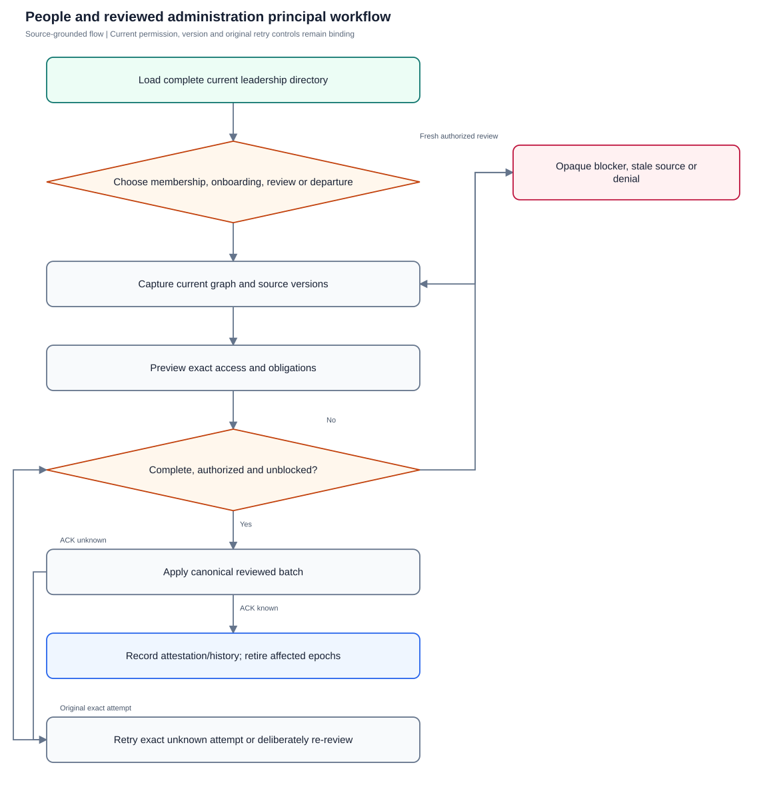
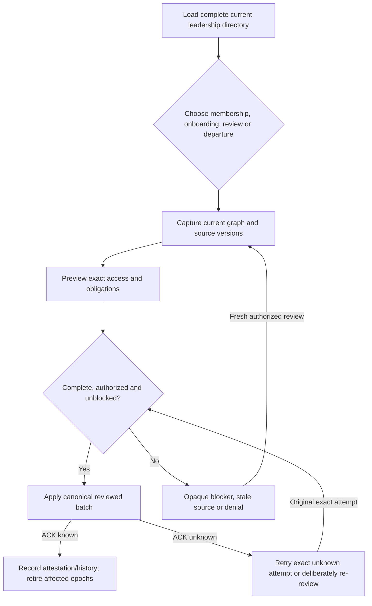

# People and reviewed administration

Manage company graph and reviewed onboarding, access attestation and departure while protecting private sources, credentials and epoch-bound outputs.

**Entry:** People → People / Departments / Reporting lines; Reviewed onboarding; Onboarding presets; Review company access; Review company departure

**Actors:** Alpha leader — company leadership (founder in QA Alpha; not platform admin); Owner A — accountable owner and department member, Engineering; Reviewer R — currently eligible independent reviewer; never owner of the reviewed work; Member B — second department member, Engineering; Finance F — company Finance; work access remains assignment scoped; Platform operator — platform admin; company authority requires a separate membership; Outsider O — outsider with no QA Alpha membership

## Main flow

1. Load current complete authorized company directory and eligible choices.
2. Review versioned membership/department graph or onboarding preset.
3. Preview exact access/task source changes.
4. Apply canonically or complete immutable access attestation/departure.
5. Reauthenticate after consequential scope changes; keep private history and retired outputs inaccessible.

[Editable Mermaid](../diagrams/PEOPLE.mmd)

## Controls and limits

- Leadership company administration never grants private conversation metadata/content. Platform suspension remains a separate platform-admin operation.
- Credential retry keyring is required for new-account apply; malformed deployment configuration and rotation/restart require separately configured fixtures.
- Directory/access review/departure completeness bounds must fail closed rather than attest a truncated snapshot.
- Demo lacks real account authentication, cryptographic credential binding, private-source semantics and task-template provisioning.

## Proposed manual scenarios

All start **NOT_RUN**. Missing prerequisite = BLOCKED.

### PEOPLE-001: Department and reporting graph setup uses eligible current people

**P1 · LOCAL · Web, API**

**Actors:**

- Alpha leader — company leadership (founder in QA Alpha; not platform admin)
- Owner A — accountable owner and department member, Engineering
- Reviewer R — currently eligible independent reviewer; never owner of the reviewed work

**Preconditions:**

- Use a separately provisioned isolated server fixture, never the running workspace or historical native fixture.
- Company QA Alpha uses Asia/Kolkata, INR and April financial-year start; QA Beta is a second isolated company.
- Provision named fictional actors and secrets separately; record no passwords, tokens, private source prose or real account identifiers in evidence.
- Begin the manual run as NOT_RUN; a missing server/configuration/device prerequisite is BLOCKED.

**Test data:**

- Engineering QA department; Owner A member reporting to independent Reviewer R; 36 weekly capacity.
- For department-head and managerial-graph variants, provision Reviewer R as an eligible head and Owner A/Member B under appropriate current roles; ordinary member variants remain separate.

| Step | Action | Expected result |
| --- | --- | --- |
| 1 | Choose Departments → Add department, enter Engineering QA description and eligible head, then save. | Department and head relationship are recorded under current authority/captured versions. |
| 2 | Edit Owner A’s department, Reports to and Weekly capacity; inspect Reporting lines. | Current reporting graph and declared capacity agree; invalid/foreign/cyclic manager relationships are rejected without partial graph changes. |

**Cleanup:** Close draft/recovery controls after recording the result; sign out test sessions. Retain immutable history until evidence review, then discard this isolated fixture through its approved fixture lifecycle.

[Scenario flow](../diagrams/PEOPLE-001.svg) · [Editable source](../diagrams/PEOPLE-001.mmd)

**Source:** [docs/PEOPLE_ADMINISTRATION.md](../../../docs/PEOPLE_ADMINISTRATION.md), [docs/USER_GUIDE.md](../../../docs/USER_GUIDE.md), [docs/API_CONTRACT.md](../../../docs/API_CONTRACT.md), [frontend/src/pages/Organization.tsx](../../../frontend/src/pages/Organization.tsx), [frontend/src/components/PeopleOnboarding.tsx](../../../frontend/src/components/PeopleOnboarding.tsx), [frontend/src/components/AccessReview.tsx](../../../frontend/src/components/AccessReview.tsx), [frontend/src/components/DepartureHandover.tsx](../../../frontend/src/components/DepartureHandover.tsx), [backend/platform/people_membership.go](../../../backend/platform/people_membership.go), [backend/platform/people_onboarding.go](../../../backend/platform/people_onboarding.go), [backend/platform/people_departure.go](../../../backend/platform/people_departure.go)

**Supporting automation:** [backend/platform/people_membership_test.go](../../../backend/platform/people_membership_test.go), [backend/platform/people_onboarding_test.go](../../../backend/platform/people_onboarding_test.go), [backend/platform/people_onboarding_review_test.go](../../../backend/platform/people_onboarding_review_test.go), [backend/platform/people_reviews_test.go](../../../backend/platform/people_reviews_test.go), [backend/platform/people_departure_test.go](../../../backend/platform/people_departure_test.go), [backend/platform/people_output_lifecycle_test.go](../../../backend/platform/people_output_lifecycle_test.go), [frontend/src/components/PeopleOnboarding.test.tsx](../../../frontend/src/components/PeopleOnboarding.test.tsx), [mobile/src/PeopleFlows.test.tsx](../../../mobile/src/PeopleFlows.test.tsx)

### PEOPLE-002: Title/capacity edit preserves session while consequential edit revokes

**P0 · LOCAL · Web, API**

**Actors:**

- Alpha leader — company leadership (founder in QA Alpha; not platform admin)
- Owner A — accountable owner and department member, Engineering

**Preconditions:**

- Use a separately provisioned isolated server fixture, never the running workspace or historical native fixture.
- Company QA Alpha uses Asia/Kolkata, INR and April financial-year start; QA Beta is a second isolated company.
- Provision named fictional actors and secrets separately; record no passwords, tokens, private source prose or real account identifiers in evidence.
- Begin the manual run as NOT_RUN; a missing server/configuration/device prerequisite is BLOCKED.

**Test data:**

- Owner A has two sessions; title QA coordinator and capacity 36; separate role/department change variant.

| Step | Action | Expected result |
| --- | --- | --- |
| 1 | PATCH Owner A title/capacity with expectedVersion and inspect both sessions. | Membership version advances; unchanged authority/access basis keeps sessions current. |
| 2 | Save a consequential role/department/manager scope change with current captured version. | Affected membership access/session/company permission epochs advance and account-wide sessions/devices/grants are invalidated; current-source client state clears. |
| 3 | Reauthenticate in another still-active company. | Other membership remains, but old account-wide session cannot be reused. |

**Cleanup:** Close draft/recovery controls after recording the result; sign out test sessions. Retain immutable history until evidence review, then discard this isolated fixture through its approved fixture lifecycle.

[Scenario flow](../diagrams/PEOPLE-002.svg) · [Editable source](../diagrams/PEOPLE-002.mmd)

**Source:** [docs/PEOPLE_ADMINISTRATION.md](../../../docs/PEOPLE_ADMINISTRATION.md), [docs/USER_GUIDE.md](../../../docs/USER_GUIDE.md), [docs/API_CONTRACT.md](../../../docs/API_CONTRACT.md), [frontend/src/pages/Organization.tsx](../../../frontend/src/pages/Organization.tsx), [frontend/src/components/PeopleOnboarding.tsx](../../../frontend/src/components/PeopleOnboarding.tsx), [frontend/src/components/AccessReview.tsx](../../../frontend/src/components/AccessReview.tsx), [frontend/src/components/DepartureHandover.tsx](../../../frontend/src/components/DepartureHandover.tsx), [backend/platform/people_membership.go](../../../backend/platform/people_membership.go), [backend/platform/people_onboarding.go](../../../backend/platform/people_onboarding.go), [backend/platform/people_departure.go](../../../backend/platform/people_departure.go)

**Supporting automation:** [backend/platform/people_membership_test.go](../../../backend/platform/people_membership_test.go), [backend/platform/people_onboarding_test.go](../../../backend/platform/people_onboarding_test.go), [backend/platform/people_onboarding_review_test.go](../../../backend/platform/people_onboarding_review_test.go), [backend/platform/people_reviews_test.go](../../../backend/platform/people_reviews_test.go), [backend/platform/people_departure_test.go](../../../backend/platform/people_departure_test.go), [backend/platform/people_output_lifecycle_test.go](../../../backend/platform/people_output_lifecycle_test.go), [frontend/src/components/PeopleOnboarding.test.tsx](../../../frontend/src/components/PeopleOnboarding.test.tsx), [mobile/src/PeopleFlows.test.tsx](../../../mobile/src/PeopleFlows.test.tsx)

### PEOPLE-003: Membership rank, stale versions and last-founder guards

**P0 · LOCAL · Web, API**

**Actors:**

- Alpha leader — company leadership (founder in QA Alpha; not platform admin)
- Owner A — accountable owner and department member, Engineering
- Platform operator — platform admin; company authority requires a separate membership
- Outsider O — outsider with no QA Alpha membership

**Preconditions:**

- Use a separately provisioned isolated server fixture, never the running workspace or historical native fixture.
- Company QA Alpha uses Asia/Kolkata, INR and April financial-year start; QA Beta is a second isolated company.
- Provision named fictional actors and secrets separately; record no passwords, tokens, private source prose or real account identifiers in evidence.
- Begin the manual run as NOT_RUN; a missing server/configuration/device prerequisite is BLOCKED.

**Test data:**

- Alpha leader last founder; Owner A ordinary member; stale member/department versions; Platform operator without leadership membership.

| Step | Action | Expected result |
| --- | --- | --- |
| 1 | Attempt Owner A self-escalation, Alpha leader last-founder removal, and unauthorized People API writes by Platform operator/Outsider O. | Authority/last-founder guards deny invalid writes; platform status is separate from company membership authority. |
| 2 | Save one membership/department edit, then submit the prior expectedVersion from a second editor. | 409 prevents stale overwrite; latest graph/version requires deliberate reinspection. |

**Cleanup:** Close draft/recovery controls after recording the result; sign out test sessions. Retain immutable history until evidence review, then discard this isolated fixture through its approved fixture lifecycle.

[Scenario flow](../diagrams/PEOPLE-003.svg) · [Editable source](../diagrams/PEOPLE-003.mmd)

**Source:** [docs/PEOPLE_ADMINISTRATION.md](../../../docs/PEOPLE_ADMINISTRATION.md), [docs/USER_GUIDE.md](../../../docs/USER_GUIDE.md), [docs/API_CONTRACT.md](../../../docs/API_CONTRACT.md), [frontend/src/pages/Organization.tsx](../../../frontend/src/pages/Organization.tsx), [frontend/src/components/PeopleOnboarding.tsx](../../../frontend/src/components/PeopleOnboarding.tsx), [frontend/src/components/AccessReview.tsx](../../../frontend/src/components/AccessReview.tsx), [frontend/src/components/DepartureHandover.tsx](../../../frontend/src/components/DepartureHandover.tsx), [backend/platform/people_membership.go](../../../backend/platform/people_membership.go), [backend/platform/people_onboarding.go](../../../backend/platform/people_onboarding.go), [backend/platform/people_departure.go](../../../backend/platform/people_departure.go)

**Supporting automation:** [backend/platform/people_membership_test.go](../../../backend/platform/people_membership_test.go), [backend/platform/people_onboarding_test.go](../../../backend/platform/people_onboarding_test.go), [backend/platform/people_onboarding_review_test.go](../../../backend/platform/people_onboarding_review_test.go), [backend/platform/people_reviews_test.go](../../../backend/platform/people_reviews_test.go), [backend/platform/people_departure_test.go](../../../backend/platform/people_departure_test.go), [backend/platform/people_output_lifecycle_test.go](../../../backend/platform/people_output_lifecycle_test.go), [frontend/src/components/PeopleOnboarding.test.tsx](../../../frontend/src/components/PeopleOnboarding.test.tsx), [mobile/src/PeopleFlows.test.tsx](../../../mobile/src/PeopleFlows.test.tsx)

### PEOPLE-004: Reviewed preset and template task provisioning stays exact

**P0 · LOCAL_CONFIG · Web, API**

**Actors:**

- Alpha leader — company leadership (founder in QA Alpha; not platform admin)
- Owner A — accountable owner and department member, Engineering
- Reviewer R — currently eligible independent reviewer; never owner of the reviewed work

**Preconditions:**

- Use a separately provisioned isolated server fixture, never the running workspace or historical native fixture.
- Company QA Alpha uses Asia/Kolkata, INR and April financial-year start; QA Beta is a second isolated company.
- Provision named fictional actors and secrets separately; record no passwords, tokens, private source prose or real account identifiers in evidence.
- Begin the manual run as NOT_RUN; a missing server/configuration/device prerequisite is BLOCKED.

**Test data:**

- QA starter preset; role member, Engineering QA, capacity 36; one existing task template with original deadline/checklist/independent reviewer.

| Step | Action | Expected result |
| --- | --- | --- |
| 1 | Create preset through Save reviewed preset, then edit its captured version concurrently. | Preset is current rank-filtered/versioned; stale save names the preset and requires deliberate current selection. |
| 2 | Use Reviewed onboarding with preset and template, choose Review onboarding and inspect Review exact access/task criteria/deadlines/reviewer. | Preview is read-only and captures preset/template/source versions; generated task intent has exact commitments/checklists and independent review. |
| 3 | Apply after all choices are reviewed, then inspect created tasks and Inbox. | Atomic apply provisions only reviewed tasks through existing task engine/facts/notifications; private conversation membership is never automatically granted. |

**Cleanup:** Close draft/recovery controls after recording the result; sign out test sessions. Retain immutable history until evidence review, then discard this isolated fixture through its approved fixture lifecycle.

[Scenario flow](../diagrams/PEOPLE-004.svg) · [Editable source](../diagrams/PEOPLE-004.mmd)

**Source:** [docs/PEOPLE_ADMINISTRATION.md](../../../docs/PEOPLE_ADMINISTRATION.md), [docs/USER_GUIDE.md](../../../docs/USER_GUIDE.md), [docs/API_CONTRACT.md](../../../docs/API_CONTRACT.md), [frontend/src/pages/Organization.tsx](../../../frontend/src/pages/Organization.tsx), [frontend/src/components/PeopleOnboarding.tsx](../../../frontend/src/components/PeopleOnboarding.tsx), [frontend/src/components/AccessReview.tsx](../../../frontend/src/components/AccessReview.tsx), [frontend/src/components/DepartureHandover.tsx](../../../frontend/src/components/DepartureHandover.tsx), [backend/platform/people_membership.go](../../../backend/platform/people_membership.go), [backend/platform/people_onboarding.go](../../../backend/platform/people_onboarding.go), [backend/platform/people_departure.go](../../../backend/platform/people_departure.go)

**Supporting automation:** [backend/platform/people_membership_test.go](../../../backend/platform/people_membership_test.go), [backend/platform/people_onboarding_test.go](../../../backend/platform/people_onboarding_test.go), [backend/platform/people_onboarding_review_test.go](../../../backend/platform/people_onboarding_review_test.go), [backend/platform/people_reviews_test.go](../../../backend/platform/people_reviews_test.go), [backend/platform/people_departure_test.go](../../../backend/platform/people_departure_test.go), [backend/platform/people_output_lifecycle_test.go](../../../backend/platform/people_output_lifecycle_test.go), [frontend/src/components/PeopleOnboarding.test.tsx](../../../frontend/src/components/PeopleOnboarding.test.tsx), [mobile/src/PeopleFlows.test.tsx](../../../mobile/src/PeopleFlows.test.tsx)

### PEOPLE-005: New account requires configured credentials and never sends invitation

**P0 · LOCAL_CONFIG · Web, API**

**Actors:**

- Alpha leader — company leadership (founder in QA Alpha; not platform admin)

**Preconditions:**

- Use a separately provisioned isolated server fixture, never the running workspace or historical native fixture.
- Company QA Alpha uses Asia/Kolkata, INR and April financial-year start; QA Beta is a second isolated company.
- Provision named fictional actors and secrets separately; record no passwords, tokens, private source prose or real account identifiers in evidence.
- Begin the manual run as NOT_RUN; a missing server/configuration/device prerequisite is BLOCKED.

**Test data:**

- New persona Nila Rowan, nila.qa@example.invalid; private provisioned password ≥12 characters; separate unconfigured keyring fixture.

| Step | Action | Expected result |
| --- | --- | --- |
| 1 | Create onboarding preview for Nila with no tasks and inspect accountMode. | Preview reports new_account and does not create account/membership or send email. |
| 2 | Apply on fixture without PEOPLE_CREDENTIAL_RETRY keyring; repeat configured fixture with invalid short secret. | Missing configuration returns 503; short credential fails validation; neither produces partial membership. |
| 3 | Apply a fresh reviewed configured preview with a valid private secret and sign in as Nila. | One new account/membership is created; no invitation email is promised; secret is absent from read DTOs, storage/log evidence and browser persistence. |

**Cleanup:** Close draft/recovery controls after recording the result; sign out test sessions. Retain immutable history until evidence review, then discard this isolated fixture through its approved fixture lifecycle.

[Scenario flow](../diagrams/PEOPLE-005.svg) · [Editable source](../diagrams/PEOPLE-005.mmd)

**Source:** [docs/PEOPLE_ADMINISTRATION.md](../../../docs/PEOPLE_ADMINISTRATION.md), [docs/USER_GUIDE.md](../../../docs/USER_GUIDE.md), [docs/API_CONTRACT.md](../../../docs/API_CONTRACT.md), [frontend/src/pages/Organization.tsx](../../../frontend/src/pages/Organization.tsx), [frontend/src/components/PeopleOnboarding.tsx](../../../frontend/src/components/PeopleOnboarding.tsx), [frontend/src/components/AccessReview.tsx](../../../frontend/src/components/AccessReview.tsx), [frontend/src/components/DepartureHandover.tsx](../../../frontend/src/components/DepartureHandover.tsx), [backend/platform/people_membership.go](../../../backend/platform/people_membership.go), [backend/platform/people_onboarding.go](../../../backend/platform/people_onboarding.go), [backend/platform/people_departure.go](../../../backend/platform/people_departure.go)

**Supporting automation:** [backend/platform/people_membership_test.go](../../../backend/platform/people_membership_test.go), [backend/platform/people_onboarding_test.go](../../../backend/platform/people_onboarding_test.go), [backend/platform/people_onboarding_review_test.go](../../../backend/platform/people_onboarding_review_test.go), [backend/platform/people_reviews_test.go](../../../backend/platform/people_reviews_test.go), [backend/platform/people_departure_test.go](../../../backend/platform/people_departure_test.go), [backend/platform/people_output_lifecycle_test.go](../../../backend/platform/people_output_lifecycle_test.go), [frontend/src/components/PeopleOnboarding.test.tsx](../../../frontend/src/components/PeopleOnboarding.test.tsx), [mobile/src/PeopleFlows.test.tsx](../../../mobile/src/PeopleFlows.test.tsx)

### PEOPLE-006: Existing account and explicit rejoin preserve global identity

**P0 · LOCAL · Web, API**

**Actors:**

- Alpha leader — company leadership (founder in QA Alpha; not platform admin)
- Member B — second department member, Engineering

**Preconditions:**

- Use a separately provisioned isolated server fixture, never the running workspace or historical native fixture.
- Company QA Alpha uses Asia/Kolkata, INR and April financial-year start; QA Beta is a second isolated company.
- Provision named fictional actors and secrets separately; record no passwords, tokens, private source prose or real account identifiers in evidence.
- Begin the manual run as NOT_RUN; a missing server/configuration/device prerequisite is BLOCKED.

**Test data:**

- Member B existing global account with other-company membership/MFA; inactive QA Alpha membership variant.

| Step | Action | Expected result |
| --- | --- | --- |
| 1 | Preview adding existing Member B and apply with reviewed company membership only. | Global name/credential/MFA/platform identity is preserved; onboarding does not reset an existing account password. |
| 2 | Attempt duplicate active membership then inactive membership without explicit rejoin; complete deliberate rejoin on a fresh preview. | Duplicate/implicit rejoin fails; explicit rejoin creates a new access interval/epoch without restoring historical private intervals or old output capabilities. |

**Cleanup:** Close draft/recovery controls after recording the result; sign out test sessions. Retain immutable history until evidence review, then discard this isolated fixture through its approved fixture lifecycle.

[Scenario flow](../diagrams/PEOPLE-006.svg) · [Editable source](../diagrams/PEOPLE-006.mmd)

**Source:** [docs/PEOPLE_ADMINISTRATION.md](../../../docs/PEOPLE_ADMINISTRATION.md), [docs/USER_GUIDE.md](../../../docs/USER_GUIDE.md), [docs/API_CONTRACT.md](../../../docs/API_CONTRACT.md), [frontend/src/pages/Organization.tsx](../../../frontend/src/pages/Organization.tsx), [frontend/src/components/PeopleOnboarding.tsx](../../../frontend/src/components/PeopleOnboarding.tsx), [frontend/src/components/AccessReview.tsx](../../../frontend/src/components/AccessReview.tsx), [frontend/src/components/DepartureHandover.tsx](../../../frontend/src/components/DepartureHandover.tsx), [backend/platform/people_membership.go](../../../backend/platform/people_membership.go), [backend/platform/people_onboarding.go](../../../backend/platform/people_onboarding.go), [backend/platform/people_departure.go](../../../backend/platform/people_departure.go)

**Supporting automation:** [backend/platform/people_membership_test.go](../../../backend/platform/people_membership_test.go), [backend/platform/people_onboarding_test.go](../../../backend/platform/people_onboarding_test.go), [backend/platform/people_onboarding_review_test.go](../../../backend/platform/people_onboarding_review_test.go), [backend/platform/people_reviews_test.go](../../../backend/platform/people_reviews_test.go), [backend/platform/people_departure_test.go](../../../backend/platform/people_departure_test.go), [backend/platform/people_output_lifecycle_test.go](../../../backend/platform/people_output_lifecycle_test.go), [frontend/src/components/PeopleOnboarding.test.tsx](../../../frontend/src/components/PeopleOnboarding.test.tsx), [mobile/src/PeopleFlows.test.tsx](../../../mobile/src/PeopleFlows.test.tsx)

### PEOPLE-007: Unknown onboarding credential attempt remains frozen and payload bound

**P0 · LOCAL_CONFIG · Web, API**

**Actors:**

- Alpha leader — company leadership (founder in QA Alpha; not platform admin)

**Preconditions:**

- Use a separately provisioned isolated server fixture, never the running workspace or historical native fixture.
- Company QA Alpha uses Asia/Kolkata, INR and April financial-year start; QA Beta is a second isolated company.
- Provision named fictional actors and secrets separately; record no passwords, tokens, private source prose or real account identifiers in evidence.
- Begin the manual run as NOT_RUN; a missing server/configuration/device prerequisite is BLOCKED.

**Test data:**

- One-time lost apply ACK; configured retained old credential retry key plus rotated new active key; secrets held privately.

| Step | Action | Expected result |
| --- | --- | --- |
| 1 | Submit reviewed new-account apply and suppress ACK; allow a same-principal graph refresh, then Retry the same submission. | Original key, target, ordered task dependencies, preview/version/body and exact submitted credential remain scoped RAM-frozen; known ACK clears credential-bearing attempt before dependent refresh. |
| 2 | On retained-key restart/rotation fixture retry the same original apply after the account password has changed; submit a changed credential under its original key. | Exact replay returns the canonical application without resetting current password or duplicating tasks; changed credential returns 409. |
| 3 | Confirm actor/session/source loss and release a late ACK. | Relevant attempt clears and late callbacks cannot restore it; password is never persisted in localStorage, SecureStore or logs. |

**Cleanup:** Close draft/recovery controls after recording the result; sign out test sessions. Retain immutable history until evidence review, then discard this isolated fixture through its approved fixture lifecycle.

[Scenario flow](../diagrams/PEOPLE-007.svg) · [Editable source](../diagrams/PEOPLE-007.mmd)

**Source:** [docs/PEOPLE_ADMINISTRATION.md](../../../docs/PEOPLE_ADMINISTRATION.md), [docs/USER_GUIDE.md](../../../docs/USER_GUIDE.md), [docs/API_CONTRACT.md](../../../docs/API_CONTRACT.md), [frontend/src/pages/Organization.tsx](../../../frontend/src/pages/Organization.tsx), [frontend/src/components/PeopleOnboarding.tsx](../../../frontend/src/components/PeopleOnboarding.tsx), [frontend/src/components/AccessReview.tsx](../../../frontend/src/components/AccessReview.tsx), [frontend/src/components/DepartureHandover.tsx](../../../frontend/src/components/DepartureHandover.tsx), [backend/platform/people_membership.go](../../../backend/platform/people_membership.go), [backend/platform/people_onboarding.go](../../../backend/platform/people_onboarding.go), [backend/platform/people_departure.go](../../../backend/platform/people_departure.go)

**Supporting automation:** [backend/platform/people_membership_test.go](../../../backend/platform/people_membership_test.go), [backend/platform/people_onboarding_test.go](../../../backend/platform/people_onboarding_test.go), [backend/platform/people_onboarding_review_test.go](../../../backend/platform/people_onboarding_review_test.go), [backend/platform/people_reviews_test.go](../../../backend/platform/people_reviews_test.go), [backend/platform/people_departure_test.go](../../../backend/platform/people_departure_test.go), [backend/platform/people_output_lifecycle_test.go](../../../backend/platform/people_output_lifecycle_test.go), [frontend/src/components/PeopleOnboarding.test.tsx](../../../frontend/src/components/PeopleOnboarding.test.tsx), [mobile/src/PeopleFlows.test.tsx](../../../mobile/src/PeopleFlows.test.tsx)

### PEOPLE-008: Stale onboarding previews and graph refresh require fresh reviewed choices

**P0 · LOCAL_CONFIG · Web, API**

**Actors:**

- Alpha leader — company leadership (founder in QA Alpha; not platform admin)

**Preconditions:**

- Use a separately provisioned isolated server fixture, never the running workspace or historical native fixture.
- Company QA Alpha uses Asia/Kolkata, INR and April financial-year start; QA Beta is a second isolated company.
- Provision named fictional actors and secrets separately; record no passwords, tokens, private source prose or real account identifiers in evidence.
- Begin the manual run as NOT_RUN; a missing server/configuration/device prerequisite is BLOCKED.

**Test data:**

- Preview older than 30 minutes or changed preset/template/checklist; typed name/email/title/capacity/password controls.

| Step | Action | Expected result |
| --- | --- | --- |
| 1 | Attempt apply after preview expiry or source version/checklist change. | Conflict/expiry prevents account/task mutation; fresh source review is required, not silent version replacement. |
| 2 | During ordinary pending current-source read inspect mounted authored controls and source descendants. | Same-principal authored controls remain in RAM; fetched names/eligible choices/previews are withheld and send disabled, with only neutral geometry retained. |
| 3 | Complete graph-only draft clearing, then request a fresh preview. | Name/Email reentry and Person step correction are required; any still-authorized unknown canonical submission remains separately frozen and is not rewritten. |

**Cleanup:** Close draft/recovery controls after recording the result; sign out test sessions. Retain immutable history until evidence review, then discard this isolated fixture through its approved fixture lifecycle.

[Scenario flow](../diagrams/PEOPLE-008.svg) · [Editable source](../diagrams/PEOPLE-008.mmd)

**Source:** [docs/PEOPLE_ADMINISTRATION.md](../../../docs/PEOPLE_ADMINISTRATION.md), [docs/USER_GUIDE.md](../../../docs/USER_GUIDE.md), [docs/API_CONTRACT.md](../../../docs/API_CONTRACT.md), [frontend/src/pages/Organization.tsx](../../../frontend/src/pages/Organization.tsx), [frontend/src/components/PeopleOnboarding.tsx](../../../frontend/src/components/PeopleOnboarding.tsx), [frontend/src/components/AccessReview.tsx](../../../frontend/src/components/AccessReview.tsx), [frontend/src/components/DepartureHandover.tsx](../../../frontend/src/components/DepartureHandover.tsx), [backend/platform/people_membership.go](../../../backend/platform/people_membership.go), [backend/platform/people_onboarding.go](../../../backend/platform/people_onboarding.go), [backend/platform/people_departure.go](../../../backend/platform/people_departure.go)

**Supporting automation:** [backend/platform/people_membership_test.go](../../../backend/platform/people_membership_test.go), [backend/platform/people_onboarding_test.go](../../../backend/platform/people_onboarding_test.go), [backend/platform/people_onboarding_review_test.go](../../../backend/platform/people_onboarding_review_test.go), [backend/platform/people_reviews_test.go](../../../backend/platform/people_reviews_test.go), [backend/platform/people_departure_test.go](../../../backend/platform/people_departure_test.go), [backend/platform/people_output_lifecycle_test.go](../../../backend/platform/people_output_lifecycle_test.go), [frontend/src/components/PeopleOnboarding.test.tsx](../../../frontend/src/components/PeopleOnboarding.test.tsx), [mobile/src/PeopleFlows.test.tsx](../../../mobile/src/PeopleFlows.test.tsx)

### PEOPLE-009: Access review attests complete resulting graph and preserves history

**P0 · LOCAL · Web, API**

**Actors:**

- Alpha leader — company leadership (founder in QA Alpha; not platform admin)
- Owner A — accountable owner and department member, Engineering
- Member B — second department member, Engineering

**Preconditions:**

- Use a separately provisioned isolated server fixture, never the running workspace or historical native fixture.
- Company QA Alpha uses Asia/Kolkata, INR and April financial-year start; QA Beta is a second isolated company.
- Provision named fictional actors and secrets separately; record no passwords, tokens, private source prose or real account identifiers in evidence.
- Begin the manual run as NOT_RUN; a missing server/configuration/device prerequisite is BLOCKED.

**Test data:**

- Whole directory reviewed: keep Owner A, capacity change Member B, revoke disposable persona, departure-follow-up for Owner A in separate variant.

| Step | Action | Expected result |
| --- | --- | --- |
| 1 | Choose Review company access, enter decisions/reason and Preview access decisions. | Complete bounded snapshot and resulting graph are validated; pending departure is labeled as follow-up, not completed handover. |
| 2 | Choose Complete access attestation, then retry its exact captured request and read history. | One immutable completed attestation records decisions/result; canonical replay does not duplicate or rewrite history. |
| 3 | Use stale fingerprint/version or an oversized incomplete directory fixture. | Completion is blocked/conflicted; no truncated snapshot is certified. |

**Cleanup:** Close draft/recovery controls after recording the result; sign out test sessions. Retain immutable history until evidence review, then discard this isolated fixture through its approved fixture lifecycle.

[Scenario flow](../diagrams/PEOPLE-009.svg) · [Editable source](../diagrams/PEOPLE-009.mmd)

**Source:** [docs/PEOPLE_ADMINISTRATION.md](../../../docs/PEOPLE_ADMINISTRATION.md), [docs/USER_GUIDE.md](../../../docs/USER_GUIDE.md), [docs/API_CONTRACT.md](../../../docs/API_CONTRACT.md), [frontend/src/pages/Organization.tsx](../../../frontend/src/pages/Organization.tsx), [frontend/src/components/PeopleOnboarding.tsx](../../../frontend/src/components/PeopleOnboarding.tsx), [frontend/src/components/AccessReview.tsx](../../../frontend/src/components/AccessReview.tsx), [frontend/src/components/DepartureHandover.tsx](../../../frontend/src/components/DepartureHandover.tsx), [backend/platform/people_membership.go](../../../backend/platform/people_membership.go), [backend/platform/people_onboarding.go](../../../backend/platform/people_onboarding.go), [backend/platform/people_departure.go](../../../backend/platform/people_departure.go)

**Supporting automation:** [backend/platform/people_membership_test.go](../../../backend/platform/people_membership_test.go), [backend/platform/people_onboarding_test.go](../../../backend/platform/people_onboarding_test.go), [backend/platform/people_onboarding_review_test.go](../../../backend/platform/people_onboarding_review_test.go), [backend/platform/people_reviews_test.go](../../../backend/platform/people_reviews_test.go), [backend/platform/people_departure_test.go](../../../backend/platform/people_departure_test.go), [backend/platform/people_output_lifecycle_test.go](../../../backend/platform/people_output_lifecycle_test.go), [frontend/src/components/PeopleOnboarding.test.tsx](../../../frontend/src/components/PeopleOnboarding.test.tsx), [mobile/src/PeopleFlows.test.tsx](../../../mobile/src/PeopleFlows.test.tsx)

### PEOPLE-010: Departure transfers exact live obligations and preserves economic facts

**P0 · LOCAL · Web, API**

**Actors:**

- Alpha leader — company leadership (founder in QA Alpha; not platform admin)
- Owner A — accountable owner and department member, Engineering
- Reviewer R — currently eligible independent reviewer; never owner of the reviewed work
- Finance F — company Finance; work access remains assignment scoped
- Member B — second department member, Engineering

**Preconditions:**

- Use a separately provisioned isolated server fixture, never the running workspace or historical native fixture.
- Company QA Alpha uses Asia/Kolkata, INR and April financial-year start; QA Beta is a second isolated company.
- Provision named fictional actors and secrets separately; record no passwords, tokens, private source prose or real account identifiers in evidence.
- Begin the manual run as NOT_RUN; a missing server/configuration/device prerequisite is BLOCKED.
- Use separate role-qualified departure variants: a head/manager for department/reporting obligations, an eligible Finance actor for expense-review routing, and an independent milestone reviewer. Do not presume an ordinary member has all these obligations.

**Test data:**

- Owner A departing with open task/project/milestone/goal/department obligations; expense review route to independent Finance F or eligible Reviewer R; accepted/timed task and paid finance records.

| Step | Action | Expected result |
| --- | --- | --- |
| 1 | Choose Review company departure, enter reason, inspect inventory and select exact eligible replacements plus explicit reporting-manager removal/replacement. | Complete current inventory/versions are reviewed; accepted obligations and private blockers are qualified, not casually transferred. |
| 2 | Choose Review selected replacements then Complete company departure; retry the original exact canonical request. | All-or-none transfer/departure occurs once; task original dates/mode/instant/zone, accepted task/milestone facts, measured goal facts, finance amounts and recorded financial actors remain unchanged. |
| 3 | Inspect expense route and goal reminder ownership after apply. | Route is independently eligible or explicitly retained; no expense approval/payment occurs and personal goal reminders do not transfer. |

**Cleanup:** Close draft/recovery controls after recording the result; sign out test sessions. Retain immutable history until evidence review, then discard this isolated fixture through its approved fixture lifecycle.

[Scenario flow](../diagrams/PEOPLE-010.svg) · [Editable source](../diagrams/PEOPLE-010.mmd)

**Source:** [docs/PEOPLE_ADMINISTRATION.md](../../../docs/PEOPLE_ADMINISTRATION.md), [docs/USER_GUIDE.md](../../../docs/USER_GUIDE.md), [docs/API_CONTRACT.md](../../../docs/API_CONTRACT.md), [frontend/src/pages/Organization.tsx](../../../frontend/src/pages/Organization.tsx), [frontend/src/components/PeopleOnboarding.tsx](../../../frontend/src/components/PeopleOnboarding.tsx), [frontend/src/components/AccessReview.tsx](../../../frontend/src/components/AccessReview.tsx), [frontend/src/components/DepartureHandover.tsx](../../../frontend/src/components/DepartureHandover.tsx), [backend/platform/people_membership.go](../../../backend/platform/people_membership.go), [backend/platform/people_onboarding.go](../../../backend/platform/people_onboarding.go), [backend/platform/people_departure.go](../../../backend/platform/people_departure.go)

**Supporting automation:** [backend/platform/people_membership_test.go](../../../backend/platform/people_membership_test.go), [backend/platform/people_onboarding_test.go](../../../backend/platform/people_onboarding_test.go), [backend/platform/people_onboarding_review_test.go](../../../backend/platform/people_onboarding_review_test.go), [backend/platform/people_reviews_test.go](../../../backend/platform/people_reviews_test.go), [backend/platform/people_departure_test.go](../../../backend/platform/people_departure_test.go), [backend/platform/people_output_lifecycle_test.go](../../../backend/platform/people_output_lifecycle_test.go), [frontend/src/components/PeopleOnboarding.test.tsx](../../../frontend/src/components/PeopleOnboarding.test.tsx), [mobile/src/PeopleFlows.test.tsx](../../../mobile/src/PeopleFlows.test.tsx)

### PEOPLE-011: Private blockers and in-review milestone require separate source actions

**P0 · LOCAL · Web, API**

**Actors:**

- Alpha leader — company leadership (founder in QA Alpha; not platform admin)
- Owner A — accountable owner and department member, Engineering
- Reviewer R — currently eligible independent reviewer; never owner of the reviewed work

**Preconditions:**

- Use a separately provisioned isolated server fixture, never the running workspace or historical native fixture.
- Company QA Alpha uses Asia/Kolkata, INR and April financial-year start; QA Beta is a second isolated company.
- Provision named fictional actors and secrets separately; record no passwords, tokens, private source prose or real account identifiers in evidence.
- Begin the manual run as NOT_RUN; a missing server/configuration/device prerequisite is BLOCKED.

**Test data:**

- Archived/past-due private review obligation unreadable to Alpha leader; in-review milestone with current independent Reviewer R.

| Step | Action | Expected result |
| --- | --- | --- |
| 1 | As Alpha leader preview Owner A departure and inspect blocked obligations. | Private review blocker remains opaque regardless of company rank, archive or deadline; People provides no private decision close/reviewer-transfer API. |
| 2 | Attempt departure while milestone is in_review, then use project route as Reviewer R to Request milestone changes with a reason. | Departure cannot reset the milestone itself; separate authorized human action is required. |
| 3 | Create a fresh departure preview; introduce another live obligation after it and apply the old preview. | Fresh source inventory is needed; old changed-inventory apply conflicts with no partial transfers. |

**Cleanup:** Close draft/recovery controls after recording the result; sign out test sessions. Retain immutable history until evidence review, then discard this isolated fixture through its approved fixture lifecycle.

[Scenario flow](../diagrams/PEOPLE-011.svg) · [Editable source](../diagrams/PEOPLE-011.mmd)

**Source:** [docs/PEOPLE_ADMINISTRATION.md](../../../docs/PEOPLE_ADMINISTRATION.md), [docs/USER_GUIDE.md](../../../docs/USER_GUIDE.md), [docs/API_CONTRACT.md](../../../docs/API_CONTRACT.md), [frontend/src/pages/Organization.tsx](../../../frontend/src/pages/Organization.tsx), [frontend/src/components/PeopleOnboarding.tsx](../../../frontend/src/components/PeopleOnboarding.tsx), [frontend/src/components/AccessReview.tsx](../../../frontend/src/components/AccessReview.tsx), [frontend/src/components/DepartureHandover.tsx](../../../frontend/src/components/DepartureHandover.tsx), [backend/platform/people_membership.go](../../../backend/platform/people_membership.go), [backend/platform/people_onboarding.go](../../../backend/platform/people_onboarding.go), [backend/platform/people_departure.go](../../../backend/platform/people_departure.go)

**Supporting automation:** [backend/platform/people_membership_test.go](../../../backend/platform/people_membership_test.go), [backend/platform/people_onboarding_test.go](../../../backend/platform/people_onboarding_test.go), [backend/platform/people_onboarding_review_test.go](../../../backend/platform/people_onboarding_review_test.go), [backend/platform/people_reviews_test.go](../../../backend/platform/people_reviews_test.go), [backend/platform/people_departure_test.go](../../../backend/platform/people_departure_test.go), [backend/platform/people_output_lifecycle_test.go](../../../backend/platform/people_output_lifecycle_test.go), [frontend/src/components/PeopleOnboarding.test.tsx](../../../frontend/src/components/PeopleOnboarding.test.tsx), [mobile/src/PeopleFlows.test.tsx](../../../mobile/src/PeopleFlows.test.tsx)

### PEOPLE-012: Direct revoke and rejoin cannot resurrect outputs or historical private access

**P0 · LOCAL · Web, API**

**Actors:**

- Alpha leader — company leadership (founder in QA Alpha; not platform admin)
- Owner A — accountable owner and department member, Engineering
- Finance F — company Finance; work access remains assignment scoped

**Preconditions:**

- Use a separately provisioned isolated server fixture, never the running workspace or historical native fixture.
- Company QA Alpha uses Asia/Kolkata, INR and April financial-year start; QA Beta is a second isolated company.
- Provision named fictional actors and secrets separately; record no passwords, tokens, private source prose or real account identifiers in evidence.
- Begin the manual run as NOT_RUN; a missing server/configuration/device prerequisite is BLOCKED.

**Test data:**

- Owner A with ready report export, raw finance assistance output, goal reminder and private interval; other-company membership.

| Step | Action | Expected result |
| --- | --- | --- |
| 1 | As Alpha leader directly PATCH Owner A active=false with captured version; inspect preserved assignments and handover status. | Direct revocation records handover not performed, preserves assignment history, retires personal derived outputs and invalidates sessions/grants. |
| 2 | Explicitly rejoin Owner A and authenticate anew; request old ready links/raw outputs/private history/reminder capabilities. | Rejoin cannot revive old raw finance/report/reminder capabilities or historical private intervals; definition-backed owner/recipient artifacts remain retired, while independent snapshots retain ordinary source ACL. |
| 3 | Inspect queued Inbox/output delivery and attempt replay of previously scoped capability. | Old epochs cannot publish/deliver across rejoin; current epoch is invalidation metadata, never an access grant. |

**Cleanup:** Close draft/recovery controls after recording the result; sign out test sessions. Retain immutable history until evidence review, then discard this isolated fixture through its approved fixture lifecycle.

[Scenario flow](../diagrams/PEOPLE-012.svg) · [Editable source](../diagrams/PEOPLE-012.mmd)

**Source:** [docs/PEOPLE_ADMINISTRATION.md](../../../docs/PEOPLE_ADMINISTRATION.md), [docs/USER_GUIDE.md](../../../docs/USER_GUIDE.md), [docs/API_CONTRACT.md](../../../docs/API_CONTRACT.md), [frontend/src/pages/Organization.tsx](../../../frontend/src/pages/Organization.tsx), [frontend/src/components/PeopleOnboarding.tsx](../../../frontend/src/components/PeopleOnboarding.tsx), [frontend/src/components/AccessReview.tsx](../../../frontend/src/components/AccessReview.tsx), [frontend/src/components/DepartureHandover.tsx](../../../frontend/src/components/DepartureHandover.tsx), [backend/platform/people_membership.go](../../../backend/platform/people_membership.go), [backend/platform/people_onboarding.go](../../../backend/platform/people_onboarding.go), [backend/platform/people_departure.go](../../../backend/platform/people_departure.go)

**Supporting automation:** [backend/platform/people_membership_test.go](../../../backend/platform/people_membership_test.go), [backend/platform/people_onboarding_test.go](../../../backend/platform/people_onboarding_test.go), [backend/platform/people_onboarding_review_test.go](../../../backend/platform/people_onboarding_review_test.go), [backend/platform/people_reviews_test.go](../../../backend/platform/people_reviews_test.go), [backend/platform/people_departure_test.go](../../../backend/platform/people_departure_test.go), [backend/platform/people_output_lifecycle_test.go](../../../backend/platform/people_output_lifecycle_test.go), [frontend/src/components/PeopleOnboarding.test.tsx](../../../frontend/src/components/PeopleOnboarding.test.tsx), [mobile/src/PeopleFlows.test.tsx](../../../mobile/src/PeopleFlows.test.tsx)
