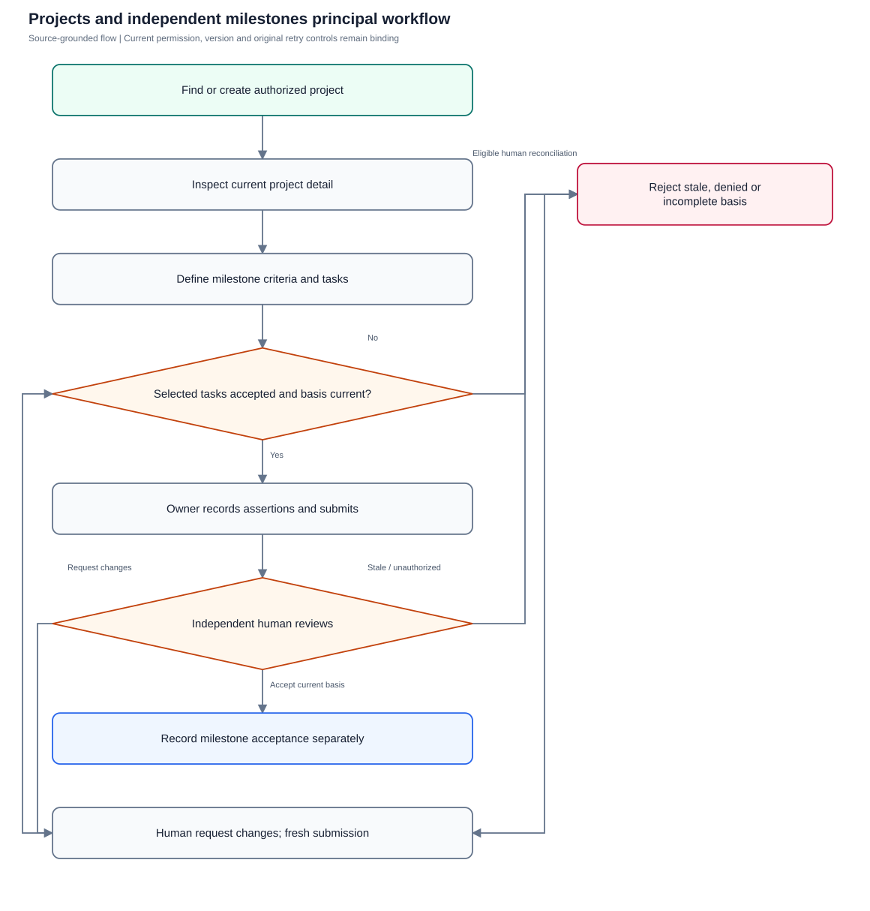
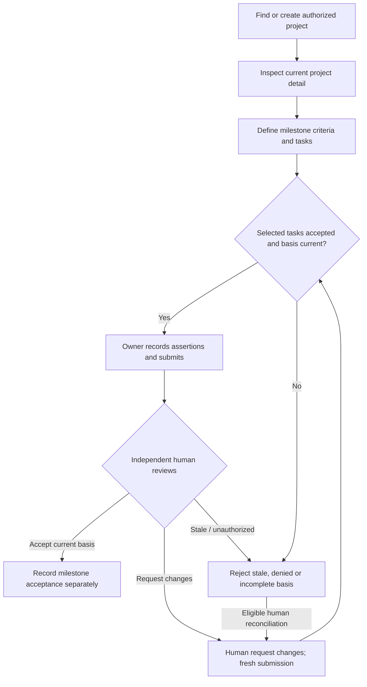

# Projects and independent milestones

Group authorized work and independently review milestones without rewriting underlying task acceptance.

**Entry:** Projects → New project; Project detail → Add task; Milestone review; Review project task schedule

**Actors:** Alpha leader — company leadership (founder in QA Alpha; not platform admin); Owner A — accountable owner and department member, Engineering; Reviewer R — currently eligible independent reviewer; never owner of the reviewed work; Viewer V — read-only company viewer

## Main flow

1. Create or find an authorized project.
2. Open current detail and inspect scoped summary.
3. Select already accepted project tasks and record milestone criteria/assertions.
4. Independent reviewer accepts current basis or requests changes.
5. Use explicit schedule preview/apply for current task changes.

[Editable Mermaid](../diagrams/PROJECTS.mmd)

## Controls and limits

- Project card counts and some detail overdue/blocked rows derive from currently loaded authorized workspace tasks; current detail accepted/total summary is separate.
- Milestone acceptance is a separate human decision and never accepts linked tasks.

## Proposed manual scenarios

All start **NOT_RUN**. Missing prerequisite = BLOCKED.

### PROJECTS-001: Create and find a project using existing controls

**P1 · LOCAL · Web, API**

**Actors:**

- Alpha leader — company leadership (founder in QA Alpha; not platform admin)
- Owner A — accountable owner and department member, Engineering

**Preconditions:**

- Use a separately provisioned isolated server fixture, never the running workspace or historical native fixture.
- Company QA Alpha uses Asia/Kolkata, INR and April financial-year start; QA Beta is a second isolated company.
- Provision named fictional actors and secrets separately; record no passwords, tokens, private source prose or real account identifiers in evidence.
- Begin the manual run as NOT_RUN; a missing server/configuration/device prerequisite is BLOCKED.

**Test data:**

- Launch QA; Engineering department; owner Owner A; target 2026-10-30; status active.

| Step | Action | Expected result |
| --- | --- | --- |
| 1 | As Alpha leader choose New project, complete project identity/ownership/date and save. | Project appears with recorded owner, target and active status. |
| 2 | Search projects for Launch QA and narrow Filter projects by department/status. | Only matching visible project cards appear; open its card to inspect current detail. |

**Cleanup:** Close draft/recovery controls after recording the result; sign out test sessions. Retain immutable history until evidence review, then discard this isolated fixture through its approved fixture lifecycle.

[Scenario flow](../diagrams/PROJECTS-001.svg) · [Editable source](../diagrams/PROJECTS-001.mmd)

**Source:** [docs/USER_GUIDE.md](../../../docs/USER_GUIDE.md), [docs/API_CONTRACT.md](../../../docs/API_CONTRACT.md), [frontend/src/pages/Projects.tsx](../../../frontend/src/pages/Projects.tsx), [frontend/src/components/ProjectMilestones.tsx](../../../frontend/src/components/ProjectMilestones.tsx), [backend/platform/project_milestones.go](../../../backend/platform/project_milestones.go), [backend/platform/task_schedule.go](../../../backend/platform/task_schedule.go)

**Supporting automation:** [frontend/src/pages/Projects.test.tsx](../../../frontend/src/pages/Projects.test.tsx), [frontend/src/components/ProjectMilestones.test.tsx](../../../frontend/src/components/ProjectMilestones.test.tsx), [frontend/src/components/ProjectMilestones.retry.test.tsx](../../../frontend/src/components/ProjectMilestones.retry.test.tsx), [backend/platform/project_milestones_test.go](../../../backend/platform/project_milestones_test.go), [backend/platform/task_schedule_test.go](../../../backend/platform/task_schedule_test.go)

### PROJECTS-002: Project detail separates scoped summary and underlying tasks

**P0 · LOCAL · Web, API**

**Actors:**

- Alpha leader — company leadership (founder in QA Alpha; not platform admin)
- Owner A — accountable owner and department member, Engineering

**Preconditions:**

- Use a separately provisioned isolated server fixture, never the running workspace or historical native fixture.
- Company QA Alpha uses Asia/Kolkata, INR and April financial-year start; QA Beta is a second isolated company.
- Provision named fictional actors and secrets separately; record no passwords, tokens, private source prose or real account identifiers in evidence.
- Begin the manual run as NOT_RUN; a missing server/configuration/device prerequisite is BLOCKED.

**Test data:**

- Launch QA has accepted, blocked and overdue tasks; Owner A sees only a subset.

| Step | Action | Expected result |
| --- | --- | --- |
| 1 | Open Launch QA as Alpha leader then Owner A; compare Authorized tasks, Accepted and Project work. | Each sees current authorized counts and independently readable rows; scoped totals are not represented as unrestricted company totals. |
| 2 | Choose Add task from the project detail. | Task form carries the project association; task creation still validates current owner/reviewer/work scope. |

**Cleanup:** Close draft/recovery controls after recording the result; sign out test sessions. Retain immutable history until evidence review, then discard this isolated fixture through its approved fixture lifecycle.

[Scenario flow](../diagrams/PROJECTS-002.svg) · [Editable source](../diagrams/PROJECTS-002.mmd)

**Source:** [docs/USER_GUIDE.md](../../../docs/USER_GUIDE.md), [docs/API_CONTRACT.md](../../../docs/API_CONTRACT.md), [frontend/src/pages/Projects.tsx](../../../frontend/src/pages/Projects.tsx), [frontend/src/components/ProjectMilestones.tsx](../../../frontend/src/components/ProjectMilestones.tsx), [backend/platform/project_milestones.go](../../../backend/platform/project_milestones.go), [backend/platform/task_schedule.go](../../../backend/platform/task_schedule.go)

**Supporting automation:** [frontend/src/pages/Projects.test.tsx](../../../frontend/src/pages/Projects.test.tsx), [frontend/src/components/ProjectMilestones.test.tsx](../../../frontend/src/components/ProjectMilestones.test.tsx), [frontend/src/components/ProjectMilestones.retry.test.tsx](../../../frontend/src/components/ProjectMilestones.retry.test.tsx), [backend/platform/project_milestones_test.go](../../../backend/platform/project_milestones_test.go), [backend/platform/task_schedule_test.go](../../../backend/platform/task_schedule_test.go)

### PROJECTS-003: Project editing enforces version and management scope

**P1 · LOCAL · Web, API**

**Actors:**

- Alpha leader — company leadership (founder in QA Alpha; not platform admin)
- Viewer V — read-only company viewer

**Preconditions:**

- Use a separately provisioned isolated server fixture, never the running workspace or historical native fixture.
- Company QA Alpha uses Asia/Kolkata, INR and April financial-year start; QA Beta is a second isolated company.
- Provision named fictional actors and secrets separately; record no passwords, tokens, private source prose or real account identifiers in evidence.
- Begin the manual run as NOT_RUN; a missing server/configuration/device prerequisite is BLOCKED.

**Test data:**

- Alpha leader holds stale Launch QA version; session B changes its name; Viewer V is viewer.

| Step | Action | Expected result |
| --- | --- | --- |
| 1 | Save project Edit in B then PATCH the project from A with the old version. | 409 prevents lost updates; old version does not overwrite the current name. |
| 2 | As Viewer V inspect New project/Edit and attempt equivalent API mutations. | Controls are unavailable and backend denies management; read access alone grants no project write. |

**Cleanup:** Close draft/recovery controls after recording the result; sign out test sessions. Retain immutable history until evidence review, then discard this isolated fixture through its approved fixture lifecycle.

[Scenario flow](../diagrams/PROJECTS-003.svg) · [Editable source](../diagrams/PROJECTS-003.mmd)

**Source:** [docs/USER_GUIDE.md](../../../docs/USER_GUIDE.md), [docs/API_CONTRACT.md](../../../docs/API_CONTRACT.md), [frontend/src/pages/Projects.tsx](../../../frontend/src/pages/Projects.tsx), [frontend/src/components/ProjectMilestones.tsx](../../../frontend/src/components/ProjectMilestones.tsx), [backend/platform/project_milestones.go](../../../backend/platform/project_milestones.go), [backend/platform/task_schedule.go](../../../backend/platform/task_schedule.go)

**Supporting automation:** [frontend/src/pages/Projects.test.tsx](../../../frontend/src/pages/Projects.test.tsx), [backend/platform/platform_test.go](../../../backend/platform/platform_test.go)

### PROJECTS-004: Create milestone criteria from accepted project work

**P1 · LOCAL · Web, API**

**Actors:**

- Owner A — accountable owner and department member, Engineering
- Reviewer R — currently eligible independent reviewer; never owner of the reviewed work
- Alpha leader — company leadership (founder in QA Alpha; not platform admin)

**Preconditions:**

- Use a separately provisioned isolated server fixture, never the running workspace or historical native fixture.
- Company QA Alpha uses Asia/Kolkata, INR and April financial-year start; QA Beta is a second isolated company.
- Provision named fictional actors and secrets separately; record no passwords, tokens, private source prose or real account identifiers in evidence.
- Begin the manual run as NOT_RUN; a missing server/configuration/device prerequisite is BLOCKED.

**Test data:**

- Milestone Release QA ready; Owner A owner; Reviewer R reviewer; two accepted tasks; criterion Engineering evidence checked.

| Step | Action | Expected result |
| --- | --- | --- |
| 1 | Open milestone creation, select an independent reviewer and accepted project tasks, enter criteria and Save milestone criteria. | One draft milestone records criteria version, task selection and captured project version. |
| 2 | Choose Inspect current submission basis, author each Criterion assertion and Submit milestone for independent review. | Current accepted task versions and assertions are captured; milestone becomes in_review, preserving underlying task status/version. |

**Cleanup:** Close draft/recovery controls after recording the result; sign out test sessions. Retain immutable history until evidence review, then discard this isolated fixture through its approved fixture lifecycle.

[Scenario flow](../diagrams/PROJECTS-004.svg) · [Editable source](../diagrams/PROJECTS-004.mmd)

**Source:** [docs/USER_GUIDE.md](../../../docs/USER_GUIDE.md), [docs/API_CONTRACT.md](../../../docs/API_CONTRACT.md), [frontend/src/pages/Projects.tsx](../../../frontend/src/pages/Projects.tsx), [frontend/src/components/ProjectMilestones.tsx](../../../frontend/src/components/ProjectMilestones.tsx), [backend/platform/project_milestones.go](../../../backend/platform/project_milestones.go), [backend/platform/task_schedule.go](../../../backend/platform/task_schedule.go)

**Supporting automation:** [frontend/src/pages/Projects.test.tsx](../../../frontend/src/pages/Projects.test.tsx), [frontend/src/components/ProjectMilestones.test.tsx](../../../frontend/src/components/ProjectMilestones.test.tsx), [frontend/src/components/ProjectMilestones.retry.test.tsx](../../../frontend/src/components/ProjectMilestones.retry.test.tsx), [backend/platform/project_milestones_test.go](../../../backend/platform/project_milestones_test.go), [backend/platform/task_schedule_test.go](../../../backend/platform/task_schedule_test.go)

### PROJECTS-005: Owner and incomplete task basis cannot accept milestones

**P0 · LOCAL · Web, API**

**Actors:**

- Owner A — accountable owner and department member, Engineering
- Reviewer R — currently eligible independent reviewer; never owner of the reviewed work

**Preconditions:**

- Use a separately provisioned isolated server fixture, never the running workspace or historical native fixture.
- Company QA Alpha uses Asia/Kolkata, INR and April financial-year start; QA Beta is a second isolated company.
- Provision named fictional actors and secrets separately; record no passwords, tokens, private source prose or real account identifiers in evidence.
- Begin the manual run as NOT_RUN; a missing server/configuration/device prerequisite is BLOCKED.

**Test data:**

- One unaccepted selected task variant; separate submitted milestone owned by Owner A.

| Step | Action | Expected result |
| --- | --- | --- |
| 1 | Attempt Inspect current submission basis when a selected task is not done. | Submission basis fails; every selected task must already be accepted. |
| 2 | As Owner A attempt approve transition; as Reviewer R inspect assertions/current evidence and Accept milestone independently. | Owner is denied; eligible independent reviewer accepts once with history, without altering task acceptance or finance. |

**Cleanup:** Close draft/recovery controls after recording the result; sign out test sessions. Retain immutable history until evidence review, then discard this isolated fixture through its approved fixture lifecycle.

[Scenario flow](../diagrams/PROJECTS-005.svg) · [Editable source](../diagrams/PROJECTS-005.mmd)

**Source:** [docs/USER_GUIDE.md](../../../docs/USER_GUIDE.md), [docs/API_CONTRACT.md](../../../docs/API_CONTRACT.md), [frontend/src/pages/Projects.tsx](../../../frontend/src/pages/Projects.tsx), [frontend/src/components/ProjectMilestones.tsx](../../../frontend/src/components/ProjectMilestones.tsx), [backend/platform/project_milestones.go](../../../backend/platform/project_milestones.go), [backend/platform/task_schedule.go](../../../backend/platform/task_schedule.go)

**Supporting automation:** [frontend/src/pages/Projects.test.tsx](../../../frontend/src/pages/Projects.test.tsx), [frontend/src/components/ProjectMilestones.test.tsx](../../../frontend/src/components/ProjectMilestones.test.tsx), [frontend/src/components/ProjectMilestones.retry.test.tsx](../../../frontend/src/components/ProjectMilestones.retry.test.tsx), [backend/platform/project_milestones_test.go](../../../backend/platform/project_milestones_test.go), [backend/platform/task_schedule_test.go](../../../backend/platform/task_schedule_test.go)

### PROJECTS-006: Stale milestone basis requires separate human change request

**P0 · LOCAL · Web, API**

**Actors:**

- Owner A — accountable owner and department member, Engineering
- Reviewer R — currently eligible independent reviewer; never owner of the reviewed work
- Alpha leader — company leadership (founder in QA Alpha; not platform admin)

**Preconditions:**

- Use a separately provisioned isolated server fixture, never the running workspace or historical native fixture.
- Company QA Alpha uses Asia/Kolkata, INR and April financial-year start; QA Beta is a second isolated company.
- Provision named fictional actors and secrets separately; record no passwords, tokens, private source prose or real account identifiers in evidence.
- Begin the manual run as NOT_RUN; a missing server/configuration/device prerequisite is BLOCKED.

**Test data:**

- In-review milestone; task time/evidence or project version changes after submission.

| Step | Action | Expected result |
| --- | --- | --- |
| 1 | Attempt Accept milestone independently using stale submitted basis. | 409/current-basis warning prevents stale acceptance. |
| 2 | As Reviewer R provide Milestone change request reason and Request milestone changes; as owner attempt the same reset. | Authorized independent human reset returns draft; owner reset is denied. Historical submitted assertions/versions remain. |
| 3 | Inspect current submission basis and resubmit before a fresh independent decision. | Fresh captured task/project versions are reviewed; prior retry cannot erase the fresh submission. |

**Cleanup:** Close draft/recovery controls after recording the result; sign out test sessions. Retain immutable history until evidence review, then discard this isolated fixture through its approved fixture lifecycle.

[Scenario flow](../diagrams/PROJECTS-006.svg) · [Editable source](../diagrams/PROJECTS-006.mmd)

**Source:** [docs/USER_GUIDE.md](../../../docs/USER_GUIDE.md), [docs/API_CONTRACT.md](../../../docs/API_CONTRACT.md), [frontend/src/pages/Projects.tsx](../../../frontend/src/pages/Projects.tsx), [frontend/src/components/ProjectMilestones.tsx](../../../frontend/src/components/ProjectMilestones.tsx), [backend/platform/project_milestones.go](../../../backend/platform/project_milestones.go), [backend/platform/task_schedule.go](../../../backend/platform/task_schedule.go)

**Supporting automation:** [frontend/src/pages/Projects.test.tsx](../../../frontend/src/pages/Projects.test.tsx), [frontend/src/components/ProjectMilestones.test.tsx](../../../frontend/src/components/ProjectMilestones.test.tsx), [frontend/src/components/ProjectMilestones.retry.test.tsx](../../../frontend/src/components/ProjectMilestones.retry.test.tsx), [backend/platform/project_milestones_test.go](../../../backend/platform/project_milestones_test.go), [backend/platform/task_schedule_test.go](../../../backend/platform/task_schedule_test.go)

### PROJECTS-007: Milestone unknown save/decision retries original intent

**P0 · LOCAL · Web, API**

**Actors:**

- Owner A — accountable owner and department member, Engineering
- Reviewer R — currently eligible independent reviewer; never owner of the reviewed work

**Preconditions:**

- Use a separately provisioned isolated server fixture, never the running workspace or historical native fixture.
- Company QA Alpha uses Asia/Kolkata, INR and April financial-year start; QA Beta is a second isolated company.
- Provision named fictional actors and secrets separately; record no passwords, tokens, private source prose or real account identifiers in evidence.
- Begin the manual run as NOT_RUN; a missing server/configuration/device prerequisite is BLOCKED.

**Test data:**

- Captured milestone save or transition; isolated one-time lost ACK; later source edits.

| Step | Action | Expected result |
| --- | --- | --- |
| 1 | Suppress one successful save/decision response and choose Retry same milestone save / Retry same milestone action. | Original key, target, criteria, assertions, task/project versions and body are retried; one canonical result/history event is produced. |
| 2 | After known success, inspect history and perform deliberate Reopen milestone for fresh review with a reason. | Historical human acceptance is retained; current basis qualification may change but replay does not rewrite underlying task facts. |

**Cleanup:** Close draft/recovery controls after recording the result; sign out test sessions. Retain immutable history until evidence review, then discard this isolated fixture through its approved fixture lifecycle.

[Scenario flow](../diagrams/PROJECTS-007.svg) · [Editable source](../diagrams/PROJECTS-007.mmd)

**Source:** [docs/USER_GUIDE.md](../../../docs/USER_GUIDE.md), [docs/API_CONTRACT.md](../../../docs/API_CONTRACT.md), [frontend/src/pages/Projects.tsx](../../../frontend/src/pages/Projects.tsx), [frontend/src/components/ProjectMilestones.tsx](../../../frontend/src/components/ProjectMilestones.tsx), [backend/platform/project_milestones.go](../../../backend/platform/project_milestones.go), [backend/platform/task_schedule.go](../../../backend/platform/task_schedule.go)

**Supporting automation:** [frontend/src/pages/Projects.test.tsx](../../../frontend/src/pages/Projects.test.tsx), [frontend/src/components/ProjectMilestones.test.tsx](../../../frontend/src/components/ProjectMilestones.test.tsx), [frontend/src/components/ProjectMilestones.retry.test.tsx](../../../frontend/src/components/ProjectMilestones.retry.test.tsx), [backend/platform/project_milestones_test.go](../../../backend/platform/project_milestones_test.go), [backend/platform/task_schedule_test.go](../../../backend/platform/task_schedule_test.go)

### PROJECTS-008: Schedule preview is all-or-none and preserves originals

**P1 · LOCAL · Web, API**

**Actors:**

- Alpha leader — company leadership (founder in QA Alpha; not platform admin)
- Owner A — accountable owner and department member, Engineering

**Preconditions:**

- Use a separately provisioned isolated server fixture, never the running workspace or historical native fixture.
- Company QA Alpha uses Asia/Kolkata, INR and April financial-year start; QA Beta is a second isolated company.
- Provision named fictional actors and secrets separately; record no passwords, tokens, private source prose or real account identifiers in evidence.
- Begin the manual run as NOT_RUN; a missing server/configuration/device prerequisite is BLOCKED.

**Test data:**

- Two editable Launch QA tasks; proposed current date shift +2 days; one concurrent task edit.

| Step | Action | Expected result |
| --- | --- | --- |
| 1 | Choose Review project task schedule, review the proposed change and reasons without applying. | Preview is read-only, checks current versions/authority and shows exact proposed current deadlines. |
| 2 | Advance one selected task version in another session, then attempt captured apply. | Whole batch conflicts; neither current deadline is partially changed. |
| 3 | Obtain a fresh reviewed preview and apply, then retry its exact canonical body/key. | Current task deadlines shift once; original commitments, accepted task facts and finance remain unchanged. |

**Cleanup:** Close draft/recovery controls after recording the result; sign out test sessions. Retain immutable history until evidence review, then discard this isolated fixture through its approved fixture lifecycle.

[Scenario flow](../diagrams/PROJECTS-008.svg) · [Editable source](../diagrams/PROJECTS-008.mmd)

**Source:** [frontend/src/pages/Projects.tsx](../../../frontend/src/pages/Projects.tsx), [frontend/src/components/ScheduleReview.tsx](../../../frontend/src/components/ScheduleReview.tsx), [backend/platform/task_schedule.go](../../../backend/platform/task_schedule.go)

**Supporting automation:** [backend/platform/task_schedule_test.go](../../../backend/platform/task_schedule_test.go), [frontend/src/pages/Projects.test.tsx](../../../frontend/src/pages/Projects.test.tsx)
