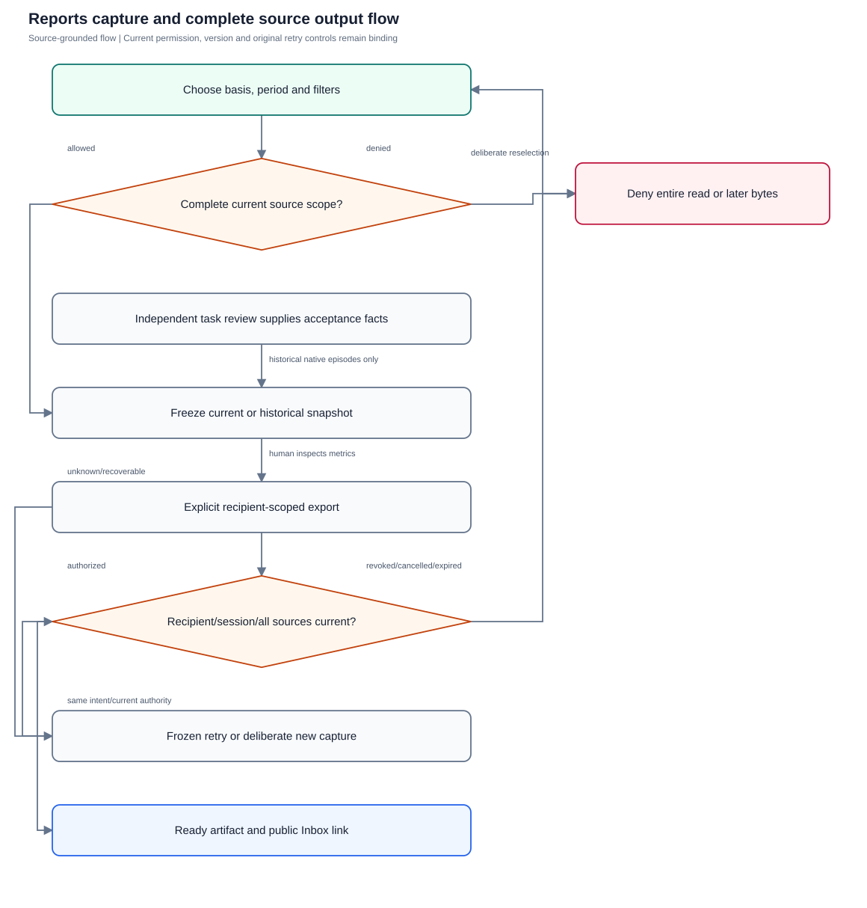
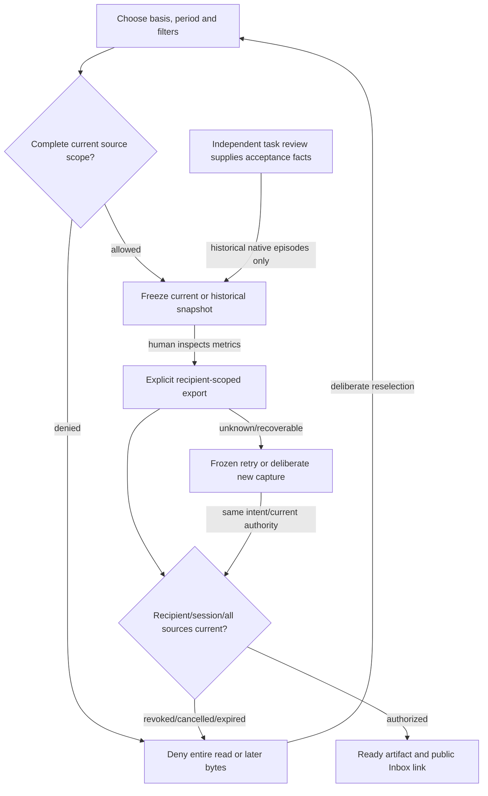

# Current and historical reports

Validate scoped frozen metrics, durable historical provenance, private revocable output and isolated recipient delivery.

**Entry:** Web Reports; native More → Reports needs separate DEVICE qualification; Company-relative /reports/tasks/summary, /rows, /export; Company-relative /reports/history/snapshots, /compare, /definitions, /exports, /artifacts; ordinary /attention

**Actors:** platform admin: operator without company membership; company leadership: QA Alpha founder; owner: QA Alpha expense/task creator; independent reviewer: QA Alpha department head distinct from owner; department member: QA Alpha Engineering member; finance: QA Alpha finance role distinct from owner; outsider: QA Beta member only

## Main flow

1. Select explicit period, filters and current/historical basis
2. Capture complete authorized snapshot, retaining coverage and metric version
3. Inspect denominators and deliberate row drilldowns; historical acceptance facts require independent task review
4. Save versioned definition/schedule with current eligible recipients
5. Queue private export; each recipient uses own current task scope
6. Recheck all sources and session before headers and every output chunk
7. Project only recipient-bound current report-ready IDs in ordinary Inbox

[Editable Mermaid](../diagrams/REPORTS.mmd)

## Controls and limits

- All scenarios NOT_RUN; demo metrics do not establish server/source/session acceptance.
- Current snapshots are process-local five-minute caches; durable task_history_v1 never invents pre-observation acceptance episodes.
- Private storage/worker faults require LOCAL_CONFIG disposable qualification; no email/external delivery implied.
- Already written/in-flight bytes and downloaded copies cannot be recalled. Physical native sharing/background handling needs DEVICE qualification.

## Proposed manual scenarios

All start **NOT_RUN**. Missing prerequisite = BLOCKED.

### REPORTS-001: Full-cohort current summary preserves original/current deadline metrics

**P0 · LOCAL · Web, API**

**Actors:**

- platform admin: operator without company membership
- company leadership: QA Alpha founder
- owner: QA Alpha expense/task creator
- independent reviewer: QA Alpha department head distinct from owner
- department member: QA Alpha Engineering member
- finance: QA Alpha finance role distinct from owner
- outsider: QA Beta member only

**Preconditions:**

- Provision a disposable isolated server/API fixture with fictional QA Alpha (INR, Asia/Kolkata, April financial year) and unrelated QA Beta; use separate actor sessions and a controlled 2026-10-12 clock.
- Never mutate the running workspace, restore historical native fixtures or reuse consumed capabilities. Browser demo does not establish backend authorization acceptance.

**Test data:**

- Period2026-10-01–2026-10-12 inclusive;205 readable noncancelled tasks plus cancelled control.
- One accepted task missed original deadline but met reasoned changed current deadline.

| Step | Action | Expected result |
| --- | --- | --- |
| 1 | GET /reports/tasks/summary before loading every report row page. | Full authorized summary basis snapshot_current_state includes frozen period/timezone/metricVersion and separate original/current denominators/met counts. |
| 2 | Deliberately load commitments/accepted/exceptions row pages up to100 and compare totals. | Tab filtering precedes pagination; later rows remain in summary and cancelled input is excluded. |
| 3 | Drill into changed-deadline task and export selected full tab. | Original/current deadlines remain distinct; export covers full tab not loaded page and excludes financial/chat evidence. |

**Cleanup:** Record sanitized observations without real IDs, credentials, private prose or prompts. Close QA sessions and remove owned temporary downloads; reset/dispose only this isolated fixture through its approved lifecycle, retaining audit history until disposal.

[Scenario flow](../diagrams/REPORTS-001.svg) · [Editable source](../diagrams/REPORTS-001.mmd)

**Source:** [docs/API_CONTRACT.md](../../../docs/API_CONTRACT.md), [docs/reports-storage.md](../../../docs/reports-storage.md), [docs/SECURITY_AND_LIMITATIONS.md](../../../docs/SECURITY_AND_LIMITATIONS.md), [backend/platform/report_reads.go](../../../backend/platform/report_reads.go)

**Supporting automation:** [backend/platform/reports_test.go](../../../backend/platform/reports_test.go), [frontend/src/data/reports.test.ts](../../../frontend/src/data/reports.test.ts)

### REPORTS-002: Role and company filters cannot grant task report access

**P0 · LOCAL · Web, API**

**Actors:**

- platform admin: operator without company membership
- company leadership: QA Alpha founder
- owner: QA Alpha expense/task creator
- independent reviewer: QA Alpha department head distinct from owner
- department member: QA Alpha Engineering member
- finance: QA Alpha finance role distinct from owner
- outsider: QA Beta member only

**Preconditions:**

- Provision a disposable isolated server/API fixture with fictional QA Alpha (INR, Asia/Kolkata, April financial year) and unrelated QA Beta; use separate actor sessions and a controlled 2026-10-12 clock.
- Never mutate the running workspace, restore historical native fixtures or reuse consumed capabilities. Browser demo does not establish backend authorization acceptance.

**Test data:**

- Engineering head, manager with one report, owner member and viewer in QA Alpha.
- QA Alpha private project;QA Beta department/owner;QA Alpha snapshot handle used by other principal/company.

| Step | Action | Expected result |
| --- | --- | --- |
| 1 | Read current reports as each QA Alpha role and compare task detail scope. | Reports follow ordinary task read permissions; recipient/member never inherits leadership scope. |
| 2 | Try hidden/cross-company filters or another actor/company snapshot token. | Filters only narrow existing visibility; wrong-user/company token404 and no hidden business fields. |
| 3 | Read endpoints as outsider and operator without QA Alpha membership. | Current authenticated company membership required; platform admin is distinct from company leadership. |

**Cleanup:** Record sanitized observations without real IDs, credentials, private prose or prompts. Close QA sessions and remove owned temporary downloads; reset/dispose only this isolated fixture through its approved lifecycle, retaining audit history until disposal.

[Scenario flow](../diagrams/REPORTS-002.svg) · [Editable source](../diagrams/REPORTS-002.mmd)

**Source:** [docs/API_CONTRACT.md](../../../docs/API_CONTRACT.md), [docs/reports-storage.md](../../../docs/reports-storage.md), [docs/SECURITY_AND_LIMITATIONS.md](../../../docs/SECURITY_AND_LIMITATIONS.md), [backend/platform/reports.go](../../../backend/platform/reports.go), [backend/platform/report_reads.go](../../../backend/platform/report_reads.go)

**Supporting automation:** [backend/platform/reports_test.go](../../../backend/platform/reports_test.go)

### REPORTS-003: Calendar, period and cursor/filter validation preserve exact boundaries

**P1 · LOCAL · Web, API**

**Actors:**

- platform admin: operator without company membership
- company leadership: QA Alpha founder
- owner: QA Alpha expense/task creator
- independent reviewer: QA Alpha department head distinct from owner
- department member: QA Alpha Engineering member
- finance: QA Alpha finance role distinct from owner
- outsider: QA Beta member only

**Preconditions:**

- Provision a disposable isolated server/API fixture with fictional QA Alpha (INR, Asia/Kolkata, April financial year) and unrelated QA Beta; use separate actor sessions and a controlled 2026-10-12 clock.
- Never mutate the running workspace, restore historical native fixtures or reuse consumed capabilities. Browser demo does not establish backend authorization acceptance.

**Test data:**

- Accepted instant2026-09-30T18:30:00Z equals company-local2026-10-01;periodOct1–12.
- Invalid missing/reversed dates,2026-02-30,limit0/101;timed acceptance at deadline and+1ns.

| Step | Action | Expected result |
| --- | --- | --- |
| 1 | Generate period summary with intersecting department/owner/project filters and inspect boundary task. | Inclusive company calendar and displayed timezone govern membership/accepted dates; filters intersect. |
| 2 | Try each invalid date/limit and change filters while reading snapshot-bound rows. | 422 for invalid/mismatched input; token/cursor cannot broaden original selection. |
| 3 | Inspect exact timed equality and1ns-later fixtures in punctuality metrics. | Equality on time and1ns later late without rounded boundary; original/current definition retained. |

**Cleanup:** Record sanitized observations without real IDs, credentials, private prose or prompts. Close QA sessions and remove owned temporary downloads; reset/dispose only this isolated fixture through its approved lifecycle, retaining audit history until disposal.

[Scenario flow](../diagrams/REPORTS-003.svg) · [Editable source](../diagrams/REPORTS-003.mmd)

**Source:** [docs/API_CONTRACT.md](../../../docs/API_CONTRACT.md), [docs/reports-storage.md](../../../docs/reports-storage.md), [docs/SECURITY_AND_LIMITATIONS.md](../../../docs/SECURITY_AND_LIMITATIONS.md), [backend/platform/report_reads.go](../../../backend/platform/report_reads.go), [backend/platform/report_history.go](../../../backend/platform/report_history.go)

**Supporting automation:** [backend/platform/reports_test.go](../../../backend/platform/reports_test.go), [backend/platform/report_history_test.go](../../../backend/platform/report_history_test.go)

### REPORTS-004: Readable live changes do not replace frozen current snapshot values

**P0 · LOCAL · Web, API**

**Actors:**

- platform admin: operator without company membership
- company leadership: QA Alpha founder
- owner: QA Alpha expense/task creator
- independent reviewer: QA Alpha department head distinct from owner
- department member: QA Alpha Engineering member
- finance: QA Alpha finance role distinct from owner
- outsider: QA Beta member only

**Preconditions:**

- Provision a disposable isolated server/API fixture with fictional QA Alpha (INR, Asia/Kolkata, April financial year) and unrelated QA Beta; use separate actor sessions and a controlled 2026-10-12 clock.
- Never mutate the running workspace, restore historical native fixtures or reuse consumed capabilities. Browser demo does not establish backend authorization acceptance.

**Test data:**

- Captured task title QA original/current dueOct10.
- Authorized later edit title QA later/current dueOct12 with meaningful reason.

| Step | Action | Expected result |
| --- | --- | --- |
| 1 | Capture summary/first rows; second actor edits readable task with current version. | Live version changes independently; captured values/metrics remain frozen. |
| 2 | Read remaining rows and export original token/filters. | Exact snapshot values used; no later title or recomputed latest metrics substitute silently. |
| 3 | Explicitly refresh summary and inspect new token before selecting latest. | New current capture reflects authorized latest values; original selection remains explicit and distinct. |

**Cleanup:** Record sanitized observations without real IDs, credentials, private prose or prompts. Close QA sessions and remove owned temporary downloads; reset/dispose only this isolated fixture through its approved lifecycle, retaining audit history until disposal.

[Scenario flow](../diagrams/REPORTS-004.svg) · [Editable source](../diagrams/REPORTS-004.mmd)

**Source:** [docs/API_CONTRACT.md](../../../docs/API_CONTRACT.md), [docs/reports-storage.md](../../../docs/reports-storage.md), [docs/SECURITY_AND_LIMITATIONS.md](../../../docs/SECURITY_AND_LIMITATIONS.md), [backend/platform/report_reads.go](../../../backend/platform/report_reads.go), [frontend/src/pages/GoalsReports.tsx](../../../frontend/src/pages/GoalsReports.tsx)

**Supporting automation:** [backend/platform/reporting_final_test.go](../../../backend/platform/reporting_final_test.go), [frontend/src/pages/Reports.test.tsx](../../../frontend/src/pages/Reports.test.tsx)

### REPORTS-005: Any off-page source or outside-period exposed reference loss invalidates snapshot

**P0 · LOCAL · Web, API**

**Actors:**

- platform admin: operator without company membership
- company leadership: QA Alpha founder
- owner: QA Alpha expense/task creator
- independent reviewer: QA Alpha department head distinct from owner
- department member: QA Alpha Engineering member
- finance: QA Alpha finance role distinct from owner
- outsider: QA Beta member only

**Preconditions:**

- Provision a disposable isolated server/API fixture with fictional QA Alpha (INR, Asia/Kolkata, April financial year) and unrelated QA Beta; use separate actor sessions and a controlled 2026-10-12 clock.
- Never mutate the running workspace, restore historical native fixtures or reuse consumed capabilities. Browser demo does not establish backend authorization acceptance.

**Test data:**

- 205 member-readable October tasks;last source references readable December dependency.
- Fresh variants: last source reassigned away;December dependency becomes inaccessible.

| Step | Action | Expected result |
| --- | --- | --- |
| 1 | Capture summary/first page while complete cohort/reference set readable. | Snapshot authority binds all source tasks and exposed reference, including outside-period dependency. |
| 2 | Leadership commits specified reassignment through isolated authorized control; read original rows/export before headers. | Entire frozen snapshot invalidates with409/access denial and no CSV/data output; server never drops only denied row. |
| 3 | Deliberately refresh under current scope. | New cohort reflects current visibility; old token/cache never grants stale access. |

**Cleanup:** Record sanitized observations without real IDs, credentials, private prose or prompts. Close QA sessions and remove owned temporary downloads; reset/dispose only this isolated fixture through its approved lifecycle, retaining audit history until disposal.

[Scenario flow](../diagrams/REPORTS-005.svg) · [Editable source](../diagrams/REPORTS-005.mmd)

**Source:** [docs/API_CONTRACT.md](../../../docs/API_CONTRACT.md), [docs/reports-storage.md](../../../docs/reports-storage.md), [docs/SECURITY_AND_LIMITATIONS.md](../../../docs/SECURITY_AND_LIMITATIONS.md), [backend/platform/report_reads.go](../../../backend/platform/report_reads.go)

**Supporting automation:** [backend/platform/reporting_final_test.go](../../../backend/platform/reporting_final_test.go)

### REPORTS-006: Current CSV checks complete sources and original session before every64KiB chunk

**P0 · LOCAL · Web, API**

**Actors:**

- platform admin: operator without company membership
- company leadership: QA Alpha founder
- owner: QA Alpha expense/task creator
- independent reviewer: QA Alpha department head distinct from owner
- department member: QA Alpha Engineering member
- finance: QA Alpha finance role distinct from owner
- outsider: QA Beta member only

**Preconditions:**

- Provision a disposable isolated server/API fixture with fictional QA Alpha (INR, Asia/Kolkata, April financial year) and unrelated QA Beta; use separate actor sessions and a controlled 2026-10-12 clock.
- Never mutate the running workspace, restore historical native fixtures or reuse consumed capabilities. Browser demo does not establish backend authorization acceptance.
- Use existing isolated chunk-writer regression technique or separately qualified fixture interception; never fault running workspace.

**Test data:**

- 201 tasks each1KiB fictional description;first title=QA_FORMULA;final titleQA-LAST.
- Separate variants: membership removal,original session invalidation,last source reassignment,outside-period dependency loss.

| Step | Action | Expected result |
| --- | --- | --- |
| 1 | Start snapshot CSV in isolated controlled writer and hold after first chunk. | Exact Content-Length and basis/row headers present; formula neutralized; chunk at most64KiB. |
| 2 | For each fresh variant commit authority loss before next check/write. | Later chunks stop after current complete-source/session denial; no QA-LAST prose or appended JSON error in started CSV. |
| 3 | Compare received length/retry original export; run unchanged-authority control. | Truncation detectable via length; denied retry cannot start CSV; unchanged control complete/frozen. Already written/in-flight bytes cannot be recalled. |

**Cleanup:** Record sanitized observations without real IDs, credentials, private prose or prompts. Close QA sessions and remove owned temporary downloads; reset/dispose only this isolated fixture through its approved lifecycle, retaining audit history until disposal.

[Scenario flow](../diagrams/REPORTS-006.svg) · [Editable source](../diagrams/REPORTS-006.mmd)

**Source:** [docs/API_CONTRACT.md](../../../docs/API_CONTRACT.md), [docs/reports-storage.md](../../../docs/reports-storage.md), [docs/SECURITY_AND_LIMITATIONS.md](../../../docs/SECURITY_AND_LIMITATIONS.md), [backend/platform/report_reads.go](../../../backend/platform/report_reads.go)

**Supporting automation:** [backend/platform/reporting_final_test.go](../../../backend/platform/reporting_final_test.go)

### REPORTS-007: Current snapshot expiry, bound cursors and oversized capture fail closed

**P1 · LOCAL · Web, API**

**Actors:**

- platform admin: operator without company membership
- company leadership: QA Alpha founder
- owner: QA Alpha expense/task creator
- independent reviewer: QA Alpha department head distinct from owner
- department member: QA Alpha Engineering member
- finance: QA Alpha finance role distinct from owner
- outsider: QA Beta member only

**Preconditions:**

- Provision a disposable isolated server/API fixture with fictional QA Alpha (INR, Asia/Kolkata, April financial year) and unrelated QA Beta; use separate actor sessions and a controlled 2026-10-12 clock.
- Never mutate the running workspace, restore historical native fixtures or reuse consumed capabilities. Browser demo does not establish backend authorization acceptance.

**Test data:**

- TTL5min;64 snapshots;10000 rows;8MiB each;32MiB aggregate.
- Controls: expired/evicted/restarted token;commitments cursor used for accepted tab;oversized cohort.

| Step | Action | Expected result |
| --- | --- | --- |
| 1 | Obtain row cursor and use changed tab/filter/principal. | Cursor bound to authorized snapshot/filter/tab; cannot continue another selection. |
| 2 | Use token after expiry or isolated restart/eviction. | 409 requires explicit fresh summary; no automatic latest substitution. |
| 3 | Request over-row/byte-limit cohort then deliberately narrow filters. | 422 instead of partial report totals; valid narrower bounded capture works. |

**Cleanup:** Record sanitized observations without real IDs, credentials, private prose or prompts. Close QA sessions and remove owned temporary downloads; reset/dispose only this isolated fixture through its approved lifecycle, retaining audit history until disposal.

[Scenario flow](../diagrams/REPORTS-007.svg) · [Editable source](../diagrams/REPORTS-007.mmd)

**Source:** [docs/API_CONTRACT.md](../../../docs/API_CONTRACT.md), [docs/reports-storage.md](../../../docs/reports-storage.md), [docs/SECURITY_AND_LIMITATIONS.md](../../../docs/SECURITY_AND_LIMITATIONS.md), [backend/platform/report_reads.go](../../../backend/platform/report_reads.go)

**Supporting automation:** [backend/platform/reporting_final_test.go](../../../backend/platform/reporting_final_test.go), [frontend/src/data/reports.test.ts](../../../frontend/src/data/reports.test.ts)

### REPORTS-008: Historical independent acceptance episodes differ from current state/progress

**P0 · LOCAL · Web, API**

**Actors:**

- platform admin: operator without company membership
- company leadership: QA Alpha founder
- owner: QA Alpha expense/task creator
- independent reviewer: QA Alpha department head distinct from owner
- department member: QA Alpha Engineering member
- finance: QA Alpha finance role distinct from owner
- outsider: QA Beta member only

**Preconditions:**

- Provision a disposable isolated server/API fixture with fictional QA Alpha (INR, Asia/Kolkata, April financial year) and unrelated QA Beta; use separate actor sessions and a controlled 2026-10-12 clock.
- Never mutate the running workspace, restore historical native fixtures or reuse consumed capabilities. Browser demo does not establish backend authorization acceptance.

**Test data:**

- QA task acceptedOct5 then reopened and independently acceptedOct8.
- Another task100percent in_review;2h native time and4h separately observed historical effort.

| Step | Action | Expected result |
| --- | --- | --- |
| 1 | Using staged isolated fixture dates Oct5 and Oct8, owner completes prerequisites/submits and independent reviewer accepts, with authorized reopening between. | Only valid independent acceptance creates episodes;100percent/in_review does not imply accepted completion. |
| 2 | Capture task_history_v1 period snapshot and inspect state/acceptance/effort metrics. | Two episodes versus one unique accepted task;cutoff state distinct;native and observed hours separate provenance. |
| 3 | Drill acceptance rows and compare original/current deadline denominators. | Denominators refer to episodes where defined, not silently collapsed task totals or employee-quality/payroll inference. |

**Cleanup:** Record sanitized observations without real IDs, credentials, private prose or prompts. Close QA sessions and remove owned temporary downloads; reset/dispose only this isolated fixture through its approved lifecycle, retaining audit history until disposal.

[Scenario flow](../diagrams/REPORTS-008.svg) · [Editable source](../diagrams/REPORTS-008.mmd)

**Source:** [docs/API_CONTRACT.md](../../../docs/API_CONTRACT.md), [docs/reports-storage.md](../../../docs/reports-storage.md), [docs/SECURITY_AND_LIMITATIONS.md](../../../docs/SECURITY_AND_LIMITATIONS.md), [backend/platform/report_history_reads.go](../../../backend/platform/report_history_reads.go), [backend/platform/report_facts.go](../../../backend/platform/report_facts.go)

**Supporting automation:** [backend/platform/report_history_test.go](../../../backend/platform/report_history_test.go), [backend/platform/report_facts_test.go](../../../backend/platform/report_facts_test.go)

### REPORTS-009: Observed legacy coverage never invents acceptance or period-start facts

**P0 · LOCAL · Web, API**

**Actors:**

- platform admin: operator without company membership
- company leadership: QA Alpha founder
- owner: QA Alpha expense/task creator
- independent reviewer: QA Alpha department head distinct from owner
- department member: QA Alpha Engineering member
- finance: QA Alpha finance role distinct from owner
- outsider: QA Beta member only

**Preconditions:**

- Provision a disposable isolated server/API fixture with fictional QA Alpha (INR, Asia/Kolkata, April financial year) and unrelated QA Beta; use separate actor sessions and a controlled 2026-10-12 clock.
- Never mutate the running workspace, restore historical native fixtures or reuse consumed capabilities. Browser demo does not establish backend authorization acceptance.
- Do not restore real/user databases or completed native acceptance artifacts; use a new fictional legacy fixture.

**Test data:**

- Newly authored fictional pre-history task first observedOct6,done,actualHours9.
- Separate interior-gap task;period startsOct1;empty accepted cohort.

| Step | Action | Expected result |
| --- | --- | --- |
| 1 | Provision disposable fictional legacy fixture and let normal observation run. | Observed state retains provenance;legacy done never becomes acceptance episode. |
| 2 | Capture earlier-start period and inspect coverage drilldown. | Unknown-before coverage and unavailable start state explicit;current values cannot fabricate prior history. |
| 3 | Inspect gap/control rate and effort outputs. | Interior gap stays visible even with known cutoff;zero/missing denominator rate unavailable, not100percent;observed hours not native effort. |

**Cleanup:** Record sanitized observations without real IDs, credentials, private prose or prompts. Close QA sessions and remove owned temporary downloads; reset/dispose only this isolated fixture through its approved lifecycle, retaining audit history until disposal.

[Scenario flow](../diagrams/REPORTS-009.svg) · [Editable source](../diagrams/REPORTS-009.mmd)

**Source:** [docs/API_CONTRACT.md](../../../docs/API_CONTRACT.md), [docs/reports-storage.md](../../../docs/reports-storage.md), [docs/SECURITY_AND_LIMITATIONS.md](../../../docs/SECURITY_AND_LIMITATIONS.md), [backend/platform/report_facts.go](../../../backend/platform/report_facts.go), [backend/platform/report_history.go](../../../backend/platform/report_history.go)

**Supporting automation:** [backend/platform/report_facts_test.go](../../../backend/platform/report_facts_test.go), [backend/platform/report_history_test.go](../../../backend/platform/report_history_test.go)

### REPORTS-010: Historical durable capture retries original immutable request

**P0 · LOCAL · Web, API**

**Actors:**

- platform admin: operator without company membership
- company leadership: QA Alpha founder
- owner: QA Alpha expense/task creator
- independent reviewer: QA Alpha department head distinct from owner
- department member: QA Alpha Engineering member
- finance: QA Alpha finance role distinct from owner
- outsider: QA Beta member only

**Preconditions:**

- Provision a disposable isolated server/API fixture with fictional QA Alpha (INR, Asia/Kolkata, April financial year) and unrelated QA Beta; use separate actor sessions and a controlled 2026-10-12 clock.
- Never mutate the running workspace, restore historical native fixtures or reuse consumed capabilities. Browser demo does not establish backend authorization acceptance.

**Test data:**

- basis task_history_v1;Oct1–12;reportZoneAsia/Kolkata;qa-reports-010.
- Later readable title/deadline edit;changed key-bound period control.

| Step | Action | Expected result |
| --- | --- | --- |
| 1 | Create historical snapshot and drop acknowledgement after commit. | Snapshot durable;client keeps exact unknown intent/key. |
| 2 | Edit readable task then retry identical capture and read original snapshot. | Same snapshot ID/frozen values/period/metric version;no regeneration from latest business state. |
| 3 | Change period under same key then explicitly capture separate new reviewed request. | Changed intent conflicts;deliberate new snapshot independent without altering original. |

**Cleanup:** Record sanitized observations without real IDs, credentials, private prose or prompts. Close QA sessions and remove owned temporary downloads; reset/dispose only this isolated fixture through its approved lifecycle, retaining audit history until disposal.

[Scenario flow](../diagrams/REPORTS-010.svg) · [Editable source](../diagrams/REPORTS-010.mmd)

**Source:** [docs/API_CONTRACT.md](../../../docs/API_CONTRACT.md), [docs/reports-storage.md](../../../docs/reports-storage.md), [docs/SECURITY_AND_LIMITATIONS.md](../../../docs/SECURITY_AND_LIMITATIONS.md), [backend/platform/report_history_reads.go](../../../backend/platform/report_history_reads.go)

**Supporting automation:** [backend/platform/report_history_test.go](../../../backend/platform/report_history_test.go)

### REPORTS-011: Historical comparison requires both complete immutable source manifests

**P0 · LOCAL · Web, API**

**Actors:**

- platform admin: operator without company membership
- company leadership: QA Alpha founder
- owner: QA Alpha expense/task creator
- independent reviewer: QA Alpha department head distinct from owner
- department member: QA Alpha Engineering member
- finance: QA Alpha finance role distinct from owner
- outsider: QA Beta member only

**Preconditions:**

- Provision a disposable isolated server/API fixture with fictional QA Alpha (INR, Asia/Kolkata, April financial year) and unrelated QA Beta; use separate actor sessions and a controlled 2026-10-12 clock.
- Never mutate the running workspace, restore historical native fixtures or reuse consumed capabilities. Browser demo does not establish backend authorization acceptance.

**Test data:**

- October snapshotsA/B each103 included readable tasks;last source off page.
- Metriccoverage.unknown_before;foreign QA Beta snapshot handle control.

| Step | Action | Expected result |
| --- | --- | --- |
| 1 | Capture/read A/B and deliberately continue100-row metric drilldowns. | Filtering before paging reaches all matching rows, including beyond candidate pages. |
| 2 | Reassign/delete off-page B source through isolated fixture control;read B/rows and compareA/B. | B and comparison denied as whole;no partial counts/old cached rows after any included source loss. |
| 3 | Try foreign snapshot/cursor and read unrelated fully authorized A. | Foreign handle cannot reveal company data;A remains available when own full manifest authorized. |

**Cleanup:** Record sanitized observations without real IDs, credentials, private prose or prompts. Close QA sessions and remove owned temporary downloads; reset/dispose only this isolated fixture through its approved lifecycle, retaining audit history until disposal.

[Scenario flow](../diagrams/REPORTS-011.svg) · [Editable source](../diagrams/REPORTS-011.mmd)

**Source:** [docs/API_CONTRACT.md](../../../docs/API_CONTRACT.md), [docs/reports-storage.md](../../../docs/reports-storage.md), [docs/SECURITY_AND_LIMITATIONS.md](../../../docs/SECURITY_AND_LIMITATIONS.md), [backend/platform/report_history_access.go](../../../backend/platform/report_history_access.go), [backend/platform/report_history_reads.go](../../../backend/platform/report_history_reads.go)

**Supporting automation:** [backend/platform/report_history_test.go](../../../backend/platform/report_history_test.go)

### REPORTS-012: Definition/schedule inspected versions and frozen save replay

**P0 · LOCAL · Web, API**

**Actors:**

- platform admin: operator without company membership
- company leadership: QA Alpha founder
- owner: QA Alpha expense/task creator
- independent reviewer: QA Alpha department head distinct from owner
- department member: QA Alpha Engineering member
- finance: QA Alpha finance role distinct from owner
- outsider: QA Beta member only

**Preconditions:**

- Provision a disposable isolated server/API fixture with fictional QA Alpha (INR, Asia/Kolkata, April financial year) and unrelated QA Beta; use separate actor sessions and a controlled 2026-10-12 clock.
- Never mutate the running workspace, restore historical native fixtures or reuse consumed capabilities. Browser demo does not establish backend authorization acceptance.

**Test data:**

- QA October Review,task_history_v1,fixedOct1–12,explicitAsia/Kolkata,owner/finance recipients.
- Schedule all weekdays09:00Asia/Kolkata;captured expected definition/schedule versions.

| Step | Action | Expected result |
| --- | --- | --- |
| 1 | Review active distinct recipients and save definition/schedule with stable keys. | Every recipient validated on explicit save;definition revision and schedule version separate. |
| 2 | Lose save ack,make intervening deliberate edit,then replay original key/body. | Original committed fields/versions returned;not latest edit or duplicate schedule. |
| 3 | Try stale versions,changed keyed body,duplicate/suspended/noncompany recipient or invalid zone. | Rejected without silent latest substitution;new save requires explicit current review. |

**Cleanup:** Record sanitized observations without real IDs, credentials, private prose or prompts. Close QA sessions and remove owned temporary downloads; reset/dispose only this isolated fixture through its approved lifecycle, retaining audit history until disposal.

[Scenario flow](../diagrams/REPORTS-012.svg) · [Editable source](../diagrams/REPORTS-012.mmd)

**Source:** [docs/API_CONTRACT.md](../../../docs/API_CONTRACT.md), [docs/reports-storage.md](../../../docs/reports-storage.md), [docs/SECURITY_AND_LIMITATIONS.md](../../../docs/SECURITY_AND_LIMITATIONS.md), [backend/platform/saved_reports.go](../../../backend/platform/saved_reports.go), [backend/platform/report_schedules.go](../../../backend/platform/report_schedules.go)

**Supporting automation:** [backend/platform/saved_reports_test.go](../../../backend/platform/saved_reports_test.go), [backend/platform/report_schedules_test.go](../../../backend/platform/report_schedules_test.go)

### REPORTS-013: Scheduled outputs capture each recipient own scope and occurrence once

**P1 · LOCAL_CONFIG · Web, API**

**Actors:**

- platform admin: operator without company membership
- company leadership: QA Alpha founder
- owner: QA Alpha expense/task creator
- independent reviewer: QA Alpha department head distinct from owner
- department member: QA Alpha Engineering member
- finance: QA Alpha finance role distinct from owner
- outsider: QA Beta member only

**Preconditions:**

- Provision a disposable isolated server/API fixture with fictional QA Alpha (INR, Asia/Kolkata, April financial year) and unrelated QA Beta; use separate actor sessions and a controlled 2026-10-12 clock.
- Never mutate the running workspace, restore historical native fixtures or reuse consumed capabilities. Browser demo does not establish backend authorization acceptance.
- Operator separately provisions private report storage/isolated workers;author does not alter shared runtime.

**Test data:**

- Leadership definition owner;A department member;B finance.
- A own task and leadership-only task in fixedOctober period;missed multi-day occurrence control.

| Step | Action | Expected result |
| --- | --- | --- |
| 1 | Save eligible schedule and permit one due isolated worker occurrence. | A source capture follows own task ACL,never inherits leadership-only tasks. |
| 2 | Repeat due tick and inspect per-recipient job/period/identity. | Occurrence identity deduplicates;resolved period/timezone/revision retained;no duplicate delivery. |
| 3 | Inspect missed occurrence catch-up/skipped range and bounded processing. | Actual schedule policy/diagnostics disclose skips;bounded worker is not evidence of email/external delivery. |

**Cleanup:** Record sanitized observations without real IDs, credentials, private prose or prompts. Close QA sessions and remove owned temporary downloads; reset/dispose only this isolated fixture through its approved lifecycle, retaining audit history until disposal.

[Scenario flow](../diagrams/REPORTS-013.svg) · [Editable source](../diagrams/REPORTS-013.mmd)

**Source:** [docs/API_CONTRACT.md](../../../docs/API_CONTRACT.md), [docs/reports-storage.md](../../../docs/reports-storage.md), [docs/SECURITY_AND_LIMITATIONS.md](../../../docs/SECURITY_AND_LIMITATIONS.md), [backend/platform/report_schedules.go](../../../backend/platform/report_schedules.go)

**Supporting automation:** [backend/platform/report_schedules_test.go](../../../backend/platform/report_schedules_test.go)

### REPORTS-014: Recipient B departure leaves A healthy artifacts and public Inbox delivery intact

**P0 · LOCAL_CONFIG · Web, API**

**Actors:**

- platform admin: operator without company membership
- company leadership: QA Alpha founder
- owner: QA Alpha expense/task creator
- independent reviewer: QA Alpha department head distinct from owner
- department member: QA Alpha Engineering member
- finance: QA Alpha finance role distinct from owner
- outsider: QA Beta member only

**Preconditions:**

- Provision a disposable isolated server/API fixture with fictional QA Alpha (INR, Asia/Kolkata, April financial year) and unrelated QA Beta; use separate actor sessions and a controlled 2026-10-12 clock.
- Never mutate the running workspace, restore historical native fixtures or reuse consumed capabilities. Browser demo does not establish backend authorization acceptance.

**Test data:**

- Active schedule,leadership owner eligible;recipientsA owner/B finance.
- Report-ready items from ordinary GET/attention;IDs-only company/job link.

| Step | Action | Expected result |
| --- | --- | --- |
| 1 | Generate ready A/B outputs and GET ordinary /attention as each recipient. | Each receives one recipient-bound eligible report_ready with own job IDs;no email/automatic device/private-authority grant. |
| 2 | Leadership removes/suspends B;A owner/sources remain eligible;read A output/Inbox and next occurrence. | A previous bytes/link and later output stay usable;unrelated B failure never rolls back A or pauses healthy delivery. |
| 3 | As B read old output/Inbox;as A attempt route/escalate report_ready. | B receives no stale link/new output;current membership epoch and full sources checked;ready link cannot route/escalate. |

**Cleanup:** Record sanitized observations without real IDs, credentials, private prose or prompts. Close QA sessions and remove owned temporary downloads; reset/dispose only this isolated fixture through its approved lifecycle, retaining audit history until disposal.

[Scenario flow](../diagrams/REPORTS-014.svg) · [Editable source](../diagrams/REPORTS-014.mmd)

**Source:** [docs/API_CONTRACT.md](../../../docs/API_CONTRACT.md), [docs/reports-storage.md](../../../docs/reports-storage.md), [docs/SECURITY_AND_LIMITATIONS.md](../../../docs/SECURITY_AND_LIMITATIONS.md), [backend/platform/report_export_jobs.go](../../../backend/platform/report_export_jobs.go), [backend/platform/report_schedules.go](../../../backend/platform/report_schedules.go)

**Supporting automation:** [backend/platform/reporting_final_test.go](../../../backend/platform/reporting_final_test.go)

### REPORTS-015: Owner/revision/explicit-removal/source changes retain wider invalidation

**P0 · LOCAL_CONFIG · Web, API**

**Actors:**

- platform admin: operator without company membership
- company leadership: QA Alpha founder
- owner: QA Alpha expense/task creator
- independent reviewer: QA Alpha department head distinct from owner
- department member: QA Alpha Engineering member
- finance: QA Alpha finance role distinct from owner
- outsider: QA Beta member only

**Preconditions:**

- Provision a disposable isolated server/API fixture with fictional QA Alpha (INR, Asia/Kolkata, April financial year) and unrelated QA Beta; use separate actor sessions and a controlled 2026-10-12 clock.
- Never mutate the running workspace, restore historical native fixtures or reuse consumed capabilities. Browser demo does not establish backend authorization acceptance.

**Test data:**

- Fresh readyA output for each variant:owner departs/demotes viewer,definition revision,explicitA removal,schedule version,A source loss.

| Step | Action | Expected result |
| --- | --- | --- |
| 1 | Confirm ready artifact/public Inbox before each isolated variant. | Control establishes eligible owner,recipient,current versions and complete manifest. |
| 2 | Commit variant and read affected job/artifact/public Inbox. | Affected outputs denied/retired;recipient isolation does not bypass owner/version/removal/full-source boundaries. |
| 3 | Restore eligibility where valid,review current configuration and generate fresh occurrence. | Old invalidated handles never silently revive;new capture binds current basis/epoch. |

**Cleanup:** Record sanitized observations without real IDs, credentials, private prose or prompts. Close QA sessions and remove owned temporary downloads; reset/dispose only this isolated fixture through its approved lifecycle, retaining audit history until disposal.

[Scenario flow](../diagrams/REPORTS-015.svg) · [Editable source](../diagrams/REPORTS-015.mmd)

**Source:** [docs/API_CONTRACT.md](../../../docs/API_CONTRACT.md), [docs/reports-storage.md](../../../docs/reports-storage.md), [docs/SECURITY_AND_LIMITATIONS.md](../../../docs/SECURITY_AND_LIMITATIONS.md), [backend/platform/report_export_jobs.go](../../../backend/platform/report_export_jobs.go), [backend/platform/report_schedules.go](../../../backend/platform/report_schedules.go)

**Supporting automation:** [backend/platform/reporting_final_test.go](../../../backend/platform/reporting_final_test.go), [backend/platform/saved_reports_test.go](../../../backend/platform/saved_reports_test.go)

### REPORTS-016: Canonical export queue, leased retry and cancellation publish once

**P0 · LOCAL_CONFIG · Web, API**

**Actors:**

- platform admin: operator without company membership
- company leadership: QA Alpha founder
- owner: QA Alpha expense/task creator
- independent reviewer: QA Alpha department head distinct from owner
- department member: QA Alpha Engineering member
- finance: QA Alpha finance role distinct from owner
- outsider: QA Beta member only

**Preconditions:**

- Provision a disposable isolated server/API fixture with fictional QA Alpha (INR, Asia/Kolkata, April financial year) and unrelated QA Beta; use separate actor sessions and a controlled 2026-10-12 clock.
- Never mutate the running workspace, restore historical native fixtures or reuse consumed capabilities. Browser demo does not establish backend authorization acceptance.

**Test data:**

- Historical snapshot;csvSchemaVersion1;qa-reports-016-export.
- Generation120s;lease60s/renew15s;max5 attempts;retry5/10/20/40s.

| Step | Action | Expected result |
| --- | --- | --- |
| 1 | Request export,drop ack,retry exact snapshot/schema/key;try different valid snapshot under key. | One canonical queued job;changed keyed intent conflicts;unsupported schema rejected. |
| 2 | Use isolated lease-expiry/reclaim test controls then release stale/current workers. | Old lease cannot renew/publish;current lease may create one ready artifact/delivery intent under bounded attempts. |
| 3 | Cancel separate queued/running/ready job with stable key;try stale publication/download. | Cancellation immediately denies bytes and late publish;history snapshot remains durable;cancelled output cannot restart. |

**Cleanup:** Record sanitized observations without real IDs, credentials, private prose or prompts. Close QA sessions and remove owned temporary downloads; reset/dispose only this isolated fixture through its approved lifecycle, retaining audit history until disposal.

[Scenario flow](../diagrams/REPORTS-016.svg) · [Editable source](../diagrams/REPORTS-016.mmd)

**Source:** [docs/API_CONTRACT.md](../../../docs/API_CONTRACT.md), [docs/reports-storage.md](../../../docs/reports-storage.md), [docs/SECURITY_AND_LIMITATIONS.md](../../../docs/SECURITY_AND_LIMITATIONS.md), [backend/platform/report_export_jobs.go](../../../backend/platform/report_export_jobs.go), [backend/platform/report_runtime.go](../../../backend/platform/report_runtime.go)

**Supporting automation:** [backend/platform/report_export_jobs_test.go](../../../backend/platform/report_export_jobs_test.go)

### REPORTS-017: Private artifact authenticates live session and full sources before headers/chunks

**P0 · LOCAL_CONFIG · Web, API**

**Actors:**

- platform admin: operator without company membership
- company leadership: QA Alpha founder
- owner: QA Alpha expense/task creator
- independent reviewer: QA Alpha department head distinct from owner
- department member: QA Alpha Engineering member
- finance: QA Alpha finance role distinct from owner
- outsider: QA Beta member only

**Preconditions:**

- Provision a disposable isolated server/API fixture with fictional QA Alpha (INR, Asia/Kolkata, April financial year) and unrelated QA Beta; use separate actor sessions and a controlled 2026-10-12 clock.
- Never mutate the running workspace, restore historical native fixtures or reuse consumed capabilities. Browser demo does not establish backend authorization acceptance.

**Test data:**

- CSV>128KiB;103+ included sources;formula title=QA_REPORT.
- Fresh off-page source loss,download-session invalidation,cancellation variants.

| Step | Action | Expected result |
| --- | --- | --- |
| 1 | Download as authorized recipient through isolated controlled writer. | ID is not public/bearerURL;full immutable manifest before headers;exact Content-Length/formula-safe CSV;chunks<=64KiB. |
| 2 | After first chunk commit variant before next current check. | Later bytes stop;no denied-row dropping/recapture or appendedJSON;already delivered/in-flight bytes cannot be recalled. |
| 3 | Compare actual length;retry as revoked original session,another recipient and outsider. | Truncation detectable;each retry requires current recipient/company/session/full-source/expiry,no bytes leaked. |

**Cleanup:** Record sanitized observations without real IDs, credentials, private prose or prompts. Close QA sessions and remove owned temporary downloads; reset/dispose only this isolated fixture through its approved lifecycle, retaining audit history until disposal.

[Scenario flow](../diagrams/REPORTS-017.svg) · [Editable source](../diagrams/REPORTS-017.mmd)

**Source:** [docs/API_CONTRACT.md](../../../docs/API_CONTRACT.md), [docs/reports-storage.md](../../../docs/reports-storage.md), [docs/SECURITY_AND_LIMITATIONS.md](../../../docs/SECURITY_AND_LIMITATIONS.md), [backend/platform/report_artifacts.go](../../../backend/platform/report_artifacts.go), [backend/platform/report_export_jobs.go](../../../backend/platform/report_export_jobs.go)

**Supporting automation:** [backend/platform/report_export_jobs_test.go](../../../backend/platform/report_export_jobs_test.go)

### REPORTS-018: Private storage unavailable/expired artifacts preserve durable business history

**P0 · LOCAL_CONFIG · Web, API**

**Actors:**

- platform admin: operator without company membership
- company leadership: QA Alpha founder
- owner: QA Alpha expense/task creator
- independent reviewer: QA Alpha department head distinct from owner
- department member: QA Alpha Engineering member
- finance: QA Alpha finance role distinct from owner
- outsider: QA Beta member only

**Preconditions:**

- Provision a disposable isolated server/API fixture with fictional QA Alpha (INR, Asia/Kolkata, April financial year) and unrelated QA Beta; use separate actor sessions and a controlled 2026-10-12 clock.
- Never mutate the running workspace, restore historical native fixtures or reuse consumed capabilities. Browser demo does not establish backend authorization acceptance.

**Test data:**

- Unconfigured production private root;separate valid nonsymlink root0700/file0600.
- Configured fixtureTTL1h;default168h,valid1–8760;storage blocked worker control.

| Step | Action | Expected result |
| --- | --- | --- |
| 1 | Read historical snapshots with storage unavailable;request export;inspect configured privacy/path controls separately. | History supported;new export export_unavailable;no public/static/symlink/traversal fallback. |
| 2 | Generate valid artifact then controlled expiry and bounded cleanup. | Bytes/link/public Inbox retire while facts/snapshot history persist. |
| 3 | During storage fault test independent communication/current revocation and later schedule candidates. | Long storage work does not stop independent loops;bounded safe diagnostics/backoff isolate recipient failures without private prose. |

**Cleanup:** Record sanitized observations without real IDs, credentials, private prose or prompts. Close QA sessions and remove owned temporary downloads; reset/dispose only this isolated fixture through its approved lifecycle, retaining audit history until disposal.

[Scenario flow](../diagrams/REPORTS-018.svg) · [Editable source](../diagrams/REPORTS-018.mmd)

**Source:** [docs/API_CONTRACT.md](../../../docs/API_CONTRACT.md), [docs/reports-storage.md](../../../docs/reports-storage.md), [docs/SECURITY_AND_LIMITATIONS.md](../../../docs/SECURITY_AND_LIMITATIONS.md), [backend/platform/report_artifacts.go](../../../backend/platform/report_artifacts.go), [backend/platform/report_runtime.go](../../../backend/platform/report_runtime.go)

**Supporting automation:** [backend/platform/report_schedules_test.go](../../../backend/platform/report_schedules_test.go), [backend/platform/report_export_jobs_test.go](../../../backend/platform/report_export_jobs_test.go)
