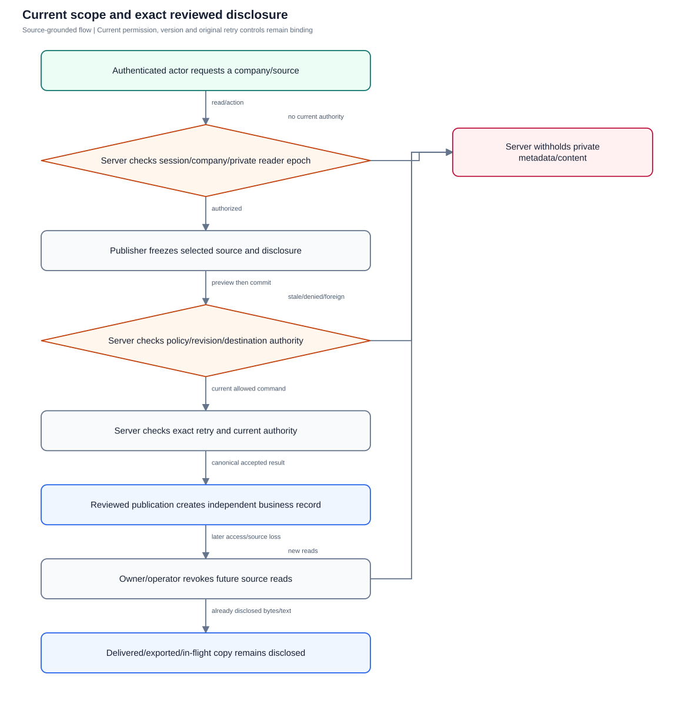
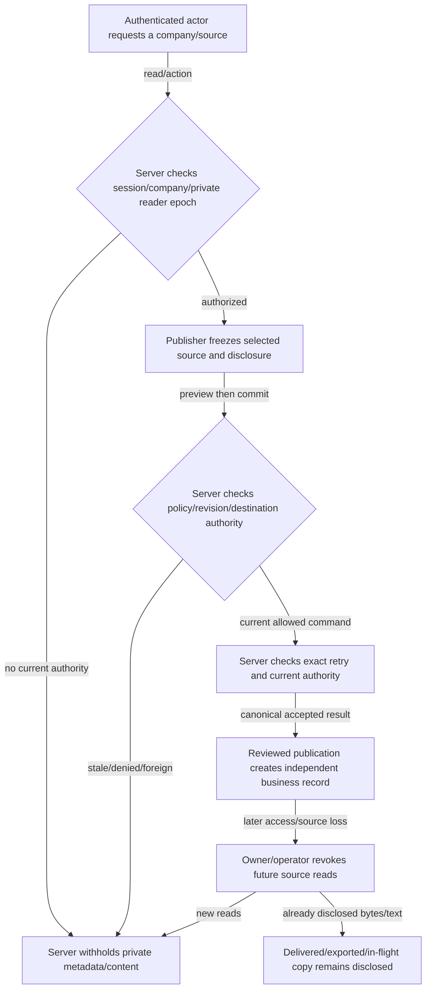

# Company, source and replay authority

Verify current company/private boundaries, exact publication disclosure, session/history epochs and practical transport/copy limits.

**Entry:** Company-qualified API and Web Connect/work/publication surfaces; Account device/MFA controls; Operator staged origin/ingress and retention review

**Actors:** Owner A: conversation owner and company member in fictional QA Alpha; Member B: company member and selected recipient in QA Alpha; Reviewer R: independent reviewer in QA Alpha; Alpha leader: company administrator outside the private conversation in QA Alpha; Outsider O: member only in fictional QA Beta; Platform operator: platform operator without private conversation membership

## Main flow

1. Authenticated user resolves active company membership and current private conversation scope.
2. Reader fetches current source under history/session epochs; leadership/platform operator has no private bypass.
3. Publisher previews exact selected disclosure and destination audience, then server rechecks current authority.
4. Canonical replay returns only authorized original outcomes; revoked users/epochs cannot resume private reads or delivery.

[Editable Mermaid](../diagrams/SECURITY.mmd)

## Controls and limits

- Company isolation is shared application authorization, not a claim of physical tenant databases, RLS or E2EE. Trusted database/operator components remain outside this application-private boundary.
- Chat downloads use current transaction authorization; no per-chunk current-network fencing borrowed from report CSV is required here. Already sent/exported/in-flight copies are irreversible.
- Current source-revision changes invalidate fresh actions, but some exact accepted-operation replays deliberately return canonical original outcomes after current access checks; they do not republish new prose.
- Authentication/origin/provider checks must use an isolated real API or named staged deployment; browser demo cannot certify them.

## Proposed manual scenarios

All start **NOT_RUN**. Missing prerequisite = BLOCKED.

### SECURITY-001: Active company membership isolates every private/derived surface

**P0 · LOCAL · Web, API**

**Actors:**

- Owner A: conversation owner and company member in fictional QA Alpha
- Member B: company member and selected recipient in QA Alpha
- Reviewer R: independent reviewer in QA Alpha
- Alpha leader: company administrator outside the private conversation in QA Alpha
- Outsider O: member only in fictional QA Beta
- Platform operator: platform operator without private conversation membership

**Preconditions:**

- Use a newly provisioned isolated QA server and fictional accounts; never the running workspace or historical native fixture.
- Record sanitized observations only: no tokens, private prose, raw sensitive screenshots, provider secrets or real company/user identifiers.
- This is a proposed manual scenario with status NOT_RUN. Missing required configuration/build/device/deployment is BLOCKED; automated references are not manual passes.

**Test data:**

- Use authored fictional QA text and newly issued fixture IDs; never paste real conversations or credentials.

| Step | Action | Expected result |
| --- | --- | --- |
| 1 | As Outsider O use owned fictional QA Alpha conversation/message/media/call IDs in company-qualified list/detail/search/thread/records routes. | Juniper-only user receives no Cedar private content or metadata even with known fixture IDs. |
| 2 | As a QA Alpha actor substitute a Juniper company path with otherwise valid QA Alpha object IDs. | Cross-company references fail; object IDs cannot substitute for current company membership. |
| 3 | Inspect current-work links, attention and saved/search projections from both principals. | Hidden sources contribute no private prose, IDs or counts to unrelated derived surfaces. |
| 4 | Use an actor in both fictional companies and select each company normally. | Dual membership yields separately authorized company data without carrying source/drafts/permissions across boundaries. |

**Cleanup:** Close fixture dialogs, discard unsent QA input and remove or archive only the owned disposable fixture through authorized controls; revoke fixture sessions when finished.

[Scenario flow](../diagrams/SECURITY-001.svg) · [Editable source](../diagrams/SECURITY-001.mmd)

**Source:** [backend/platform/communication_access.go](../../../backend/platform/communication_access.go), [backend/platform/communication_daily.go](../../../backend/platform/communication_daily.go), [backend/platform/communication_projection.go](../../../backend/platform/communication_projection.go), [backend/platform/permissions.go](../../../backend/platform/permissions.go)

**Supporting automation:** [backend/platform/communication_access_test.go](../../../backend/platform/communication_access_test.go), [backend/platform/communication_daily_test.go](../../../backend/platform/communication_daily_test.go)

### SECURITY-002: Company and platform administration do not bypass private access

**P0 · LOCAL · Web, API**

**Actors:**

- Owner A: conversation owner and company member in fictional QA Alpha
- Member B: company member and selected recipient in QA Alpha
- Reviewer R: independent reviewer in QA Alpha
- Alpha leader: company administrator outside the private conversation in QA Alpha
- Outsider O: member only in fictional QA Beta
- Platform operator: platform operator without private conversation membership

**Preconditions:**

- Use a newly provisioned isolated QA server and fictional accounts; never the running workspace or historical native fixture.
- Record sanitized observations only: no tokens, private prose, raw sensitive screenshots, provider secrets or real company/user identifiers.
- This is a proposed manual scenario with status NOT_RUN. Missing required configuration/build/device/deployment is BLOCKED; automated references are not manual passes.

**Test data:**

- Use authored fictional QA text and newly issued fixture IDs; never paste real conversations or credentials.

| Step | Action | Expected result |
| --- | --- | --- |
| 1 | Owner A and Member B create a private DM/group excluding Alpha leader and Platform operator; send only a fictional QA marker. | Private scope is participant-based; administrative role is independent of conversation membership. |
| 2 | As Alpha leader company administrator request private metadata/history/search/record/media access. | Company administration alone returns no private metadata/content or hidden target links. |
| 3 | As Platform operator platform operator without private membership repeat those reads, including a company without Platform operator membership. | Platform ownership grants no company/private-read bypass in application routes. Trusted direct database administration is a separate documented limit. |
| 4 | Explicitly invite Alpha leader to a newly authorized private interval and repeat eligible reads. | Explicit invitation grants only current interval rights; admin status does not restore pre-invite history. |

**Cleanup:** Close fixture dialogs, discard unsent QA input and remove or archive only the owned disposable fixture through authorized controls; revoke fixture sessions when finished.

[Scenario flow](../diagrams/SECURITY-002.svg) · [Editable source](../diagrams/SECURITY-002.mmd)

**Source:** [backend/platform/communication_access.go](../../../backend/platform/communication_access.go), [backend/platform/conversations.go](../../../backend/platform/conversations.go), [backend/platform/permissions.go](../../../backend/platform/permissions.go), [docs/SECURITY_AND_LIMITATIONS.md](../../../docs/SECURITY_AND_LIMITATIONS.md)

**Supporting automation:** [backend/platform/communication_access_test.go](../../../backend/platform/communication_access_test.go)

### SECURITY-003: Viewer and blocked-pair restrictions survive repeated commands

**P0 · LOCAL · Web, API**

**Actors:**

- Owner A: conversation owner and company member in fictional QA Alpha
- Member B: company member and selected recipient in QA Alpha
- Reviewer R: independent reviewer in QA Alpha
- Alpha leader: company administrator outside the private conversation in QA Alpha
- Outsider O: member only in fictional QA Beta
- Platform operator: platform operator without private conversation membership

**Preconditions:**

- Use a newly provisioned isolated QA server and fictional accounts; never the running workspace or historical native fixture.
- Record sanitized observations only: no tokens, private prose, raw sensitive screenshots, provider secrets or real company/user identifiers.
- This is a proposed manual scenario with status NOT_RUN. Missing required configuration/build/device/deployment is BLOCKED; automated references are not manual passes.

**Test data:**

- Use authored fictional QA text and newly issued fixture IDs; never paste real conversations or credentials.

| Step | Action | Expected result |
| --- | --- | --- |
| 1 | As a company viewer open an eligible public channel and attempt send, manage, structured creation and call token issuance through fixture API. | Readability does not confer mutation/call rights; viewer commands deny. |
| 2 | Before a DM exists, Member B blocks Owner A using the supported company block API and Owner A selects Member B in person picker. | Blocked pair cannot be created by choosing a person, including nameless DM reuse/create path. |
| 3 | In a separate existing DM block the pair, then retry an ordinary send/call grant as company leadership. | Leadership cannot override a blocked pair for sending or new call grants; UI/service errors do not imply accepted mutation. |
| 4 | Unblock through the authorized actor and explicitly retry a new valid command. | Only current unblocked authorized commands may resume; fixture history is not fabricated. |

**Cleanup:** Close fixture dialogs, discard unsent QA input and remove or archive only the owned disposable fixture through authorized controls; revoke fixture sessions when finished.

[Scenario flow](../diagrams/SECURITY-003.svg) · [Editable source](../diagrams/SECURITY-003.mmd)

**Source:** [backend/platform/communication_controls.go](../../../backend/platform/communication_controls.go), [backend/platform/communication_access.go](../../../backend/platform/communication_access.go), [backend/platform/conversations.go](../../../backend/platform/conversations.go), [backend/platform/communication_calls.go](../../../backend/platform/communication_calls.go)

**Supporting automation:** [backend/platform/communication_access_test.go](../../../backend/platform/communication_access_test.go), [backend/platform/communication_daily_controls_test.go](../../../backend/platform/communication_daily_controls_test.go)

### SECURITY-004: Message-to-task preview discloses exact selected text and current audience

**P0 · LOCAL · Web, API**

**Actors:**

- Owner A: conversation owner and company member in fictional QA Alpha
- Member B: company member and selected recipient in QA Alpha
- Reviewer R: independent reviewer in QA Alpha
- Alpha leader: company administrator outside the private conversation in QA Alpha
- Outsider O: member only in fictional QA Beta
- Platform operator: platform operator without private conversation membership

**Preconditions:**

- Use a newly provisioned isolated QA server and fictional accounts; never the running workspace or historical native fixture.
- Record sanitized observations only: no tokens, private prose, raw sensitive screenshots, provider secrets or real company/user identifiers.
- This is a proposed manual scenario with status NOT_RUN. Missing required configuration/build/device/deployment is BLOCKED; automated references are not manual passes.

**Test data:**

- Use authored fictional QA text and newly issued fixture IDs; never paste real conversations or credentials.

| Step | Action | Expected result |
| --- | --- | --- |
| 1 | With selected publication enabled choose Create task from a fictional private root; inspect seeded Task title and keep Publish this exact excerpt unchecked. | Even with excerpt unchecked the seeded task title is disclosure and must be reviewed; no other private messages are automatically selected. |
| 2 | Edit Task title to a new fictional approved phrase, choose owner/reviewer/deadline and Preview audience. | Preview shows current destination audience and independent-record notice; changing reviewed fields clears preview/acknowledgement. |
| 3 | Check Publish this exact excerpt, preview again, acknowledge current audience and Create task. | Only reviewed task fields plus the exact checked excerpt are published; commit remains source/policy/destination-authorized. |
| 4 | As a broader authorized work reader without source access inspect the task and source links, then remove the private root. | Task text persists as independently published work; hidden source IDs/counts/prose stay withheld and source removal does not retract published disclosure. |

**Cleanup:** Close fixture dialogs, discard unsent QA input and remove or archive only the owned disposable fixture through authorized controls; revoke fixture sessions when finished.

[Scenario flow](../diagrams/SECURITY-004.svg) · [Editable source](../diagrams/SECURITY-004.mmd)

**Source:** [frontend/src/components/MessageTaskConversion.tsx](../../../frontend/src/components/MessageTaskConversion.tsx), [backend/platform/communication_conversion.go](../../../backend/platform/communication_conversion.go), [backend/platform/communication_projection.go](../../../backend/platform/communication_projection.go)

**Supporting automation:** [frontend/src/components/MessageTaskConversion.test.tsx](../../../frontend/src/components/MessageTaskConversion.test.tsx), [backend/platform/communication_conversion_test.go](../../../backend/platform/communication_conversion_test.go)

### SECURITY-005: Publication rechecks source revision policy and assignment authority

**P0 · LOCAL · Web, API**

**Actors:**

- Owner A: conversation owner and company member in fictional QA Alpha
- Member B: company member and selected recipient in QA Alpha
- Reviewer R: independent reviewer in QA Alpha
- Alpha leader: company administrator outside the private conversation in QA Alpha
- Outsider O: member only in fictional QA Beta
- Platform operator: platform operator without private conversation membership

**Preconditions:**

- Use a newly provisioned isolated QA server and fictional accounts; never the running workspace or historical native fixture.
- Record sanitized observations only: no tokens, private prose, raw sensitive screenshots, provider secrets or real company/user identifiers.
- This is a proposed manual scenario with status NOT_RUN. Missing required configuration/build/device/deployment is BLOCKED; automated references are not manual passes.

**Test data:**

- Use authored fictional QA text and newly issued fixture IDs; never paste real conversations or credentials.

| Step | Action | Expected result |
| --- | --- | --- |
| 1 | Preview a task/request from source revision N under selected policy with current destination audience. | Preview freezes an exact source/policy/destination proposal, not an authorization lease. |
| 2 | Before confirmation edit/remove the root or change forwarding to deny in separate fixture variants. | Material source/policy changes invalidate the old proposed action. |
| 3 | Attempt the exact previously previewed commit; separately attempt assignment to a person outside the actor’s work authority. | Stale/denied/missing source commits fail; source access alone does not authorize arbitrary assignment. No task/request is silently created from fresh replacement text. |
| 4 | Reopen current review only after fresh source/authority inspection and explicitly select revised disclosure. | A new review can proceed only with its current audience/revision and independent reviewer controls. |

**Cleanup:** Close fixture dialogs, discard unsent QA input and remove or archive only the owned disposable fixture through authorized controls; revoke fixture sessions when finished.

[Scenario flow](../diagrams/SECURITY-005.svg) · [Editable source](../diagrams/SECURITY-005.mmd)

**Source:** [backend/platform/communication_conversion.go](../../../backend/platform/communication_conversion.go), [backend/platform/communication_requests.go](../../../backend/platform/communication_requests.go), [frontend/src/components/MessageTaskConversion.tsx](../../../frontend/src/components/MessageTaskConversion.tsx)

**Supporting automation:** [backend/platform/communication_conversion_test.go](../../../backend/platform/communication_conversion_test.go), [frontend/src/communication/review-source.test.tsx](../../../frontend/src/communication/review-source.test.tsx), [frontend/src/communication/review-deleted-root.test.tsx](../../../frontend/src/communication/review-deleted-root.test.tsx)

### SECURITY-006: Current epoch invalidates old cursors and closes private streams

**P0 · LOCAL · Web, API**

**Actors:**

- Owner A: conversation owner and company member in fictional QA Alpha
- Member B: company member and selected recipient in QA Alpha
- Reviewer R: independent reviewer in QA Alpha
- Alpha leader: company administrator outside the private conversation in QA Alpha
- Outsider O: member only in fictional QA Beta
- Platform operator: platform operator without private conversation membership

**Preconditions:**

- Use a newly provisioned isolated QA server and fictional accounts; never the running workspace or historical native fixture.
- Record sanitized observations only: no tokens, private prose, raw sensitive screenshots, provider secrets or real company/user identifiers.
- This is a proposed manual scenario with status NOT_RUN. Missing required configuration/build/device/deployment is BLOCKED; automated references are not manual passes.

**Test data:**

- Use authored fictional QA text and newly issued fixture IDs; never paste real conversations or credentials.

| Step | Action | Expected result |
| --- | --- | --- |
| 1 | Fetch history/sync cursors and open the authorized communication WebSocket as Member B. | Cursors are bound to user/company/conversation/epoch/policy kind and sockets to current authority. |
| 2 | Owner A removes and explicitly re-invites Member B to create a new private epoch/history interval. | Old private access closes; rejoin creates current forward history. |
| 3 | Use old cursors and old source links while signed into the current session; open a new socket/read. | Old cursor returns refetch_required conflict; new reads obey new history and old links remain unavailable. |
| 4 | Remove company membership or suspend the account in separate owned fixture variants and repeat reads/streams. | Company/session/global access loss cancels private delivery; current membership is required even when IDs/cursors are known. |

**Cleanup:** Close fixture dialogs, discard unsent QA input and remove or archive only the owned disposable fixture through authorized controls; revoke fixture sessions when finished.

[Scenario flow](../diagrams/SECURITY-006.svg) · [Editable source](../diagrams/SECURITY-006.mmd)

**Source:** [backend/platform/communication_sync.go](../../../backend/platform/communication_sync.go), [backend/platform/communication_stream.go](../../../backend/platform/communication_stream.go), [backend/platform/communication_access.go](../../../backend/platform/communication_access.go), [backend/platform/permission_revocation.go](../../../backend/platform/permission_revocation.go)

**Supporting automation:** [backend/platform/messages_test.go](../../../backend/platform/messages_test.go), [backend/platform/communication_delivery_test.go](../../../backend/platform/communication_delivery_test.go), [backend/platform/communication_access_test.go](../../../backend/platform/communication_access_test.go)

### SECURITY-007: Canonical accepted retries never rewrite frozen intent or bypass current access

**P0 · LOCAL · Web, API**

**Actors:**

- Owner A: conversation owner and company member in fictional QA Alpha
- Member B: company member and selected recipient in QA Alpha
- Reviewer R: independent reviewer in QA Alpha
- Alpha leader: company administrator outside the private conversation in QA Alpha
- Outsider O: member only in fictional QA Beta
- Platform operator: platform operator without private conversation membership

**Preconditions:**

- Use a newly provisioned isolated QA server and fictional accounts; never the running workspace or historical native fixture.
- Record sanitized observations only: no tokens, private prose, raw sensitive screenshots, provider secrets or real company/user identifiers.
- This is a proposed manual scenario with status NOT_RUN. Missing required configuration/build/device/deployment is BLOCKED; automated references are not manual passes.

**Test data:**

- Use authored fictional QA text and newly issued fixture IDs; never paste real conversations or credentials.

| Step | Action | Expected result |
| --- | --- | --- |
| 1 | Accept a fictional message/task conversion/intake with its original retry key and retain only sanitized original payload metadata. | Original acceptance fixes payload-bound identity and result; no repeated-operation guarantee is assumed for unsupported actions. |
| 2 | Repeat the exact operation while currently authorized; for conversion include a separate A versus A+B primary-claim lookup. | Exact retry returns canonical original identity; existing primary action opens its original task and does not apply newly reviewed fields/context. |
| 3 | Reuse the key with changed fields, then edit the source before replaying the exact previously accepted operation. | Changed payload conflicts. Exact accepted replay may return its existing result after current access checks; it must not create a new result or substitute the edited source prose. |
| 4 | Revoke original session or private membership and attempt another exact replay. | Current authority is required on replay; lost session/source history prevents using the old key as a private-access grant. |

**Cleanup:** Close fixture dialogs, discard unsent QA input and remove or archive only the owned disposable fixture through authorized controls; revoke fixture sessions when finished.

[Scenario flow](../diagrams/SECURITY-007.svg) · [Editable source](../diagrams/SECURITY-007.mmd)

**Source:** [backend/platform/messages.go](../../../backend/platform/messages.go), [backend/platform/communication_conversion.go](../../../backend/platform/communication_conversion.go), [backend/platform/communication_requests.go](../../../backend/platform/communication_requests.go), [backend/platform/communication_bundles.go](../../../backend/platform/communication_bundles.go)

**Supporting automation:** [backend/platform/messages_test.go](../../../backend/platform/messages_test.go), [backend/platform/communication_conversion_test.go](../../../backend/platform/communication_conversion_test.go), [backend/platform/communication_finance_test.go](../../../backend/platform/communication_finance_test.go)

### SECURITY-008: Current-network media checks and irreversible delivery limits

**P0 · LOCAL_CONFIG · API, Operator**

**Actors:**

- Owner A: conversation owner and company member in fictional QA Alpha
- Member B: company member and selected recipient in QA Alpha
- Reviewer R: independent reviewer in QA Alpha
- Alpha leader: company administrator outside the private conversation in QA Alpha
- Outsider O: member only in fictional QA Beta
- Platform operator: platform operator without private conversation membership

**Preconditions:**

- Use a newly provisioned isolated QA server and fictional accounts; never the running workspace or historical native fixture.
- Record sanitized observations only: no tokens, private prose, raw sensitive screenshots, provider secrets or real company/user identifiers.
- This is a proposed manual scenario with status NOT_RUN. Missing required configuration/build/device/deployment is BLOCKED; automated references are not manual passes.

**Test data:**

- Use authored fictional QA text and newly issued fixture IDs; never paste real conversations or credentials.

| Step | Action | Expected result |
| --- | --- | --- |
| 1 | Member B starts a fresh clean attachment download while currently authorized; record only request status/content size. | downloadMedia checks current session/company/source/history/expiry/clean state within its communication transaction. |
| 2 | In a separate fresh request revoke membership before download and attempt the remembered URL. | Revoked fresh request receives no readable attachment. |
| 3 | In an isolated slow-client variant request media and schedule owner revocation during transfer; record completion/order without assuming chunk fencing. | Current io.Copy occurs within that transaction, so revocation may wait for transaction completion; there is no specified report-style per-chunk stop guarantee. |
| 4 | Compare a previously delivered QA copy and a fresh request after revocation commits. | Fresh reads after committed access loss are denied; delivered/in-flight/copied bytes cannot be recalled. No forensic remote-erasure claim is made. |

**Cleanup:** Delete all disposable downloaded QA copies and revoke fixture sessions; never retain raw transfer/token traces.

[Scenario flow](../diagrams/SECURITY-008.svg) · [Editable source](../diagrams/SECURITY-008.mmd)

**Source:** [backend/platform/communication_media.go](../../../backend/platform/communication_media.go), [backend/platform/communication_access.go](../../../backend/platform/communication_access.go), [docs/SECURITY_AND_LIMITATIONS.md](../../../docs/SECURITY_AND_LIMITATIONS.md)

**Supporting automation:** [backend/platform/communication_media_test.go](../../../backend/platform/communication_media_test.go)

### SECURITY-009: Lost-device revocation, logout and MFA remain account-scoped

**P0 · LOCAL_CONFIG · Web, API**

**Actors:**

- Owner A: conversation owner and company member in fictional QA Alpha
- Member B: company member and selected recipient in QA Alpha
- Reviewer R: independent reviewer in QA Alpha
- Alpha leader: company administrator outside the private conversation in QA Alpha
- Outsider O: member only in fictional QA Beta
- Platform operator: platform operator without private conversation membership

**Preconditions:**

- Use a newly provisioned isolated QA server and fictional accounts; never the running workspace or historical native fixture.
- Record sanitized observations only: no tokens, private prose, raw sensitive screenshots, provider secrets or real company/user identifiers.
- This is a proposed manual scenario with status NOT_RUN. Missing required configuration/build/device/deployment is BLOCKED; automated references are not manual passes.
- Isolated MFA encryption key configured for recovery-code variant; never include keys/codes or real devices in evidence.

**Test data:**

- Use authored fictional QA text and newly issued fixture IDs; never paste real conversations or credentials.

| Step | Action | Expected result |
| --- | --- | --- |
| 1 | Register two owned devices in separate fictional-account sessions and inspect Account’s device list. | Only owned session-bound devices are listed with supported account controls. |
| 2 | From the retained session revoke the other lost device; attempt its API reads, delivery and call token/rejoin across both fixture companies. | Revoked device’s bound session loses authority across companies; other authorized session remains usable. |
| 3 | Logout the retained session and attempt reuse; in an MFA-enabled configured fixture use one recovery code twice. | Logout token no longer authorizes; a recovery code is single-use and does not disable independent company/private scope. |
| 4 | Inspect another actor’s device listing/revocation attempt. | Another user cannot list/revoke devices by guessing owned fixture IDs. |

**Cleanup:** Close fixture dialogs, discard unsent QA input and remove or archive only the owned disposable fixture through authorized controls; revoke fixture sessions when finished.

[Scenario flow](../diagrams/SECURITY-009.svg) · [Editable source](../diagrams/SECURITY-009.mmd)

**Source:** [backend/platform/communication_devices.go](../../../backend/platform/communication_devices.go), [backend/platform/mfa.go](../../../backend/platform/mfa.go), [backend/platform/auth.go](../../../backend/platform/auth.go), [mobile/src/AccountScreen.tsx](../../../mobile/src/AccountScreen.tsx)

**Supporting automation:** [backend/platform/communication_devices_test.go](../../../backend/platform/communication_devices_test.go), [backend/platform/mfa_test.go](../../../backend/platform/mfa_test.go), [backend/platform/communication_lifecycle_test.go](../../../backend/platform/communication_lifecycle_test.go)

### SECURITY-010: Origin, no-store and deployed authority acceptance

**P0 · PRODUCTION · Web, API, Operator**

**Actors:**

- Owner A: conversation owner and company member in fictional QA Alpha
- Member B: company member and selected recipient in QA Alpha
- Reviewer R: independent reviewer in QA Alpha
- Alpha leader: company administrator outside the private conversation in QA Alpha
- Outsider O: member only in fictional QA Beta
- Platform operator: platform operator without private conversation membership

**Preconditions:**

- Use a newly provisioned isolated QA server and fictional accounts; never the running workspace or historical native fixture.
- Record sanitized observations only: no tokens, private prose, raw sensitive screenshots, provider secrets or real company/user identifiers.
- This is a proposed manual scenario with status NOT_RUN. Missing required configuration/build/device/deployment is BLOCKED; automated references are not manual passes.
- Named staged deployment with real trusted TLS/origin configuration and fictional test accounts; catalog authoring performs no deployment.

**Test data:**

- Use authored fictional QA text and newly issued fixture IDs; never paste real conversations or credentials.

| Step | Action | Expected result |
| --- | --- | --- |
| 1 | On the named staged deployment sign in to the fictional account over trusted HTTPS; inspect only sanitized cookie/header attributes. | Production secure session cookie/TLS and actual origin configuration are verified, not inferred from localhost. |
| 2 | Attempt unsafe API methods and socket upgrades from an unconfigured origin and Origin null, then from the exact authorized origin. | Foreign/null origin is rejected; exact accepted origin can use authenticated authorized routes. |
| 3 | Inspect private API no-store/nosniff/referrer headers and staged provider gateway ingress without capturing token-bearing URLs. | Private response controls are present; provider signaling cannot bypass Schach. Headers alone are not malware/E2EE/private-copy guarantees. |
| 4 | Repeat cross-company/private/admin denial and revoked-session/call rejoin on the exact staged runtime. | Actual deployed boundaries match current source; missing staged origin/identity/private-ingress qualification is BLOCKED. |

**Cleanup:** Close fixture dialogs, discard unsent QA input and remove or archive only the owned disposable fixture through authorized controls; revoke fixture sessions when finished.

[Scenario flow](../diagrams/SECURITY-010.svg) · [Editable source](../diagrams/SECURITY-010.mmd)

**Source:** [backend/platform/server.go](../../../backend/platform/server.go), [backend/platform/auth.go](../../../backend/platform/auth.go), [backend/platform/communication_stream.go](../../../backend/platform/communication_stream.go), [backend/platform/communication_calls.go](../../../backend/platform/communication_calls.go), [docs/SECURITY_AND_LIMITATIONS.md](../../../docs/SECURITY_AND_LIMITATIONS.md), [docs/COMMUNICATION_OPERATIONS.md](../../../docs/COMMUNICATION_OPERATIONS.md)

**Supporting automation:** Manual/device/provider gate; no owning automated reference.
