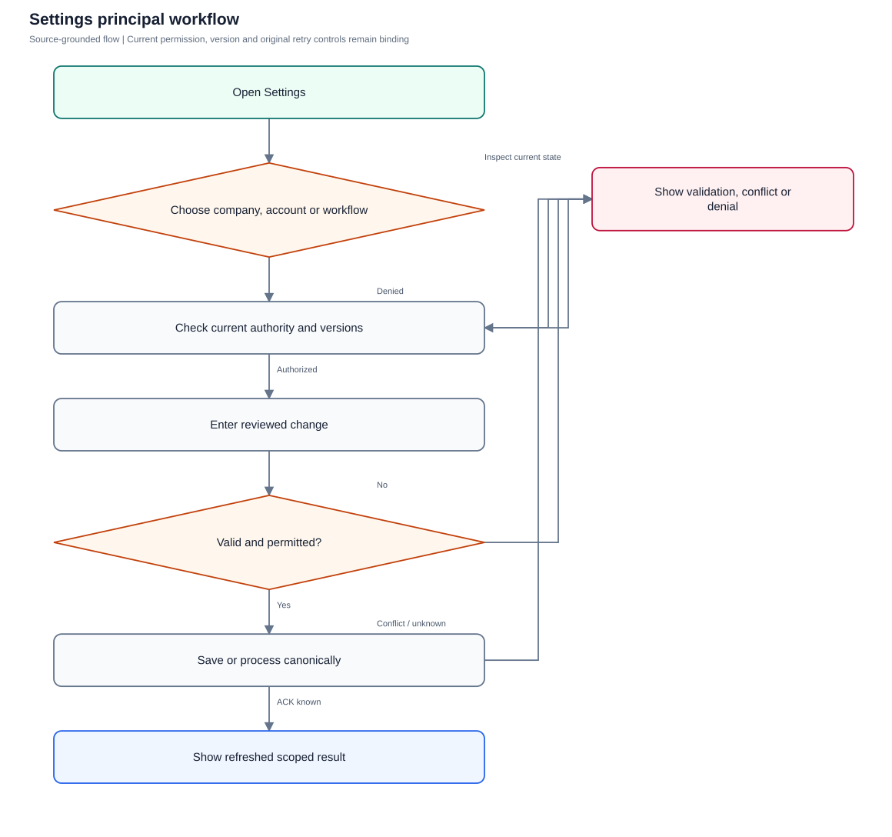
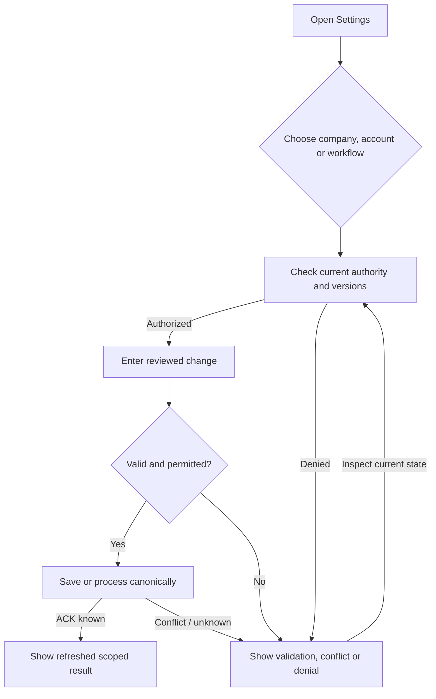

# Settings

Manage company configuration, account protection, personal attention preferences and idempotent workflow processing.

**Entry:** Settings → Company; Settings → My account; Settings → Workflow

**Actors:** Alpha leader — company leadership (founder in QA Alpha; not platform admin); Owner A — accountable owner and department member, Engineering; Platform operator — platform admin; company authority requires a separate membership

## Main flow

1. Choose Company, My account or Workflow.
2. Load current authority and captured versions where applicable.
3. Validate the intended change.
4. Save and verify the refreshed scoped state.

[Editable Mermaid](../diagrams/SETTINGS.mmd)

## Controls and limits

- Company leader and platform admin are distinct fixture actors.
- Attention preferences change delivery/follow-up settings, not source access.
- Attention delivery preferences use versioned PATCH and a form reload, not the canonical unknown-attempt controls used by goals/People; there is no per-user timezone field.

## Proposed manual scenarios

All start **NOT_RUN**. Missing prerequisite = BLOCKED.

### SETTINGS-001: Edit company identity and timezone with authority

**P1 · LOCAL · Web, API**

**Actors:**

- Alpha leader — company leadership (founder in QA Alpha; not platform admin)

**Preconditions:**

- Use a separately provisioned isolated server fixture, never the running workspace or historical native fixture.
- Company QA Alpha uses Asia/Kolkata, INR and April financial-year start; QA Beta is a second isolated company.
- Provision named fictional actors and secrets separately; record no passwords, tokens, private source prose or real account identifiers in evidence.
- Begin the manual run as NOT_RUN; a missing server/configuration/device prerequisite is BLOCKED.

**Test data:**

- QA Alpha has no finance records; alternate timezone Europe/London; name QA Alpha Studio.

| Step | Action | Expected result |
| --- | --- | --- |
| 1 | As Alpha leader, open Company → Edit details, change the name and timezone, and save the form. | PATCH /api/companies/{Aster} succeeds; Company details and current workspace identity show the new values. |
| 2 | Open Calendar and compare company civil-date labeling. | Calendar displays the new company timezone; existing timed UTC commitments and their original instant/zone remain unchanged. |

**Cleanup:** Close draft/recovery controls after recording the result; sign out test sessions. Retain immutable history until evidence review, then discard this isolated fixture through its approved fixture lifecycle.

[Scenario flow](../diagrams/SETTINGS-001.svg) · [Editable source](../diagrams/SETTINGS-001.mmd)

**Source:** [docs/USER_GUIDE.md](../../../docs/USER_GUIDE.md), [docs/API_CONTRACT.md](../../../docs/API_CONTRACT.md), [frontend/src/pages/InboxSettings.tsx](../../../frontend/src/pages/InboxSettings.tsx), [frontend/src/components/EntityForm.tsx](../../../frontend/src/components/EntityForm.tsx), [backend/platform/organization.go](../../../backend/platform/organization.go), [frontend/src/components/AttentionPreferences.tsx](../../../frontend/src/components/AttentionPreferences.tsx)

**Supporting automation:** [backend/platform/platform_test.go](../../../backend/platform/platform_test.go), [backend/platform/finance_test.go](../../../backend/platform/finance_test.go), [backend/platform/people_membership_test.go](../../../backend/platform/people_membership_test.go), [frontend/src/components/AttentionPreferences.test.tsx](../../../frontend/src/components/AttentionPreferences.test.tsx), [mobile/src/AccountScreen.test.tsx](../../../mobile/src/AccountScreen.test.tsx)

### SETTINGS-002: Company settings deny a member or outsider write

**P0 · LOCAL · Web, API**

**Actors:**

- Owner A — accountable owner and department member, Engineering
- Outsider O — outsider with no QA Alpha membership

**Preconditions:**

- Use a separately provisioned isolated server fixture, never the running workspace or historical native fixture.
- Company QA Alpha uses Asia/Kolkata, INR and April financial-year start; QA Beta is a second isolated company.
- Provision named fictional actors and secrets separately; record no passwords, tokens, private source prose or real account identifiers in evidence.
- Begin the manual run as NOT_RUN; a missing server/configuration/device prerequisite is BLOCKED.

**Test data:**

- Owner A active member; Outsider O outside QA Alpha.

| Step | Action | Expected result |
| --- | --- | --- |
| 1 | Open Company as Owner A and attempt an equivalent PATCH /api/companies/{Aster}. | Edit details is unavailable for Owner A and server denies the mutation; company values stay unchanged. |
| 2 | Repeat company read/write as Outsider O. | No membership is granted by a guessed company ID; server rejects access without a company payload. |

**Cleanup:** Close draft/recovery controls after recording the result; sign out test sessions. Retain immutable history until evidence review, then discard this isolated fixture through its approved fixture lifecycle.

[Scenario flow](../diagrams/SETTINGS-002.svg) · [Editable source](../diagrams/SETTINGS-002.mmd)

**Source:** [docs/USER_GUIDE.md](../../../docs/USER_GUIDE.md), [docs/API_CONTRACT.md](../../../docs/API_CONTRACT.md), [frontend/src/pages/InboxSettings.tsx](../../../frontend/src/pages/InboxSettings.tsx), [frontend/src/components/EntityForm.tsx](../../../frontend/src/components/EntityForm.tsx), [backend/platform/organization.go](../../../backend/platform/organization.go), [frontend/src/components/AttentionPreferences.tsx](../../../frontend/src/components/AttentionPreferences.tsx)

**Supporting automation:** [backend/platform/platform_test.go](../../../backend/platform/platform_test.go), [backend/platform/finance_test.go](../../../backend/platform/finance_test.go), [backend/platform/people_membership_test.go](../../../backend/platform/people_membership_test.go), [frontend/src/components/AttentionPreferences.test.tsx](../../../frontend/src/components/AttentionPreferences.test.tsx), [mobile/src/AccountScreen.test.tsx](../../../mobile/src/AccountScreen.test.tsx)

### SETTINGS-003: Finance initialization freezes currency and financial-year start

**P1 · LOCAL · Web, API**

**Actors:**

- Alpha leader — company leadership (founder in QA Alpha; not platform admin)
- Finance F — company Finance; work access remains assignment scoped

**Preconditions:**

- Use a separately provisioned isolated server fixture, never the running workspace or historical native fixture.
- Company QA Alpha uses Asia/Kolkata, INR and April financial-year start; QA Beta is a second isolated company.
- Provision named fictional actors and secrets separately; record no passwords, tokens, private source prose or real account identifiers in evidence.
- Begin the manual run as NOT_RUN; a missing server/configuration/device prerequisite is BLOCKED.

**Test data:**

- Two variants: first active budget, first expense; initial currency INR and start month 4.

| Step | Action | Expected result |
| --- | --- | --- |
| 1 | On each separately isolated variant, create its first budget or expense through an eligible finance actor, then reopen Edit details. | Currency and financial-year start are locked once either kind of finance record exists. |
| 2 | PATCH company currency to USD and financial-year start to 1. | Server rejects the financial-setting rewrite; existing amounts, recorded financial actors and fiscal boundaries remain intact. |

**Cleanup:** Close draft/recovery controls after recording the result; sign out test sessions. Retain immutable history until evidence review, then discard this isolated fixture through its approved fixture lifecycle.

[Scenario flow](../diagrams/SETTINGS-003.svg) · [Editable source](../diagrams/SETTINGS-003.mmd)

**Source:** [docs/USER_GUIDE.md](../../../docs/USER_GUIDE.md), [docs/API_CONTRACT.md](../../../docs/API_CONTRACT.md), [frontend/src/pages/InboxSettings.tsx](../../../frontend/src/pages/InboxSettings.tsx), [frontend/src/components/EntityForm.tsx](../../../frontend/src/components/EntityForm.tsx), [backend/platform/organization.go](../../../backend/platform/organization.go), [frontend/src/components/AttentionPreferences.tsx](../../../frontend/src/components/AttentionPreferences.tsx)

**Supporting automation:** [backend/platform/finance_test.go](../../../backend/platform/finance_test.go)

### SETTINGS-004: Platform admin adds a company with separate membership

**P0 · LOCAL · Web, API**

**Actors:**

- Platform operator — platform admin; company authority requires a separate membership
- Alpha leader — company leadership (founder in QA Alpha; not platform admin)
- Owner A — accountable owner and department member, Engineering

**Preconditions:**

- Use a separately provisioned isolated server fixture, never the running workspace or historical native fixture.
- Company QA Alpha uses Asia/Kolkata, INR and April financial-year start; QA Beta is a second isolated company.
- Provision named fictional actors and secrets separately; record no passwords, tokens, private source prose or real account identifiers in evidence.
- Begin the manual run as NOT_RUN; a missing server/configuration/device prerequisite is BLOCKED.

**Test data:**

- New company Cedar QA, slug cedar-qa, timezone UTC; Platform operator is platform admin, Alpha leader is not.

| Step | Action | Expected result |
| --- | --- | --- |
| 1 | As Platform operator, choose Your companies → Add company and save Cedar QA. | POST /api/companies succeeds and establishes the creator’s founder membership in Cedar QA. |
| 2 | As Alpha leader and Owner A, inspect Add company and attempt POST /api/companies. | Control is absent and server denies company creation for actors without platform authority. |
| 3 | Switch between Cedar QA and QA Alpha using a currently eligible account. | Company data, memberships and role-specific controls reload for the selected company. |

**Cleanup:** Close draft/recovery controls after recording the result; sign out test sessions. Retain immutable history until evidence review, then discard this isolated fixture through its approved fixture lifecycle.

[Scenario flow](../diagrams/SETTINGS-004.svg) · [Editable source](../diagrams/SETTINGS-004.mmd)

**Source:** [docs/USER_GUIDE.md](../../../docs/USER_GUIDE.md), [docs/API_CONTRACT.md](../../../docs/API_CONTRACT.md), [frontend/src/pages/InboxSettings.tsx](../../../frontend/src/pages/InboxSettings.tsx), [frontend/src/components/EntityForm.tsx](../../../frontend/src/components/EntityForm.tsx), [backend/platform/organization.go](../../../backend/platform/organization.go), [frontend/src/components/AttentionPreferences.tsx](../../../frontend/src/components/AttentionPreferences.tsx)

**Supporting automation:** [backend/platform/platform_test.go](../../../backend/platform/platform_test.go), [backend/platform/finance_test.go](../../../backend/platform/finance_test.go), [backend/platform/people_membership_test.go](../../../backend/platform/people_membership_test.go), [frontend/src/components/AttentionPreferences.test.tsx](../../../frontend/src/components/AttentionPreferences.test.tsx), [mobile/src/AccountScreen.test.tsx](../../../mobile/src/AccountScreen.test.tsx)

### SETTINGS-005: Password validation and rotation revoke other sessions

**P0 · LOCAL · Web, API**

**Actors:**

- Owner A — accountable owner and department member, Engineering

**Preconditions:**

- Use a separately provisioned isolated server fixture, never the running workspace or historical native fixture.
- Company QA Alpha uses Asia/Kolkata, INR and April financial-year start; QA Beta is a second isolated company.
- Provision named fictional actors and secrets separately; record no passwords, tokens, private source prose or real account identifiers in evidence.
- Begin the manual run as NOT_RUN; a missing server/configuration/device prerequisite is BLOCKED.

**Test data:**

- Owner A signed in twice; provisioned old/new secret references, no literal secrets.

| Step | Action | Expected result |
| --- | --- | --- |
| 1 | In My account submit mismatched New password / Repeat new password; repeat with a value under 12 characters or incorrect Current password. | Mismatch or minimum-length/current-password validation prevents the change; existing credential remains usable. |
| 2 | Submit a valid matching new secret through Update password. | Password fields clear on known success; other sessions are signed out and cannot read protected data. |
| 3 | Authenticate using the old and new provisioned credentials in separate fresh clients. | Old credential fails; new credential succeeds. Current login-session treatment follows the password contract. |

**Cleanup:** Close draft/recovery controls after recording the result; sign out test sessions. Retain immutable history until evidence review, then discard this isolated fixture through its approved fixture lifecycle.

[Scenario flow](../diagrams/SETTINGS-005.svg) · [Editable source](../diagrams/SETTINGS-005.mmd)

**Source:** [docs/USER_GUIDE.md](../../../docs/USER_GUIDE.md), [docs/API_CONTRACT.md](../../../docs/API_CONTRACT.md), [frontend/src/pages/InboxSettings.tsx](../../../frontend/src/pages/InboxSettings.tsx), [frontend/src/components/EntityForm.tsx](../../../frontend/src/components/EntityForm.tsx), [backend/platform/organization.go](../../../backend/platform/organization.go), [frontend/src/components/AttentionPreferences.tsx](../../../frontend/src/components/AttentionPreferences.tsx)

**Supporting automation:** [backend/platform/platform_test.go](../../../backend/platform/platform_test.go), [backend/platform/finance_test.go](../../../backend/platform/finance_test.go), [backend/platform/people_membership_test.go](../../../backend/platform/people_membership_test.go), [frontend/src/components/AttentionPreferences.test.tsx](../../../frontend/src/components/AttentionPreferences.test.tsx), [mobile/src/AccountScreen.test.tsx](../../../mobile/src/AccountScreen.test.tsx)

### SETTINGS-006: Workflow processing is idempotent and admin scoped

**P1 · LOCAL · Web, API**

**Actors:**

- Alpha leader — company leadership (founder in QA Alpha; not platform admin)
- Owner A — accountable owner and department member, Engineering

**Preconditions:**

- Use a separately provisioned isolated server fixture, never the running workspace or historical native fixture.
- Company QA Alpha uses Asia/Kolkata, INR and April financial-year start; QA Beta is a second isolated company.
- Provision named fictional actors and secrets separately; record no passwords, tokens, private source prose or real account identifiers in evidence.
- Begin the manual run as NOT_RUN; a missing server/configuration/device prerequisite is BLOCKED.

**Test data:**

- Accepted all-day weekly recurring task; one due reminder eligible in fixture clock.

| Step | Action | Expected result |
| --- | --- | --- |
| 1 | As Alpha leader, open Workflow and choose Process now twice. | Result reports processing counts; only one next recurring commitment and one occurrence reminder are created. |
| 2 | As Owner A, inspect Workflow and call POST /api/companies/{Aster}/automations/run. | Process now is absent for an ordinary member; server denies unauthorized manual processing. |

**Cleanup:** Close draft/recovery controls after recording the result; sign out test sessions. Retain immutable history until evidence review, then discard this isolated fixture through its approved fixture lifecycle.

[Scenario flow](../diagrams/SETTINGS-006.svg) · [Editable source](../diagrams/SETTINGS-006.mmd)

**Source:** [docs/USER_GUIDE.md](../../../docs/USER_GUIDE.md), [docs/API_CONTRACT.md](../../../docs/API_CONTRACT.md), [frontend/src/pages/InboxSettings.tsx](../../../frontend/src/pages/InboxSettings.tsx), [frontend/src/components/EntityForm.tsx](../../../frontend/src/components/EntityForm.tsx), [backend/platform/organization.go](../../../backend/platform/organization.go), [frontend/src/components/AttentionPreferences.tsx](../../../frontend/src/components/AttentionPreferences.tsx)

**Supporting automation:** [backend/platform/platform_test.go](../../../backend/platform/platform_test.go), [backend/platform/automation_concurrency_test.go](../../../backend/platform/automation_concurrency_test.go)

### SETTINGS-007: Company-local attention preferences validate paired hours and independent escalation

**P1 · LOCAL · Web, API**

**Actors:**

- Owner A — accountable owner and department member, Engineering
- Member B — second department member, Engineering

**Preconditions:**

- Use a separately provisioned isolated server fixture, never the running workspace or historical native fixture.
- Company QA Alpha uses Asia/Kolkata, INR and April financial-year start; QA Beta is a second isolated company.
- Provision named fictional actors and secrets separately; record no passwords, tokens, private source prose or real account identifiers in evidence.
- Begin the manual run as NOT_RUN; a missing server/configuration/device prerequisite is BLOCKED.

**Test data:**

- Owner A quiet period 22:00–07:00; company zone Asia/Kolkata; working weekdays Monday–Friday, 09:00–18:00; Reviewer R independent escalation recipient.

| Step | Action | Expected result |
| --- | --- | --- |
| 1 | Open Attention delivery preferences, set Quiet hours start/end and Enable working hours with Working weekdays/start/end, then Save attention preferences. | Captured preference version is saved for Owner A; clocks use the displayed company timezone and Member B’s preferences stay unchanged. |
| 2 | Submit a single quiet boundary or invalid working-hours combination through PATCH /attention/preferences; attempt self-escalation. | Invalid paired-hours/working policy and self-escalation are rejected; previous valid preference remains intact. |
| 3 | Enable escalation, select Reviewer R as Escalation recipient and a valid interval, then save and inspect current preference. | Independent current membership is required for the recipient; each actual source is separately authorized before escalation, so preferences grant no source access. |

**Cleanup:** Close draft/recovery controls after recording the result; sign out test sessions. Retain immutable history until evidence review, then discard this isolated fixture through its approved fixture lifecycle.

[Scenario flow](../diagrams/SETTINGS-007.svg) · [Editable source](../diagrams/SETTINGS-007.mmd)

**Source:** [frontend/src/components/AttentionPreferences.tsx](../../../frontend/src/components/AttentionPreferences.tsx), [backend/platform/attention_preferences.go](../../../backend/platform/attention_preferences.go)

**Supporting automation:** [frontend/src/components/AttentionPreferences.test.tsx](../../../frontend/src/components/AttentionPreferences.test.tsx), [backend/platform/attention_jobs_test.go](../../../backend/platform/attention_jobs_test.go)

### SETTINGS-008: Stale attention preference requires leaving the form and inspecting latest version

**P1 · LOCAL · Web, API**

**Actors:**

- Owner A — accountable owner and department member, Engineering

**Preconditions:**

- Use a separately provisioned isolated server fixture, never the running workspace or historical native fixture.
- Company QA Alpha uses Asia/Kolkata, INR and April financial-year start; QA Beta is a second isolated company.
- Provision named fictional actors and secrets separately; record no passwords, tokens, private source prose or real account identifiers in evidence.
- Begin the manual run as NOT_RUN; a missing server/configuration/device prerequisite is BLOCKED.

**Test data:**

- Two browser sessions editing the same personal preference; first save advances version.

| Step | Action | Expected result |
| --- | --- | --- |
| 1 | Save a changed preference in session B, then Save attention preferences from the older form in session A. | Server returns 409 and the form displays an error; session A does not overwrite B’s values. |
| 2 | Navigate away from Settings and reopen it; inspect GET /attention/preferences before entering the intentional new policy. | The component loads the latest preference/version. This control has no dedicated canonical retry or discard button; an unknown save result must first be reconciled by this current read. |
| 3 | Save the deliberately re-entered policy with its freshly loaded version. | Current version is used for the deliberate new save; no invented canonical retry or automatic rebase is assumed. |

**Cleanup:** Close draft/recovery controls after recording the result; sign out test sessions. Retain immutable history until evidence review, then discard this isolated fixture through its approved fixture lifecycle.

[Scenario flow](../diagrams/SETTINGS-008.svg) · [Editable source](../diagrams/SETTINGS-008.mmd)

**Source:** [frontend/src/components/AttentionPreferences.tsx](../../../frontend/src/components/AttentionPreferences.tsx), [frontend/src/data/attention.ts](../../../frontend/src/data/attention.ts), [backend/platform/attention_preferences.go](../../../backend/platform/attention_preferences.go)

**Supporting automation:** [frontend/src/components/AttentionPreferences.test.tsx](../../../frontend/src/components/AttentionPreferences.test.tsx)

