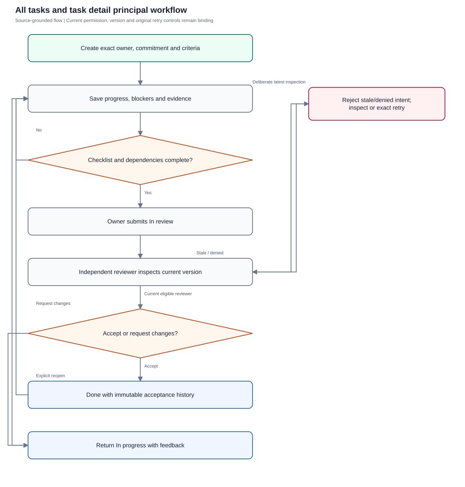
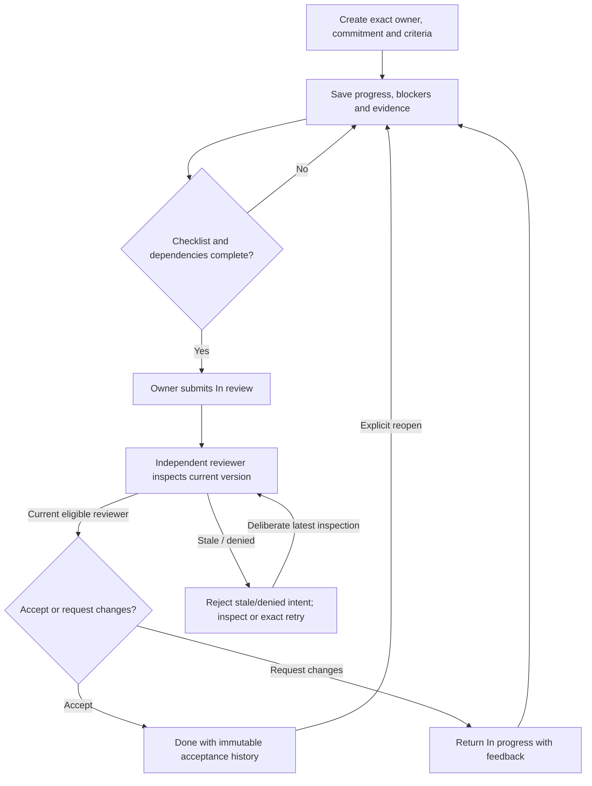

# All tasks and task detail

Create precise commitments, update work, capture evidence and accept through independent review with immutable originals and explicit retry recovery.

**Entry:** All tasks → New task; Overview → Create task; Task Details / Evidence & time / Activity; All tasks → Import CSV

**Actors:** Alpha leader — company leadership (founder in QA Alpha; not platform admin); Owner A — accountable owner and department member, Engineering; Reviewer R — currently eligible independent reviewer; never owner of the reviewed work; Member B — second department member, Engineering; Viewer V — read-only company viewer; Outsider O — outsider with no QA Alpha membership

## Main flow

1. Create with one accountable owner and current valid references.
2. Update progress, blocker or current deadline with captured version.
3. Complete checklist/dependencies and submit In review.
4. Eligible independent reviewer accepts or requests changes.
5. Reopen accepted work before editing; reconcile conflicts deliberately.

[Editable Mermaid](../diagrams/TASKS.mmd)

## Controls and limits

- API fault/retry scenarios require an isolated request-capture fixture; no production fault injection.
- 100% progress and In review are not accepted completion; immutable original mode/date/instant/zone remain the reporting baseline.

## Proposed manual scenarios

All start **NOT_RUN**. Missing prerequisite = BLOCKED.

### TASKS-001: Create a reviewed task with eligible owner and exact checklist

**P0 · LOCAL · Web, API**

**Actors:**

- Alpha leader — company leadership (founder in QA Alpha; not platform admin)
- Owner A — accountable owner and department member, Engineering
- Reviewer R — currently eligible independent reviewer; never owner of the reviewed work

**Preconditions:**

- Use a separately provisioned isolated server fixture, never the running workspace or historical native fixture.
- Company QA Alpha uses Asia/Kolkata, INR and April financial-year start; QA Beta is a second isolated company.
- Provision named fictional actors and secrets separately; record no passwords, tokens, private source prose or real account identifiers in evidence.
- Begin the manual run as NOT_RUN; a missing server/configuration/device prerequisite is BLOCKED.

**Test data:**

- Title: Publish QA release notes; outcome: release notes approved; owner Owner A; reviewer Reviewer R; Engineering / Launch QA; date 2026-10-20; checklist: verify links, attach review summary.

| Step | Action | Expected result |
| --- | --- | --- |
| 1 | Choose New task, enter Outcome & context and Acceptance checklist, and select Owner A as Accountable owner. | Eligible owner selection supplies department/reporting reviewer defaults; inspect and deliberately select currently eligible independent Reviewer R. |
| 2 | Choose Create task and reopen the saved title. | One task has code, owner, current/original deadline, checklist and version; company/creator/original fields come from server. |

**Cleanup:** Close draft/recovery controls after recording the result; sign out test sessions. Retain immutable history until evidence review, then discard this isolated fixture through its approved fixture lifecycle.

[Scenario flow](../diagrams/TASKS-001.svg) · [Editable source](../diagrams/TASKS-001.mmd)

**Source:** [docs/USER_GUIDE.md](../../../docs/USER_GUIDE.md), [docs/API_CONTRACT.md](../../../docs/API_CONTRACT.md), [backend/platform/tasks.go](../../../backend/platform/tasks.go), [backend/platform/task_mutations.go](../../../backend/platform/task_mutations.go), [backend/platform/task_evidence.go](../../../backend/platform/task_evidence.go), [backend/platform/deadlines.go](../../../backend/platform/deadlines.go), [frontend/src/pages/Tasks.tsx](../../../frontend/src/pages/Tasks.tsx)

**Supporting automation:** [backend/platform/platform_test.go](../../../backend/platform/platform_test.go), [backend/platform/task_retries_test.go](../../../backend/platform/task_retries_test.go), [backend/platform/task_evidence_test.go](../../../backend/platform/task_evidence_test.go), [backend/platform/deadlines_test.go](../../../backend/platform/deadlines_test.go), [frontend/src/pages/TaskImport.retry.test.tsx](../../../frontend/src/pages/TaskImport.retry.test.tsx), [mobile/src/TaskRoute.test.tsx](../../../mobile/src/TaskRoute.test.tsx)

### TASKS-002: Progress and blockers describe work without accepting it

**P1 · LOCAL · Web, API**

**Actors:**

- Owner A — accountable owner and department member, Engineering

**Preconditions:**

- Use a separately provisioned isolated server fixture, never the running workspace or historical native fixture.
- Company QA Alpha uses Asia/Kolkata, INR and April financial-year start; QA Beta is a second isolated company.
- Provision named fictional actors and secrets separately; record no passwords, tokens, private source prose or real account identifiers in evidence.
- Begin the manual run as NOT_RUN; a missing server/configuration/device prerequisite is BLOCKED.

**Test data:**

- Existing todo task; 60% progress; blocker reason Awaiting fictional QA asset review.

| Step | Action | Expected result |
| --- | --- | --- |
| 1 | As owner select In progress, set progress to 60 and Save changes; repeat with progress 100. | Current task remains in_progress; progress 100 does not imply independent acceptance or completedAt. |
| 2 | Select Blocked without a reason, then supply What is blocking this task? and Save changes. | Empty blocker is rejected; valid reason is visible in current detail and activity. |

**Cleanup:** Close draft/recovery controls after recording the result; sign out test sessions. Retain immutable history until evidence review, then discard this isolated fixture through its approved fixture lifecycle.

[Scenario flow](../diagrams/TASKS-002.svg) · [Editable source](../diagrams/TASKS-002.mmd)

**Source:** [docs/USER_GUIDE.md](../../../docs/USER_GUIDE.md), [docs/API_CONTRACT.md](../../../docs/API_CONTRACT.md), [backend/platform/tasks.go](../../../backend/platform/tasks.go), [backend/platform/task_mutations.go](../../../backend/platform/task_mutations.go), [backend/platform/task_evidence.go](../../../backend/platform/task_evidence.go), [backend/platform/deadlines.go](../../../backend/platform/deadlines.go), [frontend/src/pages/Tasks.tsx](../../../frontend/src/pages/Tasks.tsx)

**Supporting automation:** [backend/platform/platform_test.go](../../../backend/platform/platform_test.go), [backend/platform/task_retries_test.go](../../../backend/platform/task_retries_test.go), [backend/platform/task_evidence_test.go](../../../backend/platform/task_evidence_test.go), [backend/platform/deadlines_test.go](../../../backend/platform/deadlines_test.go), [frontend/src/pages/TaskImport.retry.test.tsx](../../../frontend/src/pages/TaskImport.retry.test.tsx), [mobile/src/TaskRoute.test.tsx](../../../mobile/src/TaskRoute.test.tsx)

### TASKS-003: Required criteria and dependencies gate submission and acceptance

**P0 · LOCAL · Web, API**

**Actors:**

- Owner A — accountable owner and department member, Engineering
- Reviewer R — currently eligible independent reviewer; never owner of the reviewed work

**Preconditions:**

- Use a separately provisioned isolated server fixture, never the running workspace or historical native fixture.
- Company QA Alpha uses Asia/Kolkata, INR and April financial-year start; QA Beta is a second isolated company.
- Provision named fictional actors and secrets separately; record no passwords, tokens, private source prose or real account identifiers in evidence.
- Begin the manual run as NOT_RUN; a missing server/configuration/device prerequisite is BLOCKED.

**Test data:**

- Task requires two checklist items and one unfinished prerequisite; independent reviewer Reviewer R.

| Step | Action | Expected result |
| --- | --- | --- |
| 1 | As Owner A select In review with incomplete criteria/prerequisite and Save changes. | Validation prevents unsafe submission according to current task guards; no accepted fact is recorded. |
| 2 | Complete criteria and have the prerequisite accepted, then submit In review. | Submission succeeds with current version; status is in_review, not done. |
| 3 | As Reviewer R inspect current evidence and choose Accept work. | Independent acceptance changes status to done and records reviewer/acceptance provenance once. |

**Cleanup:** Close draft/recovery controls after recording the result; sign out test sessions. Retain immutable history until evidence review, then discard this isolated fixture through its approved fixture lifecycle.

[Scenario flow](../diagrams/TASKS-003.svg) · [Editable source](../diagrams/TASKS-003.mmd)

**Source:** [docs/USER_GUIDE.md](../../../docs/USER_GUIDE.md), [docs/API_CONTRACT.md](../../../docs/API_CONTRACT.md), [backend/platform/tasks.go](../../../backend/platform/tasks.go), [backend/platform/task_mutations.go](../../../backend/platform/task_mutations.go), [backend/platform/task_evidence.go](../../../backend/platform/task_evidence.go), [backend/platform/deadlines.go](../../../backend/platform/deadlines.go), [frontend/src/pages/Tasks.tsx](../../../frontend/src/pages/Tasks.tsx)

**Supporting automation:** [backend/platform/platform_test.go](../../../backend/platform/platform_test.go), [backend/platform/task_retries_test.go](../../../backend/platform/task_retries_test.go), [backend/platform/task_evidence_test.go](../../../backend/platform/task_evidence_test.go), [backend/platform/deadlines_test.go](../../../backend/platform/deadlines_test.go), [frontend/src/pages/TaskImport.retry.test.tsx](../../../frontend/src/pages/TaskImport.retry.test.tsx), [mobile/src/TaskRoute.test.tsx](../../../mobile/src/TaskRoute.test.tsx)

### TASKS-004: Owner cannot self-accept and change request requires feedback

**P0 · LOCAL · Web, API**

**Actors:**

- Alpha leader — company leadership (founder in QA Alpha; not platform admin)
- Owner A — accountable owner and department member, Engineering
- Reviewer R — currently eligible independent reviewer; never owner of the reviewed work

**Preconditions:**

- Use a separately provisioned isolated server fixture, never the running workspace or historical native fixture.
- Company QA Alpha uses Asia/Kolkata, INR and April financial-year start; QA Beta is a second isolated company.
- Provision named fictional actors and secrets separately; record no passwords, tokens, private source prose or real account identifiers in evidence.
- Begin the manual run as NOT_RUN; a missing server/configuration/device prerequisite is BLOCKED.

**Test data:**

- Two variants: ordinary owner Owner A and founder owner Alpha leader; required review remains assigned independently.

| Step | Action | Expected result |
| --- | --- | --- |
| 1 | As each owner attempt POST /tasks/{id}/review decision approve with current version. | Server denies self-approval even for company leadership; required review cannot be removed to bypass it. |
| 2 | As Reviewer R choose Request changes with blank feedback, then provide Revise fictional checklist evidence before acceptance. | Blank feedback is rejected; valid request returns task to in_progress and records the decision/comment. |

**Cleanup:** Close draft/recovery controls after recording the result; sign out test sessions. Retain immutable history until evidence review, then discard this isolated fixture through its approved fixture lifecycle.

[Scenario flow](../diagrams/TASKS-004.svg) · [Editable source](../diagrams/TASKS-004.mmd)

**Source:** [docs/USER_GUIDE.md](../../../docs/USER_GUIDE.md), [docs/API_CONTRACT.md](../../../docs/API_CONTRACT.md), [backend/platform/tasks.go](../../../backend/platform/tasks.go), [backend/platform/task_mutations.go](../../../backend/platform/task_mutations.go), [backend/platform/task_evidence.go](../../../backend/platform/task_evidence.go), [backend/platform/deadlines.go](../../../backend/platform/deadlines.go), [frontend/src/pages/Tasks.tsx](../../../frontend/src/pages/Tasks.tsx)

**Supporting automation:** [backend/platform/platform_test.go](../../../backend/platform/platform_test.go), [backend/platform/task_retries_test.go](../../../backend/platform/task_retries_test.go), [backend/platform/task_evidence_test.go](../../../backend/platform/task_evidence_test.go), [backend/platform/deadlines_test.go](../../../backend/platform/deadlines_test.go), [frontend/src/pages/TaskImport.retry.test.tsx](../../../frontend/src/pages/TaskImport.retry.test.tsx), [mobile/src/TaskRoute.test.tsx](../../../mobile/src/TaskRoute.test.tsx)

### TASKS-005: Deadline revision preserves all original commitment fields

**P0 · LOCAL · Web, API**

**Actors:**

- Owner A — accountable owner and department member, Engineering
- Alpha leader — company leadership (founder in QA Alpha; not platform admin)

**Preconditions:**

- Use a separately provisioned isolated server fixture, never the running workspace or historical native fixture.
- Company QA Alpha uses Asia/Kolkata, INR and April financial-year start; QA Beta is a second isolated company.
- Provision named fictional actors and secrets separately; record no passwords, tokens, private source prose or real account identifiers in evidence.
- Begin the manual run as NOT_RUN; a missing server/configuration/device prerequisite is BLOCKED.

**Test data:**

- All-day date 2026-10-20; timed variant 2026-10-20T09:30:00Z in Asia/Kolkata.

| Step | Action | Expected result |
| --- | --- | --- |
| 1 | Change current deadline without a reason and Save changes, then submit a documented reason. | Missing reason fails; valid change succeeds and appears in history. |
| 2 | Compare originalDueDate and original timed mode/instant/zone before and after revision through detail/report API. | Original commitment remains unchanged; current deadline fields reflect the revision only. |

**Cleanup:** Close draft/recovery controls after recording the result; sign out test sessions. Retain immutable history until evidence review, then discard this isolated fixture through its approved fixture lifecycle.

[Scenario flow](../diagrams/TASKS-005.svg) · [Editable source](../diagrams/TASKS-005.mmd)

**Source:** [docs/USER_GUIDE.md](../../../docs/USER_GUIDE.md), [docs/API_CONTRACT.md](../../../docs/API_CONTRACT.md), [backend/platform/tasks.go](../../../backend/platform/tasks.go), [backend/platform/task_mutations.go](../../../backend/platform/task_mutations.go), [backend/platform/task_evidence.go](../../../backend/platform/task_evidence.go), [backend/platform/deadlines.go](../../../backend/platform/deadlines.go), [frontend/src/pages/Tasks.tsx](../../../frontend/src/pages/Tasks.tsx)

**Supporting automation:** [backend/platform/platform_test.go](../../../backend/platform/platform_test.go), [backend/platform/deadlines_test.go](../../../backend/platform/deadlines_test.go)

### TASKS-006: Evidence upload invalidates an older review version

**P0 · LOCAL · Web, API**

**Actors:**

- Owner A — accountable owner and department member, Engineering
- Reviewer R — currently eligible independent reviewer; never owner of the reviewed work

**Preconditions:**

- Use a separately provisioned isolated server fixture, never the running workspace or historical native fixture.
- Company QA Alpha uses Asia/Kolkata, INR and April financial-year start; QA Beta is a second isolated company.
- Provision named fictional actors and secrets separately; record no passwords, tokens, private source prose or real account identifiers in evidence.
- Begin the manual run as NOT_RUN; a missing server/configuration/device prerequisite is BLOCKED.

**Test data:**

- proof.txt is fictional plain text under 10 MiB; Reviewer R has open in-review task version N.

| Step | Action | Expected result |
| --- | --- | --- |
| 1 | As Owner A use Evidence & time → Upload; as Reviewer R attempt review using captured version N. | Upload succeeds and advances version; older review returns 409 and does not accept new evidence blindly. |
| 2 | As Reviewer R choose Load latest version, download/inspect the current attachment and Accept work. | Attachment requires task authorization; independent acceptance uses the latest inspected version. |

**Cleanup:** Close draft/recovery controls after recording the result; sign out test sessions. Retain immutable history until evidence review, then discard this isolated fixture through its approved fixture lifecycle.

[Scenario flow](../diagrams/TASKS-006.svg) · [Editable source](../diagrams/TASKS-006.mmd)

**Source:** [docs/USER_GUIDE.md](../../../docs/USER_GUIDE.md), [docs/API_CONTRACT.md](../../../docs/API_CONTRACT.md), [backend/platform/tasks.go](../../../backend/platform/tasks.go), [backend/platform/task_mutations.go](../../../backend/platform/task_mutations.go), [backend/platform/task_evidence.go](../../../backend/platform/task_evidence.go), [backend/platform/deadlines.go](../../../backend/platform/deadlines.go), [frontend/src/pages/Tasks.tsx](../../../frontend/src/pages/Tasks.tsx)

**Supporting automation:** [backend/platform/platform_test.go](../../../backend/platform/platform_test.go), [backend/platform/task_retries_test.go](../../../backend/platform/task_retries_test.go), [backend/platform/task_evidence_test.go](../../../backend/platform/task_evidence_test.go), [backend/platform/deadlines_test.go](../../../backend/platform/deadlines_test.go), [frontend/src/pages/TaskImport.retry.test.tsx](../../../frontend/src/pages/TaskImport.retry.test.tsx), [mobile/src/TaskRoute.test.tsx](../../../mobile/src/TaskRoute.test.tsx)

### TASKS-007: Attachment boundary and accepted-content lock

**P0 · LOCAL · Web, API**

**Actors:**

- Owner A — accountable owner and department member, Engineering
- Reviewer R — currently eligible independent reviewer; never owner of the reviewed work
- Outsider O — outsider with no QA Alpha membership

**Preconditions:**

- Use a separately provisioned isolated server fixture, never the running workspace or historical native fixture.
- Company QA Alpha uses Asia/Kolkata, INR and April financial-year start; QA Beta is a second isolated company.
- Provision named fictional actors and secrets separately; record no passwords, tokens, private source prose or real account identifiers in evidence.
- Begin the manual run as NOT_RUN; a missing server/configuration/device prerequisite is BLOCKED.

**Test data:**

- Safe proof.txt; blocked executable extension; oversized file over 10 MiB; accepted task variant.

| Step | Action | Expected result |
| --- | --- | --- |
| 1 | Attempt unsafe and oversized Upload, then valid proof.txt. | Unsafe/oversized uploads fail; valid evidence is downloadable only by currently authorized task readers. |
| 2 | As outsider request GET /api/attachments/{id}; on accepted task attempt new evidence/content edits. | Outsider is denied without bytes; accepted evidence/content changes require reopening. |
| 3 | Choose Reopen task, then edit and resubmit for independent review. | Task returns to in_progress; original commitments and historical acceptance persist; required-review work needs fresh acceptance. |

**Cleanup:** Close draft/recovery controls after recording the result; sign out test sessions. Retain immutable history until evidence review, then discard this isolated fixture through its approved fixture lifecycle.

[Scenario flow](../diagrams/TASKS-007.svg) · [Editable source](../diagrams/TASKS-007.mmd)

**Source:** [docs/USER_GUIDE.md](../../../docs/USER_GUIDE.md), [docs/API_CONTRACT.md](../../../docs/API_CONTRACT.md), [backend/platform/tasks.go](../../../backend/platform/tasks.go), [backend/platform/task_mutations.go](../../../backend/platform/task_mutations.go), [backend/platform/task_evidence.go](../../../backend/platform/task_evidence.go), [backend/platform/deadlines.go](../../../backend/platform/deadlines.go), [frontend/src/pages/Tasks.tsx](../../../frontend/src/pages/Tasks.tsx)

**Supporting automation:** [backend/platform/platform_test.go](../../../backend/platform/platform_test.go), [backend/platform/task_retries_test.go](../../../backend/platform/task_retries_test.go), [backend/platform/task_evidence_test.go](../../../backend/platform/task_evidence_test.go), [backend/platform/deadlines_test.go](../../../backend/platform/deadlines_test.go), [frontend/src/pages/TaskImport.retry.test.tsx](../../../frontend/src/pages/TaskImport.retry.test.tsx), [mobile/src/TaskRoute.test.tsx](../../../mobile/src/TaskRoute.test.tsx)

### TASKS-008: Log time and comments preserve their separate meanings

**P1 · LOCAL · Web, API**

**Actors:**

- Owner A — accountable owner and department member, Engineering

**Preconditions:**

- Use a separately provisioned isolated server fixture, never the running workspace or historical native fixture.
- Company QA Alpha uses Asia/Kolkata, INR and April financial-year start; QA Beta is a second isolated company.
- Provision named fictional actors and secrets separately; record no passwords, tokens, private source prose or real account identifiers in evidence.
- Begin the manual run as NOT_RUN; a missing server/configuration/device prerequisite is BLOCKED.

**Test data:**

- 2.5 hours on 2026-10-12, note Checked fictional QA links; Activity comment Awaiting reviewer feedback.

| Step | Action | Expected result |
| --- | --- | --- |
| 1 | Use Log time with hours 0 and 25, then 2.5 with date/note. | Out-of-range time is rejected; valid entry adds actualHours and advances task version. |
| 2 | Use Activity → Post comment and inspect Evidence & time and history. | Comment appends discussion/audit context; it does not count as independent task acceptance or silently replace acceptance evidence. |

**Cleanup:** Close draft/recovery controls after recording the result; sign out test sessions. Retain immutable history until evidence review, then discard this isolated fixture through its approved fixture lifecycle.

[Scenario flow](../diagrams/TASKS-008.svg) · [Editable source](../diagrams/TASKS-008.mmd)

**Source:** [docs/USER_GUIDE.md](../../../docs/USER_GUIDE.md), [docs/API_CONTRACT.md](../../../docs/API_CONTRACT.md), [backend/platform/tasks.go](../../../backend/platform/tasks.go), [backend/platform/task_mutations.go](../../../backend/platform/task_mutations.go), [backend/platform/task_evidence.go](../../../backend/platform/task_evidence.go), [backend/platform/deadlines.go](../../../backend/platform/deadlines.go), [frontend/src/pages/Tasks.tsx](../../../frontend/src/pages/Tasks.tsx)

**Supporting automation:** [backend/platform/platform_test.go](../../../backend/platform/platform_test.go), [backend/platform/messages_test.go](../../../backend/platform/messages_test.go)

### TASKS-009: Stale edits and unknown creation keep separate recovery paths

**P0 · LOCAL · Web, API**

**Actors:**

- Alpha leader — company leadership (founder in QA Alpha; not platform admin)
- Owner A — accountable owner and department member, Engineering

**Preconditions:**

- Use a separately provisioned isolated server fixture, never the running workspace or historical native fixture.
- Company QA Alpha uses Asia/Kolkata, INR and April financial-year start; QA Beta is a second isolated company.
- Provision named fictional actors and secrets separately; record no passwords, tokens, private source prose or real account identifiers in evidence.
- Begin the manual run as NOT_RUN; a missing server/configuration/device prerequisite is BLOCKED.

**Test data:**

- Two sessions editing one task; separate new task with canonical retryKey task-qa-create-01.

| Step | Action | Expected result |
| --- | --- | --- |
| 1 | Save a title in session B and then Save changes from stale session A. | 409 leaves B’s content intact; A must Load latest version before intentional retry. |
| 2 | Suppress one POST /tasks creation ACK after delivery, then retry the identical body/key. | Same canonical task ID returns; task count and creation facts do not duplicate. |
| 3 | Change title while reusing the same create key; repeat exact retry after confirmed actor denial. | Changed body conflicts; revoked authority denies replay and clears relevant recovery state. Unknown retry never silently rebases body or versions. |

**Cleanup:** Close draft/recovery controls after recording the result; sign out test sessions. Retain immutable history until evidence review, then discard this isolated fixture through its approved fixture lifecycle.

[Scenario flow](../diagrams/TASKS-009.svg) · [Editable source](../diagrams/TASKS-009.mmd)

**Source:** [docs/USER_GUIDE.md](../../../docs/USER_GUIDE.md), [docs/API_CONTRACT.md](../../../docs/API_CONTRACT.md), [backend/platform/tasks.go](../../../backend/platform/tasks.go), [backend/platform/task_mutations.go](../../../backend/platform/task_mutations.go), [backend/platform/task_evidence.go](../../../backend/platform/task_evidence.go), [backend/platform/deadlines.go](../../../backend/platform/deadlines.go), [frontend/src/pages/Tasks.tsx](../../../frontend/src/pages/Tasks.tsx)

**Supporting automation:** [backend/platform/task_retries_test.go](../../../backend/platform/task_retries_test.go), [frontend/src/store.details.test.tsx](../../../frontend/src/store.details.test.tsx)

### TASKS-010: CSV import validates atomically and retries canonically

**P1 · LOCAL · Web, API**

**Actors:**

- Alpha leader — company leadership (founder in QA Alpha; not platform admin)

**Preconditions:**

- Use a separately provisioned isolated server fixture, never the running workspace or historical native fixture.
- Company QA Alpha uses Asia/Kolkata, INR and April financial-year start; QA Beta is a second isolated company.
- Provision named fictional actors and secrets separately; record no passwords, tokens, private source prose or real account identifiers in evidence.
- Begin the manual run as NOT_RUN; a missing server/configuration/device prerequisite is BLOCKED.

**Test data:**

- Two rows: QA import alpha valid; QA import beta has an unknown owner email; valid retry uses two corrected rows and one captured key.

| Step | Action | Expected result |
| --- | --- | --- |
| 1 | Download CSV template, Choose CSV and inspect validation for the mixed file; attempt Import. | Each bad row gets an actionable error; neither task is partially added. |
| 2 | Correct the file, preview and Import; withhold ACK and retry the original corrected ordered rows/key. | Exactly two tasks are created once; replay reports the same canonical result. |
| 3 | Alter a corrected row under the same import key. | HTTP 409; canonical import identity is preserved. |

**Cleanup:** Close draft/recovery controls after recording the result; sign out test sessions. Retain immutable history until evidence review, then discard this isolated fixture through its approved fixture lifecycle.

[Scenario flow](../diagrams/TASKS-010.svg) · [Editable source](../diagrams/TASKS-010.mmd)

**Source:** [docs/USER_GUIDE.md](../../../docs/USER_GUIDE.md), [docs/API_CONTRACT.md](../../../docs/API_CONTRACT.md), [backend/platform/tasks.go](../../../backend/platform/tasks.go), [backend/platform/task_mutations.go](../../../backend/platform/task_mutations.go), [backend/platform/task_evidence.go](../../../backend/platform/task_evidence.go), [backend/platform/deadlines.go](../../../backend/platform/deadlines.go), [frontend/src/pages/Tasks.tsx](../../../frontend/src/pages/Tasks.tsx)

**Supporting automation:** [backend/platform/platform_test.go](../../../backend/platform/platform_test.go), [backend/platform/task_retries_test.go](../../../backend/platform/task_retries_test.go), [frontend/src/pages/TaskImport.retry.test.tsx](../../../frontend/src/pages/TaskImport.retry.test.tsx)

### TASKS-011: Read and write scope rejects viewer, outsider and foreign references

**P0 · LOCAL · Web, API**

**Actors:**

- Alpha leader — company leadership (founder in QA Alpha; not platform admin)
- Viewer V — read-only company viewer
- Outsider O — outsider with no QA Alpha membership
- Finance F — company Finance; work access remains assignment scoped

**Preconditions:**

- Use a separately provisioned isolated server fixture, never the running workspace or historical native fixture.
- Company QA Alpha uses Asia/Kolkata, INR and April financial-year start; QA Beta is a second isolated company.
- Provision named fictional actors and secrets separately; record no passwords, tokens, private source prose or real account identifiers in evidence.
- Begin the manual run as NOT_RUN; a missing server/configuration/device prerequisite is BLOCKED.

**Test data:**

- Viewer Viewer V; outsider Outsider O; QA Beta task/project; attempted cyclic dependency and parent relationship.

| Step | Action | Expected result |
| --- | --- | --- |
| 1 | As Viewer V inspect task read detail, then attempt create/update/review; as Outsider O request the same detail. | Viewer reads authorized company work but cannot mutate/review; outsider gets no protected content. |
| 2 | As authorized editor submit foreign owner/project/dependency and cyclic/self-parent variants. | Validation denies cross-company references and cycles atomically; hidden project references are not exposed by task creation. |
| 3 | As Finance F inspect a task linked from company finance but not independently readable. | Finance scope does not reveal task body or evidence. |

**Cleanup:** Close draft/recovery controls after recording the result; sign out test sessions. Retain immutable history until evidence review, then discard this isolated fixture through its approved fixture lifecycle.

[Scenario flow](../diagrams/TASKS-011.svg) · [Editable source](../diagrams/TASKS-011.mmd)

**Source:** [docs/USER_GUIDE.md](../../../docs/USER_GUIDE.md), [docs/API_CONTRACT.md](../../../docs/API_CONTRACT.md), [backend/platform/tasks.go](../../../backend/platform/tasks.go), [backend/platform/task_mutations.go](../../../backend/platform/task_mutations.go), [backend/platform/task_evidence.go](../../../backend/platform/task_evidence.go), [backend/platform/deadlines.go](../../../backend/platform/deadlines.go), [frontend/src/pages/Tasks.tsx](../../../frontend/src/pages/Tasks.tsx)

**Supporting automation:** [backend/platform/platform_test.go](../../../backend/platform/platform_test.go), [backend/platform/read_scopes_test.go](../../../backend/platform/read_scopes_test.go), [backend/platform/finance_test.go](../../../backend/platform/finance_test.go)

### TASKS-012: Timed commitments handle DST, exact acceptance and recurrence

**P0 · LOCAL · Web, API**

**Actors:**

- Owner A — accountable owner and department member, Engineering
- Reviewer R — currently eligible independent reviewer; never owner of the reviewed work

**Preconditions:**

- Use a separately provisioned isolated server fixture, never the running workspace or historical native fixture.
- Company QA Alpha uses Asia/Kolkata, INR and April financial-year start; QA Beta is a second isolated company.
- Provision named fictional actors and secrets separately; record no passwords, tokens, private source prose or real account identifiers in evidence.
- Begin the manual run as NOT_RUN; a missing server/configuration/device prerequisite is BLOCKED.

**Test data:**

- America/New_York gap 2026-03-08 02:30; overlap 2026-11-01 01:30; fixed acceptance clock at dueAt.

| Step | Action | Expected result |
| --- | --- | --- |
| 1 | Choose timed deadline at the gap, then at the repeated time without selecting an offset. | Gap is rejected; overlap requires an explicit exact instant/offset. |
| 2 | Save a selected overlap instant and attempt timed weekly recurrence. | UTC instant and IANA zone are preserved; timed recurrence is rejected, while separate all-day recurrence remains supported. |
| 3 | In isolated controlled-clock API fixture accept work exactly at dueAt and compare just-after variant. | Exact timed instant is on time; later acceptance is late. Original instant remains immutable across current deadline changes. |

**Cleanup:** Close draft/recovery controls after recording the result; sign out test sessions. Retain immutable history until evidence review, then discard this isolated fixture through its approved fixture lifecycle.

[Scenario flow](../diagrams/TASKS-012.svg) · [Editable source](../diagrams/TASKS-012.mmd)

**Source:** [docs/USER_GUIDE.md](../../../docs/USER_GUIDE.md), [docs/API_CONTRACT.md](../../../docs/API_CONTRACT.md), [backend/platform/tasks.go](../../../backend/platform/tasks.go), [backend/platform/task_mutations.go](../../../backend/platform/task_mutations.go), [backend/platform/task_evidence.go](../../../backend/platform/task_evidence.go), [backend/platform/deadlines.go](../../../backend/platform/deadlines.go), [frontend/src/pages/Tasks.tsx](../../../frontend/src/pages/Tasks.tsx)

**Supporting automation:** [backend/platform/deadlines_test.go](../../../backend/platform/deadlines_test.go), [mobile/src/DeadlinePicker.test.tsx](../../../mobile/src/DeadlinePicker.test.tsx)

