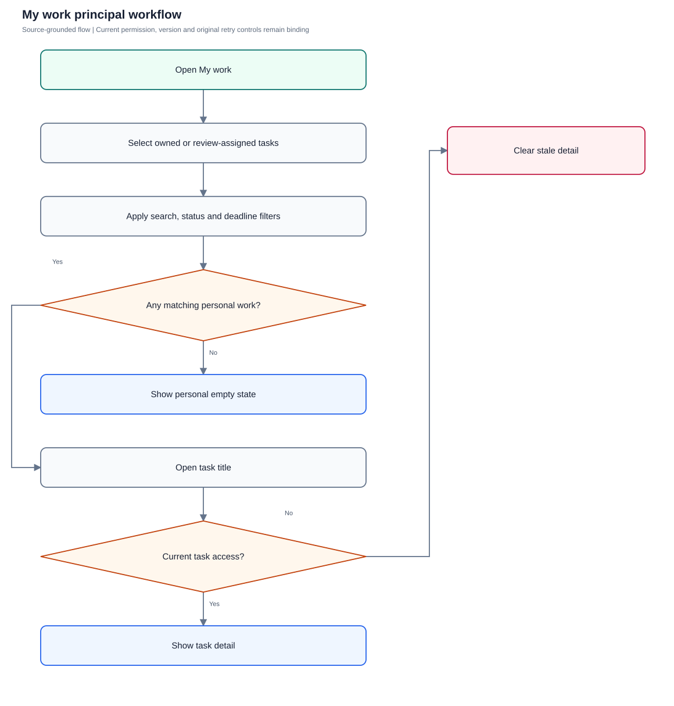
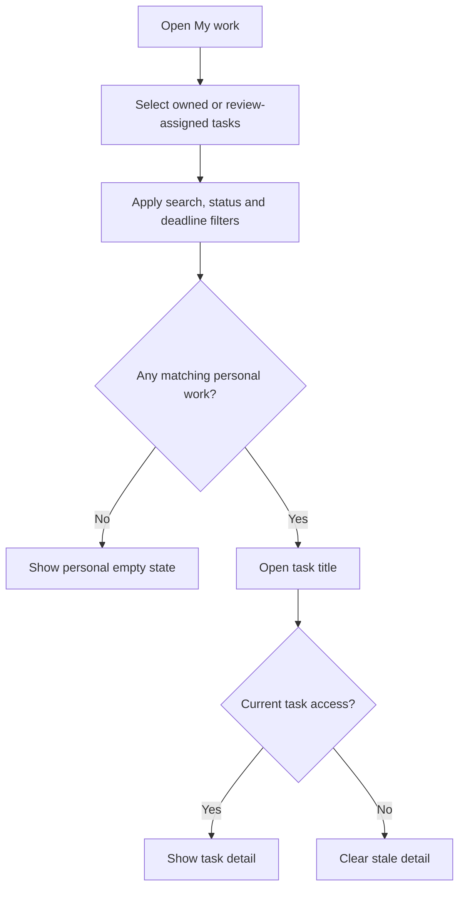

# My work

Locate owned and review-assigned commitments using the personal list, board and filters.

**Entry:** My work sidebar entry; Personal summary chips; List / Board

**Actors:** Owner A — accountable owner and department member, Engineering; Reviewer R — currently eligible independent reviewer; never owner of the reviewed work; Member B — second department member, Engineering

## Main flow

1. Open My work.
2. Select personal status/deadline filters.
3. Inspect list or board.
4. Open current task details for the task workflow.

[Editable Mermaid](../diagrams/WORK.mmd)

## Controls and limits

- Personal source is ownerId = me OR reviewerId = me; collaborator-only or creator-only visibility does not automatically add a task to My work.
- Standalone My work scenarios cover read/filter/detail behavior; write/review rules are in TASKS.

## Proposed manual scenarios

All start **NOT_RUN**. Missing prerequisite = BLOCKED.

### WORK-001: Personal source includes owned and review-assigned work

**P1 · LOCAL · Web, API**

**Actors:**

- Owner A — accountable owner and department member, Engineering
- Member B — second department member, Engineering

**Preconditions:**

- Use a separately provisioned isolated server fixture, never the running workspace or historical native fixture.
- Company QA Alpha uses Asia/Kolkata, INR and April financial-year start; QA Beta is a second isolated company.
- Provision named fictional actors and secrets separately; record no passwords, tokens, private source prose or real account identifiers in evidence.
- Begin the manual run as NOT_RUN; a missing server/configuration/device prerequisite is BLOCKED.

**Test data:**

- Owner A owns Draft QA; reviews Peer QA owned by Member B; is only collaborator on Support QA.

| Step | Action | Expected result |
| --- | --- | --- |
| 1 | As Owner A open My work and inspect the unfiltered personal rows. | Draft QA and Peer QA appear; collaborator-only Support QA is omitted even if it is independently readable in All tasks. |
| 2 | Open Peer QA. | Task detail identifies Member B as owner and Owner A as reviewer; no assumption of self-approval is made. |

**Cleanup:** Close draft/recovery controls after recording the result; sign out test sessions. Retain immutable history until evidence review, then discard this isolated fixture through its approved fixture lifecycle.

[Scenario flow](../diagrams/WORK-001.svg) · [Editable source](../diagrams/WORK-001.mmd)

**Source:** [docs/USER_GUIDE.md](../../../docs/USER_GUIDE.md), [frontend/src/pages/Tasks.tsx](../../../frontend/src/pages/Tasks.tsx), [frontend/src/App.tsx](../../../frontend/src/App.tsx)

**Supporting automation:** [frontend/src/ui.test.tsx](../../../frontend/src/ui.test.tsx), [frontend/src/list-controls.api.test.tsx](../../../frontend/src/list-controls.api.test.tsx), [backend/platform/platform_test.go](../../../backend/platform/platform_test.go)

### WORK-002: Personal Open tasks, Due today and In review chips narrow the correct source

**P1 · LOCAL · Web, API**

**Actors:**

- Owner A — accountable owner and department member, Engineering

**Preconditions:**

- Use a separately provisioned isolated server fixture, never the running workspace or historical native fixture.
- Company QA Alpha uses Asia/Kolkata, INR and April financial-year start; QA Beta is a second isolated company.
- Provision named fictional actors and secrets separately; record no passwords, tokens, private source prose or real account identifiers in evidence.
- Begin the manual run as NOT_RUN; a missing server/configuration/device prerequisite is BLOCKED.

**Test data:**

- Owner A owns an open task due on company-local today; Owner A reviews Member B’s in-review task; unrelated company work exists.

| Step | Action | Expected result |
| --- | --- | --- |
| 1 | Click My work → Open tasks, then Due today. | Open tasks narrows to Owner A-owned open work; Due today narrows to Owner A-owned deadlines today, using existing chip behavior and excluding unrelated work. |
| 2 | Click In review and inspect its owner/reviewer-assigned rows. | In_review applies to the full owner-or-reviewer personal source, unlike the two owner-only chips; actual review capability is separately checked on detail. |

**Cleanup:** Close draft/recovery controls after recording the result; sign out test sessions. Retain immutable history until evidence review, then discard this isolated fixture through its approved fixture lifecycle.

[Scenario flow](../diagrams/WORK-002.svg) · [Editable source](../diagrams/WORK-002.mmd)

**Source:** [docs/USER_GUIDE.md](../../../docs/USER_GUIDE.md), [frontend/src/pages/Tasks.tsx](../../../frontend/src/pages/Tasks.tsx), [frontend/src/App.tsx](../../../frontend/src/App.tsx)

**Supporting automation:** [frontend/src/ui.test.tsx](../../../frontend/src/ui.test.tsx), [frontend/src/list-controls.api.test.tsx](../../../frontend/src/list-controls.api.test.tsx), [backend/platform/platform_test.go](../../../backend/platform/platform_test.go)

### WORK-003: Search, filter and sort cooperate in List and Board

**P1 · LOCAL · Web, API**

**Actors:**

- Owner A — accountable owner and department member, Engineering

**Preconditions:**

- Use a separately provisioned isolated server fixture, never the running workspace or historical native fixture.
- Company QA Alpha uses Asia/Kolkata, INR and April financial-year start; QA Beta is a second isolated company.
- Provision named fictional actors and secrets separately; record no passwords, tokens, private source prose or real account identifiers in evidence.
- Begin the manual run as NOT_RUN; a missing server/configuration/device prerequisite is BLOCKED.

**Test data:**

- Two personal tasks containing QA, distinct projects/priorities/deadlines.

| Step | Action | Expected result |
| --- | --- | --- |
| 1 | Enter QA in Search tasks, open Filters, set project and priority, and choose Sort tasks → deadline. | Rows satisfy all selected conditions and order follows the chosen sort. |
| 2 | Switch to Board, then Clear filters. | Filtered cards represent the same personal source; clearing restores personal scope, not all company work. |

**Cleanup:** Close draft/recovery controls after recording the result; sign out test sessions. Retain immutable history until evidence review, then discard this isolated fixture through its approved fixture lifecycle.

[Scenario flow](../diagrams/WORK-003.svg) · [Editable source](../diagrams/WORK-003.mmd)

**Source:** [docs/USER_GUIDE.md](../../../docs/USER_GUIDE.md), [frontend/src/pages/Tasks.tsx](../../../frontend/src/pages/Tasks.tsx), [frontend/src/App.tsx](../../../frontend/src/App.tsx)

**Supporting automation:** [frontend/src/ui.test.tsx](../../../frontend/src/ui.test.tsx), [frontend/src/list-controls.api.test.tsx](../../../frontend/src/list-controls.api.test.tsx), [backend/platform/platform_test.go](../../../backend/platform/platform_test.go)

### WORK-004: Empty personal view provides a truthful state

**P1 · LOCAL · Web, API**

**Actors:**

- Member B — second department member, Engineering

**Preconditions:**

- Use a separately provisioned isolated server fixture, never the running workspace or historical native fixture.
- Company QA Alpha uses Asia/Kolkata, INR and April financial-year start; QA Beta is a second isolated company.
- Provision named fictional actors and secrets separately; record no passwords, tokens, private source prose or real account identifiers in evidence.
- Begin the manual run as NOT_RUN; a missing server/configuration/device prerequisite is BLOCKED.

**Test data:**

- Member B has no owned or review-assigned tasks; one independently visible collaboration exists.

| Step | Action | Expected result |
| --- | --- | --- |
| 1 | As Member B open My work in List and Board. | Zero personal count/empty state appears; no assignment or acceptance is fabricated. |
| 2 | Open All tasks and find the visible collaboration. | All tasks may show it under ordinary read scope; My work’s narrower membership is preserved. |

**Cleanup:** Close draft/recovery controls after recording the result; sign out test sessions. Retain immutable history until evidence review, then discard this isolated fixture through its approved fixture lifecycle.

[Scenario flow](../diagrams/WORK-004.svg) · [Editable source](../diagrams/WORK-004.mmd)

**Source:** [docs/USER_GUIDE.md](../../../docs/USER_GUIDE.md), [frontend/src/pages/Tasks.tsx](../../../frontend/src/pages/Tasks.tsx), [frontend/src/App.tsx](../../../frontend/src/App.tsx)

**Supporting automation:** [frontend/src/ui.test.tsx](../../../frontend/src/ui.test.tsx), [frontend/src/list-controls.api.test.tsx](../../../frontend/src/list-controls.api.test.tsx), [backend/platform/platform_test.go](../../../backend/platform/platform_test.go)

### WORK-005: Current authorization replaces stale personal detail

**P0 · LOCAL · Web, API**

**Actors:**

- Owner A — accountable owner and department member, Engineering
- Alpha leader — company leadership (founder in QA Alpha; not platform admin)

**Preconditions:**

- Use a separately provisioned isolated server fixture, never the running workspace or historical native fixture.
- Company QA Alpha uses Asia/Kolkata, INR and April financial-year start; QA Beta is a second isolated company.
- Provision named fictional actors and secrets separately; record no passwords, tokens, private source prose or real account identifiers in evidence.
- Begin the manual run as NOT_RUN; a missing server/configuration/device prerequisite is BLOCKED.

**Test data:**

- Owner A views an owned task; Alpha leader deliberately transfers its readable relationships away in isolated fixture.

| Step | Action | Expected result |
| --- | --- | --- |
| 1 | Keep My work open while Alpha leader changes task relationships and refresh the current client. | Rows and counts re-evaluate current scope; lost task title/detail is withheld or removed. |
| 2 | Attempt to reopen the old task through its prior ID. | Current-source denial/unavailable state is shown; a prior personal row does not act as an access grant. |

**Cleanup:** Close draft/recovery controls after recording the result; sign out test sessions. Retain immutable history until evidence review, then discard this isolated fixture through its approved fixture lifecycle.

[Scenario flow](../diagrams/WORK-005.svg) · [Editable source](../diagrams/WORK-005.mmd)

**Source:** [docs/USER_GUIDE.md](../../../docs/USER_GUIDE.md), [frontend/src/pages/Tasks.tsx](../../../frontend/src/pages/Tasks.tsx), [frontend/src/App.tsx](../../../frontend/src/App.tsx)

**Supporting automation:** [frontend/src/store.scopes.test.tsx](../../../frontend/src/store.scopes.test.tsx), [backend/platform/read_scopes_test.go](../../../backend/platform/read_scopes_test.go)
