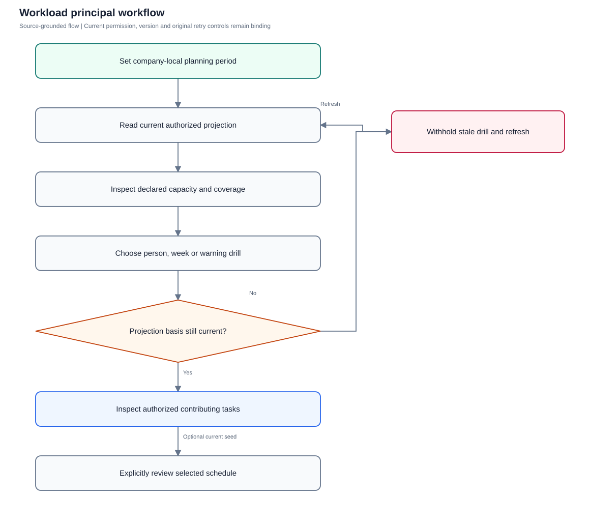
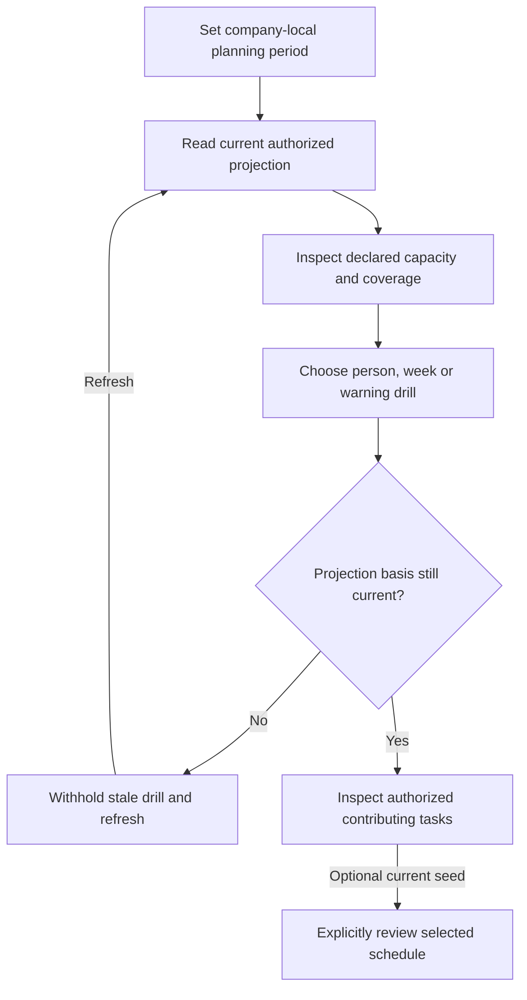

# Workload

Inspect remaining effort exposure against declared weekly capacity with truthful coverage and current-basis drilldowns.

**Entry:** Workload; Planning from / Planning to; Inspect work for person; Review selected schedule

**Actors:** Alpha leader — company leadership (founder in QA Alpha; not platform admin); Owner A — accountable owner and department member, Engineering; Member B — second department member, Engineering

## Main flow

1. Set planning period and authorized owner/department filters.
2. Read current complete planning projection.
3. Inspect capacity/coverage/warnings and current task drill.
4. Optionally review selected schedule explicitly.

[Editable Mermaid](../diagrams/WORKLOAD.mmd)

## Controls and limits

- Weekly exposure repeats full remaining effort in each overlapping week; it is not hours worked or an employee rating.
- Partial weeks use whole recorded weekly capacity; zero/invalid capacity produces unavailable utilization.
- Connected server is required; demo does not calculate current complete planning projections.

## Proposed manual scenarios

All start **NOT_RUN**. Missing prerequisite = BLOCKED.

### WORKLOAD-001: Three-week exposure distinguishes unique remaining effort

**P1 · LOCAL · Web, API**

**Actors:**

- Alpha leader — company leadership (founder in QA Alpha; not platform admin)
- Owner A — accountable owner and department member, Engineering

**Preconditions:**

- Use a separately provisioned isolated server fixture, never the running workspace or historical native fixture.
- Company QA Alpha uses Asia/Kolkata, INR and April financial-year start; QA Beta is a second isolated company.
- Provision named fictional actors and secrets separately; record no passwords, tokens, private source prose or real account identifiers in evidence.
- Begin the manual run as NOT_RUN; a missing server/configuration/device prerequisite is BLOCKED.

**Test data:**

- Owner A capacity 40h; task estimate 10h, progress 20%, interval 2026-10-05 through 2026-10-25.

| Step | Action | Expected result |
| --- | --- | --- |
| 1 | Set Planning from/to to the three-week interval and select Owner A. | Unique selected remaining effort is 8h; each of three overlapping weeks exposes 8h; total weekly exposure is 24h. |
| 2 | Select a partial week period and Inspect work for Owner A. | Whole recorded weekly capacity remains 40h; drill contains only currently authorized contributing tasks. |

**Cleanup:** Close draft/recovery controls after recording the result; sign out test sessions. Retain immutable history until evidence review, then discard this isolated fixture through its approved fixture lifecycle.

[Scenario flow](../diagrams/WORKLOAD-001.svg) · [Editable source](../diagrams/WORKLOAD-001.mmd)

**Source:** [docs/PLANNING_AND_GOALS.md](../../../docs/PLANNING_AND_GOALS.md), [frontend/src/components/PlanningView.tsx](../../../frontend/src/components/PlanningView.tsx), [frontend/src/pages/CalendarWorkload.tsx](../../../frontend/src/pages/CalendarWorkload.tsx), [backend/platform/planning.go](../../../backend/platform/planning.go)

**Supporting automation:** [backend/platform/planning_test.go](../../../backend/platform/planning_test.go), [backend/platform/planning_suggestions_test.go](../../../backend/platform/planning_suggestions_test.go), [backend/platform/task_schedule_test.go](../../../backend/platform/task_schedule_test.go), [frontend/src/pages/CalendarWorkload.test.tsx](../../../frontend/src/pages/CalendarWorkload.test.tsx), [mobile/src/PlanningGoals.test.tsx](../../../mobile/src/PlanningGoals.test.tsx)

### WORKLOAD-002: Zero capacity and coverage do not invent productivity

**P1 · LOCAL · Web, API**

**Actors:**

- Alpha leader — company leadership (founder in QA Alpha; not platform admin)
- Owner A — accountable owner and department member, Engineering

**Preconditions:**

- Use a separately provisioned isolated server fixture, never the running workspace or historical native fixture.
- Company QA Alpha uses Asia/Kolkata, INR and April financial-year start; QA Beta is a second isolated company.
- Provision named fictional actors and secrets separately; record no passwords, tokens, private source prose or real account identifiers in evidence.
- Begin the manual run as NOT_RUN; a missing server/configuration/device prerequisite is BLOCKED.

**Test data:**

- Owner A capacity 0; one zero-estimate task, one undated task, separately provisioned invalid legacy interval.

| Step | Action | Expected result |
| --- | --- | --- |
| 1 | Load Workload and inspect Visible coverage and Owner A’s capacity line. | Zero estimate/undated/invalid counts are explicit; utilization is unavailable for recorded zero capacity, never infinity or a performance score. |
| 2 | Choose Inspect zero estimate, Inspect undated and Inspect invalid. | Each drill identifies currently authorized contributing records; missing timing/effort is not fabricated. |

**Cleanup:** Close draft/recovery controls after recording the result; sign out test sessions. Retain immutable history until evidence review, then discard this isolated fixture through its approved fixture lifecycle.

[Scenario flow](../diagrams/WORKLOAD-002.svg) · [Editable source](../diagrams/WORKLOAD-002.mmd)

**Source:** [docs/PLANNING_AND_GOALS.md](../../../docs/PLANNING_AND_GOALS.md), [frontend/src/components/PlanningView.tsx](../../../frontend/src/components/PlanningView.tsx), [frontend/src/pages/CalendarWorkload.tsx](../../../frontend/src/pages/CalendarWorkload.tsx), [backend/platform/planning.go](../../../backend/platform/planning.go)

**Supporting automation:** [backend/platform/planning_test.go](../../../backend/platform/planning_test.go), [backend/platform/planning_suggestions_test.go](../../../backend/platform/planning_suggestions_test.go), [backend/platform/task_schedule_test.go](../../../backend/platform/task_schedule_test.go), [frontend/src/pages/CalendarWorkload.test.tsx](../../../frontend/src/pages/CalendarWorkload.test.tsx), [mobile/src/PlanningGoals.test.tsx](../../../mobile/src/PlanningGoals.test.tsx)

### WORKLOAD-003: Warnings use actual thresholds and current task evidence

**P1 · LOCAL · Web, API**

**Actors:**

- Alpha leader — company leadership (founder in QA Alpha; not platform admin)

**Preconditions:**

- Use a separately provisioned isolated server fixture, never the running workspace or historical native fixture.
- Company QA Alpha uses Asia/Kolkata, INR and April financial-year start; QA Beta is a second isolated company.
- Provision named fictional actors and secrets separately; record no passwords, tokens, private source prose or real account identifiers in evidence.
- Begin the manual run as NOT_RUN; a missing server/configuration/device prerequisite is BLOCKED.

**Test data:**

- Capacity 40h vs remaining 40.04h; recorded-zero capacity with 0.04h effort; below-capacity control.

| Step | Action | Expected result |
| --- | --- | --- |
| 1 | Read Planning warnings for each isolated variant. | Above-capacity and effort-with-zero warnings follow unrounded values; below-capacity control does not get the warning. |
| 2 | Choose Inspect warning work and open its task. | Current source rows explain the warning; this read does not change assignment, task progress or finance. |

**Cleanup:** Close draft/recovery controls after recording the result; sign out test sessions. Retain immutable history until evidence review, then discard this isolated fixture through its approved fixture lifecycle.

[Scenario flow](../diagrams/WORKLOAD-003.svg) · [Editable source](../diagrams/WORKLOAD-003.mmd)

**Source:** [docs/PLANNING_AND_GOALS.md](../../../docs/PLANNING_AND_GOALS.md), [frontend/src/components/PlanningView.tsx](../../../frontend/src/components/PlanningView.tsx), [frontend/src/pages/CalendarWorkload.tsx](../../../frontend/src/pages/CalendarWorkload.tsx), [backend/platform/planning.go](../../../backend/platform/planning.go)

**Supporting automation:** [backend/platform/planning_test.go](../../../backend/platform/planning_test.go)

### WORKLOAD-004: Projection basis prevents stale or unauthorized drilldowns

**P0 · LOCAL · Web, API**

**Actors:**

- Alpha leader — company leadership (founder in QA Alpha; not platform admin)
- Owner A — accountable owner and department member, Engineering

**Preconditions:**

- Use a separately provisioned isolated server fixture, never the running workspace or historical native fixture.
- Company QA Alpha uses Asia/Kolkata, INR and April financial-year start; QA Beta is a second isolated company.
- Provision named fictional actors and secrets separately; record no passwords, tokens, private source prose or real account identifiers in evidence.
- Begin the manual run as NOT_RUN; a missing server/configuration/device prerequisite is BLOCKED.

**Test data:**

- Owner A current basis; another session changes readable task relationships or effort.

| Step | Action | Expected result |
| --- | --- | --- |
| 1 | Capture summary projectionBasis, change source in isolated fixture, then GET /planning/tasks using the old basis. | 409/no task projection prevents mismatched summary/drill; confirmed access loss never leaks prior source rows. |
| 2 | Refresh summary and use Inspect work for Owner A again. | New basis and currently authorized sources drive the drill; optional owner/department filters only narrow access. |

**Cleanup:** Close draft/recovery controls after recording the result; sign out test sessions. Retain immutable history until evidence review, then discard this isolated fixture through its approved fixture lifecycle.

[Scenario flow](../diagrams/WORKLOAD-004.svg) · [Editable source](../diagrams/WORKLOAD-004.mmd)

**Source:** [docs/PLANNING_AND_GOALS.md](../../../docs/PLANNING_AND_GOALS.md), [frontend/src/components/PlanningView.tsx](../../../frontend/src/components/PlanningView.tsx), [frontend/src/pages/CalendarWorkload.tsx](../../../frontend/src/pages/CalendarWorkload.tsx), [backend/platform/planning.go](../../../backend/platform/planning.go)

**Supporting automation:** [backend/platform/planning_test.go](../../../backend/platform/planning_test.go), [backend/platform/planning_suggestions_test.go](../../../backend/platform/planning_suggestions_test.go), [backend/platform/task_schedule_test.go](../../../backend/platform/task_schedule_test.go), [frontend/src/pages/CalendarWorkload.test.tsx](../../../frontend/src/pages/CalendarWorkload.test.tsx), [mobile/src/PlanningGoals.test.tsx](../../../mobile/src/PlanningGoals.test.tsx)

### WORKLOAD-005: Planning bounds and invalid numeric coverage fail honestly

**P0 · LOCAL · Web, API**

**Actors:**

- Alpha leader — company leadership (founder in QA Alpha; not platform admin)

**Preconditions:**

- Use a separately provisioned isolated server fixture, never the running workspace or historical native fixture.
- Company QA Alpha uses Asia/Kolkata, INR and April financial-year start; QA Beta is a second isolated company.
- Provision named fictional actors and secrets separately; record no passwords, tokens, private source prose or real account identifiers in evidence.
- Begin the manual run as NOT_RUN; a missing server/configuration/device prerequisite is BLOCKED.

**Test data:**

- Reversed or >84-day period; separately provisioned legacy invalid numeric effort/capacity.

| Step | Action | Expected result |
| --- | --- | --- |
| 1 | Enter malformed/reversed/out-of-bound Planning from/to through API. | Controlled validation failure; no partial current projection is presented as complete. |
| 2 | Read legacy invalid-numeric fixture and attempt its /planning/schedule-seed. | Summary qualifies invalid inputs without NaN/Infinity JSON; schedule seed returns controlled unavailable rather than editable fabricated values. |

**Cleanup:** Close draft/recovery controls after recording the result; sign out test sessions. Retain immutable history until evidence review, then discard this isolated fixture through its approved fixture lifecycle.

[Scenario flow](../diagrams/WORKLOAD-005.svg) · [Editable source](../diagrams/WORKLOAD-005.mmd)

**Source:** [docs/PLANNING_AND_GOALS.md](../../../docs/PLANNING_AND_GOALS.md), [frontend/src/components/PlanningView.tsx](../../../frontend/src/components/PlanningView.tsx), [frontend/src/pages/CalendarWorkload.tsx](../../../frontend/src/pages/CalendarWorkload.tsx), [backend/platform/planning.go](../../../backend/platform/planning.go)

**Supporting automation:** [backend/platform/planning_test.go](../../../backend/platform/planning_test.go), [backend/platform/planning_suggestions_test.go](../../../backend/platform/planning_suggestions_test.go), [backend/platform/task_schedule_test.go](../../../backend/platform/task_schedule_test.go), [frontend/src/pages/CalendarWorkload.test.tsx](../../../frontend/src/pages/CalendarWorkload.test.tsx), [mobile/src/PlanningGoals.test.tsx](../../../mobile/src/PlanningGoals.test.tsx)

### WORKLOAD-006: Selected schedule review requires complete current seed

**P1 · LOCAL · Web, API**

**Actors:**

- Alpha leader — company leadership (founder in QA Alpha; not platform admin)
- Owner A — accountable owner and department member, Engineering

**Preconditions:**

- Use a separately provisioned isolated server fixture, never the running workspace or historical native fixture.
- Company QA Alpha uses Asia/Kolkata, INR and April financial-year start; QA Beta is a second isolated company.
- Provision named fictional actors and secrets separately; record no passwords, tokens, private source prose or real account identifiers in evidence.
- Begin the manual run as NOT_RUN; a missing server/configuration/device prerequisite is BLOCKED.

**Test data:**

- Two authorized task selections; current projection basis; proposed deadline shift +1 day with reason.

| Step | Action | Expected result |
| --- | --- | --- |
| 1 | Choose Inspect work for Owner A, select two tasks and Review selected schedule. | Seed checks current task/prerequisite versions; explicit schedule review appears only after current seed is ready. |
| 2 | Review without applying, then let authority/source check become pending. | Preview does not mutate tasks; fetched task names/candidates are withheld and apply is disabled during pending checks. |
| 3 | Return to valid sources and deliberately apply fresh reviewed proposal. | Only authorized current deadlines change; originals/acceptance facts remain preserved; selected state clears on completion. |

**Cleanup:** Close draft/recovery controls after recording the result; sign out test sessions. Retain immutable history until evidence review, then discard this isolated fixture through its approved fixture lifecycle.

[Scenario flow](../diagrams/WORKLOAD-006.svg) · [Editable source](../diagrams/WORKLOAD-006.mmd)

**Source:** [frontend/src/components/PlanningView.tsx](../../../frontend/src/components/PlanningView.tsx), [frontend/src/components/ScheduleReview.tsx](../../../frontend/src/components/ScheduleReview.tsx), [backend/platform/task_schedule.go](../../../backend/platform/task_schedule.go), [backend/platform/planning_suggestions.go](../../../backend/platform/planning_suggestions.go)

**Supporting automation:** [backend/platform/planning_suggestions_test.go](../../../backend/platform/planning_suggestions_test.go), [backend/platform/task_schedule_test.go](../../../backend/platform/task_schedule_test.go)
